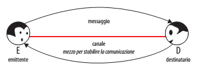
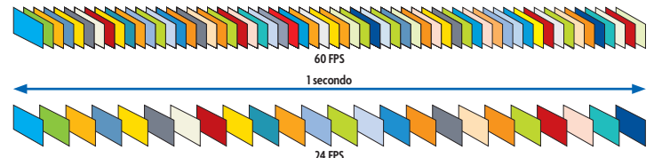
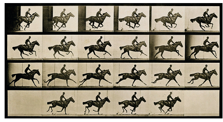
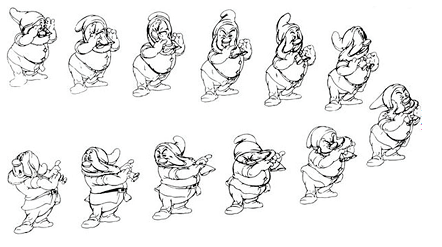
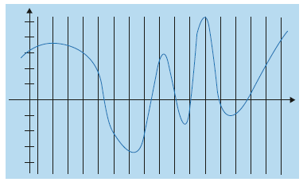
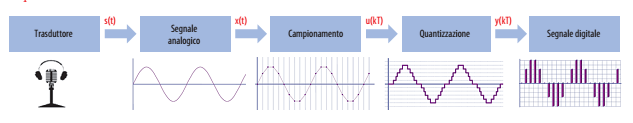
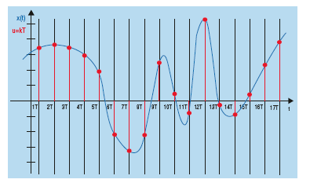
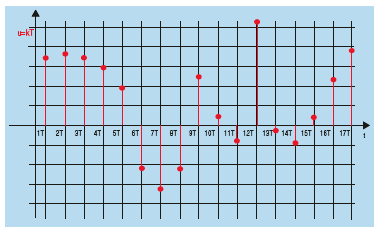
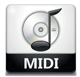

<!-- _class: title -->
<!-- _paginate: false -->
<!-- _header: '' -->
<!-- _footer: '' -->

# Unità di apprendimento 1
## Lezione 7

**La multimedialità: suoni e immagini in movimento**

TPSI · Classe 3ª Informatica

---

## In questa lezione impareremo

- la **rappresentazione dei filmati**
- la **rappresentazione dei suoni** in binario

---

## Introduzione alla multimedialità

Il termine latino **media**, plurale di *medium*, indica da tempo i mezzi di comunicazione di massa e significa:

> «stare nel mezzo tra colui che trasmette e colui che riceve»

<div class="center">



</div>

---

## Introduzione alla multimedialità

I media si classificano in **tre grandi categorie**:

1. **suoni**
2. **immagini ferme**
3. **immagini in movimento** (animazioni, filmati)

<div class="box">

In questi casi si parla di applicazioni di tipo **multimediale**.

</div>

---

<!-- _class: section-break -->
<!-- _paginate: false -->

# Immagini in movimento
## I filmati digitali

---

## Filmati digitali: concetti base

<div class="box">

**Immagini in movimento**: sequenze di immagini fisse (**frame**) visualizzate a una frequenza abbastanza alta da permettere all'occhio umano di ricostruire il movimento.

</div>

<div class="box">

**Fotogramma (frame)**: una singola immagine o disegno impiegato nella realizzazione di un'animazione.

</div>

*La tecnica era nota già nell'antichità (Lucrezio, Leonardo, Newton): dischi in movimento, poi nastri, fino alla pellicola di celluloide.*

---

## Filmati digitali: il framerate

- **Edison**, cinetoscopio: **48** fotogrammi al secondo
- **Fratelli Lumière**, cinematografo: **16** immagini al secondo
- Più alto è il **framerate** (fps), migliore è la «qualità di movimento»
- Oggi si va da **4 fps** (moviole) a **40 fps**

| Contesto | Framerate |
|---|---|
| Cinema (proiezione standard) | **24 fps** |
| Qualità TV | **30 fps** |
| Web | **15 / 10 fps** |

---

## Filmati digitali: digitalizzazione

- Si possono digitalizzare filmati da **telecamere** o da **sintonizzatore TV** con schede e software video
- Le animazioni di sintesi si ricostruiscono con appositi programmi
- Lo spazio occupato da un'animazione dipende da molti fattori; il più importante è il **framerate**

<div class="box">

**Framerate** = numero di fotogrammi al secondo, misurato in **FPS** (*Frame Per Second*).

</div>

---

## Filmati digitali: come nasce l'animazione

- Si **scompone** un movimento in fasi successive (**fotogrammi** o **frame**)
- L'effetto si basa sulla **persistenza dell'immagine sulla retina** per un tempo relativamente lungo (circa **1/10 di secondo**)

---

## Filmati digitali: come nasce l'animazione

- Ogni immagine si **sovrappone alla precedente** prima che questa scompaia dalla retina
- Ne risulta una **visione continua** del movimento, come nella visione diretta

<div class="center">



</div>

---

## Primo esempio di animazione

**Eadweard Muybridge** fotografò nel **1878** un cavallo in corsa usando **24 fotocamere**.

<div class="center">



</div>

---

## La Disney: animazione a 24 fps

<div class="center">



</div>

---

## Il formato dei filmati digitali

Oltre al numero di frame, la qualità dipende da:

- **dimensione** dei fotogrammi
- **numero di colori**
- **qualità dell'audio**

Formati video più diffusi:

- **AVI** (*Audio Video Interleave*)
- **MPEG-1/2** (*Moving Picture Experts Group*)
- **MOV** (abbreviazione di *movie*)

Si differenziano per **modalità e caratteristiche di acquisizione** e per la **tecnica di compressione**.

---

## Il formato dei filmati: container e codec

- I visualizzatori di filmati si chiamano **media player**
- Per riprodurre un video serve un **container** che supporti i **codec** per i formati audio e video usati

<div class="box">

**Codec** = programma che effettua la **codifica/decodifica**.

</div>

<div class="warn">

Esempio: **AVI** è un tipo di *container*, **MPEG-4** è un *codec*.

</div>

---

<!-- _class: section-break -->
<!-- _paginate: false -->

# Suoni
## I suoni digitali

---

## Suoni digitali: dall'analogico al digitale

Il suono è un **segnale analogico bidimensionale**: ha un'**ampiezza in funzione del tempo**.

<div class="center">



</div>

Per tradurre un segnale analogico in digitale servono questi passaggi:



---

## Suoni digitali: campionamento e quantizzazione

<div class="cols">
<div>

**Campionamento**
Si legge il valore del segnale a intervalli di tempo regolari.



</div>
<div>

**Livelli di quantizzazione**
Ogni campione viene approssimato a uno dei livelli disponibili.



</div>
</div>

---

## Suoni digitali: frequenza di campionamento

<div class="box">

**Digitalizzazione** = procedura di trasformazione da analogico a digitale.

</div>

La **frequenza minima di campionamento**, cioè il numero minimo di «letture» al secondo che permette di **non perdere segnale utile**, è dettata dai **teoremi di Shannon**.

<div class="warn">

Le schede di digitalizzazione dei PC campionano da **8000 a 48.000 Hz**, e ogni valore può essere rappresentato con **8, 16 o 32 bit**.

</div>

---

## Suoni digitali: il formato WAV


**WAV** (*WAVEform audio file format*) è lo standard dei **CD audio** (CDDA):

- campionamento a **44.100 Hz**
- quantizzazione a **16 bit** (2¹⁶ valori di codifica)

In **stereofonia** si usano **2 canali**:

- ogni secondo: 2 × 44.100 = **88.200 campioni**
- ogni campione richiede **16 bit**

```text
16 × 88.200 = 1.411.200 bit/s ≈ 1,4 Mbit/s
```

---

## Suoni digitali: MP3


- Nasce negli anni '90 (**MPEG-1 Audio Layer III**), adatto ai file audio
- Successo in Internet grazie all'**alto rapporto di compressione**: file circa **12 volte più piccoli**
- Si basa anche sulla **soglia di udibilità**:
  - l'uomo sente solo in un certo spettro di frequenze
  - i suoni fuori da questo spettro non vengono percepiti
  - eliminandoli si risparmia molto spazio
- **128 kbit/s** è un bitrate di qualità accettabile, vicina a quella di un CD
- Corrisponde a un tasso di compressione di circa **11 a 1**

---

## Suoni digitali: MIDI



**MIDI** = *Musical Instrument Digital Interface*. Indica:

- il **protocollo** di trasmissione
- l'**interfaccia hardware** che veicola la trasmissione

Nasce nel **1983** per far comunicare e scambiare dati tra **strumenti musicali di marche diverse**.

---

## Suoni digitali: MIDI


- I sistemi **analogici** erano **incompatibili** tra loro e poco precisi
- L'avvento del **personal computer** ha favorito lo sviluppo del protocollo
- Essendo **digitale**, si presta allo scambio di informazioni musicali tra **strumenti**, **sintetizzatori** (reali e virtuali) e **computer**

---

## Suoni digitali: MIDI e dimensioni dei file


Per la sua natura digitale, il file MIDI è **molto piccolo**:

- un file **WAV** da **30 MB** → il corrispondente **MIDI** occupa **30 KB**
- non contiene il suono (timbro), ma solo:
  - il **codice dello strumento**
  - un **numero** che individua la **nota** e il suo **valore musicale**

---

## Suoni digitali: MIDI


<div class="box">

Invece di campionare il suono, un file MIDI **registra gli eventi** che lo generano (quali tasti sono premuti, durata, intensità…).

</div>

- il **cantato non è presente**: lo esegue uno strumento solista o un emulatore che genera «ooooh» o «aaaah»
- **un'ora di musica** può occupare circa **500 KB**
- la qualità dipende **solo dal sintetizzatore** (scheda audio) del computer che riproduce il suono

---

<!-- _class: small -->

## Suoni digitali: MIDI, una nota di merito

Non esiste un programma che converta i file musicali **WAV** in **MIDI**.

I file MIDI sono prodotti da abili strumentisti (**midifilisti**) che suonano **a orecchio** i pezzi su strumenti musicali dotati di **sequencer**, uno strumento che converte le note suonate in file MIDI.

---

## Confronto dei formati audio

| Formato | Contenuto | Dimensioni | Note |
|---|---|---|---|
| **WAV** | campioni non compressi | circa **1,4 Mbit/s** (CD stereo) | standard CD audio |
| **MP3** | audio compresso | circa **128 kbit/s** | rapporto circa 11:1 |
| **MIDI** | eventi musicali (note, strumento) | circa **500 KB/ora** | qualità legata al sintetizzatore |

---

<!-- _class: small -->

## Esempio riepilogativo

Calcoliamo la memoria occupata da un **filmato di un'ora non compresso** (prima il video, poi l'audio).

**Video**: 24 fps, 1920 × 1080 pixel, true color (3 byte/pixel)

```text
1920 × 1080 × 3 × 24 ≈ 149 MByte/s   (bitrate ≈ 149 × 8 ≈ 1,2 Gbit/s)
149 MByte/s × 3600 s ≈ 536 GB
```

**Audio**: Dolby TrueHD, 8 canali, 96 kHz, 24 bit

```text
24 × 96.000 × 8 ≈ 18,4 Mbit/s
18,4 / 8 × 3600 ≈ 8 GB
```

---

## Esempio riepilogativo: conclusione

Totale: 536 GB + 8 GB ≈ **544 GB** per un'ora di filmato non compresso.

<div class="warn">

Se non si usasse la **compressione**, sapendo che un disco **Blu-ray** contiene **46 GB**, dove potremmo memorizzare un film di un'ora che richiede **544 GB**?

</div>

**Spunto di riflessione:** quanti Blu-ray servirebbero? (544 / 46 ≈ 12)
