<!-- _class: lead -->
<!-- _paginate: false -->
<!-- _header: "" -->


# Codici digitali pesati

## Unità di Apprendimento 2 · Lezione 1

Tecnologie e Progettazione di Sistemi Informatici e di Telecomunicazioni (TPSI)
Classe 3ª · Istituto Tecnico – Informatica
**Prof. Dicara**

---

# In questa lezione impareremo

- la codifica dei caratteri **ASCII** e **Unicode** (UTF-8, UTF-16, UTF-32)
- come un calcolatore memorizza più byte: **big-endian** e **little-endian**
- i codici **BCD** e **packed BCD**
- il codice **eccesso 3** e il codice **Aiken**
- i codici **quinario** e **biquinario**
- il codice **2 su 5**

> Filo conduttore: *come si rappresentano numeri e testi con soli 0 e 1, e come si può rendere questa rappresentazione più comoda o più sicura.*

---

# Mappa della lezione

| Parte | Argomento |
|---|---|
| **A** | Concetti base: codice, alfabeto, lunghezza, ridondanza |
| **B** | Codifica dei caratteri: ASCII, ASCII esteso |
| **C** | Unicode: UTF-8, UTF-16, UTF-32 e ordine dei byte (endianness) |
| **D** | Codici decimali: BCD, packed BCD, eccesso 3 |
| **E** | Codici pesati e a rilevazione d'errore: Aiken, quinario, biquinario, 2 su 5 |

---

<!-- _class: lead -->

# Parte A
## Codifica dell'informazione

---

# Perché il calcolatore usa il codice binario?

Un calcolatore elettronico elabora **esclusivamente numeri sotto forma di valori digitali**.

Ogni dato (testo, immagine, suono, video) deve essere trasformato in **sequenze di segnali a due valori**, cioè **binari**.

- Un circuito elettronico distingue facilmente **due livelli di tensione**: ad esempio *basso* ≈ 0 V → **0** e *alto* ≈ 5 V (o 3,3 V) → **1**.
- Distinguere due livelli è molto più affidabile che distinguerne dieci: il rumore elettrico non rovina il dato.
- L'unità minima di informazione è il **bit** (*binary digit*); 8 bit formano un **byte**.

> Con **n bit** si ottengono **2ⁿ** configurazioni diverse: 8 bit → 256, 16 bit → 65 536, 32 bit → oltre 4 miliardi.

---

# Dal mondo analogico al digitale

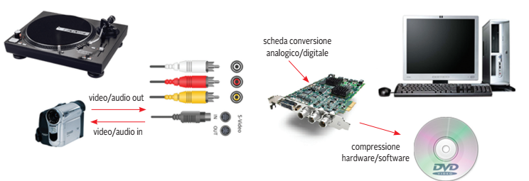

Una **scheda di conversione analogico/digitale** acquisisce il segnale di un giradischi o di una videocamera e lo trasforma in dati che il PC può memorizzare (ed eventualmente comprimere, per esempio su DVD).

Le fasi principali sono tre:
1. **Campionamento**: si misura il segnale a intervalli di tempo regolari;
2. **Quantizzazione**: ogni misura viene approssimata a un valore tra quelli disponibili;
3. **Codifica**: il valore ottenuto viene scritto come stringa di bit.

---

# Codice, alfabeto e stringa

- Si dice **codice** una regola che consente di rappresentare un dato insieme di simboli mediante un altro insieme di simboli.
- Si definisce **alfabeto** (indicato con **Σ**) l'insieme *finito* di simboli (caratteri) distinti.
- Si definisce **parola** o **stringa** una sequenza finita di simboli (anche ripetuti) di quell'alfabeto.

> **Esempio.** Σ = {a, b, c}. Le stringhe `abc`, `aab`, `cccc` sono parole di Σ. La stringa `abd` **non** lo è, perché `d` non appartiene all'alfabeto.

---

# Alfabeti: alcuni esempi

| Alfabeto | Simbolo | Insieme di simboli |
|---|---|---|
| Unario | U | {1} |
| Binario | B | {0, 1} |
| Inglese | I | {A, B, C, …, Z} |
| Alfanumerico | AB | {A, B, …, Z, 0, 1, …, 9} |
| Caratteri giapponesi, arabi, … | — | { … } |

Una stessa parola può appartenere a più alfabeti:

- `1111001101` è una parola di **B** (e anche di **AB**);
- `AB120C` è una parola di **AB** (non di B: contiene lettere);
- `1111111` è una parola di **B** e di **U**.

---

# Sistema di codifica

Dato un alfabeto **A** composto da **a** simboli, un **sistema di codifica** è un metodo per rappresentare gli *a* simboli di A tramite *b* simboli di un altro alfabeto **B**, stabilendo una **corrispondenza biunivoca** tra gli stessi.

**Biunivoca** significa che:
- a ogni simbolo di A corrisponde **una sola** parola di B (codifica);
- da ogni parola di B si risale **a un solo** simbolo di A (decodifica, senza ambiguità).

> Se la corrispondenza non fosse biunivoca, non potremmo più recuperare il messaggio originale.

---

# Esempio di codifica: alfabeto a 4 simboli

Sia **A = { R, V, G, B }** (4 caratteri) e **B = { 0, 1 }** (2 caratteri).
Vogliamo codificare in B la stringa di A: **B R R V G**.

Associamo a ogni simbolo la sua **posizione**, scritta in binario su 2 bit:

| Simbolo | Posizione | Codice |
|:-:|:-:|:-:|
| R | 0 | **00** |
| V | 1 | **01** |
| G | 2 | **10** |
| B | 3 | **11** |

---

# Esempio di codifica: risultato

Stringa da codificare: **B R R V G**

| B | R | R | V | G |
|:-:|:-:|:-:|:-:|:-:|
| 11 | 00 | 00 | 01 | 10 |

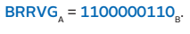

Il destinatario, conoscendo la tabella, **decodifica** leggendo la stringa a **gruppi di 2 bit**: 11·00·00·01·10 → B R R V G.

> Nota: il simbolo "B" dell'alfabeto A (blu) non va confuso con l'alfabeto "B" (binario): per questo si usano i pedici ᴀ e ʙ.

---

# Codici nella vita di tutti i giorni

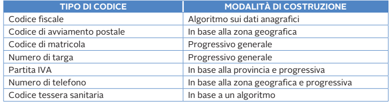

I codici non sono solo informatici: sono **regole di costruzione** di identificatori. Un buon codice è **univoco** e, spesso, contiene informazioni (zona geografica, provincia, controllo di validità).

> Esempio: nel **codice fiscale** l'ultimo carattere è di controllo e viene calcolato con un algoritmo sui primi 15: serve a individuare errori di trascrizione.

---

# Lunghezza del codice

Un **codice binario** è la codifica dei simboli di un alfabeto Σ mediante **stringhe di bit**.

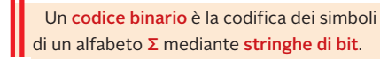

Se **C** è la **cardinalità** di Σ (numero di simboli), il numero **n** di bit da usare per codificare tutti i simboli deve essere tale che:

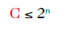

cioè, **n** deve essere almeno pari a:

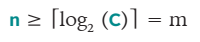

Il simbolo ⌈ ⌉ indica l'**arrotondamento per eccesso** all'intero superiore. Il valore **m** è il **minimo numero di bit** necessario.

---

# Lunghezza del codice: come si calcola

**Procedura rapida**: si cerca la più piccola potenza di 2 che sia **≥ C**.

| C (simboli) | potenze di 2 | m = ⌈log₂ C⌉ |
|:-:|:-:|:-:|
| 2 | 2¹ = 2 | 1 |
| 4 | 2² = 4 | 2 |
| 10 | 2³ = 8 (poco), 2⁴ = 16 | 4 |
| 26 | 2⁴ = 16 (poco), 2⁵ = 32 | 5 |
| 128 | 2⁷ = 128 | 7 |
| 256 | 2⁸ = 256 | 8 |

> **Trucco:** per 10 cifre decimali servono 4 bit (non 3: 3 bit danno solo 8 combinazioni).

---

# Codice ridondante e non ridondante

**M** è il minimo numero di bit necessario per codificare Σ.

- se **n = M** il codice usa il numero minimo di bit;
- se **n > M** il codice è **ridondante** (usa più bit del necessario).

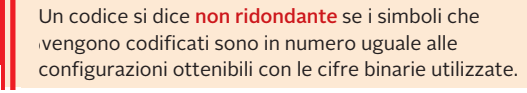

> **Attenzione al linguaggio.** Il libro chiama "ridondante" anche un codice con **configurazioni inutilizzate**, cioè con 2ⁿ > C. Sono due sfumature dello stesso concetto: le combinazioni "in più" **non rappresentano alcun simbolo** e possono essere sfruttate, per esempio, per **rilevare errori**.

---

# Esempio 1 · Alfabeto {A, B, …, Z}

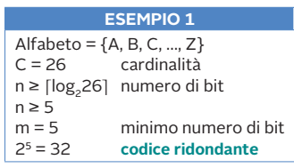

- 26 lettere → **C = 26**
- n ≥ ⌈log₂ 26⌉ = **5**
- Con 5 bit si hanno 2⁵ = **32** configurazioni
- Ne usiamo 26: **6 configurazioni restano inutilizzate**

Il codice è **ridondante** nel senso di "ha più combinazioni dei simboli".

*Esempio pratico:* A = 00000, B = 00001, …, Z = 11001. Le combinazioni 11010 … 11111 non corrispondono a nessuna lettera.

---

# Esempio 2 · Cifre decimali {0, …, 9}

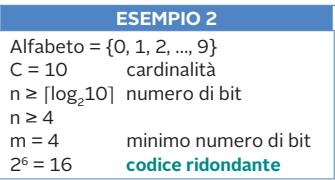

- 10 cifre → **C = 10**
- n ≥ ⌈log₂ 10⌉ = **4**
- Con 4 bit si hanno 2⁴ = **16** configurazioni (nel riquadro compare per errore 2⁶)
- Ne usiamo 10: **6 configurazioni inutilizzate** (1010 … 1111)

Questo è proprio il caso del codice **BCD**, che vedremo nella Parte D.

---

# Esempio 3 · Alfabeto {N, E, S, W}

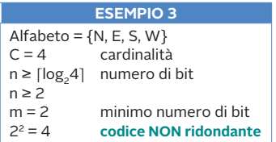

- 4 punti cardinali → **C = 4**
- n ≥ ⌈log₂ 4⌉ = **2**
- 2² = 4 configurazioni = 4 simboli

Il codice è **NON ridondante**: ogni configurazione corrisponde a un simbolo.

| Simbolo | Codice |
|:-:|:-:|
| N | 00 |
| E | 01 |
| S | 10 |
| W | 11 |

---

# Lunghezza fissa o variabile

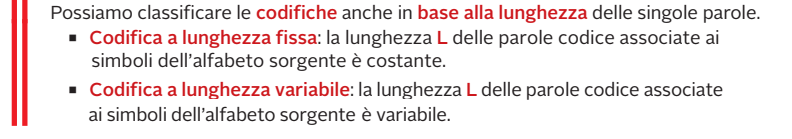

| | Lunghezza fissa | Lunghezza variabile |
|---|---|---|
| **Vantaggi** | Decodifica semplice e veloce; accesso diretto al *k*-esimo simbolo | Risparmio di spazio per simboli frequenti |
| **Svantaggi** | Possibile spreco di bit | Decodifica più complessa; serve poter capire dove finisce un simbolo |
| **Esempi** | ASCII, UTF-32, BCD | UTF-8, UTF-16, codice Morse |

---

<!-- _class: lead -->

# Parte B
## La codifica dei caratteri: ASCII

---

# Il codice ASCII

**ASCII** = *American Standard Code for Information Interchange*.
È un codice a **7 bit** → 2⁷ = **128** caratteri.

- **0–31 e 127**: caratteri di **controllo** (non stampabili), ad esempio `LF` (a capo), `CR`, `TAB`, `NUL`, `DEL`;
- **32–126**: caratteri **stampabili** (spazio, cifre, lettere maiuscole e minuscole, punteggiatura).

**Regole utili da ricordare:**
- le cifre `'0'`…`'9'` valgono 48…57 (**0x30…0x39**);
- le maiuscole `'A'`…`'Z'` partono da 65 (**0x41**);
- le minuscole `'a'`…`'z'` partono da 97 (**0x61**): differiscono dalle maiuscole di **32**, cioè dal solo **bit 5**.

---

# La tabella ASCII

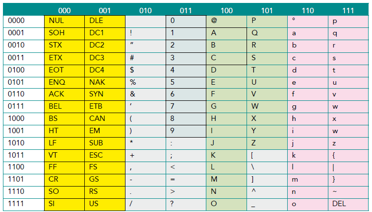

Le **colonne** indicano i 3 bit più significativi, le **righe** i 4 bit meno significativi. *(Nella riga 1001, colonna 111, il carattere corretto è **y**.)*

---

# Leggere la tabella ASCII

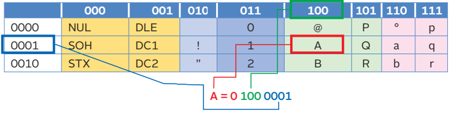

Codifichiamo il carattere **"A"** in ASCII (su 8 bit):

- il **primo bit** è **0**, perché il codice è a 7 bit;
- i bit 2-4 sono nell'intestazione di **colonna**: **100**;
- i bit 5-8 sono nell'intestazione di **riga**: **0001**.

Otteniamo:

**A = 0 100 0001₂ = 41₁₆ = 65₁₀**

*(Il risultato corretto in decimale è 65, non 64: 4·16 + 1 = 65.)*

---

# Decodificare una sequenza di bit

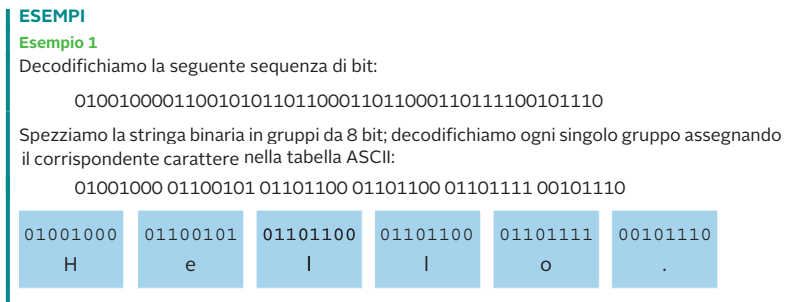

**Metodo:**
1. si suddivide la stringa in **gruppi da 8 bit** (byte);
2. si cerca ogni byte nella tabella ASCII;
3. si scrive il carattere corrispondente.

`01001000 01100101 01101100 01101100 01101111 00101110` → **H e l l o .**

> **Seconda prova.** `01101001 01101100 00000000 01110000 01101111 00101110` → **i, l, NUL, p, o, .** Il byte `00000000` è il carattere di controllo **NUL**: non stampabile.

---

# Prova adesso! · Esercizi ASCII

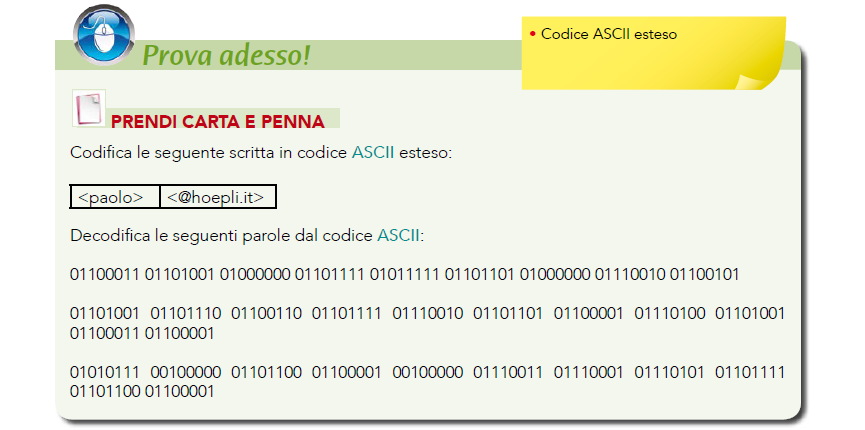

*Prendi carta e penna: le soluzioni sono alla fine della lezione.*

---

# ASCII esteso (Extended ASCII)

Dalla specifica originale a 7 bit si è passati a un'estensione a **8 bit**.

- Scopo: **raddoppiare** i caratteri rappresentabili (da 128 a **256**).
- Il nuovo codice si chiama comunemente **Extended ASCII** o **ASCII estesa**.
- Sono state aggiunte le **vocali accentate**, i **simboli semigrafici** e altri simboli meno comuni.

I primi 128 caratteri **restano identici** all'ASCII originale (compatibilità all'indietro). I caratteri 128–255 cambiano da una variante all'altra.

---

# Le codepage

Le diverse codifiche Extended ASCII sono chiamate **codepage** (pagine di codifica).

- I sistemi operativi devono essere **indipendenti dalla codifica**.
- Per passare da una regione geografica a un'altra basta **sostituire la pagina di codifica**.

| Codepage | Uso |
|---|---|
| ISO-8859-1 (*Latin-1*) | Europa occidentale |
| **ISO-8859-15** | come Latin-1, ma con il simbolo dell'euro **€** |
| Windows-1252 | variante Microsoft |
| ISO-8859-5 | alfabeto cirillico |

> **Problema classico (*mojibake*):** se un file in UTF-8 viene letto come Latin-1, la lettera "è" (byte `C3 A8`) appare come "è". Stessi byte, codepage sbagliata!

---

<!-- _class: lead -->

# Parte C
## Il codice Unicode

---

# Perché serve Unicode

L'ASCII esteso non basta: 256 caratteri non coprono **cinese, giapponese, arabo, emoji…**, e ogni codepage è incompatibile con le altre.

**Unicode** nasce per avere **un solo standard** che rappresenti i caratteri di *tutte* le lingue.

- Si basa sulla codifica dell'ASCII esteso (i primi 256 caratteri coincidono con Latin-1);
- invece degli 8 bit dell'ASCII esteso (256 caratteri) usa un codice a **32 bit**.

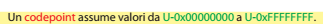

---

# Codepoint e UCS

Ogni simbolo è identificato da un numero chiamato **codepoint**, descritto con la notazione **U+*numero esadecimale***.

| Carattere | Codepoint | Descrizione |
|:-:|:-:|---|
| A | U+0041 | lettera latina maiuscola A |
| è | U+00E8 | lettera latina e minuscola con accento grave |
| € | U+20AC | simbolo dell'euro |
| 😀 | U+1F600 | emoji "faccina sorridente" |

L'insieme dei caratteri così ottenuto è l'**UCS** (*Universal Character Set*).

> Nella pratica lo spazio dei codepoint è oggi limitato a **U+0000 … U+10FFFF** (1 114 112 posizioni, 17 piani da 65 536).

---

# Le tabelle ufficiali Unicode

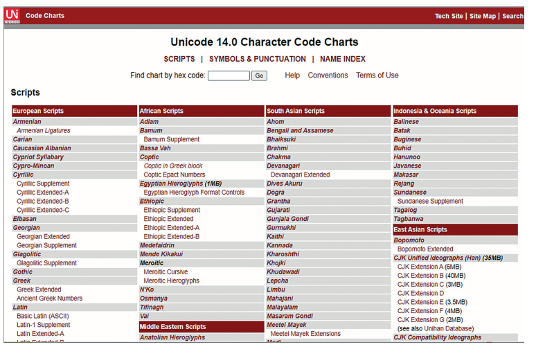

Il sito del **Unicode Consortium** (*Code Charts*) elenca tutti gli *script* (alfabeti) suddivisi per aree geografiche: europei, africani, asiatici…

---

# Dal codepoint ai byte: le codifiche UTF

Il codepoint dice **quale** carattere è; la codifica **UTF** (*UCS Transformation Format*) dice **come scriverlo in byte**.

Sono state definite tre sottocodifiche:

| Codifica | Lunghezza | Uso tipico |
|---|---|---|
| **UTF-8** | variabile (1–4 byte) | Web, file di testo, Linux, e-mail |
| **UTF-16** | variabile (2 o 4 byte) | elaborazioni applicative: Java, Windows, JavaScript |
| **UTF-32** | **fissa**, 4 byte | uso interno quando serve accesso diretto ai caratteri |

---

# UTF-8: l'idea

- I primi **128** codepoint (U+0000…U+007F) corrispondono **uno a uno** ai caratteri ASCII → **un solo byte** con il bit più alto a 0.
- I successivi codepoint (fino a 2¹¹) usano **2 byte** e coprono le estensioni ASCII, l'alfabeto greco, cirillico, arabo…
- I codepoint più alti usano **3 o 4 byte**: ideogrammi cinesi, giapponesi, emoji e altre lingue.

**Vantaggio:** un file di solo testo ASCII è **già** un file UTF-8 valido, quindi la compatibilità con il passato è perfetta.

---

# UTF-8: regola dei byte

I codepoint **maggiori di 127** sono rappresentati da sequenze di byte di lunghezza da 2 a 4 (le specifiche originali arrivavano a 6), composte da un **byte iniziale** e da uno o più **byte di continuazione**.

- Il **byte iniziale** comincia con tanti **1** quanti sono i byte totali, seguiti da uno **0**; poi iniziano i bit del carattere.
- Ogni **byte di continuazione** comincia sempre con **10** e porta 6 bit del carattere.

> Il prefisso `10` non è un bit di parità: serve a **riconoscere subito** un byte di continuazione, quindi a *risincronizzarsi* se si legge a metà di un carattere.

---

<!-- _class: small -->

# UTF-8: tabella di codifica per range

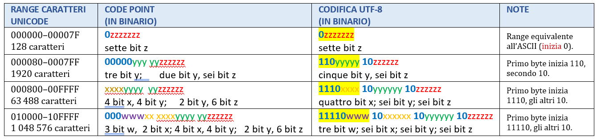

Le lettere **x, y, z, w** indicano i bit del codepoint, scritti da sinistra (più significativi) a destra (meno significativi) dentro lo "stampo" del byte.

---

# UTF-8: tabella estesa (fino a 6 byte)

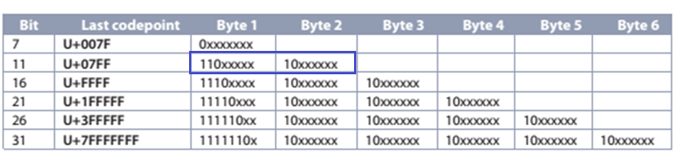

Lo standard attuale limita UTF-8 a **4 byte** (fino a U+10FFFF); le righe a 5 e 6 byte sono quelle della specifica storica, mantenute per completezza.

---

# UTF-8: come riconoscere la lunghezza

Guardando **solo il primo byte** si capisce quanti byte compongono il carattere.

| Primo byte (binario) | Byte totali | Bit utili |
|:-:|:-:|:-:|
| `0xxxxxxx` | 1 | 7 |
| `110xxxxx` | 2 | 5 + 6 = **11** |
| `1110xxxx` | 3 | 4 + 6 + 6 = **16** |
| `11110xxx` | 4 | 3 + 6 + 6 + 6 = **21** |

Nel caso in cui il primo byte inizi per **110** si deduce che:
- il codice è composto da **2 byte**;
- utilizza **5 + 6 = 11 bit** per codificare il carattere.

---

<!-- _class: small -->

# UTF-8: esempio con "è" (2 byte)

**Carattere:** è → codepoint **U+00E8** = `1110 1000`

1. Il codepoint sta in 11 bit (range U+0080…U+07FF): `000 1110 1000` → `00011 101000`
2. Si inseriscono i bit nello stampo `110yyyyy 10zzzzzz`:

| | |
|---|---|
| stampo | `110yyyyy` `10zzzzzz` |
| bit del carattere | `00011` · `101000` |
| **risultato** | `11000011` `10101000` = **C3 A8** |

**Verifica in Python:**
```python
>>> "è".encode("utf-8")
b'\xc3\xa8'
```

---

<!-- _class: small -->

# UTF-8: esempio con "€" (3 byte)

**Carattere:** € → codepoint **U+20AC** = `0010 0000 1010 1100` (16 bit)

Stampo a 3 byte: `1110xxxx 10yyyyyy 10zzzzzz`

| | |
|---|---|
| bit divisi 4 + 6 + 6 | `0010` · `000010` · `101100` |
| **risultato** | `11100010` `10000010` `10101100` = **E2 82 AC** |

Altri esempi: **A** → `41` (1 byte) · **è** → `C3 A8` (2 byte) · **😀** U+1F600 → `F0 9F 98 80` (4 byte).

> **Per esercizio:** codifica "ñ" (U+00F1) in UTF-8. *(Soluzione a fine lezione.)*

---

# Confronto: lo stesso testo in più codifiche

| Carattere | Codepoint | UTF-8 | UTF-16 BE | UTF-32 BE |
|:-:|:-:|:-:|:-:|:-:|
| **A** | U+0041 | `41` | `00 41` | `00 00 00 41` |
| **è** | U+00E8 | `C3 A8` | `00 E8` | `00 00 00 E8` |
| **€** | U+20AC | `E2 82 AC` | `20 AC` | `00 00 20 AC` |
| **😀** | U+1F600 | `F0 9F 98 80` | `D8 3D DE 00` | `00 01 F6 00` |
| *byte occupati* | | 1 · 2 · 3 · 4 | 2 · 2 · 2 · 4 | 4 · 4 · 4 · 4 |

UTF-8 è il più compatto per i testi occidentali; UTF-32 è il più semplice ma il più "costoso".

---

<!-- _class: lead -->

# Parte C-bis
## Come la RAM memorizza i dati: endianness

---

# La memorizzazione dei dati nella RAM

La memoria RAM è divisa in **unità (locazioni)**; ogni **indirizzo** individua una locazione.

- la locazione ha dimensione standard di **8 bit = 1 byte**;
- l'indirizzo ha come dimensione usuale **32 bit = 4 byte** (nei sistemi a 64 bit: 64 bit).

| Indirizzo | 0 | 1 | 2 | 3 | 4 | 5 | … |
|:-:|:-:|:-:|:-:|:-:|:-:|:-:|:-:|
| Contenuto | 1 byte | 1 byte | 1 byte | 1 byte | 1 byte | 1 byte | … |

---

# Big-endian e little-endian

I calcolatori operano su **parole di 32–64 bit** (4–8 byte). Per memorizzare una parola su **più locazioni da 1 byte contigue** esistono due possibilità:

- **big-endian (BE)**: il byte **più significativo** (la "testa" del numero) va nell'indirizzo **più basso**;
- **little-endian (LE)**: il byte **meno significativo** va nell'indirizzo **più basso**; il byte più significativo finisce all'indirizzo più alto.

> **Per ricordare:** *big-endian* = "il grande (MSB) viene per primo", si legge come scriviamo i numeri. Il **network byte order** (i protocolli di rete) è big-endian; le CPU x86 e la maggior parte delle ARM usano little-endian.

---

# Esempio: la parola AB C2 EF 03

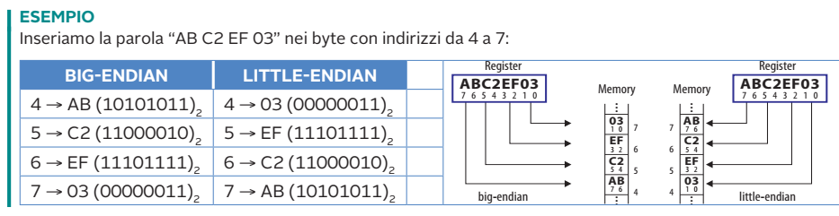

La parola **0xABC2EF03** viene inserita nei byte con indirizzi da 4 a 7:

| Indirizzo | Big-endian | Little-endian |
|:-:|:-:|:-:|
| 4 | AB | 03 |
| 5 | C2 | EF |
| 6 | EF | C2 |
| 7 | 03 | AB |

---

# Endianness in pratica (Python)

```python
import sys
print(sys.byteorder)            # 'little' sui PC x86/x64

n = 0xABC2EF03
print(n.to_bytes(4, "big").hex(" "))      # ab c2 ef 03
print(n.to_bytes(4, "little").hex(" "))   # 03 ef c2 ab
```

Per questo i file di testo UTF-16 e UTF-32 iniziano spesso con un **BOM** (*Byte Order Mark*, U+FEFF):
- `FE FF` → big-endian
- `FF FE` → little-endian

---

# UTF-16: i piani Unicode

Lo spazio di codice Unicode è diviso in **17 "piani"** di 2¹⁶ = **65 536** codepoint ciascuno.

- I codepoint di ogni piano hanno valori esadecimali da **xx0000** a **xxFFFF**.
- **xx** è un valore esadecimale **00–10** che indica il **piano** di appartenenza; la parte restante si ripete nei vari piani.
- Il **piano 0**, quello dei codepoint U+0000…U+FFFF, si chiama **BMP** (*Basic Multilingual Plane*): contiene quasi tutte le lingue di uso comune.

**Regola UTF-16:**
- codepoint nel **BMP** → **1 unità da 16 bit** (2 byte);
- codepoint **oltre** il BMP → **2 unità da 16 bit** (*surrogate pair*, 4 byte).

---

<!-- _class: small -->

# UTF-16 · Esempio 1: la lettera "A"

Codepoint (UCS a 32 bit): **U+0x00000041**
`0000-0000-0000-0000-0000-0000-0100-0001`

I 16 bit più significativi sono tutti a 0 → ricade nel **BMP** → UTF-16: **0x0041** (`0000-0000-0100-0001`).

Si ottengono due rappresentazioni, a seconda dell'ordine dei byte:

| Codifica | Byte in memoria |
|---|---|
| **UTF-16BE** | `00 41` |
| **UTF-16LE** | `41 00` |

---

<!-- _class: small -->

# UTF-16 · Esempio 2: la lettera "è"

Codepoint (UCS a 32 bit): **U+0x000000E8**
`0000-0000-0000-0000-0000-0000-1110-1000`

16 bit alti a 0 → **BMP** → UTF-16: **0x00E8** (`0000-0000-1110-1000`).

| Codifica | Byte in memoria |
|---|---|
| **UTF-16BE** | `00 E8` |
| **UTF-16LE** | `E8 00` |

> **Attenzione:** "è" (accento grave) è U+00E8; "é" (accento acuto) è U+00E9. Sono due caratteri diversi!

---

<!-- _class: small -->

# UTF-16 · Esempio 3: il simbolo "€"

Codepoint (UCS a 32 bit): **U+0x000020AC**
`0000-0000-0000-0000-0010-0000-1010-1100`

16 bit alti a 0 → **BMP** → UTF-16: **0x20AC** (`0010-0000-1010-1100`).

| Codifica | Byte in memoria |
|---|---|
| **UTF-16BE** | `20 AC` |
| **UTF-16LE** | `AC 20` |

---

<!-- _class: small -->

# UTF-16 · Oltre il BMP: surrogate pair

Per un codepoint **> U+FFFF** (per esempio l'emoji 😀, U+1F600):

1. si sottrae 0x10000: `0x1F600 − 0x10000 = 0xF600`
2. si prendono i **10 bit alti** (0x3D) e i **10 bit bassi** (0x200);
3. **high surrogate** = 0xD800 + 0x3D = **0xD83D**;
   **low surrogate** = 0xDC00 + 0x200 = **0xDE00**.

Risultato: 😀 = **D83D DE00** (UTF-16BE: `D8 3D DE 00`).

> Per questo i valori da D800 a DFFF **non** sono assegnati a caratteri: sono riservati ai surrogati.

---

# UTF-32

**UTF-32** è una codifica a **lunghezza fissa di 4 byte**.

- I codici dei caratteri **coincidono con i codici UCS**.
- Consente la **rappresentazione contemporanea** dei codici di tutte le lingue.
- Anche in UTF-32 sono possibili le due varianti **little-endian** e **big-endian**.

| Carattere | UTF-32BE | UTF-32LE |
|:-:|:-:|:-:|
| A | `00 00 00 41` | `41 00 00 00` |
| € | `00 00 20 AC` | `AC 20 00 00` |

**Pro:** il *k*-esimo carattere sta sempre all'offset 4·*k*. **Contro:** uno spreco di memoria enorme per testi latini (3 byte su 4 sono zeri).

---

<!-- _class: lead -->

# Parte D
## Codici decimali: BCD

---

# Il codice BCD (Binary Coded Decimal)

Un sistema che permette di rappresentare **esclusivamente le dieci cifre decimali** è la codifica **BCD** (*Binary Coded Decimal*, "decimale codificato in binario").

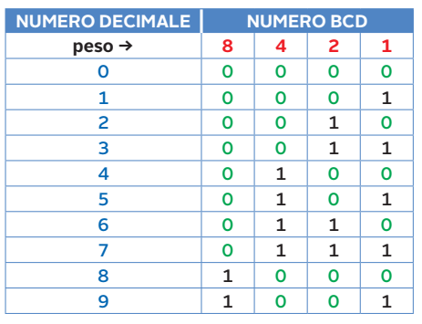

Ogni cifra decimale 0–9 è scritta su **4 bit** con i **pesi 8-4-2-1** (come il binario naturale). Si ottengono 10 combinazioni valide (0000–1001); le altre 6 (**1010–1111**) **non sono ammesse**.

---

# BCD: codificare un numero

Si **codifica ogni cifra separatamente**, su 4 bit.

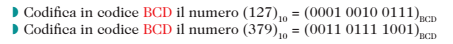

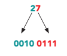

> Esempio passo passo per **(305)₁₀**: 3 → `0011`, 0 → `0000`, 5 → `0101` → **(0011 0000 0101)ʙᴄᴅ**

---

# BCD non è binario!

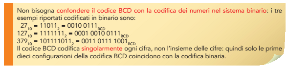

Il codice BCD codifica **singolarmente ogni cifra**, non l'insieme delle cifre: solo le prime dieci configurazioni coincidono con la codifica binaria.

| Decimale | Binario puro | BCD |
|:-:|:-:|:-:|
| 9 | 1001 | 1001 |
| 10 | 1010 | **0001 0000** |
| 27 | 11011 | **0010 0111** |
| 127 | 1111111 | **0001 0010 0111** |

**Dove si usa?** Display a 7 segmenti, orologi digitali, calcolatrici, sistemi finanziari: dove si deve mostrare o stampare il numero cifra per cifra senza conversioni complesse.

---

# Somma in BCD: la correzione +6

I 4 bit possono rappresentare i valori da 0 a 15, ma il BCD ammette solo 0–9. Se la somma di due cifre **supera 9** si ottiene una combinazione **non valida** (o si genera un riporto).

> **Regola:** occorre aggiungere **(6)₁₀ = (0110)ʙᴄᴅ** ogni volta che viene superato il numero 9.
> Sommando 6 si "saltano" le 6 configurazioni prive di significato (1010–1111).

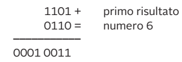

Esempio: 1101 non è ammesso → 1101 + 0110 = **0001 0011** → cifre **1** e **3** → **13**.

---

# Somma in BCD: 5 + 8

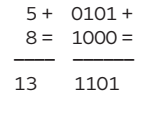

1. In decimale: 5 + 8 = 13.
2. In BCD: `0101 + 1000 = 1101`. Ma **1101 non è ammesso** (> 1001).
3. Correzione: `1101 + 0110 = 1 0011` → riporto 1 e cifra 3.
4. Risultato: **0001 0011**ʙᴄᴅ = **13**.

---

# Somma in BCD: 25 + 5

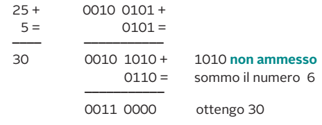

- `0010 0101 + 0101 = 0010 1010`: la cifra più a destra è **1010**, non ammessa;
- si somma 6: `0010 1010 + 0110 = 0011 0000`;
- risultato **0011 0000** = **30**.

**Altro esempio, con riporto: 9 + 8 = 17**
`1001 + 1000 = 1 0001` (riporto fuori dal nibble) → si somma 6 comunque: `0001 + 0110 = 0111` → **0001 0111** = **17**.

---

# Sottrazione in BCD: 33 − 4

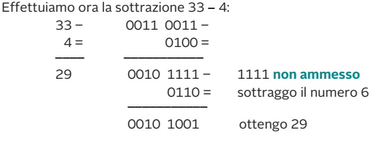

- `0011 0011 − 0100 = 0010 1111`: la cifra di destra è **1111**, non ammessa;
- si **sottrae** 6: `0010 1111 − 0110 = 0010 1001`;
- risultato **0010 1001** = **29**.

> **In sintesi:** addizione → correzione **+6**; sottrazione → correzione **−6**, sul gruppo di 4 bit non valido.

---

# Il codice Packed BCD

Nei personal computer i dati sono memorizzati a gruppi di **8 bit (byte)**, ma il BCD usa solo **4 bit** per cifra: metà byte resta vuoto.

Se mettiamo **due cifre per byte** si ottiene il **packed BCD** ("BCD impaccato").

Si aggiunge anche un **quartetto di bit per indicare il segno**:

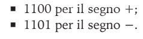

| Numero | Packed BCD | In esadecimale |
|:-:|:-:|:-:|
| +127 | `0001 0010 0111 1100` | 127**C** |
| −127 | `0001 0010 0111 1101` | 127**D** |
| +45 | `0000 0100 0101 1100` | 045**C** (zero di riempimento) |

---

# BCD e ASCII

C'è una **diretta corrispondenza** tra i numeri e il codice ASCII: basta sostituire i primi quattro bit inutilizzati con **0011** per ottenere il corrispondente carattere ASCII.

| Cifra | BCD | ASCII | Posizione ASCII |
|:-:|:-:|:-:|:-:|
| 3 | 0011 | **0011** 0011 | 51 |
| 5 | 0101 | **0011** 0101 | 53 |
| 7 | 0111 | **0011** 0111 | 55 |

*(Nell'immagine originale la cifra 7 compare come 1000: il BCD corretto di 7 è 0111, che corrisponde a ASCII 0011 0111 = 55.)*

> In Python: `ord('7')` → 55 e `ord('7') - ord('0')` → 7.

---

# Il codice eccesso 3 (Excess-3)

Si ottiene sommando **3** al valore BCD di ogni cifra: **cifra + 3**, scritta su 4 bit.

| Cifra | 0 | 1 | 2 | 3 | 4 | 5 | 6 | 7 | 8 | 9 |
|:-:|:-:|:-:|:-:|:-:|:-:|:-:|:-:|:-:|:-:|:-:|
| Eccesso 3 | 0011 | 0100 | 0101 | 0110 | 0111 | 1000 | 1001 | 1010 | 1011 | 1100 |

**Caratteristiche:**
- **non è un codice pesato**: nessun insieme fisso di pesi spiega tutte le cifre;
- è **autocomplementante a 9**: invertendo tutti i bit si ottiene il complemento a 9 (es. 2 = `0101` → `1010` = 7, e 2 + 7 = 9);
- nessuna cifra è `0000`: utile per distinguere "zero" da "linea scollegata".

*Questo argomento è nell'elenco degli obiettivi della lezione; la slide è un approfondimento aggiuntivo.*

---

<!-- _class: lead -->

# Parte E
## Codici pesati e codici a rilevazione d'errore

---

# Cos'è un codice pesato

In un **codice pesato** a ogni bit è associato un **peso**; il valore della cifra è la **somma dei pesi dei bit a 1**.

| Codice | Pesi |
|---|---|
| Binario naturale / BCD | 8-4-2-1 |
| Aiken | 2-4-2-1 |
| Quinario | 5-4-2-1 |
| Biquinario | 0-5 · 0-1-2-3-4 |
| 2 su 5 | 6-3-2-1-0 |

**Esempio con pesi 8-4-2-1:** `0111` → 0 + 4 + 2 + 1 = **7**.

---

# Il codice Aiken (2421)

Il **codice Aiken** è chiamato anche **codice 2421**, per il peso delle diverse cifre nella formazione del numero:

- le **tre cifre meno significative** hanno lo stesso peso del binario (4, 2, 1);
- la **più significativa** ha peso **2** invece di avere il peso 8 del sistema posizionale.

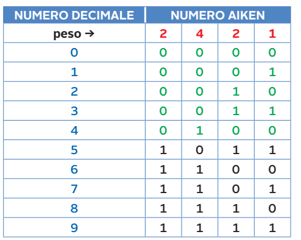

---

# Aiken: perché i numeri 5–9 sono così?

Le cifre 0–4 usano il bit di peso 2 a **0**; le cifre 5–9 lo usano a **1**.

| Cifra | Calcolo con pesi 2-4-2-1 | Codice |
|:-:|---|:-:|
| 4 | 0 + 4 + 0 + 0 | 0100 |
| 5 | 2 + 0 + 2 + 1 | **1011** |
| 7 | 2 + 4 + 0 + 1 | **1101** |
| 9 | 2 + 4 + 2 + 1 | **1111** |

Le configurazioni **0101, 0110, 0111, 1000, 1001, 1010** sono inutilizzate: ridondanza intenzionale che serve a ottenere la proprietà seguente.

---

# Aiken: codice autocomplementante a 9

La principale caratteristica del codice Aiken è di essere **autocomplementante a 9**.

Il **complemento a 9** di una cifra *c* è **9 − c**. In Aiken lo si ottiene **invertendo tutti i bit** (0↔1).

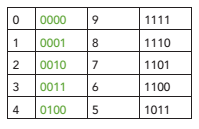

Esempio: 3 = `0011` → inverto → `1100` = **6**; infatti 3 + 6 = 9.

---

# Aiken: coppie che sommano 9

Le cifre si dispongono a **coppie che sommate danno 9**: (0,9) (1,8) (2,7) (3,6) (4,5).

| Cifra | Aiken | Complemento | Aiken |
|:-:|:-:|:-:|:-:|
| 0 | 0000 | 9 | 1111 |
| 1 | 0001 | 8 | 1110 |
| 2 | 0010 | 7 | 1101 |
| 3 | 0011 | 6 | 1100 |
| 4 | 0100 | 5 | 1011 |

**A cosa serve?** Permette di fare le **sottrazioni con la somma del complemento** senza circuiti di correzione complicati: l'inversione dei bit è un'operazione immediata (porte NOT).

---

# I codici quinario

Il **codice quinario** è un codice a **lunghezza fissa di 4 bit** con pesi **5-4-2-1**.

È in grado di codificare **5 + 4 + 2 + 1 + 1 = 13 simboli** (da 0 a 12): è quindi un codice **pesato** e **ridondante**.

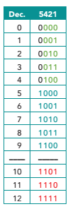

---

# Quinario: osservazioni

- A parte la colonna del **bit di peso 5**, le prime cinque configurazioni (0–4) sono **identiche, in ordine, alle cinque sottostanti** (5–9): per i numeri da 5 a 9 cambia **solo il bit più significativo (MSB)**.
- Per le cifre decimali bastano le configurazioni 0–9. Le configurazioni 10, 11, 12 (1101, 1110, 1111) sono valori oltre la cifra 9.
- Le configurazioni **0101, 0110, 0111** **non** si usano: darebbero valori già ottenuti (4+1 = 5, 4+2 = 6, 4+2+1 = 7).

> **Trucco di lettura:** se l'MSB è 1 si calcola `5 + (resto)`; es. `1010` → 5 + 2 = **7**.

---

# I codici biquinario

Il codice **biquinario** usa **7 bit**, divisi in due gruppi:

- un gruppo "**bi**" di 2 bit, con pesi **0 e 5**;
- un gruppo "**quinario**" di 5 bit, con pesi **0, 1, 2, 3, 4**.

Il valore della cifra è la somma di **un peso del primo gruppo** e **un peso del secondo**: es. 7 = 5 + 2.


Ogni cifra ha **sempre due bit a 1**: uno per gruppo.

---

# Biquinario: le tabelle

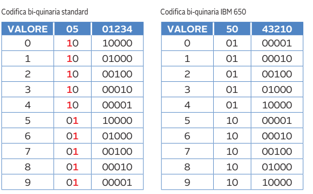

A sinistra la versione **standard**, a destra la versione usata nel calcolatore **IBM 650**.

*Esempio standard:* 7 = 5 + 2 → gruppo bi `01`, gruppo quinario `00100` → **01 00100**.

---

# Biquinario: rilevare un errore

Questo tipo di codifica si dice **ad autoverifica con conteggio fisso** (o **a rilevazione d'errore**).

Ogni parola valida contiene **esattamente due 1**: uno nel gruppo di 2 bit e uno nel gruppo di 5 bit.

| Ricevuto | Controllo | Esito |
|:-:|---|:-:|
| `01 00100` | un 1 per gruppo | valido → 7 |
| `01 00110` | tre 1 totali | **errore** |
| `00 00100` | gruppo bi senza 1 | **errore** |
| `11 00100` | gruppo bi con due 1 | **errore** |

Un **singolo bit invertito** altera il numero di 1 e viene sempre **rilevato** (ma non corretto).

---

# Il codice 2 su 5 (2/5)

- È simile al codice biquinario;
- è indicato anche come **2/5** (o "2 su 5");
- è **ridondante**;
- ha **lunghezza fissa di 5 bit**;
- pesi **6-3-2-1-0**;
- il bit di peso nullo è usato per **mantenere due bit a "1"** in ogni parola.

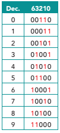

**Regola:** ogni cifra è rappresentata da una stringa di 5 bit con **esattamente due 1**.

---

# 2 su 5: quante combinazioni?

Sarebbe possibile rappresentare **6 + 3 + 2 + 1 + 0 + 1 = 13** configurazioni.

Per mantenere la condizione di **due soli 1 in ogni stringa**, si riducono a **10**: sono tutti i modi di scegliere 2 posizioni su 5.

$$\binom{5}{2} = \frac{5!}{2!\,3!} = 10$$

Esattamente le **10 cifre decimali**: 0, 1, …, 9.

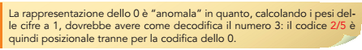

---

# 2 su 5: la cifra 0 è "anomala"

La rappresentazione dello **0** è anomala: calcolando i pesi delle cifre a 1 (`00110` → 2 + 1) si otterrebbe **3**.

Per questo il codice 2/5 è **posizionale tranne che per la codifica dello 0**.

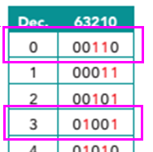

---

# 2 su 5: un esempio reale, il codice a barre

Il **codice a barre "2 di 5"** (*Industrial 2 of 5*) fu sviluppato nel **1968** da Identicon Corporation. Si usa soprattutto nei **magazzini** e nel **campo fotografico**.

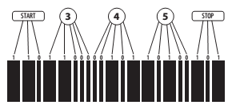

- Barra **larga** = 1, barra **stretta** = 0;
- ogni cifra è composta da **5 barre, di cui 2 larghe**;
- inizio (**START** = 110) e fine (**STOP** = 101) delimitano il codice;
- la cifra 3 = `11000`, la cifra 4 = `00101`, la cifra 5 = `10100` (in questa variante i pesi sono 1-2-4-7-0).

Se un lettore trova una cifra senza **esattamente 2 barre larghe**, scarta la lettura: **errore rilevato**.

---

<!-- _class: small -->

# 2 su 5: la tabella completa


| Cifra | Codice (6-3-2-1-0) | Calcolo |
|:-:|:-:|---|
| 0 | `00110` | anomalo |
| 1 | `00011` | 1 + 0 |
| 2 | `00101` | 2 + 0 |
| 3 | `01001` | 3 + 0 |
| 4 | `01010` | 3 + 1 |
| 5 | `01100` | 3 + 2 |
| 6 | `10001` | 6 + 0 |
| 7 | `10010` | 6 + 1 |
| 8 | `10100` | 6 + 2 |
| 9 | `11000` | 6 + 3 |

---

<!-- _class: small -->

# Riepilogo dei codici decimali

| Codice | Bit | Pesi | Cifre valide | Proprietà |
|---|:-:|:-:|:-:|---|
| **BCD** | 4 | 8-4-2-1 | 10 su 16 | semplice; somma con correzione ±6 |
| **Packed BCD** | 8 (2 cifre) | 8-4-2-1 | — | 2 cifre per byte + nibble di segno |
| **Eccesso 3** | 4 | — | 10 su 16 | autocomplementante a 9; non pesato |
| **Aiken** | 4 | 2-4-2-1 | 10 su 16 | **autocomplementante a 9** |
| **Quinario** | 4 | 5-4-2-1 | 13 | pesato, ridondante |
| **Biquinario** | 7 | 0-5 / 0-4 | 10 su 128 | **rileva errori** (due 1) |
| **2 su 5** | 5 | 6-3-2-1-0 | 10 su 32 | **rileva errori**; codici a barre |

---

# Riepilogo: i punti chiave

- Un **codice** associa i simboli di un alfabeto a stringhe di un altro alfabeto; servono **n ≥ ⌈log₂ C⌉** bit.
- **ASCII** = 7 bit (128 caratteri); **ASCII esteso** = 8 bit con **codepage**; **Unicode** assegna un **codepoint** a ogni carattere.
- **UTF-8** (1–4 byte, compatibile con ASCII), **UTF-16** (2 o 4 byte), **UTF-32** (4 byte fissi).
- Ordine dei byte in memoria: **big-endian** vs **little-endian**.
- **BCD**: una cifra decimale ↔ 4 bit; somma con correzione **+6**; **packed BCD** = 2 cifre per byte + segno.
- **Aiken** ed **eccesso 3** sono autocomplementanti a 9.
- **Biquinario** e **2 su 5** hanno un numero fisso di 1 e permettono di **rilevare errori**.

---

<!-- _class: small -->

# Verifica: esercizi

1. Quanti bit servono (minimo) per codificare 40 simboli? Il codice è ridondante? Quante configurazioni restano libere?
2. Codifica in ASCII a 8 bit la stringa `<paolo>` e decodifica la prima sequenza dell'esercizio *Prova adesso*.
3. Codifica "ñ" (U+00F1) in UTF-8.
4. Memorizza la parola `0x12345678` a partire dall'indirizzo 100 in big-endian e in little-endian.
5. Scrivi in BCD il numero 482; calcola in BCD **48 + 25**.
6. Scrivi in packed BCD il numero **−3059**.
7. Codifica la cifra 7 in Aiken e verifica che il suo complemento a 9 sia 2.
8. Scrivi la cifra 8 in biquinario standard e in codice 2 su 5.

---

<!-- _class: tiny -->

# Verifica: soluzioni

1. ⌈log₂ 40⌉ = **6** bit; 2⁶ = 64 > 40 → ridondante, **24** configurazioni libere.
2. `<paolo>` = `00111100 01110000 01100001 01101111 01101100 01101111 00111110`
   Le tre sequenze di *Prova adesso* si decodificano in **ci@o_m@re**, **informatica**, **W la squola**.
3. U+00F1 = `1111 0001` → `00011 110001` → `11000011 10110001` = **C3 B1**.
4. Big-endian: 100 → 12, 101 → 34, 102 → 56, 103 → 78. Little-endian: 100 → 78, 101 → 56, 102 → 34, 103 → 12.
5. 482 = `0100 1000 0010`. 48 + 25: `0100 1000 + 0010 0101 = 0110 1101`; 1101 non valido → +0110 = `0111 0011` = **73**.
6. Cifre 3-0-5-9 + segno D, con zero di riempimento: `0000 0011 0000 0101 1001 1101` = **03059D**.
7. 7 = 2 + 4 + 1 → `1101`; invertendo → `0010` = 2, e 7 + 2 = 9. ✔
8. Biquinario: 8 = 5 + 3 → `01 00010`. 2 su 5: 8 = 6 + 2 → `10100`.

---

<!-- _class: lead -->
<!-- _paginate: false -->

# Grazie per l'attenzione

## Domande?
