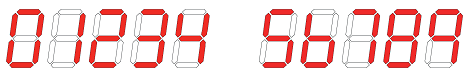
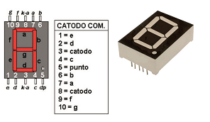
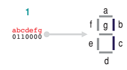
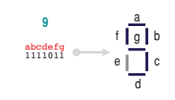
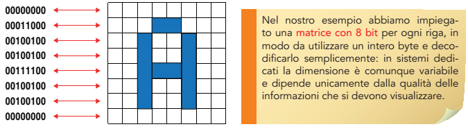
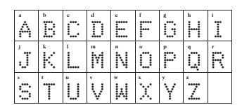

<!-- _class: lead -->
<!-- _paginate: false -->
<!-- _header: "" -->

# Codici digitali non pesati

## Unità di Apprendimento 2 · Lezione 2

Tecnologie e Progettazione di Sistemi Informatici e di Telecomunicazioni (TPSI)
Classe 3ª · Istituto Tecnico – Informatica
**Prof. Dicara**

---

# In questa lezione impareremo

- il codice a **sette segmenti**
- il codice a **matrice di punti**

> Filo conduttore: *non sempre conviene un codice "pesato" come il BCD. A volte servono codici pensati per evitare errori, per pilotare un display o per essere letti da una macchina.*

---

# Ripasso: pesato o non pesato?

| | Codice **pesato** | Codice **non pesato** |
|---|---|---|
| Valore della cifra | somma dei pesi dei bit a 1 | **non** si ottiene con pesi fissi |
| Esempi | BCD (8-4-2-1) | 7 segmenti |
| Perché si usa | calcoli aritmetici semplici | proprietà particolari (distanza, complemento, errori) |

**Esempio.** In BCD `0111` = 0 + 4 + 2 + 1 = **7** (calcolo diretto). In eccesso 3 `0111` vale **4** (perché 4 + 3 = 7): nessun insieme di pesi fissi spiega tutte le cifre.

---

<!-- _class: lead -->

# Parte E
## Codice a sette segmenti

---

# Il codice a sette segmenti

Per consentire la **rappresentazione grafica delle cifre decimali** si utilizza il codice a **sette segmenti**.

- Usa **7 bit**;
- a ogni bit è associato **un segmento** del display (acceso = 1, spento = 0).



Diffusi in orologi digitali, calcolatrici, forni, contatori, bilance…

---

# I segmenti: a, b, c, d, e, f, g

I sette segmenti sono indicati con le **prime sette lettere dell'alfabeto** (a, b, c, d, e, f, g).



A destra il display reale e i **piedini** (*pinout*) di un display a **catodo comune**: tutti i LED condividono il catodo (−); per accendere un segmento si porta a livello alto il suo piedino.

---

# Catodo comune e anodo comune

| Tipo | Pin comune | Segmento acceso quando… |
|---|---|---|
| **Catodo comune** | collegato a massa (0 V) | il pin del segmento è **1** (alto) |
| **Anodo comune** | collegato a +V | il pin del segmento è **0** (basso) |

Con l'anodo comune i bit della tabella vanno **invertiti**.

> Ogni segmento è un LED: serve sempre una **resistenza di limitazione** (tipicamente 220 Ω – 330 Ω con 5 V) per non danneggiarlo.

---

# Sette segmenti: esempio con la cifra 1



Per scrivere **1** si accendono solo **b** e **c**:

| a | b | c | d | e | f | g |
|:-:|:-:|:-:|:-:|:-:|:-:|:-:|
| 0 | 1 | 1 | 0 | 0 | 0 | 0 |

Codice: **abcdefg = 0110000**

---

# Sette segmenti: esempio con la cifra 9



Per scrivere **9** si accendono **a, b, c, d, f, g**:

| a | b | c | d | e | f | g |
|:-:|:-:|:-:|:-:|:-:|:-:|:-:|
| 1 | 1 | 1 | 1 | 0 | 1 | 1 |

Codice: **abcdefg = 1111011**

---

<!-- _class: small -->

# Tabella completa del sette segmenti

| Cifra | BCD (8421) | a | b | c | d | e | f | g | abcdefg |
|:-:|:-:|:-:|:-:|:-:|:-:|:-:|:-:|:-:|:-:|
| 0 | 0000 | 1 | 1 | 1 | 1 | 1 | 1 | 0 | `1111110` |
| 1 | 0001 | 0 | 1 | 1 | 0 | 0 | 0 | 0 | `0110000` |
| 2 | 0010 | 1 | 1 | 0 | 1 | 1 | 0 | 1 | `1101101` |
| 3 | 0011 | 1 | 1 | 1 | 1 | 0 | 0 | 1 | `1111001` |
| 4 | 0100 | 0 | 1 | 1 | 0 | 0 | 1 | 1 | `0110011` |
| 5 | 0101 | 1 | 0 | 1 | 1 | 0 | 1 | 1 | `1011011` |
| 6 | 0110 | 1 | 0 | 1 | 1 | 1 | 1 | 1 | `1011111` |
| 7 | 0111 | 1 | 1 | 1 | 0 | 0 | 0 | 0 | `1110000` |
| 8 | 1000 | 1 | 1 | 1 | 1 | 1 | 1 | 1 | `1111111` |
| 9 | 1001 | 1 | 1 | 1 | 1 | 0 | 1 | 1 | `1111011` |

---

# Il decodificatore BCD → sette segmenti

Nei circuiti reali un contatore o un microcontrollore fornisce la cifra in **BCD (4 bit)**; un **decodificatore** (per esempio il **CD4511** per display a catodo comune o il **74LS47** per anodo comune) la converte nei **7 bit** dei segmenti.

```
   BCD (4 bit)                 7 segmenti
  ┌───────────┐              ┌──────────────┐
  │ 0 1 1 1   │ ──► decod ──►│ 1 1 1 0 0 0 0│ → "7"
  └───────────┘              └──────────────┘
```

**In Python:**
```python
SEG = {0:"1111110", 1:"0110000", 2:"1101101", 3:"1111001", 4:"0110011",
       5:"1011011", 6:"1011111", 7:"1110000", 8:"1111111", 9:"1111011"}
print(SEG[7])     # 1110000
```

Le configurazioni BCD 1010–1111 non sono cifre: il decodificatore le gestisce spegnendo il display o mostrando simboli speciali.

---

<!-- _class: lead -->

# Parte F
## Codice a matrice di punti

---

# Il codice a matrice di punti

Con i sette segmenti si rappresentano bene le **cifre**, ma male le **lettere** (la M, la W, la X sono difficili). Per ottenere **lettere, numeri e simboli** si usa una **matrice di punti** (*dot matrix*).

- Il carattere è disegnato su una griglia di **righe × colonne** di punti (pixel);
- ogni punto è **acceso (1)** o **spento (0)**;
- ogni riga della griglia si codifica con una **stringa di bit**.



---

# Matrice di punti: la lettera "A"

Matrice **8 × 8**: ogni riga è un byte, scritto con 1 per i punti accesi.

| Riga | Bit | Esadecimale |
|:-:|:-:|:-:|
| 1 | `00000000` | 00 |
| 2 | `00011000` | 18 |
| 3 | `00100100` | 24 |
| 4 | `00100100` | 24 |
| 5 | `00111100` | 3C |
| 6 | `00100100` | 24 |
| 7 | `00100100` | 24 |
| 8 | `00000000` | 00 |

Quindi la lettera "A" occupa **8 byte**: `00 18 24 24 3C 24 24 00`.

---

# Matrice di punti: perché 8 bit per riga

Nell'esempio è stata impiegata una **matrice con 8 bit per ogni riga**, in modo da utilizzare un **intero byte** e decodificarlo semplicemente.

In sistemi dedicati la dimensione è comunque **variabile** e dipende unicamente dalla **qualità delle informazioni** che si devono visualizzare.

| Matrice | Uso tipico |
|---|---|
| 5 × 7 | display LCD alfanumerici (es. HD44780, 16×2) |
| 8 × 8 | piccoli moduli LED, esempi didattici |
| 9 × 5 | alfabeto completo della slide seguente |
| più grande | pannelli informativi, insegne |

**Memoria necessaria** per un carattere 8 × 8: 8 byte; per 128 caratteri → 128 × 8 = **1024 byte (1 KiB)** di "font" in ROM.

---

# Matrice 9 × 5: l'alfabeto completo



Esempio di alfabeto completo codificato con una **matrice di punti 9 × 5** (9 righe, 5 colonne): ogni lettera richiede **9 righe da 5 bit**.
