<!-- _class: lead -->
<!-- _paginate: false -->
<!-- _header: "" -->

# Codici digitali non pesati

## Unità di Apprendimento 2 · Lezione 2

Tecnologie e Progettazione di Sistemi Informatici e di Telecomunicazioni (TPSI)
Classe 3ª · Istituto Tecnico – Informatica
**Prof. Dicara**

---

# In questa lezione impareremo

- il codice **eccesso 3** e come si fanno le somme
- la codifica di **Gray** e i codici **progressivi** (eccesso 3 riflesso, Petherick…)
- il codice **1 su N**
- il codice a **sette segmenti**
- il codice a **matrice di punti**
- il **barcode** e il **QR Code**

> Filo conduttore: *non sempre conviene un codice "pesato" come il BCD. A volte servono codici pensati per evitare errori, per pilotare un display o per essere letti da una macchina.*

---

# Ripasso: pesato o non pesato?

| | Codice **pesato** | Codice **non pesato** |
|---|---|---|
| Valore della cifra | somma dei pesi dei bit a 1 | **non** si ottiene con pesi fissi |
| Esempi | BCD (8-4-2-1), Aiken (2-4-2-1) | eccesso 3, Gray, Petherick |
| Perché si usa | calcoli aritmetici semplici | proprietà particolari (distanza, complemento, errori) |

**Esempio.** In BCD `0111` = 0 + 4 + 2 + 1 = **7** (calcolo diretto). In eccesso 3 `0111` vale **4** (perché 4 + 3 = 7): nessun insieme di pesi fissi spiega tutte le cifre.

---

<!-- _class: lead -->

# Parte A
## Il codice eccesso 3

---

# Il codice eccesso 3 (Excess-3)

Ogni numero viene ottenuto dal corrispondente valore **BCD sommando 3**.

| Cifra | Calcolo | Codice |
|:-:|:-:|:-:|
| 0 | 0 + 3 = 3 | `0011` |
| 1 | 1 + 3 = 4 | `0100` |
| 2 | 2 + 3 = 5 | `0101` |
| 9 | 9 + 3 = 12 | `1100` |

… e così via per tutte le cifre da 0 a 9.

> **Esempio per scrivere un numero:** 58 → 5 + 3 = 8 → `1000`; 8 + 3 = 11 → `1011` → **(1000 1011)** in eccesso 3.

---

# Eccesso 3: la tabella

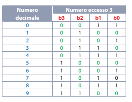

I bit sono indicati con **b3 b2 b1 b0** (da sinistra a destra, dal più al meno significativo). Le configurazioni **0000, 0001, 0010, 1101, 1110, 1111** non sono usate.

---

# Eccesso 3: codice autocomplementante

Il codice eccesso 3 è un codice **autocomplementante** (a 9): invertendo tutti i bit di una cifra si ottiene il **complemento a 9**, cioè la cifra che sommata alla prima dà 9.

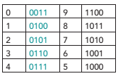

Esempio: 2 = `0101` → inverto i bit → `1010` = 7, e 2 + 7 = 9. ✔

È un codice **ridondante**, perché non sono utilizzate tutte le **16** configurazioni possibili con 4 bit (se ne usano 10, ne restano 6 libere).

> **A cosa serve?** Con il complemento a 9 si fanno le sottrazioni usando solo l'addizione, e basta una porta NOT per ogni bit.

---

# Somma in eccesso 3: la regola

Se sommiamo due cifre in eccesso 3, **l'eccesso viene contato due volte** (3 + 3 = 6). Bisogna quindi correggere il risultato.

| Situazione dopo la somma dei 4 bit | Correzione |
|---|---|
| **Non c'è riporto** (risultato ≤ 9) | **sottrarre 3** (`0011`) |
| **C'è riporto** (risultato > 9) | **sommare 3** (`0011`) |

> **Perché?** Ogni addendo contiene già un "+3": la somma ne contiene due (+6), ma ne serve uno solo. Senza riporto basta togliere 3. Con il riporto la cifra successiva riceve 16 invece di 10 (uno scarto di 6): sommando 3 si ripristina il +3 mancante nella cifra generata.

---

# Somma in eccesso 3: 2 + 5

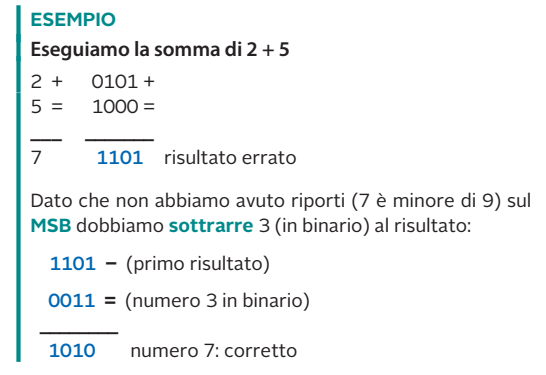

---

# Somma in eccesso 3: 2 + 5 (commento)

1. In eccesso 3: 2 = `0101`, 5 = `1000`.
2. Somma: `0101 + 1000 = 1101` → **risultato errato**.
3. **Non** ci sono riporti (7 è minore di 9) → si **sottrae 3**: `1101 − 0011 = 1010`.
4. `1010` è proprio il **7 in eccesso 3** (7 + 3 = 10 = `1010`). ✔

**Altro esempio, 4 + 5 = 9:**
`0111 + 1000 = 1111` (nessun riporto) → `1111 − 0011 = 1100` → 12 − 3 = **9** ✔

---

# Somma in eccesso 3: 2 + 8

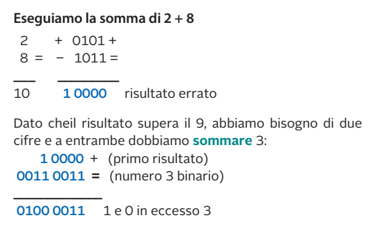

*(Nell'immagine il secondo addendo compare con un "−" per errore di stampa: l'operazione è `0101 + 1011`.)*

---

# Somma in eccesso 3: 2 + 8 (commento)

1. 2 = `0101`, 8 = `1011`; somma `0101 + 1011 = 1 0000` → **errato**.
2. Il risultato supera 9: servono **due cifre** (1 e 0).
3. In entrambe le cifre c'è stato riporto → si **somma 3** a ciascuna:

   `0001 0000 + 0011 0011 = 0100 0011`

4. `0100` = 1 e `0011` = 0 in eccesso 3 → **10** ✔

> **Riassunto operativo:** somma i 4 bit → guarda il riporto → **riporto = +3**, **niente riporto = −3**.

---

<!-- _class: lead -->

# Parte B
## La codifica di Gray

---

# La codifica di Gray

- È un **codice numerico binario**.
- Prende anche il nome di **codice ciclico** (o *riflesso*): due cifre **successive differiscono di un solo bit**.
- Si dice che hanno **distanza unitaria** (distanza di Hamming = 1).
- È un codice **non pesato** e **progressivo**.

| Decimale | Binario | Gray | Bit cambiati (Gray) |
|:-:|:-:|:-:|:-:|
| 1 → 2 | `001` → `010` | `001` → `011` | **1** |
| 3 → 4 | `011` → `100` | `010` → `110` | **1** |
| 7 → 8 | `0111` → `1000` | `0100` → `1100` | **1** |

In binario naturale, 3 → 4 cambia **tutti e 3** i bit; in Gray ne cambia **uno solo**.

---

# Storia e applicazioni

- È stato progettato e **brevettato nel 1953** nei **laboratori Bell** dal ricercatore **Frank Gray**.
- È utilizzato nell'**acquisizione della lettura di posizione** di particolari dispositivi elettronici.
- Esempio tipico: gli **encoder di posizione** dei regolatori di volume digitali degli impianti hi-fi.

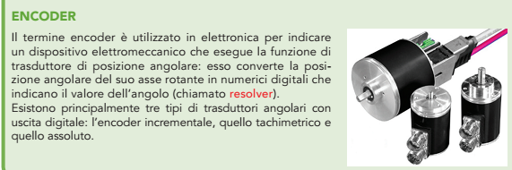

---

# Perché serve? Il problema delle commutazioni

Immagina un disco con sensori ottici che legge la posizione di un albero (**encoder assoluto**).

A causa delle **tolleranze meccaniche** è improbabile che due o più bit di una cifra commutino **esattamente nello stesso istante**.

**Esempio in binario naturale:** passaggio da 3 (`011`) a 4 (`100`).
Se i sensori non scattano insieme si possono leggere valori **intermedi sbagliati**:
`011 → 111 (7)` oppure `011 → 000 (0)` oppure `011 → 101 (5)` …

Con il **Gray** cambia **un solo bit alla volta**: si legge o il valore vecchio o il valore nuovo, **mai un valore sbagliato**.

---

# Il disco con codifica Gray

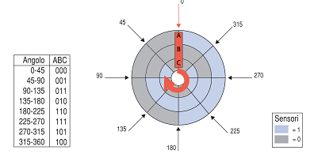

Il disco è diviso in **3 anelli (A, B, C)** e in **8 settori da 45°**. Ogni anello è chiaro (1) o scuro (0). Passando da un settore al successivo **cambia un solo anello**: 000, 001, 011, 010, 110, 111, 101, 100.

---

# Come si ottiene il codice di Gray: specularità

Per ottenere il codice di Gray si può usare la **regola della specularità** (codice *riflesso*).

**Procedura:**
1. si parte dal codice a 1 bit: `0`, `1`;
2. si **riflette** la lista (la si scrive al contrario, come in uno specchio);
3. alla lista originale si antepone uno **0**, alla lista riflessa si antepone un **1**.

| 1 bit | → riflessione → | 2 bit |
|:-:|:-:|:-:|
| 0 | | 00 |
| 1 | | 01 |
| | *(specchio)* | 11 |
| | | 10 |

---

# Specularità: tabella grafica

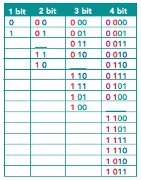

*(L'immagine originale riporta solo le prime 14 righe a 4 bit; la tabella completa è nella slide seguente.)*

---

<!-- _class: small -->

# Il codice di Gray a 4 bit (completo)

| Dec. | Binario | Gray | | Dec. | Binario | Gray |
|:-:|:-:|:-:|---|:-:|:-:|:-:|
| 0 | 0000 | 0000 | | 8 | 1000 | 1100 |
| 1 | 0001 | 0001 | | 9 | 1001 | 1101 |
| 2 | 0010 | 0011 | | 10 | 1010 | 1111 |
| 3 | 0011 | 0010 | | 11 | 1011 | 1110 |
| 4 | 0100 | 0110 | | 12 | 1100 | 1010 |
| 5 | 0101 | 0111 | | 13 | 1101 | 1011 |
| 6 | 0110 | 0101 | | 14 | 1110 | 1001 |
| 7 | 0111 | 0100 | | 15 | 1111 | 1000 |

Anche dal **15 (1000)** si torna allo **0 (0000)** cambiando un solo bit: per questo si dice **ciclico**.

---

# Gray: formula rapida (da binario a Gray)

Esiste un metodo diretto, più veloce della specularità:

> **Gray = binario XOR (binario spostato a destra di 1 posizione)**

**Esempio: 6 → Gray**
```
binario        0110
shift a dx     0011
XOR            0101   ← Gray di 6
```

**Da Gray a binario:** il primo bit resta uguale; ogni bit successivo = bit binario precedente XOR bit Gray corrente. Esempio `1101`: b3 = 1; b2 = 1⊕1 = 0; b1 = 0⊕0 = 0; b0 = 0⊕1 = 1 → `1001` = 9.

---

# Gray in Python

```python
def to_gray(n):
    return n ^ (n >> 1)

def from_gray(g):
    n = 0
    while g:
        n ^= g
        g >>= 1
    return n

for i in range(8):
    print(i, format(to_gray(i), "03b"))
# 0 000   1 001   2 011   3 010   4 110   5 111   6 101   7 100
```

L'operatore `^` è lo **XOR**, `>>` è lo **shift a destra**.

---

# Prova adesso! · Gray

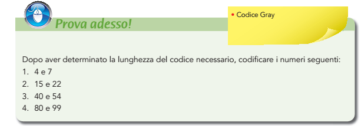

**Suggerimento:** per ogni numero si calcola prima la **lunghezza** n = ⌈log₂(N+1)⌉ (il minimo numero di bit necessario per scrivere il valore), poi la codifica in binario e infine in Gray.

*Le soluzioni sono alla fine della lezione.*

---

<!-- _class: lead -->

# Parte C
## Codici progressivi: eccesso 3 riflesso e Petherick

---

# Il codice eccesso 3 riflesso

Il **codice eccesso 3 riflesso** si ottiene dal codice eccesso 3 con **due operazioni**:

1. uno **shift a destra** di una posizione;
2. la **somma** del numero ottenuto al numero di partenza, **senza sommare i riporti**.

> Sommare senza riporti equivale a fare lo **XOR** bit a bit. È quindi la stessa formula di Gray, applicata al codice eccesso 3 anziché al binario naturale.

**In sintesi:** `eccesso 3 riflesso = ecc3 XOR (ecc3 >> 1)`

---

# Eccesso 3 riflesso: esempio con il 3

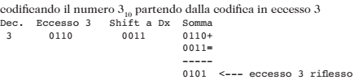

1. 3 in eccesso 3: 3 + 3 = 6 → `0110`
2. Shift a destra di 1 posizione: `0011`
3. Somma senza riporti: `0110 ⊕ 0011 = 0101`

**Il 3 in eccesso 3 riflesso è `0101`.**

---

# Eccesso 3 riflesso: esempio con il 7

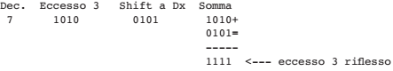

1. 7 in eccesso 3: 7 + 3 = 10 → `1010`
2. Shift a destra: `0101`
3. Somma senza riporti: `1010 ⊕ 0101 = 1111`

**Il 7 in eccesso 3 riflesso è `1111`.**

---

# Eccesso 3 riflesso: la tabella

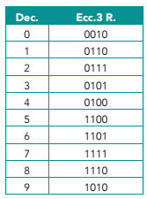

Tabella con tutti i numeri codificati in **eccesso 3 riflesso**.

Il codice ottenuto è un codice **progressivo** come il Gray: la distanza tra due configurazioni adiacenti è **unitaria**.

Verifica: `0010 → 0110 → 0111 → 0101 → 0100 → 1100 → 1101 → 1111 → 1110 → 1010`: a ogni passo cambia **un solo bit**.

> Rispetto al Gray, qui non compaiono `0000` e `0001`: le cifre 0–9 occupano 10 configurazioni **contigue** nel ciclo.

---

# Il codice BCD di Petherick

- È anch'esso un codice **progressivo non pesato**;
- ha la caratteristica di **non contenere le configurazioni 0000 e 1111**;
- esistono **due versioni**.

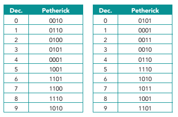

---

# Altri codici progressivi

Oltre a quelli descritti esistono altri codici progressivi (Glixon, O'Brien, Tompkins…).

- Come il codice di Petherick **non sono pesati**.
- Non hanno una **"regola diretta"** che permetta di ricavarli.
- Si ottengono **manualmente**, togliendo e/o aggiungendo un bit a partire da una configurazione.

> **Importante:** per usarli basta consultare la **tabella**; l'hardware li gestisce con una piccola ROM o con logica combinatoria.

---

# Codici progressivi: tabella riepilogativa

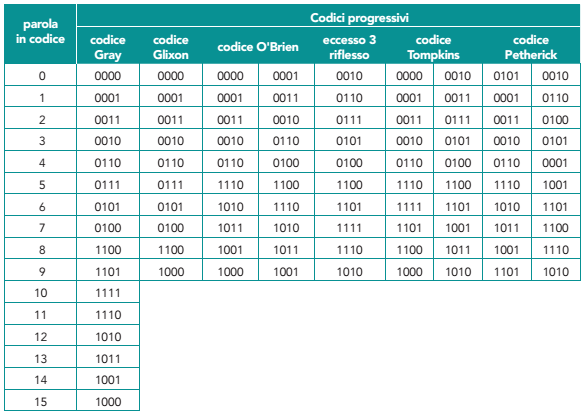

---

<!-- _class: lead -->

# Parte D
## Il codice 1 su N

---

# Il codice 1 su n

Tra i codici posizionali abbiamo visto il **2 su 5**, con numero di 1 **costante** in ogni configurazione. La stessa particolarità è presente nel codice **1 su n**.

**Definizione:** associa a ognuna delle **n** configurazioni una **stringa di n bit con un solo bit a 1**.

| Per n = 4 | Codice |
|:-:|:-:|
| simbolo 0 | `0001` |
| simbolo 1 | `0010` |
| simbolo 2 | `0100` |
| simbolo 3 | `1000` |

Per n simboli servono **n bit** (molti di più dei ⌈log₂ n⌉ del binario): è un codice molto **ridondante**, ma con decodifica immediata e controllo d'errore (un solo 1).

---

# 1 su n: la tastiera

Per esempio viene utilizzato per **immettere dati attraverso una tastiera numerica**, decodificandoli all'interno mediante **logica cablata**.

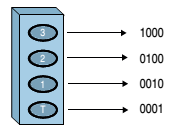

Ogni tasto è collegato a **una linea**; premendo un tasto si porta a 1 solo la sua linea. Se compaiono **due 1** (pressione di due tasti) o **nessun 1**, la combinazione **non è valida**.

Esempio: un codificatore (*encoder*) trasforma `0100` (tasto 2) nel binario `10`.

---

<!-- _class: lead -->

# Parte E
## Codice a sette segmenti

---

# Il codice a sette segmenti

Per consentire la **rappresentazione grafica delle cifre decimali** si utilizza il codice a **sette segmenti**.

- Usa **7 bit**;
- a ogni bit è associato **un segmento** del display (acceso = 1, spento = 0).

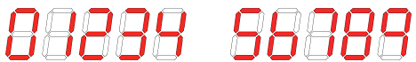

Diffusi in orologi digitali, calcolatrici, forni, contatori, bilance…

---

# I segmenti: a, b, c, d, e, f, g

I sette segmenti sono indicati con le **prime sette lettere dell'alfabeto** (a, b, c, d, e, f, g).

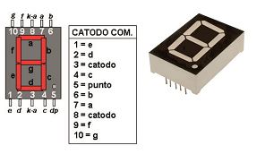

A destra il display reale e i **piedini** (*pinout*) di un display a **catodo comune**: tutti i LED condividono il catodo (−); per accendere un segmento si porta a livello alto il suo piedino.

---

# Catodo comune e anodo comune

| Tipo | Pin comune | Segmento acceso quando… |
|---|---|---|
| **Catodo comune** | collegato a massa (0 V) | il pin del segmento è **1** (alto) |
| **Anodo comune** | collegato a +V | il pin del segmento è **0** (basso) |

Con l'anodo comune i bit della tabella vanno **invertiti**.

> Ogni segmento è un LED: serve sempre una **resistenza di limitazione** (tipicamente 220 Ω – 330 Ω con 5 V) per non danneggiarlo.

---

# Sette segmenti: esempio con la cifra 1

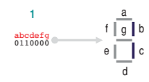

Per scrivere **1** si accendono solo **b** e **c**:

| a | b | c | d | e | f | g |
|:-:|:-:|:-:|:-:|:-:|:-:|:-:|
| 0 | 1 | 1 | 0 | 0 | 0 | 0 |

Codice: **abcdefg = 0110000**

---

# Sette segmenti: esempio con la cifra 9

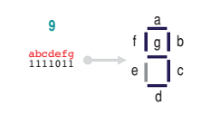

Per scrivere **9** si accendono **a, b, c, d, f, g**:

| a | b | c | d | e | f | g |
|:-:|:-:|:-:|:-:|:-:|:-:|:-:|
| 1 | 1 | 1 | 1 | 0 | 1 | 1 |

Codice: **abcdefg = 1111011**

---

<!-- _class: small -->

# Tabella completa del sette segmenti

| Cifra | BCD (8421) | a | b | c | d | e | f | g | abcdefg |
|:-:|:-:|:-:|:-:|:-:|:-:|:-:|:-:|:-:|:-:|
| 0 | 0000 | 1 | 1 | 1 | 1 | 1 | 1 | 0 | `1111110` |
| 1 | 0001 | 0 | 1 | 1 | 0 | 0 | 0 | 0 | `0110000` |
| 2 | 0010 | 1 | 1 | 0 | 1 | 1 | 0 | 1 | `1101101` |
| 3 | 0011 | 1 | 1 | 1 | 1 | 0 | 0 | 1 | `1111001` |
| 4 | 0100 | 0 | 1 | 1 | 0 | 0 | 1 | 1 | `0110011` |
| 5 | 0101 | 1 | 0 | 1 | 1 | 0 | 1 | 1 | `1011011` |
| 6 | 0110 | 1 | 0 | 1 | 1 | 1 | 1 | 1 | `1011111` |
| 7 | 0111 | 1 | 1 | 1 | 0 | 0 | 0 | 0 | `1110000` |
| 8 | 1000 | 1 | 1 | 1 | 1 | 1 | 1 | 1 | `1111111` |
| 9 | 1001 | 1 | 1 | 1 | 1 | 0 | 1 | 1 | `1111011` |

---

# Il decodificatore BCD → sette segmenti

Nei circuiti reali un contatore o un microcontrollore fornisce la cifra in **BCD (4 bit)**; un **decodificatore** (per esempio il **CD4511** per display a catodo comune o il **74LS47** per anodo comune) la converte nei **7 bit** dei segmenti.

```
   BCD (4 bit)                 7 segmenti
  ┌───────────┐              ┌──────────────┐
  │ 0 1 1 1   │ ──► decod ──►│ 1 1 1 0 0 0 0│ → "7"
  └───────────┘              └──────────────┘
```

**In Python:**
```python
SEG = {0:"1111110", 1:"0110000", 2:"1101101", 3:"1111001", 4:"0110011",
       5:"1011011", 6:"1011111", 7:"1110000", 8:"1111111", 9:"1111011"}
print(SEG[7])     # 1110000
```

Le configurazioni BCD 1010–1111 non sono cifre: il decodificatore le gestisce spegnendo il display o mostrando simboli speciali.

---

<!-- _class: lead -->

# Parte F
## Codice a matrice di punti

---

# Il codice a matrice di punti

Con i sette segmenti si rappresentano bene le **cifre**, ma male le **lettere** (la M, la W, la X sono difficili). Per ottenere **lettere, numeri e simboli** si usa una **matrice di punti** (*dot matrix*).

- Il carattere è disegnato su una griglia di **righe × colonne** di punti (pixel);
- ogni punto è **acceso (1)** o **spento (0)**;
- ogni riga della griglia si codifica con una **stringa di bit**.

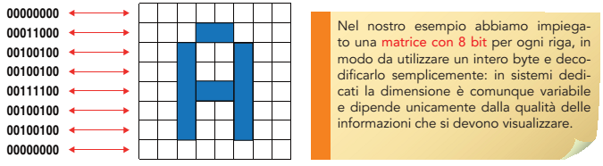

---

# Matrice di punti: la lettera "A"

Matrice **8 × 8**: ogni riga è un byte, scritto con 1 per i punti accesi.

| Riga | Bit | Esadecimale |
|:-:|:-:|:-:|
| 1 | `00000000` | 00 |
| 2 | `00011000` | 18 |
| 3 | `00100100` | 24 |
| 4 | `00100100` | 24 |
| 5 | `00111100` | 3C |
| 6 | `00100100` | 24 |
| 7 | `00100100` | 24 |
| 8 | `00000000` | 00 |

Quindi la lettera "A" occupa **8 byte**: `00 18 24 24 3C 24 24 00`.

---

# Matrice di punti: perché 8 bit per riga

Nell'esempio è stata impiegata una **matrice con 8 bit per ogni riga**, in modo da utilizzare un **intero byte** e decodificarlo semplicemente.

In sistemi dedicati la dimensione è comunque **variabile** e dipende unicamente dalla **qualità delle informazioni** che si devono visualizzare.

| Matrice | Uso tipico |
|---|---|
| 5 × 7 | display LCD alfanumerici (es. HD44780, 16×2) |
| 8 × 8 | piccoli moduli LED, esempi didattici |
| 9 × 5 | alfabeto completo della slide seguente |
| più grande | pannelli informativi, insegne |

**Memoria necessaria** per un carattere 8 × 8: 8 byte; per 128 caratteri → 128 × 8 = **1024 byte (1 KiB)** di "font" in ROM.

---

# Matrice 9 × 5: l'alfabeto completo

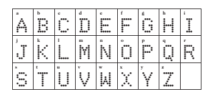

Esempio di alfabeto completo codificato con una **matrice di punti 9 × 5** (9 righe, 5 colonne): ogni lettera richiede **9 righe da 5 bit**.

---

<!-- _class: lead -->

# Parte G
## Barcode e QR Code

---

# Il codice a barre (barcode)

Il **codice a barre** codifica un numero o una stringa con **barre nere e spazi bianchi di larghezze diverse**, letti da un **lettore ottico** (laser o fotocamera).

- Nella lezione precedente abbiamo visto il **2 di 5**, un codice a barre numerico;
- si usa nei negozi, nei magazzini, nelle biblioteche, nei pacchi postali.

| Standard | Contenuto | Uso |
|---|---|---|
| **EAN-13** | 13 cifre | prodotti in vendita (Europa) |
| **UPC-A** | 12 cifre | prodotti (USA/Canada) |
| **Code 39 / Code 128** | lettere e numeri | logistica, industria |
| **2 di 5** | solo cifre | magazzini, fotografia |

---

# EAN-13: struttura e cifra di controllo

Un codice **EAN-13** è formato da 13 cifre: **prefisso** del paese/ente (es. 80 = Italia), **codice azienda**, **codice prodotto** e **cifra di controllo** (l'ultima).

**Calcolo della cifra di controllo** (esempio con `400638133393`):

1. si numerano le prime 12 cifre da sinistra;
2. si sommano le cifre in posizione **dispari** (peso 1) e quelle in posizione **pari** moltiplicate per **3** (peso 3);
3. la cifra di controllo è ciò che manca per arrivare al **multiplo di 10** successivo.

Cifre: 4 0 0 6 3 8 1 3 3 3 9 3 → pesi 1 3 1 3 1 3 1 3 1 3 1 3
Somma = 4+0+0+18+3+24+1+9+3+9+9+9 = **89** → 90 − 89 = **1**.

Codice completo: **4006381333931** ✔

---

# Perché serve la cifra di controllo

La cifra di controllo è una forma di **ridondanza** (come nel 2 su 5 e nel biquinario): permette al lettore di **rilevare** errori di lettura o di digitazione.

> **Esempio:** se il lettore legge `4006381333941` invece di `4006381333931`, il calcolo darà una cifra di controllo diversa da quella letta → il lettore **scarta la lettura** e riprova.

Un codice a barre è quindi un **codice a lunghezza fissa, con rilevazione d'errore**.

---

# Il QR Code

Il **QR Code** (*Quick Response*) è un **codice a barre bidimensionale (2D)** inventato nel **1994** dall'azienda giapponese Denso Wave. Memorizza i dati in una **griglia di quadratini neri e bianchi** (detti **moduli**).

**Caratteristiche principali:**
- può contenere **testo, URL, numeri di telefono, Wi-Fi…**;
- si legge con la **fotocamera** di uno smartphone, **da qualsiasi angolazione**;
- ha **tre quadrati di riferimento** (*finder pattern*) agli angoli, che indicano orientamento e dimensione;
- contiene **codici di correzione degli errori**, quindi può essere letto anche se parzialmente sporco o danneggiato.

---

# QR Code: capacità e correzione errori

| Livello | Dati ripristinabili |
|:-:|:-:|
| **L** (Low) | circa 7 % |
| **M** (Medium) | circa 15 % |
| **Q** (Quartile) | circa 25 % |
| **H** (High) | circa 30 % |

- Esistono **40 versioni**, da **21 × 21** moduli (versione 1) a **177 × 177** (versione 40).
- La capacità massima è di circa **7 000 cifre** (o circa 4 300 caratteri alfanumerici).

> Più alto è il livello di correzione, **meno dati** si possono memorizzare: è il compromesso tra **affidabilità** e **capacità**. Per questo si può mettere un piccolo logo al centro di un QR senza renderlo illeggibile.

---

# Barcode e QR a confronto

| | **Barcode (1D)** | **QR Code (2D)** |
|---|---|---|
| Dimensioni | solo orizzontale | orizzontale e verticale |
| Dati | poche cifre (12–20) | migliaia di caratteri |
| Correzione errori | solo rilevazione (cifra di controllo) | **rilevazione e correzione** |
| Lettura | laser o ottica | fotocamera, da qualsiasi angolo |
| Uso | negozi, magazzini | pubblicità, pagamenti, biglietti, Wi-Fi |

---

<!-- _class: small -->

# Riepilogo dei codici non pesati

| Codice | Bit | Proprietà | Dove si usa |
|---|:-:|---|---|
| **Eccesso 3** | 4 | autocomplementante, non pesato | calcolatrici, circuiti BCD |
| **Gray** | n | **distanza unitaria**, ciclico | encoder, sensori di posizione |
| **Eccesso 3 riflesso** | 4 | progressivo, ottenuto con shift + XOR | sensori di posizione decimali |
| **Petherick** | 4 | progressivo, senza 0000 e 1111 | sistemi di misura |
| **1 su n** | n | un solo 1 | tastiere, selezione di linee |
| **Sette segmenti** | 7 | un bit per segmento | display numerici |
| **Matrice di punti** | righe × colonne | un bit per punto | display di testo, stampanti |
| **Barcode / QR** | variabile | lettura ottica, rilevazione/correzione errori | commercio, logistica |

---

# Riepilogo: i punti chiave

- I codici **non pesati** non si calcolano con pesi, ma hanno **proprietà speciali**.
- **Eccesso 3** = BCD + 3; autocomplementante; nella somma: **riporto → +3**, **niente riporto → −3**.
- **Gray**: due configurazioni successive differiscono di **1 bit** → ideale per gli encoder. Formula: `g = n XOR (n >> 1)`.
- **Eccesso 3 riflesso** e **Petherick** sono codici **progressivi**.
- **1 su n**: un solo bit a 1, usato nelle tastiere.
- **Sette segmenti** per le cifre, **matrice di punti** per lettere e simboli.
- **Barcode** e **QR Code** sono codici ottici con **controllo d'errore**.

---

<!-- _class: small -->

# Verifica: esercizi

1. Scrivi in eccesso 3 i numeri **5**, **9** e **47**.
2. Esegui in eccesso 3 le somme **3 + 4** e **6 + 7**.
3. Verifica che il codice eccesso 3 sia autocomplementante per la coppia **(3, 6)**.
4. Converti in **Gray** i numeri binari `1011` e `0110`; converti da Gray a binario `1110`.
5. Trova l'**eccesso 3 riflesso** della cifra **4**.
6. Scrivi il codice **abcdefg** della cifra **5** e della cifra **7** su display a catodo comune.
7. Disegna su matrice 8 × 8 la lettera **"T"** e scrivi i **8 byte** in esadecimale.
8. Calcola la **cifra di controllo EAN-13** per `978886504008`.

---

<!-- _class: tiny -->

# Verifica: soluzioni

1. 5 → `1000`; 9 → `1100`; 47 → (4+3 = 7 = `0111`) e (7+3 = 10 = `1010`): **0111 1010**.
2. 3 + 4: `0110 + 0111 = 1101`, nessun riporto → `1101 − 0011 = 1010` = **7**. ✔
   6 + 7: `1001 + 1010 = 1 0011`, riporto → +3 su entrambe le cifre: `0001 0011 + 0011 0011 = 0100 0110` → `0100` = 1, `0110` = 3 → **13**. ✔
3. 3 = `0110`, 6 = `1001`: sono una il complemento bit a bit dell'altra e 3 + 6 = 9. ✔
4. `1011` → `1011 ⊕ 0101 = 1110`; `0110` → `0110 ⊕ 0011 = 0101`; Gray `1110` → `1011`.
5. 4 → 4 + 3 = 7 = `0111`; shift `0011`; `0111 ⊕ 0011 = 0100`.
6. 5 → `1011011`; 7 → `1110000`.
7. "T": `00 7E 18 18 18 18 18 00` (riga 2 tutta accesa: `01111110`, poi la colonna centrale `00011000`).
8. 9 7 8 8 8 6 5 0 4 0 0 8 con pesi 1 3 1 3 …: 9+21+8+24+8+18+5+0+4+0+0+24 = 121 → 130 − 121 = **9** → `9788865040089`.

---

<!-- _class: tiny -->

# Soluzioni "Prova adesso! · Gray"

| N | Lunghezza (bit) | Binario | **Gray** |
|:-:|:-:|:-:|:-:|
| 4 | 3 | `100` | **`110`** |
| 7 | 3 | `111` | **`100`** |
| 15 | 4 | `1111` | **`1000`** |
| 22 | 5 | `10110` | **`11101`** |
| 40 | 6 | `101000` | **`111100`** |
| 54 | 6 | `110110` | **`101101`** |
| 80 | 7 | `1010000` | **`1111000`** |
| 99 | 7 | `1100011` | **`1010010`** |

Regola: Gray = binario XOR (binario >> 1).

---

<!-- _class: lead -->
<!-- _paginate: false -->

# Grazie per l'attenzione

## Domande?
