<!-- _class: lead -->
<!-- _paginate: false -->
<!-- _header: "" -->

# Codici per la rilevazione e la correzione di errori

## Unità di Apprendimento 2 · Lezione 3

Tecnologie e Progettazione di Sistemi Informatici e di Telecomunicazioni (TPSI)
Classe 3ª · Istituto Tecnico – Informatica
**Prof. Dicara**

---

# In questa lezione impareremo

- il concetto di **distanza** e di **distanza minima** di un codice
- la differenza tra **rilevazione** e **correzione** degli errori
- la codifica con **bit di parità** (VRC, LRC, parità incrociata)
- il controllo **CRC** (*Cyclic Redundancy Check*)
- il **codice di Hamming**

> Domanda guida: *come fa un calcolatore ad accorgersi che un dato è arrivato sbagliato? E può anche rimetterlo a posto da solo?*

---

# Mappa della lezione

| Parte | Argomento |
|---|---|
| **A** | Il problema: errori di trasmissione e ridondanza |
| **B** | Distanza di Hamming e distanza minima Dmin |
| **C** | Bit di parità (VRC) |
| **D** | CRC: controllo a ridondanza ciclica |
| **E** | Checksum e parità incrociata (LRC) |
| **F** | Il codice di Hamming (correzione automatica) |

---

<!-- _class: lead -->

# Parte A
## Il problema: gli errori di trasmissione

---

# Introduzione: l'informazione "in movimento"

All'interno di un calcolatore, tra **unità di elaborazione** e **unità di memoria**, avvengono continuamente scambi di informazioni.

- L'informazione si muove lungo un insieme di **fili paralleli**: il **bus**.
- I valori di tensione sono **"alto"** e **"basso"** e rappresentano i segnali logici **1** e **0**.
- Ogni filo trasporta **un bit**; un bus a 32 fili trasferisce 32 bit alla volta.

**Esempio:** il bus tra CPU e RAM, oppure tra il computer e un disco SATA/USB.

---

# Un bus parallelo reale


Nella figura è riportato un **bus parallelo** utilizzato per il trasferimento dei dati dall'**hard disk** alle unità ottiche (CD e DVD): il cavo piatto contiene molti conduttori, uno per ogni bit trasferito.

---

# Il rumore elettromagnetico

I segnali sono soggetti a **rumori di natura elettromagnetica** (motori, fulmini, cavi vicini, alimentatori, onde radio…).

- Il rumore si può **sovrapporre al segnale** fino a distorcere il valore iniziale.
- A destinazione arriva **un'informazione diversa** da quella trasmessa.


Nell'esempio **un bit ha cambiato valore**: il dato **10011**, trasmesso dal mittente, viene interpretato come **10111** dal ricevente. In questo caso si dice che **un bit si è sporcato**.

---

# Quanto è grave un bit sporcato?

Un solo bit sbagliato può cambiare completamente il significato di un dato.

| Dato | Bit trasmessi | Bit ricevuti | Effetto |
|---|---|---|---|
| Numero | `00001100` (12) | `10001100` | diventa **140** |
| Carattere ASCII | `01000001` ("A") | `01000011` | diventa **"C"** |
| Importo bonifico | `0000 0111 1101` (125) | `0100 0111 1101` | diventa **1149** |

> Per questo la protezione dagli errori è fondamentale in rete, nella memoria, nei dischi, nei CD/DVD, nei QR code, nelle comunicazioni spaziali.

---

# Come si difende un sistema

È necessario introdurre un sistema che permetta innanzitutto di **individuare** la presenza di errori.

L'ideale sarebbe un meccanismo capace di **correggere automaticamente** gli errori.

Ciò è possibile **"arricchendo"** il contenuto dei dati trasmessi con **informazioni ridondanti**: bit in più che non portano informazione nuova, ma servono a **controllare** quella che c'è già.

---

# Esempio di informazione ridondante

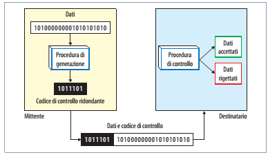

Il **mittente** calcola un **codice di controllo ridondante** a partire dai dati e lo spedisce insieme ad essi. Il **destinatario** esegue la **procedura di controllo**: i dati vengono **accettati** o **rigettati**.

> **Analogia:** quando dettate un numero di telefono lo ripetete, oppure dite "il 3 di Torino": l'informazione in più serve a capire se avete sentito bene.

---

# Cosa si fa quando c'è un errore?

In presenza di errore ci sono sostanzialmente quattro possibilità:

1. **scartare** il messaggio;
2. **richiedere la ritrasmissione** del messaggio;
3. **migliorare la qualità del canale** fino a rendere nulla la probabilità di errore (irrealizzabile in pratica);
4. effettuare la **correzione**.

| Strategia | Esempio reale |
|---|---|
| Scarto | pacchetto di streaming audio/video perso |
| Ritrasmissione | protocollo **TCP** (richiede di nuovo il segmento) |
| Correzione | memoria **ECC**, CD/DVD, comunicazioni dallo spazio |

---

<!-- _class: lead -->

# Parte B
## Distanza di Hamming e distanza minima

---

# Distanza di Hamming


La **distanza di Hamming** tra due parole binarie della stessa lunghezza è il **numero di posizioni** in cui i loro bit sono diversi.

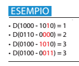

Come si calcola: si esegue lo **XOR** bit a bit e si **contano gli 1** del risultato.

---

# Calcolare la distanza con lo XOR

**Esempio:** D(0100, 1010)

```
  0100
⊕ 1010
------
  1110   → tre 1  ⇒  D = 3
```

**Esempio:** D(0110, 0000) → `0110 ⊕ 0000 = 0110` → due 1 → **D = 2**.

**In Python:**
```python
def hamming_distance(a, b):
    return bin(a ^ b).count("1")

print(hamming_distance(0b0100, 0b1010))   # 3
print(hamming_distance(0b1000, 0b1010))   # 1
```

---

# Il reticolo di Hamming

Nel caso di un codice a **3 bit** la distanza tra due codici si individua visivamente sul **reticolo di Hamming** (un **cubo**): è il **minor numero di lati** da percorrere per andare dal primo codice al secondo.

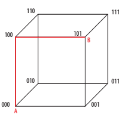

In rosso il percorso da **000** a **101**: la strada più breve è formata da **due segmenti** → le due configurazioni hanno distanza **D = 2**.

---

# Distanza minima Dmin di un codice

La **distanza minima (Dmin)** di un codice è il **minimo** delle distanze tra tutte le coppie di parole **valide** (legittime) del codice.


- **Codici non ridondanti:** tutte le configurazioni sono valide, quindi Dmin = 1: un errore trasforma una parola valida in un'altra parola valida, e **non si vede**.
- **Codici ridondanti:** devono avere Dmin > 1, così un errore porta in una configurazione **non valida**.

---

# Dmin: come si calcola su un esempio

Codice con quattro parole valide: **A = 000, B = 011, C = 101, D = 110**.

| Coppia | XOR | Distanza |
|:-:|:-:|:-:|
| A–B | 011 | 2 |
| A–C | 101 | 2 |
| A–D | 110 | 2 |
| B–C | 110 | 2 |
| B–D | 101 | 2 |
| C–D | 011 | 2 |

**Dmin = 2** → è un codice a **rilevazione di errore singolo**. È proprio il codice di **parità pari** a 3 bit (2 bit di dati + 1 di parità).

---

# Il codice SEDC

Un codice impiegato per la **rilevazione di tutti i possibili errori singoli** è detto **SEDC** (*Single Error Detection Code*).


Non deve utilizzare configurazioni a distanza 1 l'una dall'altra: altrimenti un singolo errore porterebbe a una **codifica valida** e sarebbe **impossibile individuarlo**.

---

# Tre codici a confronto: A, B, C

Vogliamo trasmettere il comando di una lampada: **on** oppure **off**.

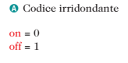 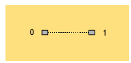

**Codice A (irridondante):** on = 0, off = 1. Se un bit si sporca si passa **sempre in una situazione valida**: è **impossibile** riconoscere l'errore.

---

# Codice B: ridondante con distanza minima 1

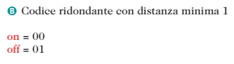 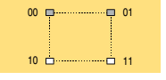

on = **00**, off = **01**. Le parole valide sono 2 su 4 configurazioni, ma **00 e 01 sono adiacenti** (distanza 1).

- se si sporca il **secondo bit** si passa da una parola valida all'altra → errore **non riconosciuto**;
- se si sporca il **primo bit** si arriva a 10 o 11 → configurazione non valida → errore riconosciuto.

Quindi **non sempre** è possibile riconoscere un errore.

---

# Codice C: ridondante con distanza minima 2

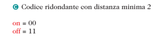 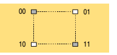

on = **00**, off = **11**. Le due parole valide sono a **distanza 2**.

Se un bit si sporca si passa **sempre** in 01 o 10, configurazioni **non valide**: è **sempre possibile** riconoscere il malfunzionamento.


---

# Rilevare o correggere: la regola generale

| Obiettivo | Condizione su Dmin | Errori gestiti |
|---|---|---|
| **Rilevare** fino a *k* errori | **Dmin ≥ k + 1** | *k* |
| **Correggere** fino a *n* errori | **Dmin ≥ 2n + 1** | *n* |

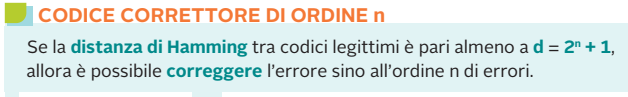

| Dmin | Rileva | Corregge |
|:-:|:-:|:-:|
| 1 | 0 | 0 |
| 2 | 1 | 0 |
| 3 | 2 | 1 |
| 4 | 3 | 1 (e rileva 2) |
| 5 | 4 | 2 |

---

# Perché Dmin ≥ 2n + 1 per correggere

Per **correggere** si sostituisce la parola ricevuta con la parola valida **più vicina**.

Se tra due parole valide ci sono **3 passi** (Dmin = 3):

```
valida A ── ● ── ● ── valida B
        1 passo  2 passi
```

- un errore da A porta a distanza 1 da A e 2 da B → si corregge verso **A**;
- ma con **due errori** da A si sarebbe a distanza 2 da A e 1 da B → si corregge male verso **B**.

> Dmin = 3 corregge **1** errore. Per correggerne 2 serve Dmin = 5.

---

# Due tipi di codici ridondanti

L'aggiunta di **bit di ridondanza** permette di costruire codici che controllano eventuali errori di trasmissione. Si hanno due tipi di codici:

- **codici a rivelazione di errore**: consentono di **individuare** la presenza di un errore;
- **codici a correzione di errore**: consentono non solo di individuare l'errore, ma anche di **identificarne la posizione** per **correggerlo**.

**Codici correttori visti in questa lezione:**
- controllo di **parità trasversale e longitudinale** (parità incrociata);
- **codice di Hamming**.

---

<!-- _class: lead -->

# Parte C
## Bit di parità (VRC)

---

# Il bit di parità

Il codice più semplice per **individuare un errore** consiste nell'aggiungere **un bit in più** alla parola: il **bit di parità**.

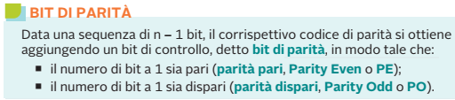

- **Parità pari** (*Even*, PE): il numero totale di 1 (dati + parità) è **pari**;
- **Parità dispari** (*Odd*, PO): il numero totale di 1 è **dispari**.


---

# Parità pari: esempio

Aggiungiamo il **bit di parità pari** come **LSB** a un alfabeto di parole a 7 bit: in questo modo si rende **pari** il numero di 1 in ogni configurazione.

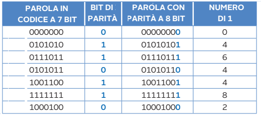

**Regola pratica:** se i dati hanno un numero **dispari** di 1, il bit di parità è **1**; se ne hanno un numero **pari**, il bit di parità è **0**.

---

# Parità: il codice di Hamming "di identificazione"

Per ogni parola il codice di identificazione dell'errore (parità) è il seguente:

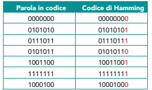

Il bit aggiunto (in rosso) rende pari il numero di 1 della parola completa.

---

# Rilevazione dell'errore con la parità

Se durante la trasmissione un bit si sporca, il ricevitore se ne accorge **semplicemente contando gli 1**: se il numero è **dispari** (in parità pari) c'è stato un errore.

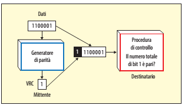

Il generatore di parità calcola il bit **VRC**; il destinatario controlla se **il numero totale di bit 1 è pari**.

---

# Le parole legittime


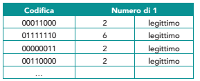

Una parola con un **numero pari di 1** è **legittima**; se il numero di 1 è dispari, la parola è **sicuramente errata**.

---

# Il limite della parità


**Esempio con 1 errore:** `01010101` (parità pari) → ricevo `01010111` → 5 uno → **errore rilevato**.

**Esempio con 2 errori:** `01010101` → ricevo `01110111` → 6 uno → pari → **errore NON rilevato**.

---

# Parità: chi riconosce che cosa

| Numero di bit sbagliati | Parità rileva? |
|:-:|:-:|
| 1 | **Sì** |
| 2 | **No** (parità ancora pari) |
| 3 | **Sì** |
| 4 | No |
| numero dispari | **Sì** |
| numero pari | No |

Il bit di parità ha **Dmin = 2**: rileva **un solo** errore (e tutti quelli dispari), ma **non può correggerlo**, perché non indica **quale** bit è sbagliato.

---

# Il cubo del codice di parità

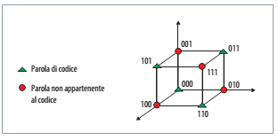

I vertici **triangolari** sono le parole di codice (numero **pari** di 1: 000, 011, 101, 110); i **cerchi rossi** sono parole non appartenenti al codice (numero dispari di 1). Ogni parola valida è circondata da vertici non validi: un errore singolo è sempre visibile.

---

# Parità in Python

```python
def bit_parita(dati: str) -> str:
    """Restituisce il bit che rende PARI il numero di 1."""
    return str(dati.count("1") % 2)

def verifica(parola: str) -> bool:
    return parola.count("1") % 2 == 0

d = "0101010"
p = bit_parita(d)          # '1'  (3 uno -> parità 1)
parola = d + p             # '01010101'
print(verifica(parola))    # True
print(verifica("01010111"))# False  -> errore rilevato
```

---

<!-- _class: lead -->

# Parte D
## CRC: Cyclic Redundancy Check

---

# CRC: controllo a ridondanza ciclica

Il metodo **CRC**, noto anche come **polynomial code**, è **più efficiente del bit di parità** per la semplice rilevazione degli errori. **Sfrutta la divisione tra polinomi.**

**Dove si usa:** reti Ethernet e Wi-Fi, file ZIP e PNG, dischi, USB, protocolli industriali.

**Idea di partenza.** Il dato da inviare è una sequenza di **m bit** che rappresentano i **coefficienti di un polinomio M(x)** con termini da x^(m−1) a x⁰:
- il termine è **presente** se il bit vale **1**;
- il termine è **assente** se il bit vale **0**.

---

# Dalla stringa di bit al polinomio

| Stringa | m | Polinomio |
|:-:|:-:|:-:|
| `111` | 3 |  |
| `11001` | 5 |  |
| `1010011` | 7 |  |

**Come si ricava:** si numerano i bit da destra (x⁰) a sinistra:
`1 0 1 0 0 1 1` → x⁶ + x⁴ + x¹ + x⁰ = **x⁶ + x⁴ + x + 1**.

> Il bit più a sinistra ha l'esponente più alto, che è il **grado** del polinomio (m − 1).

---

# Il polinomio generatore G(x)

Viene inoltre utilizzato un polinomio **G(x)** di **grado r**, chiamato **polinomio generatore**:

- è composto da **r + 1** coefficienti (bit);
- è **noto sia al mittente sia al destinatario**;
- deve avere **grado inferiore** al grado del polinomio M(x).

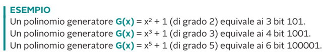

---

# Idea del metodo CRC

Il metodo si basa sul calcolo di una **checksum** da aggiungere in fondo alla stringa di M(x), in modo che la stringa ottenuta sia **divisibile** per G(x).

Cioè, si fa in modo che **M′(x) diviso G(x) dia resto 0**.

> **Analogia con i numeri:** voglio spedire 47 con controllo "divisibile per 5": calcolo 47 mod 5 = 2, quindi spedisco 47 + (5 − 2) = 50. Chi riceve verifica che il numero sia multiplo di 5. Nel CRC succede lo stesso, ma con **divisioni tra polinomi (aritmetica modulo 2)**.

---

# Cosa fanno mittente e destinatario

**Il mittente:**
1. **aggiunge** in fondo al messaggio tanti **zeri** quanto è il **grado di G(x)**;
2. **divide** il risultato per G(x) con **sottrazione modulo due**;
3. **aggiunge il resto** al messaggio originale: otterrà M′(x).

**Il destinatario:**
- esegue la divisione tra il messaggio ricevuto M′(x) e G(x):
  - se il **resto è 0** → il codice ricevuto è **esatto**;
  - se il resto è **diverso da 0** → **uno o più bit** si sono sporcati.

---

# La sottrazione modulo 2 (XOR)

La divisione tra numeri binari si calcola con la **sottrazione modulo 2**, eseguita con l'operatore **OR esclusivo (EX-OR o XOR)**.

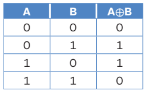

**Regola:** il risultato è **1** se i bit sono **diversi**, **0** se sono **uguali**. Non esistono **riporti** né **prestiti**: per questo il calcolo è semplice e veloce da realizzare in hardware.

---

<!-- _class: small -->

# Un esempio semplice, passo passo

Messaggio **M = 1011**, generatore **G = 101** (grado 2).

1. Aggiungo 2 zeri: `101100`.
2. Divido con XOR, allineando G sotto il primo **1**:

```
  1 0 1 1 0 0
^ 1 0 1
-----------
  0 0 0 1 0 0
      ^ 1 0 1        (si allinea sotto il successivo 1)
-----------
  0 0 0 0 0 1       ⇒ resto = 01
```

3. Trasmetto **M′ = 1011 01 = 101101**.
4. Verifica: `101101 ÷ 101` ha resto **00** ✔.
5. Se arriva `101111` (un bit sporcato) il resto è **10** ≠ 0 → **errore rilevato**.

---

# CRC · Esempio 1

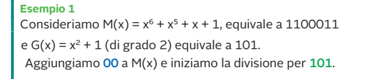

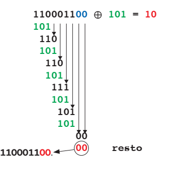

---

# CRC · Esempio 1 (commento)

- M(x) = x⁶ + x⁵ + x + 1 → `1100011`; G(x) = x² + 1 → `101`.
- Si aggiungono **2 zeri** (grado di G): `110001100`.
- Dopo le divisioni a XOR il **resto è 00**: la stringa originale (con i due zeri) è **già divisibile** per 101.
- Si trasmette quindi **M′ = 110001100**.

> Un resto uguale a 0 è un caso possibile: significa semplicemente che M era già un multiplo di G(x) dopo l'aggiunta degli zeri.

---

# CRC · Esempio 2

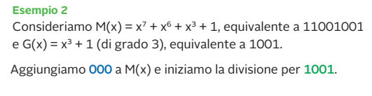

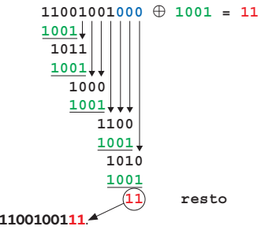

---

# CRC · Esempio 2 (commento)

- M(x) = x⁷ + x⁶ + x³ + 1 → `11001001`; G(x) = x³ + 1 → `1001` (grado 3).
- Si aggiungono **3 zeri**: `11001001000`.
- Il **resto** della divisione è **011** (3 bit, uguale al grado di G).
- Il messaggio trasmesso è **M′ = 11001001 011**.

**Verifica del destinatario:** `11001001011 ÷ 1001` → resto **000** ✔. Se un bit cambia, il resto è diverso da 000.

---

# CRC: quanto è potente?

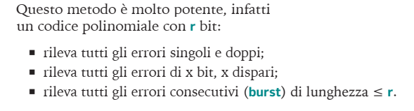

- Un polinomio di grado **r** produce un resto di **r bit**.
- Con r = 16 la probabilità che un errore casuale non venga rilevato è circa **1 su 65 536**.
- Con r = 32 (CRC-32 di Ethernet e ZIP) è circa **1 su 4 miliardi**.

> Gli errori *burst* (più bit consecutivi, tipici dei disturbi su cavo o sul disco) sono la causa più frequente, ed è proprio dove il CRC è più efficace.

---

# Polinomi standard per il CRC

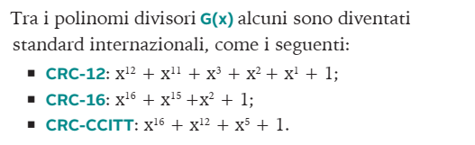

| Standard | Bit di resto | Uso tipico |
|---|:-:|---|
| CRC-12 | 12 | trasmissioni a 6 bit per carattere |
| CRC-16 | 16 | protocolli seriali, Modbus |
| CRC-CCITT | 16 | HDLC, X.25, Bluetooth |
| CRC-32 | 32 | Ethernet, ZIP, PNG |

---

# CRC in Python

```python
def crc_resto(msg: str, gen: str, aggiungi_zeri: bool = True) -> str:
    r = len(gen) - 1
    a = [int(b) for b in msg + ("0" * r if aggiungi_zeri else "")]
    g = [int(b) for b in gen]
    for i in range(len(a) - r):
        if a[i] == 1:
            for j in range(len(g)):
                a[i + j] ^= g[j]       # sottrazione modulo 2 = XOR
    return "".join(map(str, a[-r:]))

print(crc_resto("1011", "101"))                  # '01'
print(crc_resto("11001001", "1001"))             # '011'
print(crc_resto("101101", "101", False))         # '00'  -> nessun errore
print(crc_resto("101111", "101", False))         # '10'  -> errore rilevato
```

Per usare un CRC-32 vero: `import zlib; zlib.crc32(b"ciao")`.

---

<!-- _class: lead -->

# Parte E
## Checksum e parità incrociata (LRC)

---

# Identificazione degli errori: il limite dei 2 bit

Supponiamo che l'ultimo byte `1000 1000` arrivi a destinazione come `0000 0000`: **si sono sporcati 2 bit**.

Il destinatario **non si accorgerebbe** dell'errore (il numero di 1 resta pari) e lo interpreterebbe come **dato valido**.

> Il bit di parità riconosce **un solo** errore: due bit sbagliati si "compensano" e la parità torna a essere rispettata.

---

# Regola generale per i codici di Hamming

> Se la distanza di Hamming tra codici legittimi è pari almeno a **d = n + 1**, allora è identificabile l'errore fino all'ordine **n** di errori.

- Con codici legittimi a **distanza 2** (parità) **non** è riconoscibile il doppio errore, ma **solo l'errore singolo**.
- Per riconoscere **2 errori** serve distanza almeno **3**; per riconoscerne **3**, distanza almeno **4**.

Sul reticolo di Hamming (cubo) le parole legittime sono i **punti azzurri**. Se un bit si sporca si passa da un vertice a quello **adiacente**, che **non è legittimo** (freccia da 000 a 100): l'errore viene individuato.

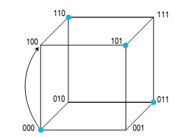

---

# Parità: singolo e doppio errore (tabella)

Messaggio a 2 bit, parola in codice a 3 bit (parità pari):

| Messaggio | Parola | 1 errore (esempi) | 2 errori (esempi) |
|:-:|:-:|:-:|:-:|
| 00 | `000` | 001, 010, 100 → **rilevati** | 011, 101, 110 → **non rilevati** |
| 01 | `011` | 111, 001, 010 → **rilevati** | 000, 101, 110 → **non rilevati** |
| 10 | `101` | 001, 111, 100 → **rilevati** | 000, 011, 110 → **non rilevati** |
| 11 | `110` | 010, 100, 111 → **rilevati** | 000, 011, 101 → **non rilevati** |

- **Un errore** porta a parole con numero **dispari** di 1 → **rilevato**.
- **Due errori** riportano a parole con numero **pari** di 1 → sembrano valide → **non rilevati**.

---

# Correggere con la parità incrociata

Per riuscire a **correggere** l'errore con un codice di parità è necessario usare il **controllo di parità incrociata**.

Si introduce in coda a un blocco di **n dati** un byte, chiamato **byte di checksum**, calcolato con l'operazione di **XOR su tutti i byte** del blocco-dati.

Questo metodo prende il nome di **controllo di parità longitudinale LRC** (*Longitudinal Redundancy Check*). Il bit di parità visto in precedenza è detto anche **controllo di parità trasversale** (VRC).

---

# La tabella del checksum

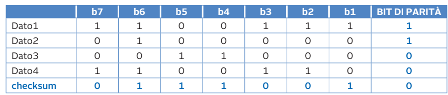

- Ogni **riga** è un dato di 7 bit + il suo **bit di parità** (controllo trasversale).
- L'ultima riga, **checksum**, contiene la parità di ogni **colonna** (controllo longitudinale): è lo XOR di tutte le righe.

**Esempio colonna b7:** 1 ⊕ 0 ⊕ 0 ⊕ 1 = **0**.

---

# Un bit si sporca: individuiamo la riga

Supponiamo che durante la trasmissione un bit del **Dato3** si sporchi.

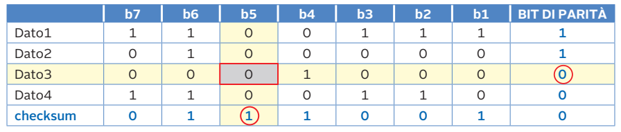

Alla ricezione il controllo di parità **trasversale** segnala l'errore **sul Dato3**, senza però indicarne la posizione dentro il dato.

---

# Individuiamo la colonna e correggiamo

Alla fine della trasmissione il controllo **"verticale"** (checksum) segnala un errore nel bit **b5**, perché il numero di 1 in quella colonna è **dispari**.

**Intersezione** tra la **riga** (Dato3) e la **colonna** (b5): individuiamo il bit sporcato → **siamo in grado di correggere un errore**: basta **invertirlo**.

| Controllo | Segnala | Informazione |
|---|---|---|
| parità **di riga** (VRC) | Dato3 | quale **riga** |
| parità **di colonna** (LRC) | b5 | quale **colonna** |
| intersezione | Dato3 / b5 | **il bit errato** |

---

# Se gli errori crescono...

Se gli errori crescono non sono più correggibili ed è necessario **aumentare la distanza minima di Hamming** introducendo ulteriori bit di ridondanza.

Per esempio, con **due errori** ci troviamo in questa situazione:

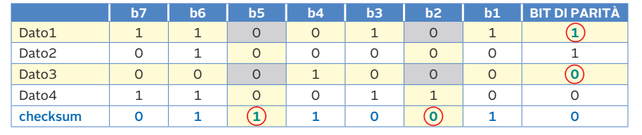

Le due righe e le due colonne con parità errata individuano **4 punti** possibili di intersezione: non sappiamo quali due bit siano sbagliati.

---

# Ambiguità di correzione con due errori

Non siamo in grado di correggere, perché **entrambe le correzioni portano a configurazioni legittime** e quindi generano un'**ambiguità**.

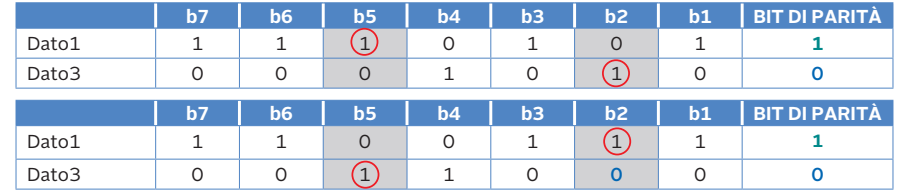

> Conclusione: la parità incrociata corregge **un solo errore** e **rileva** due errori, ma non basta quando gli errori sono di più. Serve un codice più forte: il **codice di Hamming**.

---

<!-- _class: lead -->

# Parte F
## Il codice di Hamming

---

# Il codice di Hamming: l'idea

Un modo semplice per creare codici correttori consiste nel **replicare l'informazione** (ad esempio inviare ogni bit 3 volte e scegliere "a maggioranza"). È efficace, ma **sprecato**: servono il 200 % di bit in più.

**Nel 1950 Richard Hamming** (Bell Labs) propone un sistema di codifica a correzione d'errore molto più efficiente, che oggi porta il suo nome: il **codice di Hamming**.

> **Esempio di replicazione:** invio `1` come `111`. Se arriva `101` scelgo "1" perché ci sono più 1 che 0. Rileva 2 errori e ne corregge 1, ma costa il triplo dei bit.

---

# L'idea di base di Hamming

L'idea è di **codificare la posizione dell'eventuale errore**.

- Si aggiungono alcuni **bit di controllo**, tanti quanti ne servono per **codificare la posizione** del bit errato.
- Poiché anche i bit di controllo possono sbagliarsi, bisogna **includere anche le loro posizioni** nel conteggio totale.

**Regola:** con *r* bit di controllo si distinguono 2^r posizioni (compresa la posizione "nessun errore"):

> **2^r ≥ k + r + 1**   (k = bit di dati)

---

# Quanti bit di controllo servono?

Data una stringa di **8 bit** di dati si aggiungono **4 bit di controllo**, per un totale di **12 bit di codeword**.

- 4 bit di posizione bastano per codificare le 12 posizioni, dato che **2⁴ = 16** permette di codificare 16 posizioni (**4 configurazioni non utilizzate**).
- Una **codeword** è il risultato dell'unione tra i bit di dati e i bit di controllo.

| Bit di dati k | Bit di controllo r | Codeword n = k + r | Nome |
|:-:|:-:|:-:|:-:|
| 1 | 2 | 3 | Hamming (3,1) |
| 4 | 3 | 7 | **Hamming (7,4)** |
| 8 | 4 | 12 | **Hamming (12,8)** |
| 11 | 4 | 15 | Hamming (15,11) |
| 26 | 5 | 31 | Hamming (31,26) |

---

# Costruire la codeword: le posizioni

Si costruisce la codeword "**mischiando**" bit di informazione e bit di controllo.

Prima si **numerano** i bit della parola da trasmettere, da **sinistra verso destra** (a partire da 1); a ogni posizione il cui indice è una **potenza di 2** (1, 2, 4, 8, …) si riserva il posto per un **bit di controllo**.

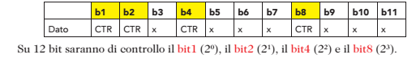

Su 12 bit saranno di controllo: **bit 1** (2⁰), **bit 2** (2¹), **bit 4** (2²) e **bit 8** (2³). Le altre posizioni (3, 5, 6, 7, 9, 10, 11, 12) contengono i **dati**.

---

# Chi controlla chi

Ogni bit di controllo è un **bit di parità** che esprime la parità di un **sottoinsieme** di bit della stringa.

> Il bit di controllo in posizione **2^j** controlla la parità di tutti i bit la cui posizione, scritta in binario, ha il **j-esimo bit a 1**.

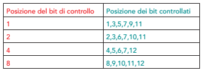

---

# Il primo bit di controllo (posizione 1)

Il **primo** bit di controllo è la parità di tutti i bit in posizione tale che la loro codifica binaria ha **1 nel bit meno significativo**: sono tutte le posizioni **dispari**.

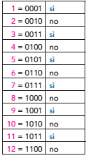

Bit 1 controlla: **1, 3, 5, 7, 9, 11**.

---

# Secondo, terzo e quarto bit di controllo

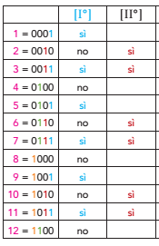

- **Secondo bit**: parità delle posizioni con il **2° bit = 1** → **2, 3, 6, 7, 10, 11, …**
- **Terzo bit**: posizioni con il **3° bit = 1** → **4, 5, 6, 7, 12, …**
- **Quarto bit**: posizioni con il **4° bit = 1** → **8, 9, 10, 11, 12, …**

---

# Il terzo e il quarto bit nella tabella

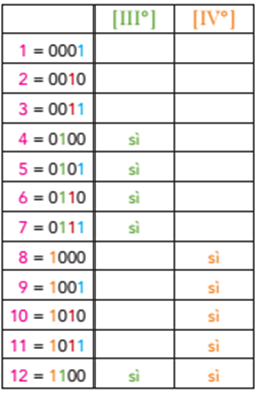

Ogni bit dati è coperto da **più** bit di controllo (quelli che corrispondono agli 1 della sua posizione in binario). Ad esempio il bit **6 = 0110** è controllato dai bit di controllo **2 e 4**.

---

# Esempio: codifica di 00101101 (Hamming 12,8)

**Dato da codificare:** `0 0 1 0 1 1 0 1`

Inseriamo i dati nelle posizioni **3, 5, 6, 7, 9, 10, 11, 12**:

| Pos. | 1 | 2 | 3 | 4 | 5 | 6 | 7 | 8 | 9 | 10 | 11 | 12 |
|:-:|:-:|:-:|:-:|:-:|:-:|:-:|:-:|:-:|:-:|:-:|:-:|:-:|
| Bit | b1 | b2 | 0 | b4 | 0 | 1 | 0 | b8 | 1 | 1 | 0 | 1 |

Ora calcoliamo uno ad uno i quattro bit di controllo, con **parità pari**.

---

# Esempio: calcolo di b1

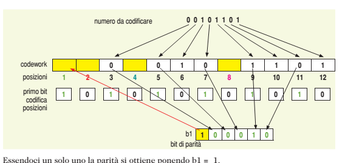

Posizioni controllate: 1, 3, 5, 7, 9, 11 → bit di dati: **0, 0, 0, 1, 0** → c'è **un solo 1**: per avere parità pari si pone **b1 = 1**.

---

# Esempio: calcolo di b2

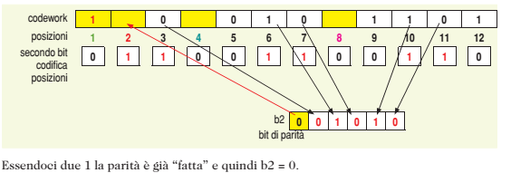

Posizioni controllate: 2, 3, 6, 7, 10, 11 → bit di dati: **0, 1, 0, 1, 0** → ci sono **due 1**: la parità è già "fatta" → **b2 = 0**.

---

# Esempio: calcolo di b4

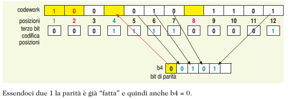

Posizioni controllate: 4, 5, 6, 7, 12 → bit di dati: **0, 1, 0, 1** → **due 1** → **b4 = 0**.

---

# Esempio: calcolo di b8

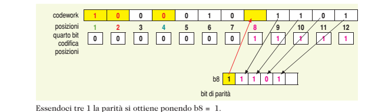

Posizioni controllate: 8, 9, 10, 11, 12 → bit di dati: **1, 1, 0, 1** → **tre 1**: per avere parità pari si pone **b8 = 1**.

---

# Esempio: la codeword finale

| Pos. | 1 | 2 | 3 | 4 | 5 | 6 | 7 | 8 | 9 | 10 | 11 | 12 |
|:-:|:-:|:-:|:-:|:-:|:-:|:-:|:-:|:-:|:-:|:-:|:-:|:-:|
| Bit | **1** | **0** | 0 | **0** | 0 | 1 | 0 | **1** | 1 | 1 | 0 | 1 |

I bit in grassetto sono quelli di controllo.

> **Codeword trasmessa: `100001011101`**

Dai **8 bit di dati** siamo passati a **12 bit**: un'efficienza di 8/12 ≈ 67 %. Con la replicazione tripla (3 × 8 = 24 bit) l'efficienza sarebbe solo 33 %.

---

# Rilevare e correggere l'errore

Nel caso di errore in trasmissione è molto semplice **individuare la posizione** del bit sporcato **verificando uno per uno** i bit di parità:

- se **tutti** i controlli sono corretti, la parola di codice viene **accettata**;
- se **alcuni** controlli sono errati, la **posizione dell'errore** è data dalla **somma degli indici** dei bit di controllo con valore sbagliato.

**Esempio:** controlli sbagliati = bit 2 e bit 4 → posizione errata = 2 + 4 = **6**.

Il ricevitore **inverte** il bit in posizione 6 e il messaggio è corretto.

---

# Esempio di correzione: si sporca il bit 6

Trasmesso: `100001011101`. Ricevuto: `100000011101` (il bit 6 è passato da 1 a 0).

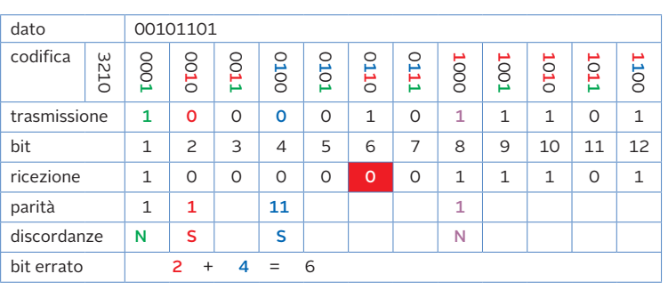

---

# Verifica di ogni parità

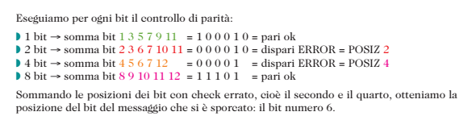

| Controllo | Bit verificati | Somma | Esito |
|:-:|---|:-:|:-:|
| 1 | 1,3,5,7,9,11 | 1 + 0 + 0 + 0 + 1 + 0 = 2 | pari → **ok** |
| 2 | 2,3,6,7,10,11 | 0 + 0 + **0** + 0 + 1 + 0 = 1 | dispari → **errore** |
| 4 | 4,5,6,7,12 | 0 + 0 + **0** + 0 + 1 = 1 | dispari → **errore** |
| 8 | 8,9,10,11,12 | 1 + 1 + 1 + 0 + 1 = 4 | pari → **ok** |

Controlli errati: **2 e 4** → posizione dell'errore **2 + 4 = 6** → si inverte il bit 6.

---

# La sindrome come numero binario

Si possono leggere i risultati dei controlli come un **numero binario di 4 bit** (la **sindrome**), con il controllo 8 come bit più significativo:

| Controllo 8 | Controllo 4 | Controllo 2 | Controllo 1 |
|:-:|:-:|:-:|:-:|
| 0 (ok) | 1 (errore) | 1 (errore) | 0 (ok) |

Sindrome = `0110` = **6** → il bit errato è in posizione **6**.

> Se la sindrome è `0000` non ci sono errori. Se è `1010` l'errore è nel bit 10, e così via. Per questo la **posizione dell'errore è scritta direttamente nei bit di controllo**.

---

<!-- _class: small -->

# Altro esempio: Hamming (7,4)

Vogliamo trasmettere i 4 bit di dati **1011**.

Posizioni: 1(c) 2(c) 3(d) 4(c) 5(d) 6(d) 7(d) → dati in 3, 5, 6, 7 = **1, 0, 1, 1**.

| Controllo | Posizioni | Bit dati | Parità pari ⇒ |
|:-:|---|---|:-:|
| c1 | 1, 3, 5, 7 | 1, 0, 1 | 2 uno → **0** |
| c2 | 2, 3, 6, 7 | 1, 1, 1 | 3 uno → **1** |
| c4 | 4, 5, 6, 7 | 0, 1, 1 | 2 uno → **0** |

**Codeword: `0110011`** (c1=0, c2=1, d=1, c4=0, d=0, d=1, d=1).

Supponiamo che arrivi **`0110111`** (si è sporcato il bit 5):
- c1 (posizioni 1, 3, 5, 7 = 0, 1, 1, 1) → dispari → **errato**;
- c2 (posizioni 2, 3, 6, 7 = 1, 1, 1, 1) → pari → corretto;
- c4 (posizioni 4, 5, 6, 7 = 0, 1, 1, 1) → dispari → **errato**.

Somma degli indici sbagliati: 1 + 4 = **5** → si inverte il bit 5 → `0110011` ✔

---

# Hamming (7,4): schema

```
Posizione:   1   2   3   4   5   6   7
Ruolo:      c1  c2  d1  c4  d2  d3  d4
Dati 1011:   -   -   1   -   0   1   1
Controlli:   0   1       0
Codeword:    0   1   1   0   0   1   1
```

| Controllo | Copre |
|:-:|---|
| c1 | 1 3 5 7 |
| c2 | 2 3 6 7 |
| c4 | 4 5 6 7 |

Con 3 bit di controllo e 4 di dati: **2³ = 8 ≥ 4 + 3 + 1 = 8** → il codice è **ottimo (perfetto)**: non c'è nessuna configurazione sprecata.

---

# Altro esempio: 7 bit di dati

Codifichiamo la stringa di **7 bit 0000101** → servono **4** bit di controllo (11 posizioni).

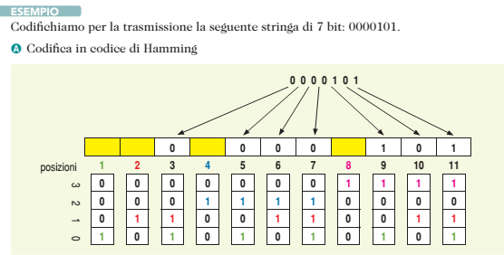

La figura mostra come i 7 bit di dati si dispongono nelle posizioni **3, 5, 6, 7, 9, 10, 11**; sotto ogni posizione è scritta la sua codifica binaria su 4 bit (la **maschera** che indica quali controlli la coprono).

---

<!-- _class: small -->

# 0000101: calcolo dei bit di controllo

Dati nelle posizioni: 3=0, 5=0, 6=0, 7=0, 9=1, 10=0, 11=1.

| Controllo | Posizioni | Bit | N. di 1 | Bit di controllo |
|:-:|---|---|:-:|:-:|
| b1 | 1, 3, 5, 7, 9, 11 | 0 0 0 1 1 | 2 | **0** |
| b2 | 2, 3, 6, 7, 10, 11 | 0 0 0 0 1 | 1 | **1** |
| b4 | 4, 5, 6, 7 | 0 0 0 | 0 | **0** |
| b8 | 8, 9, 10, 11 | 1 0 1 | 2 | **0** |

**Codeword: `01000000101`**

Se si sporca il bit **11** (arriva `01000000100`): i controlli b1, b2 e b8 risultano errati → 1 + 2 + 8 = **11** ✔ → si corregge il bit 11.

*(L'esempio svolto nelle slide originali per questa stringa presenta alcune incongruenze nei conti; qui è stato ricalcolato da capo con la parità pari.)*

---

# Il codice correttore ottimo


Un codice correttore è **ottimo** se vale:

> **bit_dati + bit_controllo + 1 ≤ 2^bit_controllo**

Significa che le configurazioni possibili della **sindrome** (2^r) bastano a indicare **ogni posizione di errore più il caso "nessun errore"**.

Se vale l'**uguaglianza** (es. Hamming 7,4: 8 = 8) il codice è anche detto **perfetto**.

---

# Esempi di codici ottimi

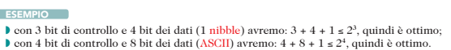


| Dati | Controllo | Calcolo | Esito |
|:-:|:-:|---|:-:|
| 4 | 3 | 4 + 3 + 1 = 8 ≤ 2³ = 8 | ottimo (perfetto) |
| 8 | 4 | 8 + 4 + 1 = 13 ≤ 2⁴ = 16 | ottimo |
| 3 | 3 | 3 + 3 + 1 = 7 ≤ 8 | ottimo (ma 1 config. libera) |
| 8 | 3 | 8 + 3 + 1 = 12 > 8 | **non basta**: servono 4 bit |

---

# Hamming in Python

```python
def hamming_codifica(dati: str) -> str:
    k = len(dati)
    r = 0
    while 2**r < k + r + 1:
        r += 1
    n = k + r
    cw = [0] * (n + 1)              # indici da 1 a n
    it = iter(dati)
    for pos in range(1, n + 1):
        if pos & (pos - 1):         # non è potenza di 2 -> dato
            cw[pos] = int(next(it))
    for j in range(r):
        c = 1 << j
        cw[c] = sum(cw[p] for p in range(1, n + 1) if p & c and p != c) % 2
    return "".join(map(str, cw[1:]))

def sindrome(cw: str) -> int:
    s = 0
    for pos, bit in enumerate(cw, 1):
        if bit == "1":
            s ^= pos                # XOR delle posizioni degli 1
    return s

print(hamming_codifica("00101101"))    # 100001011101
print(sindrome("100000011101"))        # 6  -> bit 6 da correggere
```

---

# Hamming esteso (SECDED)

Il codice di Hamming **corregge 1 errore**, ma se gli errori sono **2** può **correggere male** (scambia il caso per un errore singolo).

**Soluzione:** si aggiunge **un bit di parità globale** su tutta la codeword → **SECDED** (*Single Error Correction, Double Error Detection*), con **Dmin = 4**.

| Sindrome | Parità globale | Interpretazione |
|:-:|:-:|---|
| 0 | corretta | nessun errore |
| ≠ 0 | **errata** | **1 errore** → si corregge |
| ≠ 0 | corretta | **2 errori** → rilevati, non correggibili |
| 0 | errata | errore nel bit di parità globale |

**Uso reale:** memorie **ECC** dei server e dei computer professionali.

---

<!-- _class: small -->

# Confronto tra i metodi

| Metodo | Ridondanza | Rileva | Corregge | Dove si usa |
|---|---|---|:-:|---|
| **Bit di parità (VRC)** | 1 bit per parola | 1 errore (e tutti i dispari) | No | RAM semplice, UART seriali |
| **Parità incrociata (LRC)** | 1 byte per blocco + 1 bit/dato | 1 errore, spesso 2 | **1 errore** | nastri, trasmissioni a blocchi |
| **CRC** | r bit (es. 16 o 32) | errori singoli, doppi, burst ≤ r | No | Ethernet, ZIP, dischi |
| **Hamming** | r bit (log₂ k) | 2 errori (con SECDED) | **1 errore** | memorie ECC, codici a bit |
| **Replicazione** | 200 % | fino a 2 | 1 | sistemi critici |

---

# Riepilogo: i punti chiave

- Il **rumore** può far "sporcare" i bit; si risponde con **ridondanza**.
- **Distanza di Hamming** = numero di bit diversi (XOR + conteggio degli 1).
- **Rilevare *k* errori:** Dmin ≥ *k* + 1. **Correggere *n* errori:** Dmin ≥ 2*n* + 1.
- **Bit di parità**: Dmin = 2, rileva 1 errore ma non lo corregge.
- **CRC**: divisione tra polinomi modulo 2; il destinatario controlla che il **resto sia 0**.
- **Parità incrociata (VRC + LRC)**: l'intersezione riga/colonna individua il bit errato e lo si può **correggere**.
- **Hamming**: i bit di controllo stanno nelle posizioni 1, 2, 4, 8…; la **somma degli indici dei controlli sbagliati** dà la **posizione dell'errore**.
- Codice **ottimo**: k + r + 1 ≤ 2^r.

---

<!-- _class: small -->

# Verifica: esercizi

1. Calcola la distanza di Hamming tra `10110` e `11011`. Qual è la Dmin del codice {000, 011, 101, 110}?
2. Quanti errori rileva e quanti ne corregge un codice con Dmin = 5?
3. Aggiungi il bit di parità **pari** alle parole `1011001` e `0110000`. La parola `10110101` è valida (parità pari)?
4. Calcola il CRC di `1101` con G(x) = x² + 1 (`101`). Quale messaggio si trasmette?
5. Nella tabella di parità incrociata il controllo di riga segnala la riga 3 e quello di colonna segnala b2: in che bit è l'errore?
6. Quanti bit di controllo servono per 16 bit di dati?
7. Codifica in Hamming (7,4) i dati **1101**.
8. Hai ricevuto `0110111` (Hamming 7,4). Trova e correggi l'errore.

---

<!-- _class: tiny -->

# Verifica: soluzioni

1. `10110 ⊕ 11011 = 01101` → tre 1 → **D = 3**. Il codice {000, 011, 101, 110} ha **Dmin = 2**.
2. Dmin = 5 → rileva fino a **4** errori e corregge fino a **2** (2·2 + 1 = 5).
3. `1011001` ha quattro 1 → parità **0** → `10110010`. `0110000` ha due 1 → parità **0** → `01100000`. `10110101` ha cinque 1 → **non valida**.
4. `1101` + `00` = `110100`; dividendo per `101` con XOR si ottiene il resto **10** → si trasmette **110110** (verifica: `110110 ÷ 101` dà resto 00).
5. L'errore è nel **bit b2 del Dato 3** (intersezione riga/colonna): basta invertirlo.
6. 2^r ≥ 16 + r + 1 → r = 5 (32 ≥ 22). Si ottiene **Hamming (21,16)**.
7. Dati 1101 in posizioni 3, 5, 6, 7. c1 (pos 3,5,7 = 1,1,1) → **1**; c2 (pos 3,6,7 = 1,0,1) → **0**; c4 (pos 5,6,7 = 1,0,1) → **0** → codeword **`1010101`**.
8. `0110111`: c1 (1,3,5,7) = 0,1,1,1 → dispari ✗; c2 (2,3,6,7) = 1,1,1,1 → pari ✓; c4 (4,5,6,7) = 0,1,1,1 → dispari ✗ → 1 + 4 = **5** → il bit 5 va invertito → **`0110011`**.

---

<!-- _class: lead -->
<!-- _paginate: false -->

# Grazie per l'attenzione

## Domande?
