<!-- _class: lead -->
<!-- _paginate: false -->
<!-- _header: "" -->

# Le codifiche nella vita quotidiana

## Unità di Apprendimento 2 · Lezione 4

Tecnologie e Progettazione di Sistemi Informatici e di Telecomunicazioni (TPSI)
Classe 3ª · Istituto Tecnico – Informatica
**Prof. Dicara**

---

# In questa lezione impareremo

- il **codice fiscale** e la **partita IVA**
- il codice **EAN**
- il codice unico bancario **IBAN**
- il codice **BIC / SWIFT**

> Filo conduttore: *i codici delle lezioni precedenti (parità, CRC, cifre di controllo) non sono teoria astratta. Li trovi ogni giorno su documenti, fatture, conti correnti e bonifici.*

---

# Mappa della lezione

| Parte | Argomento | Tipo di controllo |
|---|---|---|
| **A** | Codice fiscale | carattere di controllo (somma pesata, resto 26) |
| **B** | Partita IVA | cifra di controllo (formula di Luhn) |
| **C** | IBAN | due cifre di controllo (Mod 97-10) + CIN |
| **D** | BIC / SWIFT | nessuna cifra di controllo, struttura fissa |

---

# Ripasso: a cosa serve un codice di controllo

Un identificativo (codice fiscale, IBAN…) deve essere **univoco** e **robusto agli errori di battitura**.

Per questo si aggiunge una **ridondanza**: una o più cifre/lettere calcolate dalle altre con un algoritmo noto.

- chi **scrive** il codice calcola la cifra di controllo e la accoda;
- chi **riceve** (software di una banca, dell'Agenzia delle Entrate) rifà il calcolo: se non coincide, **scarta il dato**;
- è la stessa idea del **bit di parità** e del **CRC**, ma applicata a cifre e lettere.

> Un errore comune di digitazione (una cifra sbagliata, due cifre scambiate) viene quasi sempre **rilevato**, ma **non corretto**: l'utente deve reinserire il dato.

---

# Premessa: la fatturazione elettronica

L'anno **2019** porta una svolta nel sistema commerciale italiano: tutte le fatture emesse devono essere fatte in **formato digitale**, anche tra privati e non solo per le relazioni con la Pubblica amministrazione.

Per l'identificazione servono:
- il **Codice Univoco Ufficio** (o **Codice Destinatario**);
- il **codice fiscale**;
- la **partita IVA**;
- altri codici (IBAN per il pagamento, ecc.).

> **Esempio:** una fattura elettronica è un file **XML** che contiene, oltre agli importi, il codice fiscale e la partita IVA di chi vende e di chi compra, più l'IBAN per il pagamento. Il sistema scarta il file se un codice non rispetta le regole di validità.

---

<!-- _class: lead -->

# Parte A
## Il codice fiscale

---

# Il codice fiscale

- È un codice **alfanumerico di 16 caratteri** introdotto nel **1973**.
- Viene utilizzato ai **fini fiscali e amministrativi** per identificare in modo **univoco** i cittadini italiani.
- Viene generato da un **semplice algoritmo** che elabora alcuni dati della persona, utilizzando dati già codificati in altre tabelle, e generando un **carattere di controllo**.

**In pratica:** a partire da cognome, nome, data e luogo di nascita, sesso, si calcolano 15 caratteri; il sedicesimo è la loro "firma" di controllo.

---

# Struttura del codice fiscale

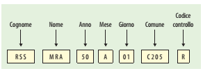

| Posizione | Contenuto | Lunghezza | Esempio |
|:-:|---|:-:|:-:|
| 1–3 | **cognome** | 3 lettere | RSS |
| 4–6 | **nome** | 3 lettere | MRA |
| 7–8 | **anno** di nascita | 2 cifre | 85 |
| 9 | **mese** di nascita | 1 lettera | T |
| 10–11 | **giorno** di nascita (+40 se femmina) | 2 cifre | 10 |
| 12–15 | **comune** (codice catastale) | 1 lettera + 3 cifre | A562 |
| 16 | **carattere di controllo** | 1 lettera | S |

*(Nella figura il carattere di controllo è solo indicativo; qui sotto vediamo come si calcola davvero.)*

---

# Cognome e nome: come si ricavano le lettere

**Cognome** (3 lettere):
1. si prendono le **consonanti** nell'ordine in cui compaiono;
2. se sono meno di 3, si aggiungono le **vocali**;
3. se mancano ancora lettere, si completa con **X**.

**Nome** (3 lettere):
- se le consonanti sono **4 o più** si prendono la **1ª, 3ª e 4ª**;
- altrimenti si segue la regola del cognome.

| Cognome / Nome | Consonanti | Risultato |
|---|---|:-:|
| ROSSI | R, S, S | **RSS** |
| MARIO | M, R (+ vocale A) | **MRA** |
| GIOVANNI | G, V, N, N → 1ª, 3ª, 4ª | **GNN** |
| FO | F (+ vocale O, poi X) | **FOX** |

---

# La tabella dei mesi

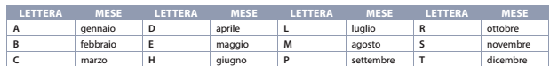

Una **lettera** identifica ogni mese. L'immagine ne mostra una parte; la tabella completa è questa:

| Mese | Lettera | Mese | Lettera | Mese | Lettera |
|---|:-:|---|:-:|---|:-:|
| gennaio | **A** | maggio | **E** | settembre | **P** |
| febbraio | **B** | giugno | **H** | ottobre | **R** |
| marzo | **C** | luglio | **L** | novembre | **S** |
| aprile | **D** | agosto | **M** | dicembre | **T** |

> **Giorno di nascita:** per i maschi è il giorno (01–31); per le femmine si **somma 40** (41–71). Così dal codice si ricava anche il **sesso**.

---

# I codici catastali dei Comuni

A ogni Comune è associato un codice di **quattro caratteri** (una lettera e tre cifre), reperibile sul sito dell'**ISTAT**.

**Esempi:** Roma = **H501**, Milano = **F205**, Napoli = **F839**, Torino = **L219**. *(Per i nati all'estero si usa la lettera **Z** seguita da un codice del Paese: Z404 = Stati Uniti.)*

> I codici catastali sono tabelle "esterne" all'algoritmo: il programma che genera il codice fiscale ha bisogno di **consultare queste tabelle**.

---

# Il carattere di controllo: l'idea

Il 16° carattere è una **lettera** calcolata sui **primi 15** caratteri.

**Procedura:**
1. si numerano i 15 caratteri da 1 a 15;
2. quelli in **posizione dispari** (1, 3, 5, …) si convertono con una tabella (**dispari**);
3. quelli in **posizione pari** (2, 4, 6, …) si convertono con un'altra tabella (**pari**);
4. si **sommano** tutti i valori;
5. si divide per **26** e si prende il **resto**;
6. il resto si converte in una lettera (0 = A, 1 = B, … 25 = Z).

---

# Tabelle di conversione: dispari e pari

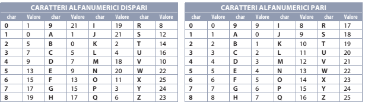

Per le **posizioni pari** la conversione è semplice: le cifre valgono se stesse (0–9), le lettere valgono la loro posizione nell'alfabeto partendo da A = 0.

---

# Dal resto alla lettera

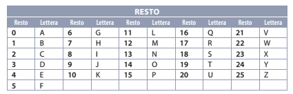

Il **resto della divisione per 26** (da 0 a 25) si converte in una lettera: 0 → A, 1 → B, …, 25 → Z.

> **Perché 26?** Perché le lettere dell'alfabeto sono 26: ogni resto possibile ha una lettera corrispondente.

---

<!-- _class: small -->

# Calcolo guidato: RSSMRA85T10A562

| # | Carattere | Pos. | Valore (tabella) |
|:-:|:-:|:-:|:-:|
| 1 | R | dispari | 8 |
| 2 | S | pari | 18 |
| 3 | S | dispari | 12 |
| 4 | M | pari | 12 |
| 5 | R | dispari | 8 |
| 6 | A | pari | 0 |
| 7 | 8 | dispari | 19 |
| 8 | 5 | pari | 5 |

| # | Carattere | Pos. | Valore (tabella) |
|:-:|:-:|:-:|:-:|
| 9 | T | dispari | 14 |
| 10 | 1 | pari | 1 |
| 11 | 0 | dispari | 1 |
| 12 | A | pari | 0 |
| 13 | 5 | dispari | 13 |
| 14 | 6 | pari | 6 |
| 15 | 2 | dispari | 5 |

Somma = 8+18+12+12+8+0+19+5+14+1+1+0+13+6+5 = **122** → 122 mod 26 = **18** → lettera **S**.

Codice fiscale completo: **RSSMRA85T10A562S** ✔

---

# Codice fiscale in Python

```python
DISPARI_CIFRE = [1, 0, 5, 7, 9, 13, 15, 17, 19, 21]
DISPARI_LETT  = [1, 0, 5, 7, 9, 13, 15, 17, 19, 21, 2, 4, 18, 20, 11,
                 3, 6, 8, 12, 14, 16, 10, 22, 25, 24, 23]   # A..Z

def controllo(cf15: str) -> str:
    tot = 0
    for i, c in enumerate(cf15.upper()):
        if i % 2 == 0:      # posizione dispari (1ª, 3ª, ...)
            tot += DISPARI_CIFRE[int(c)] if c.isdigit() else DISPARI_LETT[ord(c) - 65]
        else:               # posizione pari
            tot += int(c) if c.isdigit() else ord(c) - 65
    return chr(65 + tot % 26)

print(controllo("RSSMRA85T10A562"))   # S
```

---

# Omocodia: due persone, lo stesso codice

Può capitare che due persone abbiano **gli stessi 15 caratteri** (stessi dati anagrafici di base). Per distinguerle l'Agenzia delle Entrate **sostituisce una o più cifre** con una lettera, partendo da destra:

| Cifra | 0 | 1 | 2 | 3 | 4 | 5 | 6 | 7 | 8 | 9 |
|:-:|:-:|:-:|:-:|:-:|:-:|:-:|:-:|:-:|:-:|:-:|
| Lettera | L | M | N | P | Q | R | S | T | U | V |

Il carattere di controllo viene **ricalcolato** sul nuovo codice. Per questo un codice fiscale può contenere lettere anche nelle posizioni delle cifre.

---

<!-- _class: lead -->

# Parte B
## La partita IVA

---

# La partita IVA

- Il numero di partita IVA assegnato al contribuente ha **validità su tutto il territorio nazionale** e rimane **invariato** per tutto il periodo in cui si svolge l'attività.
- È rilasciato dall'**Ufficio dell'Agenzia delle Entrate**.
- **Identifica univocamente** il contribuente.

> **Differenza con il codice fiscale:** il codice fiscale identifica una **persona** (fisica o giuridica); la partita IVA identifica un'**attività economica** soggetta a IVA. Un libero professionista ha entrambi.

---

# Struttura della partita IVA

La partita IVA si compone di **11 cifre**:

| Cifre | Significato |
|:-:|---|
| **1–7** | numero **progressivo di matricola** del soggetto, assegnato dal relativo ufficio provinciale |
| **8–10** | **codice dell'ufficio provinciale** che ha rilasciato la matricola (corrisponde al codice ISTAT della provincia) |
| **11** | **cifra di controllo** |

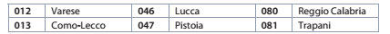

Esempi di codici provinciali: 012 = Varese, 013 = Como-Lecco, 046 = Lucca, 047 = Pistoia, 080 = Reggio Calabria, 081 = Trapani.

---

# Il controllo: la formula di Luhn

L'ultima cifra è calcolata con la **formula di Luhn**, la stessa usata per le carte di credito:

1. si sommano le cifre di **posizione dispari** (1ª, 3ª, 5ª, 7ª, 9ª) in una variabile **X**;
2. si sommano le cifre di **posizione pari** (2ª, 4ª, 6ª, 8ª, 10ª) in una variabile **Y** e la si **moltiplica per 2**;
3. si **contano** le cifre pari con valore **≥ 5** e si chiama **Z** il numero trovato;
4. la cifra di controllo **C** è il **complemento a 10** di (X + Y + Z).

> **Nota:** nelle slide originali compare "le 6 cifre", ma le prime dieci cifre si dividono in **5 dispari e 5 pari**; l'undicesima è la cifra di controllo.

---

# Perché si aggiunge Z?

Raddoppiando una cifra pari *d* può uscire un numero a due cifre (se *d* ≥ 5). Nella formula di Luhn "classica" in quel caso si **sottrae 9**:

| Cifra d | 2d | Luhn (2d − 9 se > 9) | 2d + 1 se d ≥ 5 (mod 10) |
|:-:|:-:|:-:|:-:|
| 4 | 8 | 8 | 8 |
| 5 | 10 | 1 | 1 |
| 7 | 14 | 5 | 5 |
| 9 | 18 | 9 | 9 |

Poiché **−9 ≡ +1 (mod 10)**, sottrarre 9 equivale ad **aggiungere 1** per ogni cifra ≥ 5: è proprio il contributo di **Z**. Le due versioni danno lo stesso risultato.

---

# Esempio: calcolo della cifra di controllo

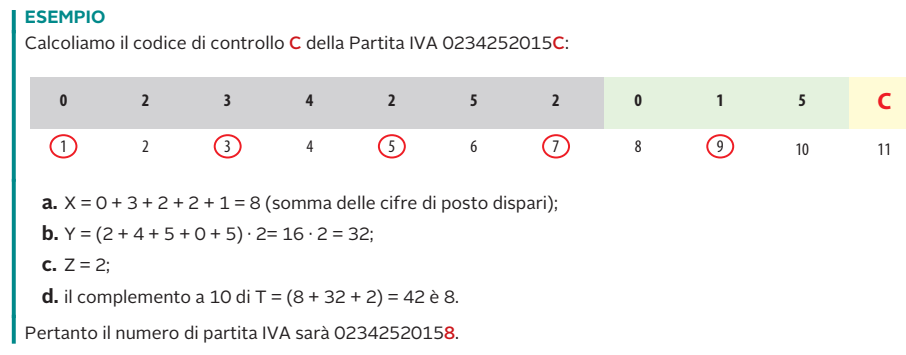

---

# Esempio: commento

Partita IVA **0234252015C**:

| Posizione | 1 | 2 | 3 | 4 | 5 | 6 | 7 | 8 | 9 | 10 |
|:-:|:-:|:-:|:-:|:-:|:-:|:-:|:-:|:-:|:-:|:-:|
| Cifra | 0 | 2 | 3 | 4 | 2 | 5 | 2 | 0 | 1 | 5 |

- **X** = 0 + 3 + 2 + 2 + 1 = **8** (posizioni dispari)
- **Y** = (2 + 4 + 5 + 0 + 5) · 2 = 16 · 2 = **32** (posizioni pari)
- **Z** = **2** (i due "5" in posizione pari)
- X + Y + Z = 42 → complemento a 10 = **8**

Partita IVA completa: **02342520158**

---

# Partita IVA in Python

```python
def cifra_controllo_piva(prime10: str) -> int:
    x = sum(int(c) for c in prime10[0::2])          # posizioni dispari
    y = sum(int(c) for c in prime10[1::2]) * 2      # posizioni pari, ×2
    z = sum(1 for c in prime10[1::2] if int(c) >= 5)
    return (10 - (x + y + z) % 10) % 10

def piva_valida(p: str) -> bool:
    return (len(p) == 11 and p.isdigit()
            and cifra_controllo_piva(p[:10]) == int(p[10]))

print(cifra_controllo_piva("0234252015"))   # 8
print(piva_valida("02342520158"))           # True
print(piva_valida("02342520159"))           # False  (una cifra sbagliata)
```

---

<!-- _class: lead -->

# Parte C
## Il codice IBAN

---

# Il codice IBAN

A partire dal **1° gennaio 2008** viene introdotto l'**International Bank Account Number (IBAN)**:

- permette di individuare **univocamente** un conto corrente **europeo**;
- rende possibili le **operazioni di trasferimento di denaro** senza conoscere altri dati dei correntisti.

**Esempio d'uso:** per un bonifico basta l'IBAN del destinatario: il software della banca ricava da esso il paese, la banca e la filiale.

---

# Struttura dell'IBAN italiano

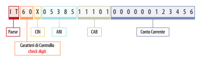

L'IBAN italiano è lungo **27 caratteri**:

| Parte | Caratteri | Significato |
|---|:-:|---|
| **Paese** | 2 | **IT** |
| **Check digit** | 2 | cifre di controllo europee (calcolate con Mod 97-10) |
| **CIN** | 1 | lettera di controllo **italiana** |
| **ABI** | 5 | codice della **banca** |
| **CAB** | 5 | codice della **filiale** |
| **Conto corrente** | 12 | numero di conto (alfanumerico) |

*L'insieme CIN + ABI + CAB + conto corrente (23 caratteri) si chiama **BBAN** (Basic Bank Account Number).*

---

# Due codici di controllo

Dal BBAN vengono calcolati **due** codici di controllo:

- il **CIN italiano**: **una lettera** (1 carattere), calcolata dai codici ABI, CAB e conto corrente;
- il **check digit europeo**: **due cifre**, calcolate con la procedura **Mod 97-10**.

> **Attenzione ai nomi.** Nelle slide originali le due definizioni compaiono con i nomi scambiati ("CIN europeo" e "check digit/CIN italiano"). Nella struttura reale dell'IBAN (come mostra la figura) le **due cifre dopo IT** sono il check digit europeo e la **lettera subito dopo** è il CIN italiano.

---

# Il CIN italiano

Il CIN è un **carattere di controllo** calcolato **incrociando** i codici ABI, CAB e il conto corrente, usando **due tabelle** di valori: una per i caratteri in **posizione dispari** e una per quelli in **posizione pari** del BBAN (senza il CIN stesso).

Funziona come nel codice fiscale:
1. si convertono i caratteri con la tabella dispari/pari;
2. si sommano i valori;
3. si divide per **26** e il resto dà la **lettera** (0 = A, …, 25 = Z).

**Esempio:** ABI 03069, CAB 10904, c/c 100000004549 → CIN = **F**.

---

# Il check digit: Mod 97-10

Procedura per calcolare le **due cifre di controllo** (check digit) dopo "IT":

1. si prende il BBAN (CIN + ABI + CAB + conto) e **a destra** si aggiunge la stringa **IT00**;
2. si **sostituiscono le lettere** con un numero di due cifre: posizione nell'alfabeto + 9 (A → 10, B → 11, …, Z → 35);
3. si ottiene un **numero molto lungo** (almeno 30 cifre);
4. si calcola il **resto della divisione per 97** (Mod 97);
5. il check digit è **98 − resto**.

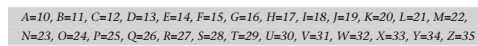

---

# Esempio: IT93F0306910904100000004549

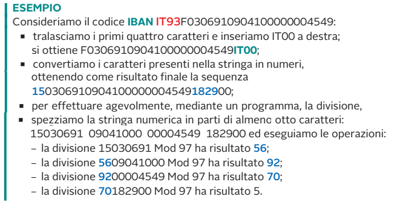

---

# Esempio: commento passo passo

IBAN: **IT93** F 03069 10904 100000004549

1. Si **tolgono i primi 4 caratteri** (IT93) e si aggiunge **IT00** in fondo: `F0306910904100000004549IT00`.
2. Conversione delle lettere: F → 15, I → 18, T → 29. Si ottiene il numero **150306910904100000004549182900**.
3. Il numero è troppo grande per un intero normale: si **spezza in blocchi** e si calcola il resto a catena (vedi slide seguente).
4. Resto finale = **5** → check digit = 98 − 5 = **93** ✔

---

# Calcolo a blocchi del Mod 97

Si divide a pezzi di circa 8 cifre; il **resto** di ogni passo viene **anteposto** al blocco successivo.

| Passo | Numero da dividere | Resto (Mod 97) |
|:-:|---|:-:|
| 1 | 15030691 | **56** |
| 2 | **56** + 09041000 → 5609041000 | **92** |
| 3 | **92** + 00004549 → 9200004549 | **70** |
| 4 | **70** + 182900 → 70182900 | **5** |

Resto finale **5** → check digit = 98 − 5 = **93**.

> Questa è una proprietà dell'aritmetica modulare: (a·10ⁿ + b) mod 97 = ((a mod 97)·10ⁿ + b) mod 97.

---

# La calcolatrice fa tutto in un colpo

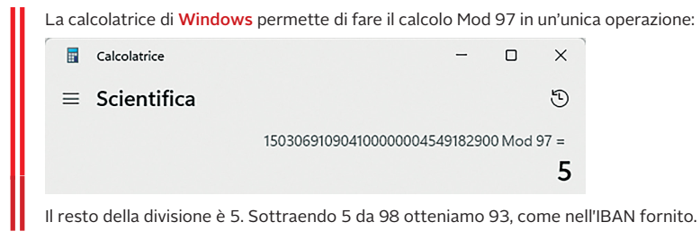

La **calcolatrice scientifica di Windows** permette di fare il calcolo Mod 97 in un'unica operazione: il resto è **5**. Sottraendo 5 da 98 si ottiene **93**, come nell'IBAN fornito.

---

# Verificare un IBAN: il resto deve essere 1

Per **controllare** un IBAN completo (invece di calcolare il check digit):

1. si **sposta** il gruppo iniziale (paese + check digit, 4 caratteri) **in fondo**;
2. si convertono le lettere in numeri (A = 10 … Z = 35);
3. si calcola **Mod 97**: se il resto è **1** l'IBAN è **valido**.

```python
def conv(s: str) -> str:
    return "".join(str(int(c, 36)) if c.isalpha() else c for c in s)

def iban_valido(iban: str) -> bool:
    iban = iban.replace(" ", "").upper()
    return int(conv(iban[4:] + iban[:4])) % 97 == 1

print(iban_valido("IT93F0306910904100000004549"))   # True
```

Python gestisce **numeri interi di qualsiasi lunghezza**: non serve spezzare in blocchi.

---

# Perché Mod 97 funziona

- Il resto della divisione per 97 è un numero tra **0 e 96**: il check digit (due cifre, 02–98) permette di far tornare sempre il resto finale a **1**.
- **97 è un numero primo**: gli errori di battitura (una cifra sbagliata, due cifre adiacenti scambiate) cambiano il resto, quindi vengono **rilevati**.
- Rileva **tutti gli errori su una singola cifra** e la quasi totalità degli scambi di cifre adiacenti.

> È una forma di **codice di controllo** più robusta del semplice bit di parità: confronta i due metodi della Lezione 3.

---

# Un IBAN "di esempio" non è per forza valido

L'IBAN mostrato nella figura di struttura (**IT60X0538511101000000123456**) serve a indicare **le parti** del codice: non è un IBAN reale e, se lo si controlla con Mod 97, **non risulta valido**.

> **Regola pratica:** gli IBAN illustrativi spesso hanno solo la forma corretta. Per capire se un IBAN è valido bisogna sempre rifare il **calcolo del controllo**.

---

<!-- _class: lead -->

# Parte D
## Il codice BIC / SWIFT

---

# SWIFT e BIC

Tra le **sanzioni economiche** applicate alla **Russia** dopo l'invasione dell'Ucraina del **2022** troviamo l'**esclusione di alcune banche** dal sistema finanziario internazionale **SWIFT**.

- **SWIFT** = *Society for Worldwide Interbank Financial Telecommunication*: è la società che **crea e assegna** alle istituzioni finanziarie il **codice BIC**;
- il **BIC** (*Bank Identifier Code*) è il codice che permette di effettuare **pagamenti internazionali** sui conti bancari, per qualsiasi tipo di transazione.

> **Analogia:** l'IBAN indica **il conto** di chi riceve; il BIC indica **la banca** che lo gestisce nel sistema internazionale.

---

# Struttura del BIC SWIFT

È un codice **alfanumerico di 8 o 11 caratteri**:

| Caratteri | Contenuto | Esempio |
|:-:|---|:-:|
| 1–4 | **codice banca** (4 lettere) | BCIT |
| 5–6 | **paese** (codice ISO a 2 lettere; Italia = **IT**) | IT |
| 7–8 | **località** (lettere/cifre) | MM |
| 9–11 | **filiale** o sede principale (spesso **XXX**) | XXX |

Se si riportano solo **8 caratteri** si indica la **sede principale**.

---

# BIC: esempio

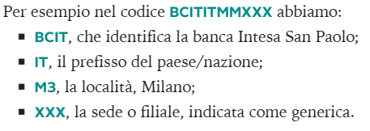

> **Nota:** `BCIT` identifica **Intesa Sanpaolo**; `IT` è l'Italia; la località è codificata con due caratteri; `XXX` indica la sede o una filiale generica.

*(Nell'immagine il BIC è **BCITITMMXXX**, quindi la località è **MM**; nel testo accanto compare "M3", probabile refuso.)*

---

# IBAN e BIC insieme

Per un **bonifico**:

| Tipo di bonifico | Dati necessari |
|---|---|
| **Italia / area SEPA** | **IBAN** del destinatario (il BIC non è più richiesto) |
| **Extra-SEPA** (es. USA, Regno Unito, Giappone) | **IBAN** (o numero di conto) + **BIC/SWIFT** |

> Un controllo di **formato** del BIC (8 o 11 caratteri, lettere per i primi 6) si fa con una semplice espressione regolare: `^[A-Z]{6}[A-Z0-9]{2}([A-Z0-9]{3})?$`.


---

<!-- _class: small -->

# Confronto tra i codici della lezione

| Codice | Lunghezza | Contenuto | Controllo |
|---|:-:|---|---|
| **Codice fiscale** | 16 | cognome, nome, data, luogo, sesso | 1 lettera: somma pesata **mod 26** |
| **Partita IVA** | 11 | matricola, ufficio provinciale | 1 cifra: **Luhn** (complemento a 10) |
| **IBAN (IT)** | 27 | paese, check, CIN, ABI, CAB, conto | 2 cifre **Mod 97-10** + 1 lettera CIN |
| **BIC / SWIFT** | 8 o 11 | banca, paese, località, filiale | nessuno (solo formato) |

Tutti sono **codici a lunghezza fissa**, **alfanumerici**, con una forma di **ridondanza** per rilevare errori di trascrizione.

---

# Riepilogo: i punti chiave

- I codici dell'identificazione quotidiana usano **cifre o lettere di controllo** per rilevare errori.
- **Codice fiscale:** 16 caratteri; il 16° è una lettera ottenuta da una somma pesata e dal resto della divisione per **26**.
- **Partita IVA:** 11 cifre; l'ultima si calcola con la **formula di Luhn**.
- **IBAN:** 27 caratteri in Italia; **check digit** europeo con **Mod 97-10** e **CIN** italiano (lettera).
- **BIC/SWIFT:** 8 o 11 caratteri; identifica la **banca** nei pagamenti internazionali.


---

<!-- _class: small -->

# Verifica: esercizi

1. Quanti caratteri ha un codice fiscale, e quali dati anagrafici contiene?
2. Ricava le prime 6 lettere del codice fiscale di **Anna Verdi**. Per una donna nata il **5 marzo 1990**, quali sono i caratteri per anno, mese e giorno?
3. Calcola la cifra di controllo della partita IVA **1234567890?** (prime 10 cifre).
4. Che cosa indicano le cifre 8–10 di una partita IVA?
5. Scomponi l'IBAN italiano **IT93F0306910904100000004549** nelle sue parti (paese, check digit, CIN, ABI, CAB, conto).
6. Spiega perché per verificare un IBAN valido il resto della divisione per 97 deve essere **1**.
7. Quanto è lungo un BIC? Che cosa significa **XXX** in fondo?

---

<!-- _class: tiny -->

# Verifica: soluzioni

1. **16** caratteri: cognome, nome, anno, mese, giorno (+40 per le donne), comune di nascita, carattere di controllo.
2. Cognome **VRD** (V, R, D); nome **NNA** (consonanti N, N + vocale A). Per la donna nata il 5 marzo 1990: anno **90**, mese **C**, giorno **45** (05 + 40).
3. X = 1+3+5+7+9 = 25; Y = (2+4+6+8+0)·2 = 40; Z = 2 (cifre pari ≥ 5: 6 e 8). Totale = 67 → complemento a 10 = **3** → partita IVA **12345678903**.
4. Il **codice dell'ufficio provinciale** che ha rilasciato la matricola (codice ISTAT della provincia).
5. **IT** (paese), **93** (check digit), **F** (CIN), **03069** (ABI), **10904** (CAB), **100000004549** (conto corrente).
6. Perché il check digit è scelto in modo che il numero complessivo diventi **congruente a 1 modulo 97**: se un carattere cambia, il resto cambia e il controllo fallisce.
7. **8 o 11** caratteri; **XXX** indica la sede principale (filiale generica).

---

<!-- _class: lead -->
<!-- _paginate: false -->

# Grazie per l'attenzione

## Domande?
