<!-- _class: lead -->
<!-- _paginate: false -->
<!-- _header: "" -->

# Codifica dell'informazione in formato ottico

## Unità di Apprendimento 2 · Lezione 5

Tecnologie e Progettazione di Sistemi Informatici e di Telecomunicazioni (TPSI)
Classe 3ª · Istituto Tecnico – Informatica
**Prof. Dicara**

---

# In questa lezione impareremo

- la **struttura dei codici a barre**
- i codici **monodimensionali** e **bidimensionali**
- il codice **EAN** e il codice **ISBN**
- i **tipi** e la **struttura** dei **QR Code**

> Filo conduttore: *come si trasforma un numero in una sequenza di barre che una macchina legge in un istante, e come si fa a leggerlo anche se il disegno è sporco o rovinato.*

---

# Mappa della lezione

| Parte | Argomento |
|---|---|
| **A** | Il codice a barre: idea e tipologie (1D e 2D) |
| **B** | Il codice EAN (13, 8, 2, 5): struttura, controllo, codifica delle barre |
| **C** | Il codice ISBN |
| **D** | I codici 2D: QR Code, Maxi Code, Aztec, Data Matrix |
| **E** | Lettura dei codici: architettura diretta e indiretta |
| **F** | Struttura interna del QR Code |
| **G** | HCCB (Microsoft Tag): il codice a colori |

---

<!-- _class: lead -->

# Parte A
## Il codice a barre

---

# Barcode: la traduzione ottica di un codice

Un **codice a barre** (*barcode*) è la **traduzione ottica** di un codice numerico o alfanumerico.

- **Definisce e individua** una particolare entità o prodotto;
- consente ai **lettori ottici**, collocati alle casse dei punti vendita, di registrare automaticamente i prodotti in uscita (marca, tipo, prezzo).

> **Attenzione:** il codice a barre contiene di solito **solo un numero identificativo**. Il prezzo non è "scritto" nelle barre: il registratore di cassa usa il numero per **cercare** il prodotto in un **database** e leggere il prezzo aggiornato.

---

# Perché usare un formato ottico

| Vantaggio | Spiegazione |
|---|---|
| **Velocità** | la lettura richiede una frazione di secondo |
| **Precisione** | niente errori di battitura dell'operatore |
| **Costo** | si stampa su carta o etichetta con una normale stampante |
| **Automazione** | magazzino, casse, biblioteche, spedizioni, biglietti |

I dati sono scritti con un **alfabeto di barre e spazi**: l'informazione è nella **larghezza** di ciascun elemento, non nel suo colore.

---

# Barcode: due grandi tipologie

I codici a barre si dividono in due grandi tipologie:

- codici a barre **monodimensionali** (barcode, **1D**);
- codici a barre **bidimensionali** (barcode **2D**).

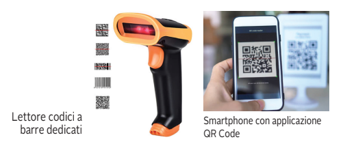

A sinistra un **lettore dedicato** (laser) con alcuni esempi di codici; a destra uno **smartphone** con applicazione per QR Code.

---

# 1D e 2D: dove sta l'informazione

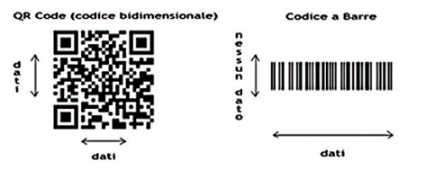

- **1D:** i dati sono distribuiti solo in **orizzontale**; l'altezza delle barre serve solo a facilitare la lettura (nessun dato in verticale);
- **2D:** i dati sono distribuiti **sia in orizzontale sia in verticale**, quindi la **capacità** è molto maggiore.

---

# I codici a barre monodimensionali

Sono i **principali sistemi di codifica** dell'informazione in formato ottico.

Permettono la **lettura automatizzata** mediante dispositivi di scansione (**scanner**), specialmente con tecnologia **laser**.

**Come funziona uno scanner laser:**
1. un raggio laser attraversa il codice con un movimento rapido;
2. le **barre scure** assorbono la luce, gli **spazi chiari** la riflettono;
3. un sensore trasforma la luce riflessa in un **segnale elettrico** (alto/basso);
4. dalla **durata** di ogni livello si ricavano le larghezze e quindi le cifre.

---

# Come si codifica: barre e spazi

La codifica del codice alfanumerico avviene mediante un'**alternanza di barre verticali e di spazi** disposti in modo da essere letti facilmente da un dispositivo ottico.

- L'unità di misura è il **modulo**: la larghezza della barra più sottile;
- ogni elemento è largo **1, 2, 3 o 4 moduli**;
- **barra** = bit **1**, **spazio** = bit **0** (si può leggere come una sequenza di bit).

**Esempio:** `1101` = una barra larga 2 moduli, uno spazio di 1 modulo, una barra di 1 modulo.

---

<!-- _class: lead -->

# Parte B
## Il codice EAN

---

# Il codice EAN

L'**European Article Number (EAN)** è una famiglia di codici a barre soggetta alle specifiche di **GS1** (*Global Standards*).

- Usato per la marcatura dei prodotti destinati alla **vendita al dettaglio**;
- usato in **Europa** e in **Giappone**, dove si chiama **JAN** (*Japanese Article Number*);
- la codifica è compatibile con il sistema **UPC** adottato in Stati Uniti, Canada, Regno Unito, Australia e Nuova Zelanda.

**Esempio:** la confezione di biscotti, la bottiglia d'acqua, la scatola di un videogioco riportano tutti un codice EAN.

---

# EAN: struttura del codice

- Le barre e gli spazi hanno **4 spessori diversi**, ognuno **multiplo del modulo unitario** (1, 2, 3 o 4 moduli);
- ogni **carattere** (cifra) è codificato in modo binario usando **7 moduli continui**: sono **significativi sia gli spazi sia le barre**;
- ogni cifra è formata da **2 barre e 2 spazi** alternati.

> **Nota:** è un codice **monodimensionale (1D)**: i dati sono solo in orizzontale. Ciò che varia sono gli spessori delle barre.

---

# Le versioni di EAN

Esistono 4 versioni principali di EAN:

| Versione | Nome | Cifre | Uso |
|---|---|:-:|---|
| **EAN-13** | "normale" | 13 | prodotti di consumo |
| **EAN-8** | "ridotto" | 8 | confezioni piccole (es. gomme da masticare) |
| **EAN-2** | supplemento | 2 | periodici, insieme all'EAN-13 (numero della rivista) |
| **EAN-5** | supplemento | 5 | carta stampata (prezzo consigliato dei libri) |

---

# Codice EAN-13: i quattro gruppi

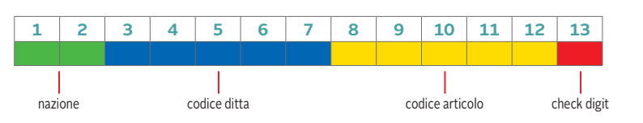

L'EAN-13 rappresenta un codice di **13 cifre**, dove ciascun gruppo ha un preciso significato:

| Cifre | Contenuto |
|:-:|---|
| **1–2** | **nazione** (prefisso GS1) |
| **3–7** | **codice ditta** (5 cifre): identifica l'azienda produttrice |
| **8–12** | **codice articolo** (5 cifre): assegnato dall'azienda al prodotto |
| **13** | **cifra di controllo** (*check digit*) |

Le prime **7 cifre** sono quindi divise in due parti: nazione (2) + ditta (5).

---

# EAN-13: il prefisso nazionale

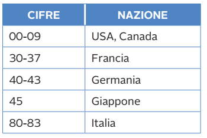

Il prefisso identifica il **paese di registrazione** del codice, non necessariamente il luogo di produzione.

> **Nota:** nel sistema GS1 completo il prefisso è di **tre cifre** (per l'Italia da **800 a 839**). Nelle slide si usano le prime due cifre (**80–83**) per semplicità.

---

# EAN-13: esempio di lettura

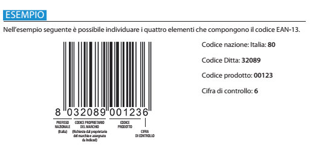

Dal codice **8032089001236** si ricava:
- **Nazione:** Italia (**80**)
- **Ditta:** **32089**
- **Prodotto:** **00123**
- **Cifra di controllo:** **6**

---

# La cifra di controllo (check digit)

L'ultima cifra rappresenta il **codice di controllo**, calcolato così:

1. si **moltiplicano le prime 12 cifre** del codice **alternativamente per 1 e per 3** (la prima per 1, la seconda per 3, …);
2. si **sommano** i valori ottenuti;
3. la cifra di controllo è il **più piccolo numero da aggiungere a questa somma** per ottenere un **multiplo di 10**.

**Formula:** C = (10 − (somma mod 10)) mod 10

---

# Perché serve la cifra di controllo

La cifra di controllo è una forma di **ridondanza** (come nel 2 su 5 e nel biquinario): permette al lettore di **rilevare** errori di lettura o di digitazione.

> **Esempio:** se il lettore legge `4006381333941` invece di `4006381333931`, il calcolo darà una cifra di controllo diversa da quella letta → il lettore **scarta la lettura** e riprova.

Un codice a barre è quindi un **codice a lunghezza fissa, con rilevazione d'errore**.

---


# Esempio 1: calcolo della cifra di controllo

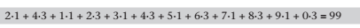

Codice senza cifra di controllo: **2 4 1 2 3 4 5 6 7 8 9 0**

| Cifra | 2 | 4 | 1 | 2 | 3 | 4 | 5 | 6 | 7 | 8 | 9 | 0 |
|:-:|:-:|:-:|:-:|:-:|:-:|:-:|:-:|:-:|:-:|:-:|:-:|:-:|
| Peso | 1 | 3 | 1 | 3 | 1 | 3 | 1 | 3 | 1 | 3 | 1 | 3 |
| Prodotto | 2 | 12 | 1 | 6 | 3 | 12 | 5 | 18 | 7 | 24 | 9 | 0 |

Somma = **99** → il multiplo di 10 successivo è 100 → **100 − 99 = 1**.

Codice completo: **2412345678901**.

---

# Esempio 2: l'EAN-13 del biscotto

Codice **803208900123?**

| Cifra | 8 | 0 | 3 | 2 | 0 | 8 | 9 | 0 | 0 | 1 | 2 | 3 |
|:-:|:-:|:-:|:-:|:-:|:-:|:-:|:-:|:-:|:-:|:-:|:-:|:-:|
| Peso | 1 | 3 | 1 | 3 | 1 | 3 | 1 | 3 | 1 | 3 | 1 | 3 |
| Prodotto | 8 | 0 | 3 | 6 | 0 | 24 | 9 | 0 | 0 | 3 | 2 | 9 |

Somma = 8+0+3+6+0+24+9+0+0+3+2+9 = **64** → multiplo di 10 successivo 70 → **70 − 64 = 6**.

Codice completo: **8032089001236** ✔

---

# Verificare un EAN-13 ricevuto

Per **controllare** un codice già completo basta applicare i pesi **1, 3, 1, 3, …** a **tutte e 13** le cifre (l'ultima ha peso 1): la somma deve essere un **multiplo di 10**.

```python
def check_ean13(d12: str) -> int:
    s = sum(int(c) * (1 if i % 2 == 0 else 3) for i, c in enumerate(d12))
    return (10 - s % 10) % 10

def ean13_valido(codice: str) -> bool:
    return len(codice) == 13 and check_ean13(codice[:12]) == int(codice[12])

print(check_ean13("803208900123"))     # 6
print(ean13_valido("8032089001236"))   # True
print(ean13_valido("8032089001237"))   # False
```

---

# Perché i pesi 1 e 3?

Se tutte le cifre avessero lo stesso peso, **scambiando due cifre adiacenti** la somma non cambierebbe e l'errore **non verrebbe rilevato**.

Con i pesi alternati **1 e 3** lo scambio di due cifre adiacenti diverse **cambia la somma** nella quasi totalità dei casi (non quando le due cifre differiscono di 5): così l'errore viene rilevato.

| Codice | Somma pesata | Controllo |
|---|:-:|:-:|
| 12 → 1·1 + 2·3 | 7 | — |
| 21 → 2·1 + 1·3 | 5 | **diverso**: errore rilevato |

> È lo stesso principio dei codici di parità: una piccola **ridondanza** protegge dagli errori più comuni di digitazione e di lettura.

---

# Come si "disegna" un EAN-13

Un EAN-13 occupa **95 moduli** in totale:

| Parte | Moduli | Contenuto |
|---|:-:|---|
| Guardia iniziale | 3 | barra-spazio-barra (`101`) |
| 6 cifre di sinistra | 42 | 6 × 7 moduli |
| Guardia centrale | 5 | `01010` |
| 6 cifre di destra | 42 | 6 × 7 moduli |
| Guardia finale | 3 | `101` |

Le **guardie** servono allo scanner per **sincronizzarsi** e riconoscere dove inizia e finisce il codice. Intorno al codice deve restare una **zona bianca** (*quiet zone*).

*La prima cifra (quella del prefisso) non ha barre proprie: è "nascosta" nel modo in cui sono codificate le sei cifre di sinistra.*

---

# Le codifiche A (L-code) per le cifre

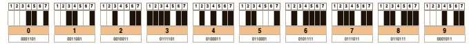

Ogni cifra è scritta con **7 moduli** (bit): 1 = barra scura, 0 = spazio chiaro. Questa è la tabella **L** (codifica di tipo A), usata per le cifre di **sinistra**: ogni parola ha **numero dispari di 1** (parità dispari).

Esempio: **0** → `0001101`, **3** → `0111101`, **8** → `0110111`.

---

# Le codifiche per la parte destra (R-code)

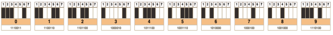

Per le cifre di **destra** si usa la codifica **R**: è il **complemento bit a bit** della codifica L.

| Cifra | L (sinistra) | R (destra) |
|:-:|:-:|:-:|
| 0 | `0001101` | `1110010` |
| 1 | `0011001` | `1100110` |
| 2 | `0010011` | `1101100` |
| 8 | `0110111` | `1001000` |
| 6 | `0101111` | `1010000` |

*(Nell'immagine l'ultimo bit del **0** è poco leggibile: il valore corretto è `1110010`.)*

---

# La codifica G e la prima cifra

Per le **sei cifre di sinistra** si può usare la codifica **L** (parità dispari) oppure la codifica **G** (parità pari, ottenuta **leggendo R al contrario**). Quale delle due si usa per ciascuna delle 6 posizioni **dipende dalla prima cifra**:

| 1ª cifra | Schema L/G delle 6 cifre | 1ª cifra | Schema L/G |
|:-:|:-:|:-:|:-:|
| 0 | LLLLLL | 5 | LGGLLG |
| 1 | LLGLGG | 6 | LGGGLL |
| 2 | LLGGLG | 7 | LGLGLG |
| 3 | LLGGGL | 8 | LGLGGL |
| 4 | LGLLGG | 9 | LGGLGL |

Così il lettore, guardando come sono scritte le 6 cifre, **ricava anche la 13ª cifra** e può leggere il codice **anche capovolto**.

---

<!-- _class: small -->

# Esempio: 8032089001236 in moduli

Prima cifra **8** → schema **LGLGGL** per le 6 cifre `0 3 2 0 8 9`:

| Parte | Cifra / schema | Moduli |
|---|:-:|---|
| Guardia | — | `101` |
| 0 | L | `0001101` |
| 3 | G | `0100001` |
| 2 | L | `0010011` |
| 0 | G | `0100111` |
| 8 | G | `0001001` |
| 9 | L | `0001011` |
| Guardia centrale | — | `01010` |
| 0, 0, 1, 2, 3, 6 | R | `1110010 1110010 1100110 1101100 1000010 1010000` |
| Guardia | — | `101` |

**Totale:** 3 + 42 + 5 + 42 + 3 = **95 moduli**.

---

# EAN-8: il formato ridotto

L'**EAN-8** ha 8 cifre: 7 di dati + 1 di controllo. La cifra di controllo si calcola in modo analogo, ma i pesi sono **3, 1, 3, 1, 3, 1, 3** (la prima cifra ha peso 3).

**Esempio:** `7 3 5 1 3 5 3 ?`

| Cifra | 7 | 3 | 5 | 1 | 3 | 5 | 3 |
|:-:|:-:|:-:|:-:|:-:|:-:|:-:|:-:|
| Peso | 3 | 1 | 3 | 1 | 3 | 1 | 3 |
| Prodotto | 21 | 3 | 15 | 1 | 9 | 5 | 9 |

Somma = **63** → 70 − 63 = **7** → codice **73513537**.

---

<!-- _class: lead -->

# Parte C
## Il codice ISBN

---

# Il codice ISBN

Analogamente alla specifica GS1, per l'**editoria** viene assegnato a ogni libro un codice univoco: l'**ISBN** (*International Standard Book Number*).

Si tratta di un numero che identifica a livello internazionale **un titolo** o **un'edizione di un titolo** di un determinato editore.

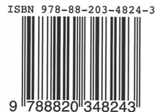

---

# ISBN-13: le cinque parti

Dal **1° gennaio 2007** l'ISBN è formato da **13 cifre**, suddivise in **5 parti** dai trattini.

| Parte | Esempio | Significato |
|---|:-:|---|
| **Prefisso EAN** | 978 | indica che si tratta di un **libro** (codice 978 del sistema GS1; esistono anche i 979) |
| **Gruppo linguistico** | 88 | paese o area linguistica dell'editore: da 1 a 5 cifre (per l'Italia **88**) |
| **Editore** | 203 | casa editrice: da 2 a 7 cifre |
| **Titolo** | 4824 | numero assegnato dall'editore al singolo titolo |
| **Cifra di controllo** | 3 | calcolata come per l'EAN-13 |

---

# ISBN: la cifra di controllo

Il barcode del libro è **un EAN-13** che coincide con l'ISBN **senza trattini**: `9788820348243`.

**Calcolo** per `978-88-203-4824-?` (pesi 1, 3, 1, 3, …):

| Cifra | 9 | 7 | 8 | 8 | 8 | 2 | 0 | 3 | 4 | 8 | 2 | 4 |
|:-:|:-:|:-:|:-:|:-:|:-:|:-:|:-:|:-:|:-:|:-:|:-:|:-:|
| Peso | 1 | 3 | 1 | 3 | 1 | 3 | 1 | 3 | 1 | 3 | 1 | 3 |
| Prodotto | 9 | 21 | 8 | 24 | 8 | 6 | 0 | 9 | 4 | 24 | 2 | 12 |

Somma = **127** → 130 − 127 = **3** → ISBN **978-88-203-4824-3** ✔

> **Prima del 2007** l'ISBN aveva **10 cifre** e un controllo con pesi da 10 a 1 e resto della divisione per **11** (l'ultima cifra poteva essere **X** = 10).

---

<!-- _class: lead -->

# Parte D
## I codici a barre bidimensionali

---

# I codici a barre 2D

I **barcode 2D** sono codici a barre bidimensionali formati da un'**immagine grafica** che immagazzina informazioni collocandole all'interno di **matrici di punti**, chiamati **moduli**.

- Nascono per rispondere alle esigenze della **logistica industriale**, dove serve una certa **tolleranza ai deterioramenti** dei codici stampati sulle merci;
- recentemente si stanno affermando anche nelle **attività di tutti i giorni**.

| Confronto | 1D | 2D |
|---|---|---|
| Direzioni dei dati | 1 | 2 |
| Capacità | 12–20 caratteri | migliaia di caratteri |
| Correzione errori | solo rilevazione | **correzione** (Reed-Solomon) |

---

# Il QR Code

Nel **1994**, in Giappone, la compagnia **Denso Wave** sviluppa la tecnologia **QR Code** (*Quick Response*, "risposta rapida"), usando un sistema a barre bidimensionale **a matrice** per codificare l'informazione.


Il QR Code può contenere **indirizzi Internet**, **testi**, **numeri di telefono**, **messaggi** ed **e-mail**.

---

# QR Code: capacità e "qurificare"

I codici QR possono memorizzare fino a un massimo di **4296 caratteri alfanumerici** e **7089 caratteri numerici**.


> Con il neologismo **qurificare** si intende il processo di codifica di un'informazione in formato QR Code; l'operazione opposta (decodifica) si chiama **dequrificazione**.

---

# Altri codici 2D: Maxi Code

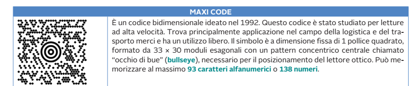

Il **Maxi Code** (1992) è studiato per **letture ad alta velocità**: è usato nella **logistica** e nel **trasporto merci** (è stato sviluppato per l'azienda di spedizioni UPS). Simbolo a **dimensione fissa** di 1 pollice quadrato, con **33 × 30 moduli esagonali** e un pattern centrale a "occhio di bue" (*bullseye*) per posizionare il lettore. Contiene al massimo **93 caratteri alfanumerici** o **138 numeri**.

---

# Altri codici 2D: Aztec e Data Matrix

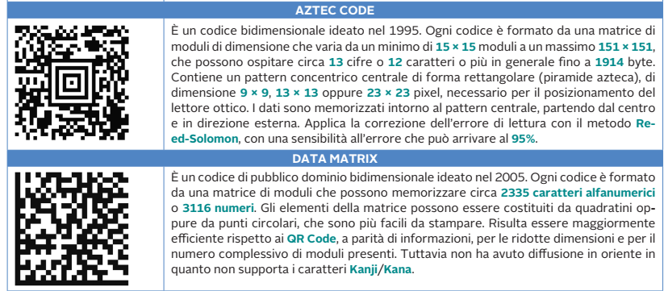

---

# Aztec e Data Matrix: confronto

| | **Aztec Code** | **Data Matrix** |
|---|---|---|
| Anno | 1995 | 2005 |
| Pattern guida | **centrale** (piramide azteca) | a "L" ai bordi |
| Dimensioni | da 15 × 15 a 151 × 151 moduli | matrici di moduli di dimensione variabile |
| Capacità | fino a 1914 byte | circa 2335 caratteri alfanumerici o 3116 numeri |
| Correzione errori | **Reed-Solomon**, fino al 95 % di sensibilità | Reed-Solomon |
| Uso tipico | biglietti, carte d'imbarco | componenti elettronici, farmaci |

---

# Tipi di codici 2D: quale scegliere?

| Esigenza | Codice adatto |
|---|---|
| Collegamento a pagina web, pagamenti, Wi-Fi | **QR Code** |
| Lettura molto veloce su pacchi in movimento | **Maxi Code** |
| Biglietti elettronici (treno, aereo) | **Aztec** |
| Etichette molto piccole su componenti | **Data Matrix** |

---

<!-- _class: lead -->

# Parte E
## La lettura dei codici

---

# Codifica e decodifica: due architetture

La **codifica** e la relativa **decodifica** dei codici a barre possono essere effettuate attraverso due architetture:

- **diretta**: il codice contiene già l'informazione completa;
- **indiretta**: il codice contiene solo un **identificativo** che rimanda a un server.

---

# Architettura diretta

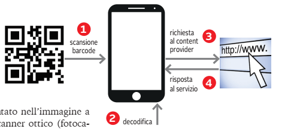

1. **Scansione** del barcode con la fotocamera;
2. **decodifica** sul dispositivo;
3. **richiesta** al *content provider* (es. un sito web);
4. **risposta** al servizio: la pagina si apre.

**Esempio:** un QR Code che contiene direttamente l'indirizzo `https://www.scuola.it`.

---

# Architettura indiretta

La **codifica indiretta** prevede un **passaggio supplementare**: l'intervento di un **server esterno**, chiamato **Service Platform**.

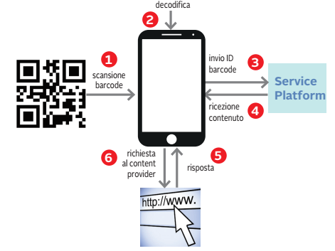

---

# Diretta o indiretta: confronto

| | **Diretta** | **Indiretta** |
|---|---|---|
| Passaggi | 4 | 6 |
| Dove sta il contenuto | **dentro** il codice | su un **server** (il codice contiene un ID) |
| Pro | funziona anche **senza passare da terzi** | contenuto **modificabile** dopo la stampa; statistiche sulle scansioni |
| Contro | cambiare il contenuto significa **ristampare** il codice | dipende dal servizio e da una connessione a Internet |

> Esempio **indiretto**: un QR Code sul manifesto di un museo che punta all'ID della scheda; il museo può cambiare la pagina di destinazione senza cambiare il manifesto.

---

# QR Code: cos'è

Un **QR Code** è un codice a **2 dimensioni** sviluppato nel **1994** da un'azienda giapponese (**Denso Wave**), realizzato per il **tracciamento dei pezzi delle automobili Toyota**.

Altri nomi e riferimenti normativi:
- **Denso barcode**;
- **Quick Response Code**;
- **JIS X 0510**;
- **ISO/IEC 18004**.

---

# QR Code: come è fatto

I codici QR sono formati da una serie di **quadratini bianchi o neri**, chiamati **pixel** o **moduli**, disposti all'interno di uno schema **quadrato** (una **matrice**).

I QR Code nascono con l'obiettivo di **ridurre al minimo gli errori di lettura** in seguito a **graffi, strappi o macchie** sul supporto cartaceo.

Utilizzano il metodo di codifica e decodifica **Reed-Solomon**, che permette di **ricostruire il codice originale danneggiato fino al 30 %**.

---

# I livelli di correzione dell'errore

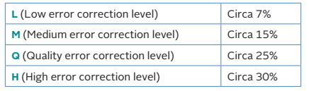

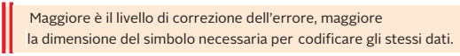

| Livello | Significato | Dati ripristinabili |
|:-:|---|:-:|
| **L** | *Low* | circa 7 % |
| **M** | *Medium* | circa 15 % |
| **Q** | *Quartile* (nelle slide "Quality") | circa 25 % |
| **H** | *High* | circa 30 % |

---

# Reed-Solomon: l'idea

Il metodo **Reed-Solomon** aggiunge ai dati un certo numero di **byte di correzione** calcolati con operazioni su polinomi (come nel CRC, ma in un campo di 256 valori per byte).

- i **dati** sono vissuti come i coefficienti di un polinomio;
- la **ridondanza** (byte E1, E2, …) permette di **trovare e correggere** i byte errati;
- più byte di correzione ⇒ si corregge di più ⇒ ma **servono più moduli** per gli stessi dati.

> **Analogia:** un cruciverba in cui puoi cancellare alcune lettere: se la struttura è abbastanza ridondante, ricostruisci quelle mancanti dalle altre.

È lo stesso tipo di codice usato nei **CD**, nei **DVD** e nelle comunicazioni spaziali.

---

# Lettura da qualunque direzione

Il codice QR può essere letto **da 3 direzioni differenti**: partendo da tre posizioni iniziali diverse si ottiene sempre la lettura dello stesso codice.

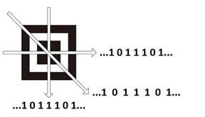

Questo è possibile grazie ai **tre quadrati di riferimento** agli angoli (*finder pattern*): il QR Code può essere rilevato anche se **ruotato di 360°**.

---

# Versioni e dimensioni

Esistono QR Code di diverse **dimensioni**: dalla più semplice (**Versione 1**, **21 × 21** moduli) alla massima (**Versione 40**, **177 × 177** moduli). Ogni versione successiva ha **4 moduli in più per lato**.

**Formula:** lato = 17 + 4 · V

| Versione | Lato (moduli) | Moduli totali |
|:-:|:-:|:-:|
| 1 | 21 | 441 |
| 2 | 25 | 625 |
| 3 | 29 | 841 |
| 10 | 57 | 3 249 |
| 40 | 177 | 31 329 |

*(Nelle slide originali due slide sono rimaste vuote: probabilmente contenevano immagini di esempi delle versioni.)*

---

# Le quattro modalità di codifica

I QR Code (fino a **7089 cifre** o **4296 caratteri alfanumerici**) usano quattro **modalità di codifica**:

| Modalità | Come codifica | Massimo (V40-L) |
|---|---|:-:|
| **Numerica** | **10 bit** per **3 cifre** | 7089 cifre |
| **Alfanumerica** | **11 bit** per **2 caratteri** (45 simboli) | 4296 caratteri |
| **Byte** | **8 bit** per carattere | 2953 caratteri |
| **Kanji / Kana** | 13 bit per carattere | 1817 simboli |

> **Attenzione:** nelle slide originali le prime due modalità sono scambiate e per la modalità a byte compare 2593: i valori corretti sono quelli della tabella.

---

# Esempio: modalità numerica

Codifichiamo la stringa **01234567** a gruppi di 3 cifre:

| Gruppo | Valore | Bit |
|:-:|:-:|:-:|
| 012 | 12 | `0000001100` (10 bit) |
| 345 | 345 | `0101011001` (10 bit) |
| 67 | 67 | `1000011` (7 bit) |

Totale **27 bit** invece dei 64 bit (8 byte ASCII) che servirebbero in modalità byte: la modalità numerica è **molto più compatta**.

*In un QR reale ogni blocco è preceduto dall'**indicatore di modalità** (`0001` numerico, `0010` alfanumerico, `0100` byte) e dalla **lunghezza** dei dati.*

---

# Esempio: modalità alfanumerica

Ogni carattere ha un valore da 0 a 44 (cifre, A–Z, spazio e `$ % * + - . / :`). Una **coppia** di caratteri si codifica come **45·primo + secondo** su 11 bit.

Stringa **AC-42** (A = 10, C = 12, − = 41, 4 = 4, 2 = 2):

| Coppia | Calcolo | Bit |
|:-:|:-:|:-:|
| AC | 10·45 + 12 = 462 | `00111001110` |
| -4 | 41·45 + 4 = 1849 | `11100111001` |
| 2 | (rimasto da solo) | `000010` (6 bit) |

Totale **28 bit** per 5 caratteri.

---

<!-- _class: lead -->

# Parte F
## La struttura interna del QR Code

---

# La struttura di un QR Code

La struttura interna contiene:

- una **zona dati** codificati (28 byte, **D1:D28**, per la **versione 2**);
- una zona con i codici di **correzione dell'errore** (16 byte, **E1:E16**, per la versione 2) generati con **Reed-Solomon**;
- una **Quiet Zone**: margine esterno interamente **bianco**, largo **4 moduli**;
- una zona **Format Information**, letta **per prima**: contiene il livello di correzione adottato e la **maschera** applicata ai dati (serve a modificare la matrice per facilitare la lettura);
- alcuni **pattern** che permettono di stabilire i parametri per il riconoscimento del codice.

---

# I pattern principali

| Pattern | Funzione |
|---|---|
| **Finder Pattern** | orientare e localizzare il codice; è rilevabile anche se il codice è **ruotato di 360°**; ha attorno un margine bianco di **1 modulo** |
| **Timing Pattern** | identifica le **coordinate centrali** di ogni cella, permette di ricavare la **versione** e **allineare** il lettore |
| **Alignment Pattern** | permette di posizionare i diversi elementi anche se il codice è letto **non in orizzontale** (distorsione prospettica) |

> **Esempio:** quando inquadri un QR da lontano e storto, il telefono usa i **tre finder pattern** per orientare l'immagine e l'**alignment pattern** per correggere la prospettiva.

---

# QR Code versione 2, livello M

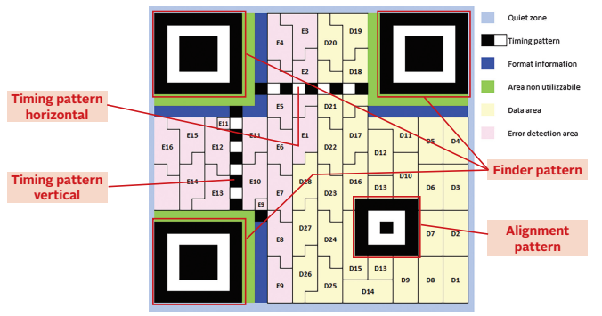

---

# Leggere la figura

Il QR Code di **versione 2 (25 × 25 moduli)** e qualità **M**:

| Colore / etichetta | Significato |
|---|---|
| **Quiet zone** (azzurro) | margine bianco di 4 moduli |
| **Finder pattern** | i tre quadrati agli angoli |
| **Timing pattern** (orizzontale e verticale) | fila alternata nero/bianco |
| **Format information** (blu) | livello di correzione e maschera |
| **Data area** (giallo) | byte dati **D1–D28** |
| **Error detection area** (rosa) | byte di correzione **E1–E16** |
| **Alignment pattern** | piccolo quadrato in basso a destra |

Totale: **28 + 16 = 44 byte** (parole di codice) nella versione 2-M.

---

# L'area dati: la matrice 4 × 2

I dati sono scritti con una **matrice 4 × 2** (*QR matrix*) che rappresenta **1 byte**.

- Ogni byte ha **8 bit**;
- **0** = modulo **bianco**, **1** = modulo **nero**;
- i bit sono disposti nella matrice con due modalità: **bottom-up** (dal basso verso l'alto) o **top-down** (dall'alto verso il basso).

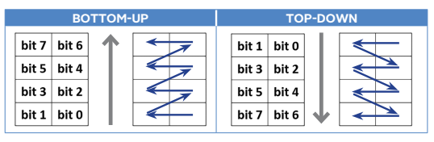

---

# Esempio: la lettera "C" in una matrice 4 × 2

**C** in ASCII = `01000011`. Si dispone in modalità **bottom-up**:

| Riga (dall'alto) | Bit | Moduli |
|:-:|:-:|:-:|
| 1ª | b7 b6 = **0 1** | ⬜ ⬛ |
| 2ª | b5 b4 = **0 0** | ⬜ ⬜ |
| 3ª | b3 b2 = **0 0** | ⬜ ⬜ |
| 4ª | b1 b0 = **1 1** | ⬛ ⬛ |

Poiché la sequenza cambia al variare della modalità, il lettore deve **sapere** quale si usa: lo ricava dalle informazioni di formato.

---

<!-- _class: lead -->

# Parte G
## HCCB o Microsoft Tag

---

# HCCB: il codice a colori

La tecnologia **HCCB** (*High Capacity Color Barcode*) è la proposta di **Microsoft Research** come variante del QR Code.

- Al posto dei quadratini monocromatici si usano **gruppi di triangoli** inseriti in una griglia **5 × 10** o più grande;
- ciascun triangolo può avere **quattro possibili colori**.

> Con **4 colori** ogni triangolo porta **2 bit** (log₂ 4); con **8 colori**, **3 bit** (log₂ 8). Più colori ⇒ più informazioni per lo stesso spazio.

---

# HCCB: i colori come bit

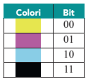

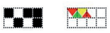

Con **8 colori** si possono generare **2000 byte binari** o **3500 caratteri alfabetici** in un **pollice quadrato**, equivalenti a **due pagine di testo**.

> **Limite pratico:** servono fotocamere a colori e una buona illuminazione, mentre i codici in bianco e nero sono più robusti. Per questo il QR Code è rimasto lo standard più diffuso.

---

# HCCB: struttura del tag

La tecnologia HCCB posiziona intorno al tag un **confine nero**, circondato da un **bordo bianco spesso**.

- il **contorno nero** individua i **bordi** dell'etichetta;
- il **bordo inferiore** si riconosce per la sua **dimensione doppia**, così da poter individuare l'**orientamento** per la corretta decodifica.

---

# HCCB: esempi di etichette

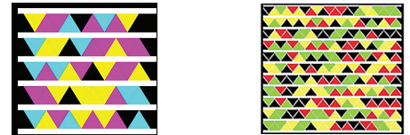

Due etichette HCCB di **dimensioni diverse**: l'etichetta più grande contiene molti più triangoli e quindi più dati.

---

<!-- _class: small -->

# Confronto tra i codici ottici

| Codice | Tipo | Dati | Controllo / correzione | Uso |
|---|:-:|---|---|---|
| **EAN-13** | 1D | 13 cifre | cifra di controllo (pesi 1-3) | prodotti al dettaglio |
| **ISBN** | 1D | 13 cifre | stessa cifra dell'EAN-13 | libri |
| **QR Code** | 2D | fino a 7089 cifre | **Reed-Solomon** (7–30 %) | web, pagamenti, biglietti |
| **Maxi Code** | 2D | 93 caratteri | correzione | logistica |
| **Aztec** | 2D | fino a 1914 byte | Reed-Solomon | biglietti |
| **Data Matrix** | 2D | 2335 car. | correzione | componenti |
| **HCCB** | 2D a colori | 2000 byte / pollice² | — | prototipo Microsoft |

---

# Riepilogo: i punti chiave

- Il **codice a barre** traduce in forma **ottica** un codice numerico: barre e spazi di larghezza 1–4 moduli.
- **1D** (EAN, ISBN): dati solo in orizzontale; **2D** (QR, Aztec, Data Matrix): dati in due direzioni, capacità molto maggiore.
- **EAN-13:** nazione (2) + ditta (5) + articolo (5) + **cifra di controllo** (pesi 1 e 3, multiplo di 10); 95 moduli.
- **ISBN-13:** prefisso 978/979, gruppo, editore, titolo, controllo (come EAN-13).
- **QR Code:** Denso Wave, 1994; versioni 1–40 (lato = 17 + 4V); correzione **Reed-Solomon** (L 7 %, M 15 %, Q 25 %, H 30 %).
- **Strutture del QR:** quiet zone, finder, timing, alignment, format information, area dati ed errori.
- Lettura **diretta** o **indiretta** (con Service Platform).
- **HCCB:** variante a colori con triangoli.

---

<!-- _class: small -->

# Verifica: esercizi

1. Quanti moduli occupa un EAN-13? Da quante barre e spazi è formata ogni cifra?
2. Calcola la cifra di controllo di **590123412345?** (prime 12 cifre dell'EAN-13).
3. Calcola la cifra di controllo dell'EAN-8 **9638507?**.
4. Verifica che l'ISBN **978-88-203-4824-3** sia coerente con la cifra di controllo.
5. Quale lato (in moduli) ha un QR Code di versione 7?
6. Codifica in modalità numerica la stringa **123456**.
7. Qual è la differenza tra lettura **diretta** e **indiretta**? Fai un esempio per ciascuna.
8. Perché un QR Code con livello **H** occupa più spazio di uno con livello **L** a parità di dati?

---

<!-- _class: tiny -->

# Verifica: soluzioni

1. **95** moduli; ogni cifra occupa 7 moduli ed è formata da **2 barre e 2 spazi**.
2. Pesi 1,3,1,3…: 5+27+0+3+2+9+4+3+2+9+4+15 = **83** → 90 − 83 = **7** → codice **5901234123457**.
3. Pesi 3,1,3,1,3,1,3: 27+6+9+8+15+0+21 = **86** → 90 − 86 = **4** → **96385074**.
4. Calcolo già svolto in slide: somma 127 → 130 − 127 = **3** ✔.
5. lato = 17 + 4·7 = **45** moduli.
6. 123 → `0001111011` (10 bit), 456 → `0111001000` (10 bit): **20 bit**.
7. **Diretta:** il codice contiene già l'informazione (es. un URL scritto nel QR). **Indiretta:** contiene un ID che rimanda a un server (Service Platform), che fornisce il contenuto.
8. Perché ha più **byte di correzione** (fino al 30 % dei dati) e quindi servono più moduli per contenere anche i dati.

---

<!-- _class: lead -->
<!-- _paginate: false -->

# Grazie per l'attenzione

## Domande?
