<!-- _class: lead -->
<!-- _paginate: false -->
<!-- _header: "" -->

# Operazioni tra numeri binari senza segno

## Unità di Apprendimento 3 · Lezione 1

Tecnologie e Progettazione di Sistemi Informatici e di Telecomunicazioni (TPSI)
Classe 3ª · Istituto Tecnico – Informatica
**Prof. Dicara**

---

# In questa lezione impareremo

- le operazioni di **complemento a 1** e **a 2**
- le operazioni di **aritmetica binaria**: addizione
- che cosa sono **carry** (riporto) e **overflow**

> Filo conduttore: *come fa un processore a fare i conti usando solo 0 e 1, con un numero limitato di bit?*

---

# Mappa della lezione

| Parte | Argomento |
|---|---|
| **A** | Aritmetica binaria: le operazioni sui byte |
| **B** | Addizione, riporto, flag di carry e di overflow |
| **C** | Prodotto e divisione (anche per potenze di 2) |
| **D** | Complemento a 1 |
| **E** | Complemento a 2 e sottrazione |

---

<!-- _class: lead -->

# Parte A
## Aritmetica binaria

---

# Aritmetica binaria

Negli strumenti che elaborano dati binari è necessario eseguire le **operazioni algebriche sui singoli byte binari**; in particolare:

- le **quattro operazioni classiche** della matematica (somma, differenza, prodotto, divisione);
- l'operazione di **complemento**, tipica dei sistemi binari.

**Numeri senza segno:** in questa lezione tutti i bit servono a rappresentare il **valore**; non c'è nessun bit di segno, quindi i numeri sono sempre **≥ 0**. Con *n* bit si rappresentano i valori da **0** a **2ⁿ − 1**.

| Bit | 4 | 8 | 16 | 32 |
|:-:|:-:|:-:|:-:|:-:|
| Valore massimo | 15 | 255 | 65 535 | 4 294 967 295 |

---

# Ripasso: potenze di 2 e conversioni

| Posizione | 7 | 6 | 5 | 4 | 3 | 2 | 1 | 0 |
|:-:|:-:|:-:|:-:|:-:|:-:|:-:|:-:|:-:|
| Peso | 128 | 64 | 32 | 16 | 8 | 4 | 2 | 1 |

**Esempio:** `0110 1101` = 64 + 32 + 8 + 4 + 1 = **109**.

**Da decimale a binario** (divisioni successive per 2): 25 → 25 : 2 = 12 r **1**; 12 : 2 = 6 r **0**; 6 : 2 = 3 r **0**; 3 : 2 = 1 r **1**; 1 : 2 = 0 r **1** → si leggono i resti dal basso: **11001**.

---

<!-- _class: lead -->

# Parte B
## L'addizione

---

# Addizione: la tabella

Le quattro possibili combinazioni della somma tra due bit:

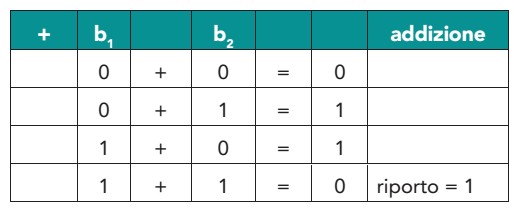

Le prime tre non danno problemi; l'ultima (1 + 1) produce **0 con riporto 1**.

---

# 1 + 1 = 0 con riporto 1

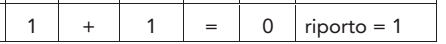

Il risultato della somma tra due bit di valore unitario è un bit di valore **0**. Contemporaneamente si genera un **riporto** (*carry*), che viene indicato in un particolare bit dei microprocessori: il **bit di carry**.

> **Analogia con il decimale:** 9 + 1 = 10 → scrivo 0 e "riporto" 1 alla colonna successiva. In base 2 succede già con 1 + 1, perché le cifre disponibili sono solo 0 e 1.

---

# Somma di due bit con riporto: la regola completa

In ogni colonna si sommano **tre** bit: i due bit dei numeri e il **riporto** della colonna precedente.

| Bit A | Bit B | Riporto in | Somma | Riporto out |
|:-:|:-:|:-:|:-:|:-:|
| 0 | 0 | 0 | 0 | 0 |
| 0 | 1 | 0 | 1 | 0 |
| 1 | 0 | 0 | 1 | 0 |
| 1 | 1 | 0 | 0 | **1** |
| 0 | 0 | 1 | 1 | 0 |
| 0 | 1 | 1 | 0 | **1** |
| 1 | 0 | 1 | 0 | **1** |
| 1 | 1 | 1 | 1 | **1** |

È la tabella del **full adder** (sommatore completo), il circuito che sta dentro l'unità aritmetica della CPU.

---

# Esempi di somma in binario

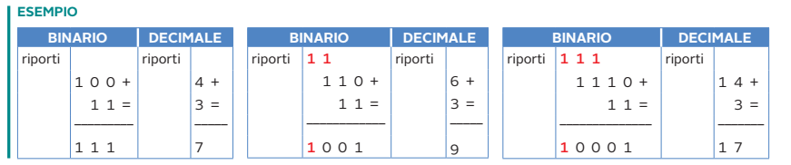

| Somma | In decimale | Risultato |
|:-:|:-:|:-:|
| `100 + 11` | 4 + 3 | `111` = 7 |
| `110 + 11` | 6 + 3 | `1001` = 9 |
| `1110 + 11` | 14 + 3 | `10001` = 17 |

---

# Somma passo passo: 1011 + 0110

```
riporti:   1 1 1 0
             1 0 1 1      (11)
           + 0 1 1 0      (6)
           ---------
           1 0 0 0 1      (17)
```

1. colonna 0: 1 + 0 = **1**, riporto 0;
2. colonna 1: 1 + 1 = **0**, riporto **1**;
3. colonna 2: 0 + 1 + 1 (riporto) = **0**, riporto **1**;
4. colonna 3: 1 + 0 + 1 (riporto) = **0**, riporto **1**;
5. il riporto finale diventa il **quinto bit**: **1**.

Risultato: `10001` = 17 ✔

---

# Il carry su 8 bit

Vediamo come viene generato un **carry** operando su **8 bit (un byte)**.

Quando il risultato dei due addendi è **maggiore di 255** (massimo rappresentabile con 8 bit) si deve generare un **riporto verso il bit più significativo** (l'eventuale *nono bit*).

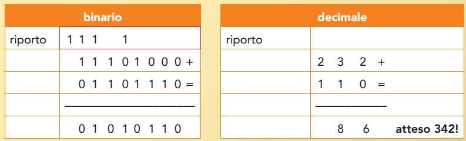

---

# 232 + 110 su 8 bit

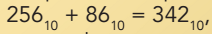

```
 riporti:  1 1 1 1
            1 1 1 0 1 0 0 0     (232)
          + 0 1 1 0 1 1 1 0     (110)
          -------------------
          1 0 1 0 1 0 1 1 0     (342 su 9 bit)
          ↑
        carry = 1  →  nel registro a 8 bit resta  0101 0110 = 86
```

Il registro contiene **86**, ma il risultato corretto è 342 = **256 + 86**. Il **carry = 1** segnala che il risultato **non sta in 8 bit**: è proprio "atteso 342!" nell'immagine.

> **Come si usa il carry:** per sommare numeri a 16 o 32 bit con un processore a 8 bit si somma prima il byte basso, poi si somma il byte alto **più il carry** (istruzione `ADC`, *add with carry*).

---

# Carry o overflow?

Quando i microprocessori eseguono somme che generano un riporto pongono a **1** un particolare bit (**flag**):

- il **flag di carry (CF)**: segnala che l'ultima operazione ha generato un **riporto**;
- il **flag di overflow (OF)**: segnala che il risultato dell'ultima operazione è **maggiore del massimo valore** che il registro di destinazione può contenere.

Nel caso di operazioni con **numeri senza segno** i due flag hanno lo **stesso significato**.

> **Precisazione:** nei processori reali (per esempio x86) per i numeri **senza segno** è il flag **CF** a indicare il superamento del massimo; il flag **OF** ha senso per i numeri **con segno** (Lezione 2), dove si calcola in modo diverso.

---

# Esempi di overflow su 8 bit

| Operazione | Risultato vero | Su 8 bit | Carry |
|---|:-:|:-:|:-:|
| 100 + 100 | 200 | 200 | **0** (ok) |
| 200 + 100 | 300 | 44 | **1** (overflow) |
| 255 + 1 | 256 | 0 | **1** (overflow) |
| 128 + 128 | 256 | 0 | **1** (overflow) |

`200 + 100` = `1100 1000 + 0110 0100` = `1 0010 1100` → il registro mantiene `0010 1100` = 44.

> **Esempio concreto (contatori):** un contatore a 8 bit che arriva a 255 e viene incrementato **ricomincia da 0**: è lo stesso fenomeno del contachilometri che "gira".

---


<!-- _class: lead -->

# Parte C
## Prodotto e divisione

---

# Prodotto di due bit

La tabella della verità riporta le quattro combinazioni del **prodotto** tra due bit:

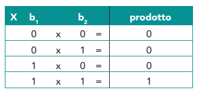

Il prodotto vale **1 solo se entrambi i bit valgono 1**.

---

# Prodotto per 2

Nel caso del prodotto per 2 non è necessario effettuare la moltiplicazione: è sufficiente **aggiungere uno zero a destra** (shift a sinistra di 1 posizione).

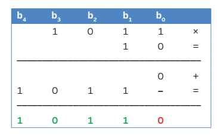

`1011 × 10` = `10110`: cioè 11 × 2 = 22.

---

# Prodotto per 2: altri esempi

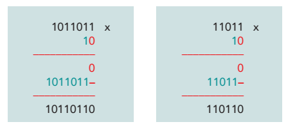

| Numero | × 2 | Decimale |
|:-:|:-:|:-:|
| `1011011` (91) | `10110110` | 182 |
| `11011` (27) | `110110` | 54 |

> **Analogia decimale:** moltiplicare per 10 significa aggiungere uno zero a destra (47 → 470). In base 2 lo stesso vale per il 2.

---

# Prodotto per 4 (e per 2ⁿ)

Aggiungiamo **2 zeri a destra** (shift a sinistra di 2).

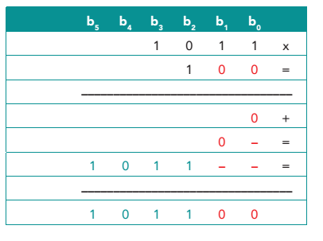

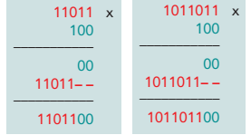

**Regola generale:** moltiplicare per **2ⁿ** = aggiungere **n zeri** a destra. Esempio: `11011 × 100` = `1101100` (27 × 4 = 108).

---

# Divisione per potenze di 2

Nel caso della divisione per 2 non serve dividere: basta **togliere uno 0 a destra**, oppure, in ogni caso, **il bit meno significativo** (shift a destra).

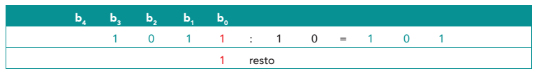

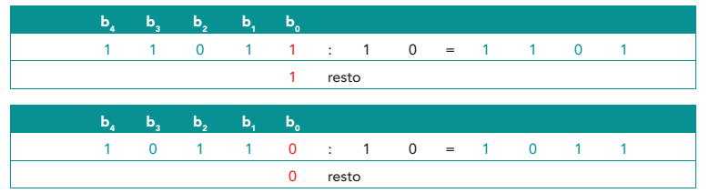

Il bit eliminato è il **resto** (0 o 1).

---

# Divisione per 2: esempi

| Numero | Binario | ÷ 2 | Quoziente | Resto |
|:-:|:-:|:-:|:-:|:-:|
| 11 | `1011` | `101` | 5 | **1** |
| 27 | `11011` | `1101` | 13 | **1** |
| 22 | `10110` | `1011` | 11 | **0** |

**Regola generale:** dividere per **2ⁿ** = togliere gli ultimi **n** bit. I bit tolti formano il **resto**; gli altri il **quoziente**.

> **Utile per:** sapere se un numero è **pari** (ultimo bit = 0) o **dispari** (ultimo bit = 1).

---

<!-- _class: lead -->

# Parte D
## Il complemento a 1

---

# L'operazione "tipica": il complemento

Oltre alle quattro operazioni della matematica, nei sistemi binari abbiamo un'operazione **tipica**: l'**operazione di complemento**.

Ne descriveremo due casi:
- **complemento a 1**;
- **complemento a 2**.

> **A cosa serve?** Come vedremo nella Lezione 2, serve a **rappresentare i numeri negativi** e a trasformare la **sottrazione in una somma**, così il processore ha bisogno solo di un sommatore.

---

# Il complemento a 1: definizione


Il **complemento a 1** di un numero binario si ottiene **scambiando gli 1 con gli 0 e viceversa**: è l'operazione **NOT** applicata a ogni bit.

**Esempio:** `0110 1101` → `1001 0010`.

---

# Notazioni per il complemento a 1

Esistono più modalità di scrittura di un numero in complemento a 1:

- **CA1(A)** oppure **CP1(A)** o semplicemente **C1(A)**;
- in elettronica si usa la **barra** sopra la lettera (A negato).

 

> **In programmazione:** in C, Java, Python l'operatore `~` calcola il complemento a 1 (su un numero di bit fissato).

---

# Complemento a 1: esempi

Eseguiamo il calcolo come indicato dalla definizione.

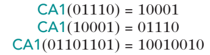

Per completezza scriviamo il **pedice** (che indica la base/rappresentazione):

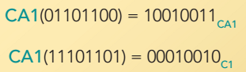

**Proprietà:** il complemento del complemento restituisce il numero di partenza: CA1(CA1(A)) = A.

---

# Complemento a 1 e somma

Il complemento a 1 di un numero a *n* bit vale: **CA1(X) = (2ⁿ − 1) − X**.

Con *n* = 8: 2⁸ − 1 = 255, quindi CA1(X) = 255 − X.

| X | Binario | CA1(X) | Verifica 255 − X |
|:-:|:-:|:-:|:-:|
| 109 | `0110 1101` | `1001 0010` (146) | 255 − 109 = **146** ✔ |
| 236 | `1110 1100` | `0001 0011` (19) | 255 − 236 = **19** ✔ |

Quindi **X + CA1(X)** è sempre `1111 1111`: tutti 1.

---

<!-- _class: lead -->

# Parte E
## Il complemento a 2

---

# Il complemento a 2: definizione

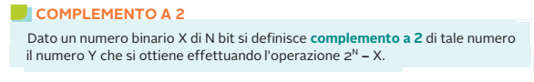

**Definizione.** Dato un numero binario X di **N bit**, il suo **complemento a 2** è il numero **Y = 2ᴺ − X**.

È il "numero che sommato a X dà 2ᴺ": cioè Y è il numero che, sommato a X, produce un riporto e rimane **zero**.

---

# Complemento a 2: esempi dalla definizione

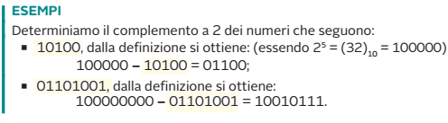

- **10100** (5 bit): 2⁵ = 32 = `100000`; `100000 − 10100 = 01100` (32 − 20 = 12 ✔);
- **01101001** (8 bit): `100000000 − 01101001 = 10010111` (256 − 105 = 151 ✔).

---

# Metodo veloce: NOT più 1

Un metodo veloce per ottenere il complemento a 2 è **scambiare gli 1 con gli 0 e sommare 1** al risultato. Cioè: **CA2(X) = CA1(X) + 1**.

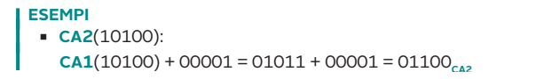

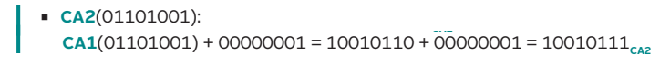

**Perché funziona?** CA1(X) = (2ⁿ − 1) − X; aggiungendo 1 si ottiene 2ⁿ − X, cioè proprio la definizione.

---

# Metodo pratico (da destra)

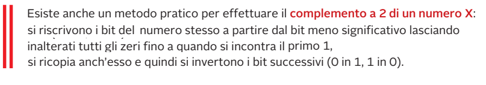

**Regola:** partendo dal bit **meno significativo**:
1. si **ricopiano** tutti gli **zeri** fino al primo **1**;
2. si **ricopia anche il primo 1**;
3. si **invertono** tutti i bit successivi (0 → 1, 1 → 0).

---

# Metodo pratico: esempi

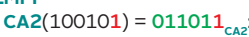

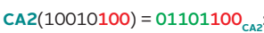

| Numero | Ricopio (da destra, fino al primo 1) | Inverto il resto | CA2 |
|:-:|:-:|:-:|:-:|
| `100101` (37) | `1` | `10010` → `01101` | `011011` (27 = 64 − 37) |
| `10010100` (148) | `100` | `10010` → `01101` | `01101100` (108 = 256 − 148) |

I bit ricopiati (rossi nell'immagine) arrivano **fino al primo 1 incluso**, i bit verdi sono **invertiti**.

---

<!-- _class: small -->

# Riepilogo: i punti chiave

- **Senza segno:** con *n* bit si rappresentano i valori da 0 a **2ⁿ − 1**.
- **Somma:** colonna per colonna con riporto; il riporto oltre l'ultimo bit è il **carry**.
- **Carry/overflow:** segnala che il risultato supera il massimo del registro (255 su 8 bit).
- **Prodotto per 2ⁿ:** aggiungere *n* zeri a destra (shift a sinistra).
- **Divisione per 2ⁿ:** togliere gli ultimi *n* bit (shift a destra); i bit tolti sono il resto.
- **Prodotto tra bit** = AND logico.
- **CA1:** invertire tutti i bit.
- **CA2:** CA1 + 1, oppure "ricopio fino al primo 1 e poi inverto".
- **Sottrazione** = somma del complemento a 2.

---

<!-- _class: small -->

# Verifica: esercizi

1. Calcola in binario: `10110 + 01101` e dì in decimale quanto fa.
2. Esegui su 8 bit `250 + 10`. Qual è il risultato nel registro? Il carry vale?
3. Calcola `1101 × 1000` e `101100 : 100` usando gli shift.
4. Scrivi il **complemento a 1** di `10010110` e di `01111111`.
5. Calcola il **complemento a 2** di `00101000` e di `10000000` (8 bit) con il metodo "NOT + 1".
6. Verifica con il metodo pratico (ricopio fino al primo 1) il CA2 di `01101000`.
7. Calcola **90 − 35** su 8 bit sommando il complemento a 2 di 35.
8. Quanti valori diversi si rappresentano con 12 bit senza segno? Qual è il massimo?

---

<!-- _class: tiny -->

# Verifica: soluzioni

1. `10110 + 01101 = 100011` → 22 + 13 = **35**.
2. `250 + 10 = 260` → nel registro **4** (`0000 0100`), **carry = 1** (260 − 256 = 4).
3. `1101 × 1000 = 1101000` (13 × 8 = 104); `101100 : 100` → tolgo 2 bit → `1011` (44 : 4 = 11), resto `00`.
4. CA1(`10010110`) = **`01101001`**; CA1(`01111111`) = **`10000000`**.
5. `00101000` → NOT `11010111` → +1 = **`11011000`**; `10000000` → NOT `01111111` → +1 = **`10000000`** (il CA2 di 128 su 8 bit è lui stesso).
6. `01101000`: da destra `000` (zeri ricopiati), `1` (primo 1 ricopiato), poi inverto `0110` → `1001` → CA2 = **`10011000`**.
7. 35 = `00100011`; CA2 = `11011101`; `01011010 + 11011101 = 1 00110111` → scarto il riporto → `00110111` = **55** ✔.
8. 2¹² = **4096** valori, da 0 a **4095**.

---

<!-- _class: lead -->
<!-- _paginate: false -->

# Grazie per l'attenzione

## Domande?
