<!-- _class: lead -->
<!-- _paginate: false -->
<!-- _header: "" -->

# I numeri binari relativi

## Unità di Apprendimento 3 · Lezione 2

Tecnologie e Progettazione di Sistemi Informatici e di Telecomunicazioni (TPSI)
Classe 3ª · Istituto Tecnico – Informatica
**Prof. Dicara**

---

# In questa lezione impareremo

- a rappresentare i **numeri relativi** (positivi e negativi) in binario;
- le quattro rappresentazioni: **modulo e segno**, **complemento a 1**, **complemento a 2**, **eccesso 2ⁿ⁻¹**;
- che cos'è l'**overflow** con i numeri con segno e come riconoscerlo.

> Problema di partenza: nella memoria ci sono solo 0 e 1. **Come si scrive il segno "−"?**

---

# Mappa della lezione

| Parte | Argomento |
|---|---|
| **A** | Modulo e segno |
| **B** | Complemento a 1 |
| **C** | Complemento a 2 (la più usata) |
| **D** | Overflow nei numeri con segno |
| **E** | Rappresentazione in eccesso |
| **F** | Confronto e riepilogo |

---

<!-- _class: lead -->

# Parte A
## Modulo e segno

---

# Modulo e segno: l'idea

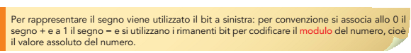

Il **bit più significativo (MSB)** è il **bit di segno**: **0 = positivo**, **1 = negativo**. Gli altri *n − 1* bit rappresentano il **modulo** (valore assoluto).

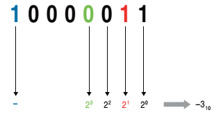

`1000 0011` → segno **1** (negativo), modulo `000 0011` = 3 → **−3**.

---

# Modulo e segno: definizione

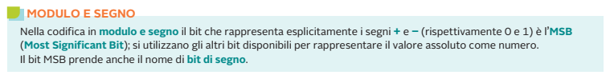

**Esempio (8 bit):**

| Numero | Segno | Modulo | Codifica |
|:-:|:-:|:-:|:-:|
| +25 | 0 | `0011001` | `0001 1001` |
| −25 | 1 | `0011001` | `1001 1001` |

Per cambiare segno basta **invertire il bit più significativo**.

---

# Tabella a 3 bit

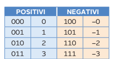

Con 3 bit: `000` = +0 e `100` = −0. Esistono **due zeri**: è uno **spreco** e complica i confronti.

---

# Range in modulo e segno

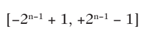

Con *n* bit: da **−(2ⁿ⁻¹ − 1)** a **+(2ⁿ⁻¹ − 1)**.

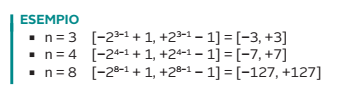

| Bit | Range | Valori distinti |
|:-:|:-:|:-:|
| 3 | −3 … +3 | 7 (2ⁿ − 1) |
| 4 | −7 … +7 | 15 |
| 8 | −127 … +127 | 255 |

Gli 2ⁿ codici disponibili rappresentano solo 2ⁿ − 1 numeri, perché lo zero è doppio.

---

# Conversioni in modulo e segno

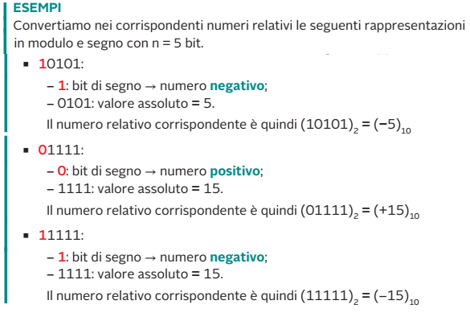

**Da decimale:** segno → bit 0/1; modulo → binario su *n − 1* bit.
**Verso decimale:** si calcola il modulo ignorando l'MSB, poi si applica il segno.

---

# Somma in modulo e segno

Non si possono sommare direttamente i bit: **bisogna guardare i segni**.

- **segni concordi** → si sommano i moduli e si mantiene il segno;
- **segni discordi** → si sottrae il modulo minore dal maggiore e si usa il **segno del numero con modulo maggiore**.

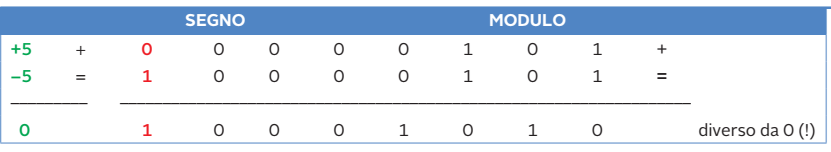

Per questo motivo l'hardware deve avere **sommatore e sottrattore** e un circuito di confronto: scomodo.

---

<!-- _class: lead -->

# Parte B
## Complemento a 1

---

# Complemento a 1 (CA1)

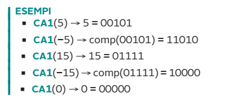

- **numeri positivi**: come in modulo e segno (MSB = 0);
- **numeri negativi**: si ottengono **invertendo tutti i bit** del corrispondente positivo (MSB = 1).

**Esempio (4 bit):** +5 = `0101` → −5 = `1010`.

---

# Tabella in complemento a 1

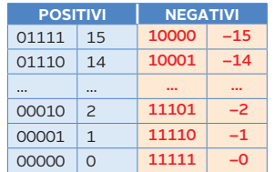

---

# Osservazioni sul CA1

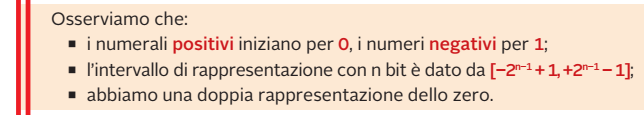

- anche qui **due zeri**: `0000` (+0) e `1111` (−0);
- range: da **−(2ⁿ⁻¹ − 1)** a **+(2ⁿ⁻¹ − 1)**, cioè −7 … +7 con 4 bit;
- il **primo bit** indica il segno.

---

<!-- _class: lead -->

# Parte C
## Complemento a 2

---

# Complemento a 2 (CA2)

- **positivi**: come in modulo e segno;
- **negativi**: **CA2 del positivo** = inversione dei bit **+ 1**;
- **un solo zero**;
- **range asimmetrico**: da **−2ⁿ⁻¹** a **+(2ⁿ⁻¹ − 1)**. Con 8 bit: **−128 … +127**.

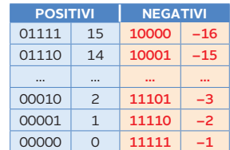

---

# Osservazioni sul CA2

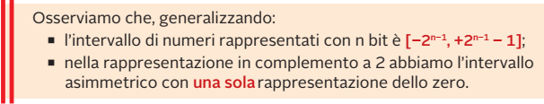

**Perché il CA2 è lo standard:**

1. **un solo zero** (`0000`);
2. **somma e sottrazione** con lo stesso circuito: A − B = A + CA2(B);
3. l'**MSB resta il bit di segno**.

---

# CA2: come calcolare il valore

L'MSB ha **peso negativo −2ⁿ⁻¹**; gli altri i pesi positivi.

`1011` (4 bit) = −8 + 0 + 2 + 1 = **−5**
`1111 0011` (8 bit) = −128 + 64 + 32 + 16 + 2 + 1 = **−13**

**Codifica di −13 su 8 bit:**
1. 13 = `0000 1101`;
2. inverto: `1111 0010`;
3. aggiungo 1: **`1111 0011`**.

---

# Errori tipici con il CA2

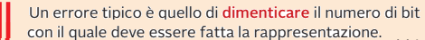

**Primo errore: dimenticare il numero di bit.**

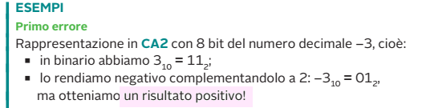

**Procedimento corretto:**

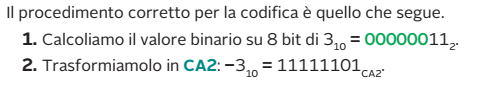

---

# Errori tipici con il CA2 (2)

**Secondo errore: complementare anche i numeri positivi.**

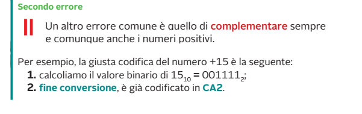

I numeri **positivi** in CA2 si scrivono **come i binari normali** (con MSB = 0). Si complementano solo i numeri **negativi**.

---

<!-- _class: lead -->

# Parte D
## Overflow con i numeri con segno

---

# Overflow nei numeri con segno

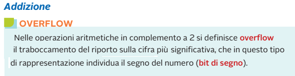

L'**overflow** si verifica quando il risultato **non è rappresentabile** con gli *n* bit disponibili: il risultato ottenuto è **sbagliato**.

**Regola pratica (CA2):**
- somma di due **positivi** che dà risultato con segno **negativo** → overflow;
- somma di due **negativi** che dà risultato con segno **positivo** → overflow;
- positivo + negativo → **mai** overflow.

---

# Tabella dell'overflow

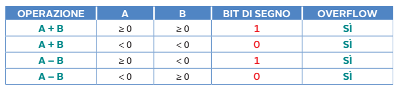

Per ogni riga il bit di segno del risultato è quello "sbagliato" rispetto al segno atteso: è questo che indica l'overflow.

---

# Esempio: 127 + 1 su 8 bit

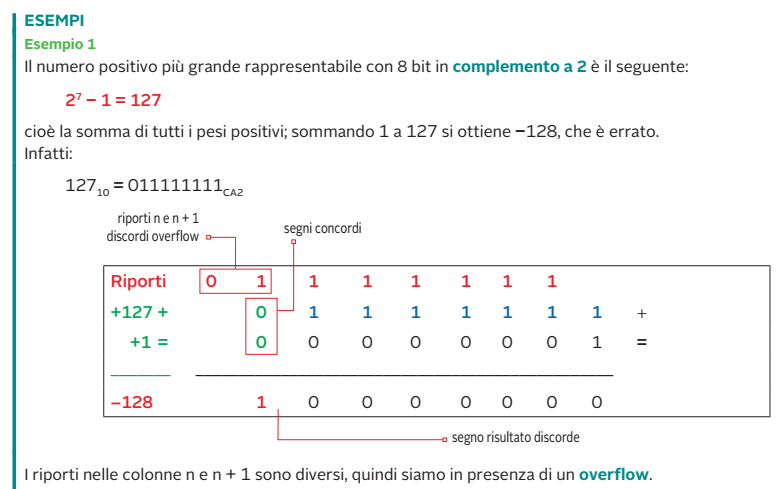

```
  0111 1111   (+127)
+ 0000 0001   (+1)
-----------
  1000 0000   → in CA2 = −128   ✘  overflow!
```

Due positivi hanno prodotto un risultato con bit di segno 1.

---

# Esempio: 100 + 25 e 100 + 50

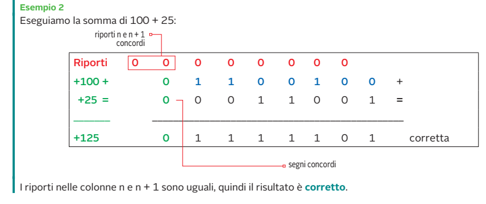

- **100 + 25 = 125** → sta in −128…+127 → **nessun overflow**;
- **100 + 50 = 150** → `0110 0100 + 0011 0010 = 1001 0110` = **−106** ✘ → **overflow**.

> Ricorda: **carry ≠ overflow** con i numeri con segno. Un carry può esserci senza overflow (−1 + 1 = `1111 1111 + 1 = 1 0000 0000` → 0, corretto).

---

<!-- _class: lead -->

# Parte E
## Rappresentazione in eccesso

---

# Eccesso 2ⁿ⁻¹

Si **somma una costante** (il "bias") al numero relativo, così il risultato è sempre **positivo**, e si codifica in binario.

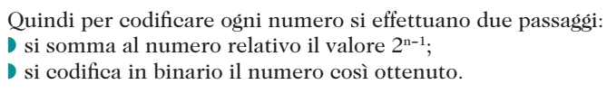

**Due passaggi:**
1. si somma al numero relativo il valore **2ⁿ⁻¹**;
2. si codifica in binario il risultato.

---

# Eccesso 8 (4 bit)

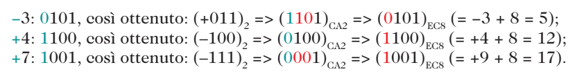

> **Nota di correzione:** in quest'immagine compaiono due errori di stampa. **+7 in eccesso 8** è `7 + 8 = 15 =` **`1111`** (non `1001`/17), e per +4 il numero tra parentesi è **+100**, non −100.

Esempi corretti: −8 → `0000`; −1 → `0111`; 0 → `1000`; +3 → `1011`; +7 → `1111`.

---

# Eccesso 16 (5 bit)

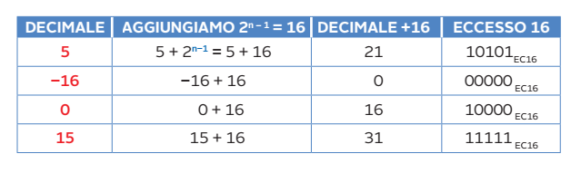

---

# Tabella completa in eccesso 16

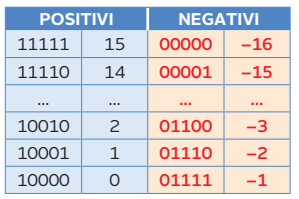

> **Nota di correzione:** in questa tabella −3 deve valere `−3 + 16 = 13 =` **`01101`** (non `01100`).
> Il testo "primi 2N−1" va letto come **2ⁿ⁻¹** (il bias).

---

# Decodifica dell'eccesso

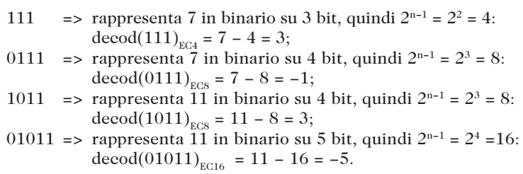

**Procedura:** si legge il numero come binario normale e **si sottrae 2ⁿ⁻¹**.

- `111` (3 bit): 7 − 4 = **3**
- `0111` (4 bit): 7 − 8 = **−1**
- `1011` (4 bit): 11 − 8 = **3**
- `01011` (5 bit): 11 − 16 = **−5**

> **Curiosità:** l'eccesso coincide con il CA2 **con il bit di segno invertito**. Si usa per **l'esponente dei numeri in virgola mobile** (Lezione 3).

---

<!-- _class: small -->

# Confronto delle rappresentazioni (4 bit)

| Dec | Modulo e segno | CA1 | CA2 | Eccesso 8 |
|:-:|:-:|:-:|:-:|:-:|
| −8 | — | — | `1000` | `0000` |
| −7 | `1111` | `1000` | `1001` | `0001` |
| −5 | `1101` | `1010` | `1011` | `0011` |
| −3 | `1011` | `1100` | `1101` | `0101` |
| −1 | `1001` | `1110` | `1111` | `0111` |
| +0 | `0000` | `0000` | `0000` | `1000` |
| +3 | `0011` | `0011` | `0011` | `1011` |
| +7 | `0111` | `0111` | `0111` | `1111` |

(in M&S e CA1 esiste anche −0: `1000` e `1111` rispettivamente)

---

<!-- _class: small -->

# Riepilogo: i punti chiave

| | Zeri | Range (n bit) | Uso |
|---|:-:|---|---|
| Modulo e segno | 2 | −(2ⁿ⁻¹−1) … +(2ⁿ⁻¹−1) | didattico |
| CA1 | 2 | −(2ⁿ⁻¹−1) … +(2ⁿ⁻¹−1) | didattico |
| **CA2** | **1** | **−2ⁿ⁻¹ … +(2ⁿ⁻¹−1)** | **interi nei computer** |
| Eccesso 2ⁿ⁻¹ | 1 | −2ⁿ⁻¹ … +(2ⁿ⁻¹−1) | esponente dei float |

- Sempre indicare **quanti bit** si usano.
- **Overflow** se il segno del risultato è incoerente con quello degli addendi.

---

<!-- _class: small -->

# Verifica: esercizi

1. Scrivi su 8 bit in **modulo e segno**, **CA1** e **CA2** il numero −45.
2. Quanto vale `1110 0110` in CA2? E in modulo e segno?
3. Qual è il range in CA2 con 6 bit? E in modulo e segno?
4. Calcola in CA2 su 8 bit: `50 + 90`. C'è overflow?
5. Calcola in CA2 su 8 bit: `30 − 50`.
6. Codifica in **eccesso 8** (4 bit) i numeri −6, 0 e +5.
7. Decodifica `10110` in **eccesso 16**.
8. Perché due zeri sono un problema?

---

<!-- _class: tiny -->

# Verifica: soluzioni

1. 45 = `0010 1101`. **M&S:** `1010 1101`; **CA1:** `1101 0010`; **CA2:** `1101 0011`.
2. CA2: −128 + 64 + 32 + 4 + 2 = **−26**. M&S: segno −, modulo `110 0110` = 102 → **−102**.
3. CA2 6 bit: **−32 … +31**; M&S: **−31 … +31**.
4. 50 + 90 = 140 > 127 → `0011 0010 + 0101 1010 = 1000 1100` = −116 → **overflow**.
5. 30 − 50 = 30 + CA2(50) = `0001 1110 + 1100 1110 = 1110 1100` = **−20** ✔ (nessun overflow).
6. −6 → −6 + 8 = 2 → **`0010`**; 0 → **`1000`**; +5 → 13 → **`1101`**.
7. `10110` = 22 → 22 − 16 = **+6**.
8. Spreco di un codice, e i confronti (`+0 == −0`?) richiedono controlli aggiuntivi.

---

<!-- _class: lead -->
<!-- _paginate: false -->

# Grazie per l'attenzione

## Domande?
