<!-- _class: lead -->
<!-- _paginate: false -->
<!-- _header: "" -->

# I numeri reali: virgola mobile

## Unità di Apprendimento 3 · Lezione 3

Tecnologie e Progettazione di Sistemi Informatici e di Telecomunicazioni (TPSI)
Classe 3ª · Istituto Tecnico – Informatica
**Prof. Dicara**

---

# In questa lezione impareremo

- a rappresentare i **numeri reali** in un calcolatore con la **virgola mobile** (*floating point*);
- mantissa, esponente, **normalizzazione** e **bit nascosto** (*hidden bit*);
- lo standard **IEEE-754** a 32, 64 e 80 bit;
- a **codificare** e **decodificare** un numero reale;
- **underflow**, numeri denormalizzati, ±0, ±∞, NaN;
- **errore** di rappresentazione: troncamento e arrotondamento.

---

# Mappa della lezione

| Parte | Argomento |
|---|---|
| **A** | Mantissa ed esponente |
| **B** | Normalizzazione e hidden bit |
| **C** | Esponente in eccesso (bias) |
| **D** | Standard IEEE-754: codifica |
| **E** | Decodifica |
| **F** | Casi speciali e denormalizzati |
| **G** | Errori: troncamento, arrotondamento |

---

<!-- _class: lead -->

# Parte A
## Mantissa ed esponente

---

# Perché serve la virgola mobile

Con la virgola **fissa** si ha un numero prefissato di cifre intere e decimali: non si possono rappresentare insieme numeri enormi (massa del Sole: 2·10³⁰ kg) e piccolissimi (massa dell'elettrone: 9·10⁻³¹ kg).

La **notazione scientifica** risolve il problema: **numero = mantissa × baseᵉˢᵖᵒⁿᵉⁿᵗᵉ**.

| Numero | Notazione scientifica |
|:-:|:-:|
| 1 234 000 | 1,234 · 10⁶ |
| 0,00056 | 5,6 · 10⁻⁴ |

La **virgola "si sposta"** (mobile) a seconda dell'esponente.

---

# Mantissa, esponente e resto

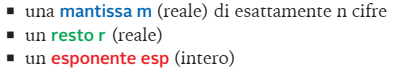

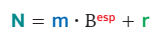

Un numero reale *N* si scrive come **N ≈ m · Bᵉˢᵖ**, con *m* = **mantissa**, *B* = **base**, *esp* = **esponente**. Il **resto** *r* è la parte che non entra nelle cifre disponibili ed è **trascurata**.

> **Precisazione:** la scrittura esatta è N = (m + r) · Bᵉˢᵖ, dove *r* è la parte della mantissa non rappresentabile con le cifre disponibili.

---

# Infinite scomposizioni

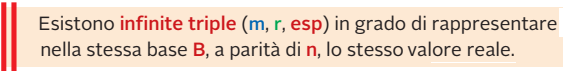

Lo stesso numero ha **infinite scomposizioni** (mantissa, esponente) diverse:

`12,5 = 1,25·10¹ = 12,5·10⁰ = 0,125·10² = 125·10⁻¹ ...`

Serve una **regola** per sceglierne una sola: la **normalizzazione**.

---

# Tabella delle scomposizioni

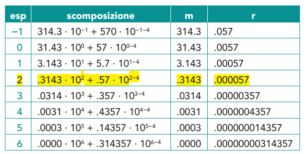


Tra tutte le scomposizioni se ne sceglie **una sola**, la **normalizzata**.

---

<!-- _class: lead -->

# Parte B
## Normalizzazione e hidden bit

---

# Il numero normalizzato

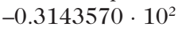

Un numero è **normalizzato** quando la mantissa ha **una sola cifra diversa da 0 prima della virgola**. In base 2 l'unica cifra diversa da 0 è **1**: la mantissa è sempre **1,xxxx**.

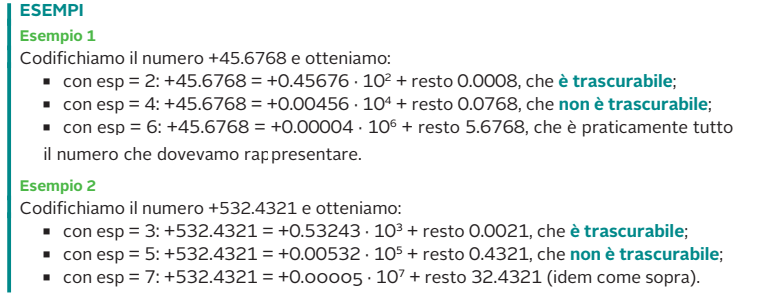

---

# Formule della virgola mobile

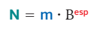

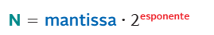

In **base 2**: **N = ± 1,f × 2ᵉˢᵖ**, dove **f** è la **parte frazionaria** della mantissa.

---

# La struttura del numero in memoria

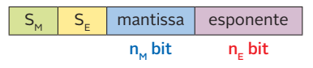

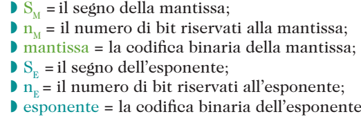

Il numero viene memorizzato in tre campi:

| Campo | Contenuto |
|---|---|
| **S** | segno (0 = +, 1 = −) |
| **E** | esponente |
| **M** | parte frazionaria della mantissa |

---

# Variante della struttura

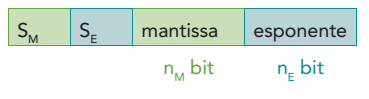


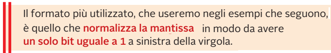

Il numero di bit di **M** limita la **precisione** (quante cifre significative); il numero di bit di **E** limita il **range** (quanto grande o piccolo).

---

# Normalizzare passo passo

**Esempio:** `101,111₂` (5,875)

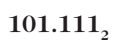

Sposto la virgola di **2 posizioni a sinistra**: `1,01111 × 2²`.

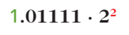

**Esempio:** `0,001011₂` → sposto di 3 a destra: `1,011 × 2⁻³`.

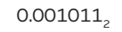 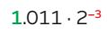

---

# Normalizzare: un altro esempio

`100,100₂` (4,5) → `1,00100 × 2²`

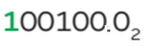 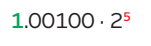

**Regola pratica:**
- virgola spostata **a sinistra** di *k* posti → esponente **+ k**;
- virgola spostata **a destra** di *k* posti → esponente **− k**.

---

# Hidden bit

Poiché la mantissa normalizzata comincia **sempre con 1**, quell'**1 non si memorizza**: è il **bit nascosto** (*hidden bit*). Così si guadagna **1 bit di precisione** gratis.

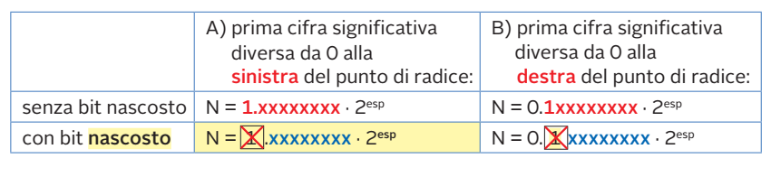

> Con 23 bit memorizzati la precisione effettiva è di **24 bit** (23 + hidden bit).

---

<!-- _class: lead -->

# Parte C
## Esponente in eccesso

---

# L'esponente in eccesso P

L'esponente può essere **negativo** (numeri piccoli) o **positivo** (numeri grandi). Per non memorizzare un segno anche per l'esponente si usa la **rappresentazione in eccesso**: si **somma una costante P** (*bias*) all'esponente, così il valore memorizzato è sempre **positivo**.

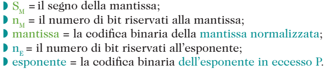

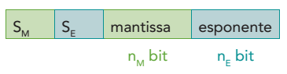

**E = esp + P**   ⟺   **esp = E − P**

Vantaggio: i numeri si **confrontano** come interi senza segno.

---

<!-- _class: lead -->

# Parte D
## Lo standard IEEE-754

---

# Tre precisioni

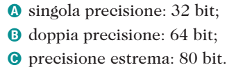

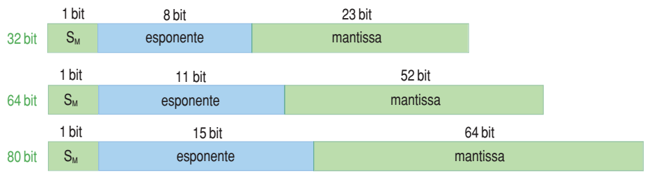

| Formato | Totale | Segno | Esponente | Mantissa | Bias |
|---|:-:|:-:|:-:|:-:|:-:|
| **Singola** | 32 bit | 1 | 8 | 23 | 127 |
| **Doppia** | 64 bit | 1 | 11 | 52 | 1023 |
| **Estesa** | 80 bit | 1 | 15 | 64 | 16383 |

---

# Singola e doppia precisione

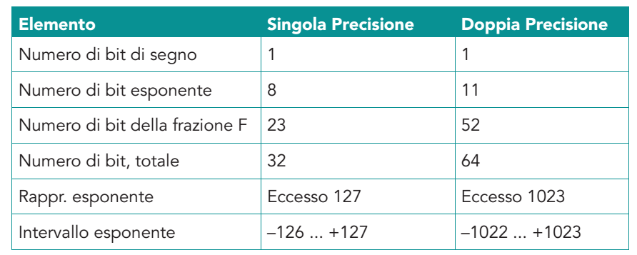

- **float** in C/Java ↔ 32 bit; **double** ↔ 64 bit;
- in Python `float` è un **double** a 64 bit.

---

# La forma dei numeri normalizzati

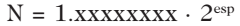

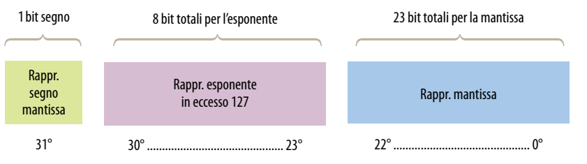

**(−1)ˢ · 1,M · 2ᴱ⁻¹²⁷**  (con E tra 1 e 254)

Su 32 bit: **bit 31** = S; **bit 30…23** = E (8 bit); **bit 22…0** = M (23 bit).

---

# Codificare il numero 1,0

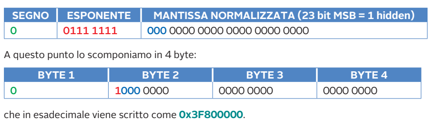

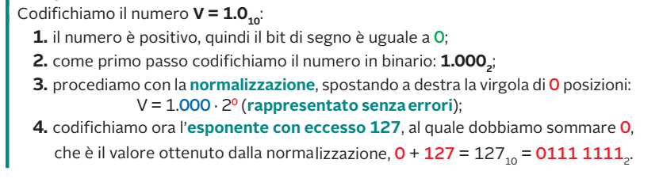

1. S = 0 (positivo);
2. 1,0 = `1,0 × 2⁰` → esp = 0 → E = 0 + 127 = 127 = `0111 1111`;
3. M = 0 (23 zeri).

`0 | 01111111 | 000…0` →  **0x3F800000**

---

# Codificare 8,5

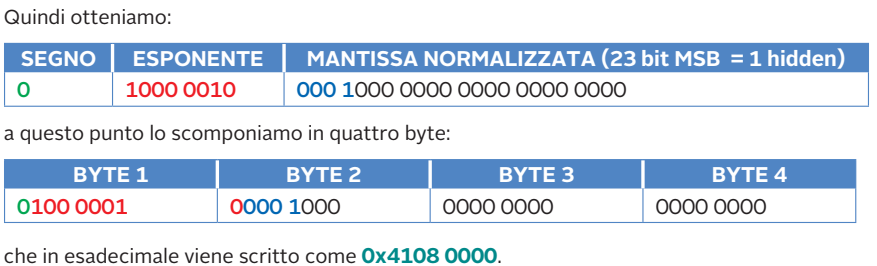

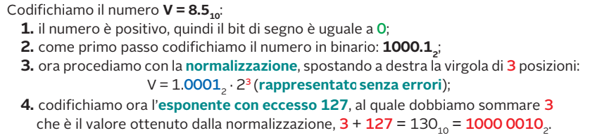

8,5 = `1000,1₂` = `1,0001 × 2³` → E = 3 + 127 = 130 = `1000 0010`; M = `0001 000…`

`0 | 10000010 | 00010000000000000000000` →  **0x41080000**

---

# Codificare −4,5

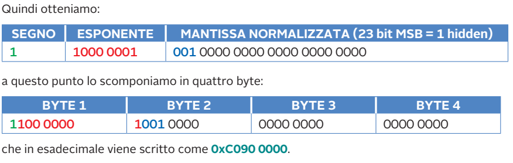

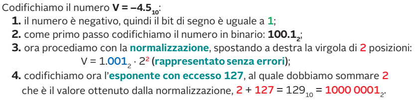

−4,5: S = 1; 4,5 = `100,1₂` = `1,001 × 2²` → E = 129 = `1000 0001`; M = `001 000…`

`1 | 10000001 | 00100000000000000000000` →  **0xC0900000**

---

# Codificare −13,75 e 5,875

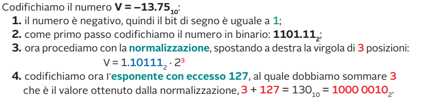

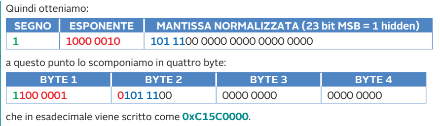

−13,75 = −`1101,11₂` = −`1,10111 × 2³` → E = 130 → **0xC15C0000**.

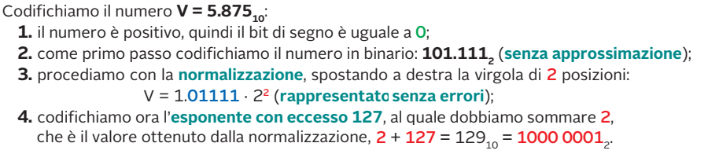

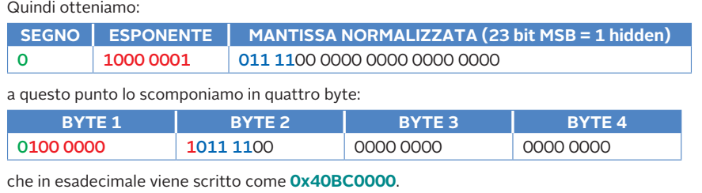

5,875 = `101,111₂` = `1,01111 × 2²` → E = 129 → **0x40BC0000**.

---

# Doppia precisione (64 bit)

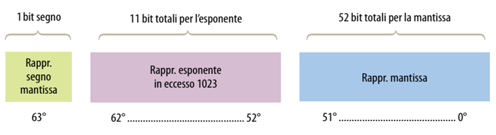

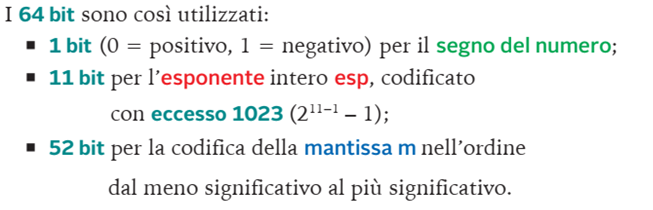

**(−1)ˢ · 1,M · 2ᴱ⁻¹⁰²³**: 1 bit di segno, **11** di esponente, **52** di mantissa. Precisione: circa **15–16 cifre decimali**.

---

# Precisione estesa (80 bit)

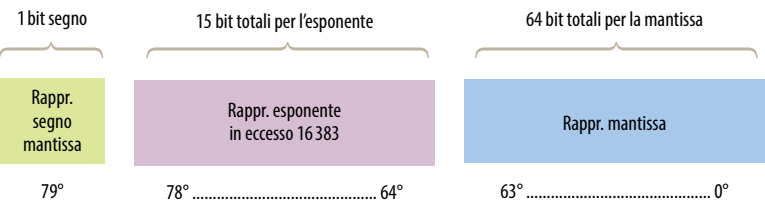

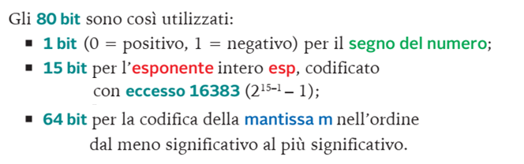

> Caratteristica: la mantissa di 64 bit contiene **esplicitamente** il bit intero (non c'è hidden bit).

---

<!-- _class: lead -->

# Parte E
## Decodifica

---

# Valori limite dell'esponente

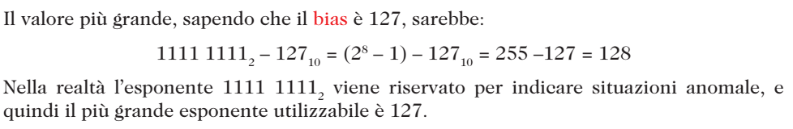


Con 8 bit E va da 0 a 255, ma **0 e 255 sono riservati** (casi speciali). Per i normalizzati: **E = 1 … 254** → esp = **−126 … +127**.

---

# Minimo esponente

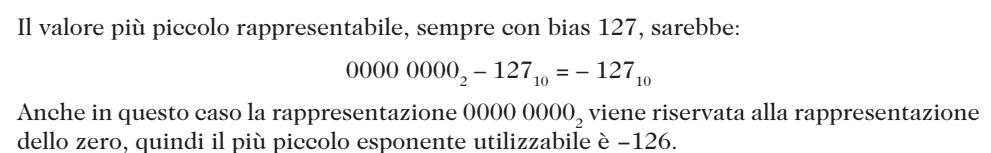

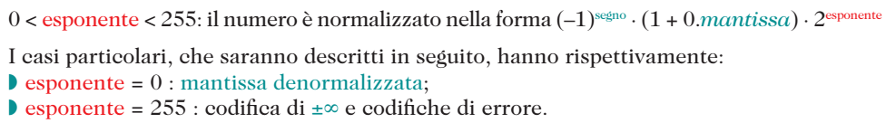

Il numero normalizzato più piccolo in singola precisione è 1,0 × 2⁻¹²⁶ ≈ **1,18 · 10⁻³⁸**; il più grande ≈ **3,4 · 10³⁸**.

---

# Procedura di decodifica

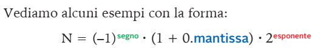

1. scrivere il numero esadecimale in **binario** (32 bit);
2. separare **S | E (8 bit) | M (23 bit)**;
3. segno: S = 0 → +, S = 1 → −;
4. esponente: **esp = E − 127**;
5. mantissa: **1,M** (si aggiunge l'hidden bit);
6. valore = **(−1)ˢ · 1,M · 2ᵉˢᵖ**.

---

# Decodifica: esempio 1

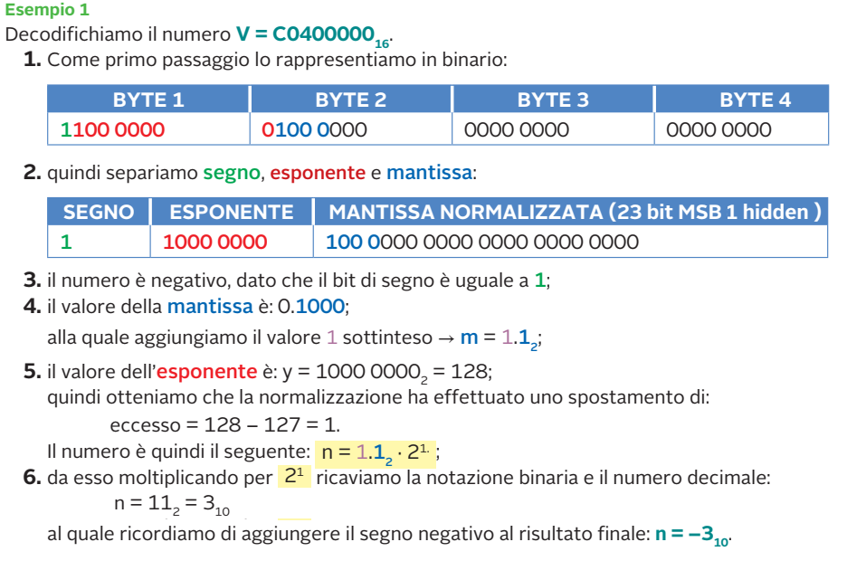

**0xC0400000** → S = 1; E = `1000 0000` = 128 → esp = 1; M = `100…` → 1,1₂ = 1,5 → −1,5 · 2 = **−3**.

---

# Decodifica: esempio 2

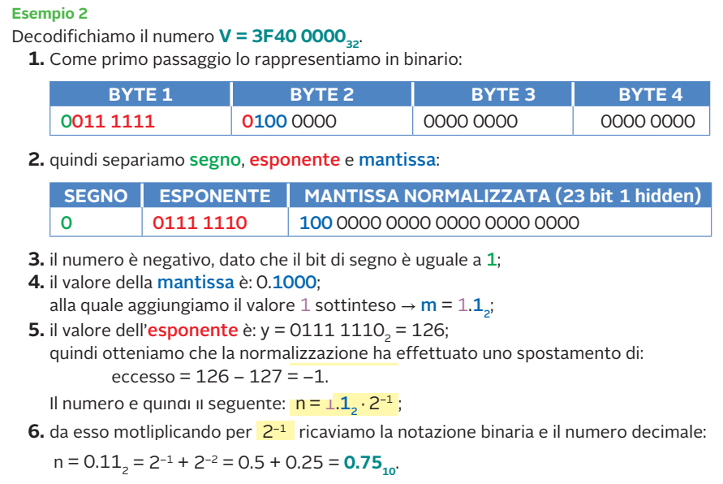

**0x3F400000** → S = 0; E = 126 → esp = −1; 1,1₂ = 1,5 → 1,5 · 2⁻¹ = **+0,75**.

> **Nota di correzione:** nel testo dell'immagine si dice "il numero è negativo", ma il bit di segno è **0**, quindi il numero è **positivo**: +0,75.

---

# Decodifica: esempio 3

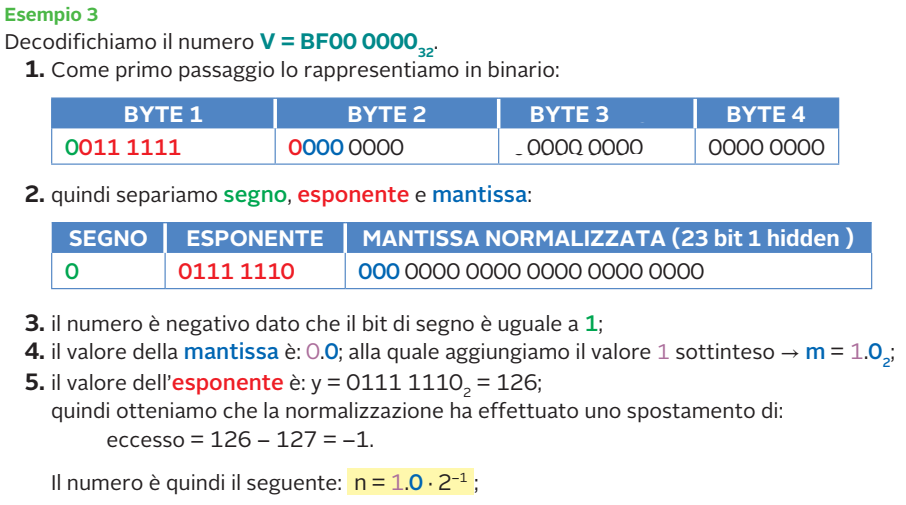

> **Nota di correzione:** il numero è indicato come BF000000, ma il primo byte è mostrato come `0011 1111` (cioè 3F). Con 3F000000 si ha S = 0, E = 126 → **+0,5**; con **0xBF000000** (primo byte `1011 1111`) si ottiene **−0,5**.

---

# Decodifica: esempio 4

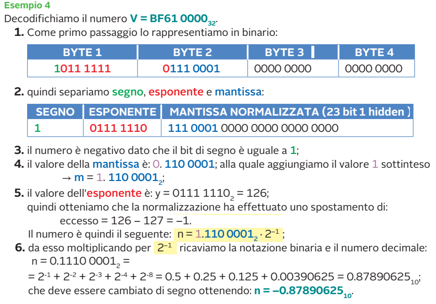

**0xBF610000** → S = 1; E = 126 → esp = −1; M = `110 0001…` → 1,1100001₂ = 1,7578125 → **−0,87890625**.

---

# Decodifica: esempio 5

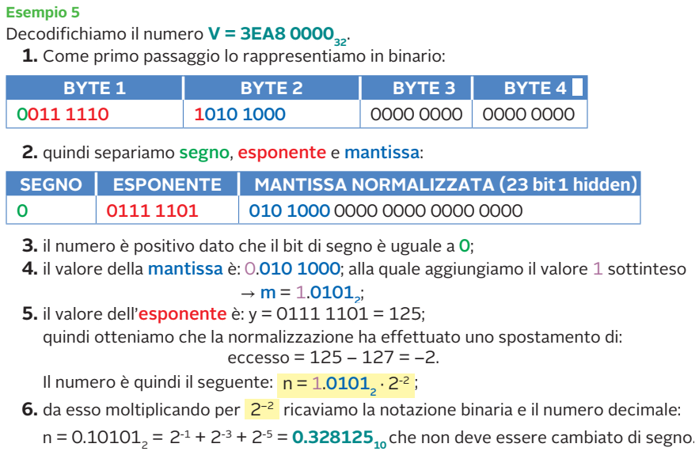

**0x3EA80000** → S = 0; E = `0111 1101` = 125 → esp = −2; M = `010 1000…` → 1,0101₂ = 1,3125 → 1,3125 · 2⁻² = **0,328125**.


---

<!-- _class: lead -->

# Parte F
## Casi speciali e denormalizzati

---

# I numeri più piccoli

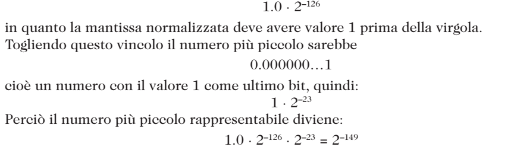


| Tipo | Valore (singola) |
|---|:-:|
| Normalizzato minimo | 2⁻¹²⁶ ≈ 1,18·10⁻³⁸ |
| Denormalizzato minimo | 2⁻¹⁴⁹ ≈ 1,4·10⁻⁴⁵ |

Sotto 2⁻¹⁴⁹ il numero viene approssimato a 0: **underflow**.

---

# Casi particolari: schema


| E | M | Significato |
|:-:|:-:|---|
| 0 | 0 | **±0** (a seconda di S) |
| 0 | ≠ 0 | **denormalizzato** |
| 1…254 | qualsiasi | **normalizzato** |
| 255 | 0 | **±∞** |
| 255 | ≠ 0 | **NaN** (*Not a Number*) |

---

# Denormalizzati: il range


Con E = 0 non c'è hidden bit: il valore è **(−1)ˢ · 0,M · 2⁻¹²⁶**. Riempiono il vuoto tra 0 e il più piccolo normalizzato (**underflow graduale**).

```python
import struct
print(struct.unpack(">f", bytes.fromhex("00000001"))[0])  # 1.4e-45
print(struct.unpack(">f", bytes.fromhex("7F800000"))[0])  # inf
```

---

<!-- _class: lead -->

# Parte G
## Errori di rappresentazione

---

# Errore assoluto e relativo


- **errore assoluto**: E_a = |valore vero − valore rappresentato|;
- **errore relativo**: E_r = E_a / |valore vero|.


L'errore **assoluto** cresce con la grandezza del numero; l'errore **relativo** resta **circa costante** (≈ 2⁻²⁴ in singola precisione).

---

# Il numero 0,1 non è esatto!


0,1 in binario è **periodico**: `0,0001 1001 1001 1001…`. Con 23 bit non si può scrivere esattamente.

```python
print(0.1 + 0.2 == 0.3)   # False!
print(0.1 + 0.2)          # 0.30000000000000004
```

---

# Troncare o arrotondare


- **troncamento**: si scartano i bit in eccesso;
- **arrotondamento**: se il primo bit scartato è 1 si **somma 1** all'ultimo bit tenuto.


I linguaggi C e Java **arrotondano**.

---

# Esempio: 0,15


Per 0,15: **troncamento** → `0x3E199999`; **arrotondamento** → **0x3E19999A**.

---

# Esempio: −1/3


−1/3 = −0,010101…₂ (periodico). Arrotondato in singola: **0xBEAAAAAB**; troncato: 0xBEAAAAAA.

---

# Esempio: 12,6


12,6 = `1100,1001 1001…₂` = `1,1001 0011 0011… × 2³`

- **troncamento**: **0x41499999**;
- **arrotondamento**: **0x4149999A**.

---

<!-- _class: small -->

# Riepilogo: i punti chiave

- **Virgola mobile:** N = (−1)ˢ · 1,M · 2ᵉˢᵖ.
- **Normalizzare:** mantissa del tipo 1,xxx; **hidden bit** non memorizzato.
- **Esponente in eccesso:** E = esp + bias (127 / 1023).
- **IEEE-754:** 32 = 1+8+23; 64 = 1+11+52; 80 = 1+15+64.
- **Casi speciali:** E=0 → ±0 / denormalizzati; E=255 → ±∞ / NaN.
- **Errori:** i numeri come 0,1 non sono esatti; si **tronca** o si **arrotonda**.
- **Errore relativo** ≈ costante; **assoluto** cresce con l'ordine di grandezza.

---


<!-- _class: small -->

# Verifica: esercizi


Esercizi da svolgere in singola precisione:

1. Codifica **−4,5** in esadecimale.
2. Codifica **11,876** con troncamento e con arrotondamento.
3. Codifica **12,6** con troncamento e con arrotondamento.
4. Decodifica **0x40490FDB** (suggerimento: è circa π).

---

<!-- _class: tiny -->

# Verifica: soluzioni

1. −4,5: **0xC0900000** (S=1, E=129, M=`001…`).
2. 11,876 = `1,01111100000010000011001… × 2³` (E = 130): troncamento **0x413E0418**; arrotondamento **0x413E0419**.
3. 12,6: troncamento **0x41499999**; arrotondamento **0x4149999A**.
4. 0x40490FDB → S=0; E=`1000 0000`=128 → esp=1; 1,5707964 · 2 = **3,1415927** (π).

Verifica in Python:
```python
import struct
for x in (-4.5, 11.876, 12.6): print(struct.pack(">f", x).hex().upper())
print(struct.unpack(">f", bytes.fromhex("40490FDB"))[0])
```

---

<!-- _class: lead -->
<!-- _paginate: false -->

# Grazie per l'attenzione

## Domande?
