<!-- _class: lead -->
<!-- _paginate: false -->
<!-- _footer: '' -->


# Il Network Layer del TCP/IP

### Routing e forwarding · IPv4 · indirizzi IP · classful e CIDR · FLSM · VLSM · supernetting

**Sistemi e Reti – Classe 4ª**

---

## Di cosa parliamo: la mappa della lezione

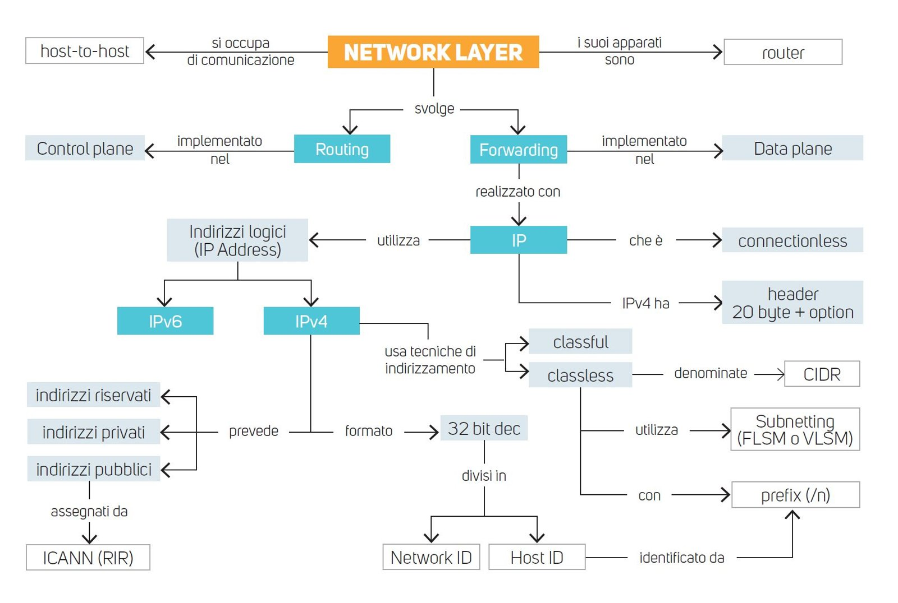

<div class="caption">Mappa concettuale dell'unità: tienila come riferimento, ogni riquadro corrisponde a una parte della lezione.</div>

---

## Indice

<div class="columns">
<div>

**Parte 1 – Il livello Network**
1. Routing e forwarding
2. Control plane e data plane
3. Servizi e protocolli

**Parte 2 – Il protocollo IPv4**
4. L'header IPv4, campo per campo
5. Frammentazione e MTU

</div>
<div>

**Parte 3 – Gli indirizzi IPv4**
6. Struttura, Network ID / Host ID, subnet mask
7. Indirizzi speciali, pubblici e privati
8. Classful vs classless (CIDR)

**Parte 4 – Pianificare una rete**
9. L'operazione di **AND**
10. Subnetting **FLSM** e **VLSM**
11. Supernetting e linee guida di progetto

</div>
</div>

---

<!-- _class: lead -->


# Parte 1
## Le funzionalità del livello Network

---

## Che cosa fa il livello Network

Il **Network Layer** (livello 3) porta un pacchetto **dall'host mittente all'host destinatario**, anche se si trovano su reti diverse e lontane. Usa i livelli sottostanti (Data Link e Physical) per i singoli "salti" e offre al livello **Transport** un servizio di consegna.

Per farlo svolge **due funzioni**:

| | **Routing** (instradamento) | **Forwarding** (inoltro) |
|---|---|---|
| Domanda | *"Qual è il percorso migliore?"* | *"Da quale porta esce questo pacchetto?"* |
| Visione | **globale**: coinvolge tutti i router | **locale**: riguarda un solo router |
| Come | algoritmi e protocolli di routing (es. OSPF, BGP) | consultazione di una tabella |
| Dove | **software** | spesso **hardware** (molto veloce) |
| Quando | periodicamente, o quando cambia la rete | per **ogni** pacchetto ricevuto |

> **Analogia del viaggio:** il **routing** è studiare la cartina e scegliere l'itinerario; il **forwarding** è, a ogni incrocio, leggere il cartello e girare a destra o a sinistra. Si decide una volta il percorso, ma si "svolta" migliaia di volte.

---

## Control plane e Data plane

<div class="columns3">
<div>

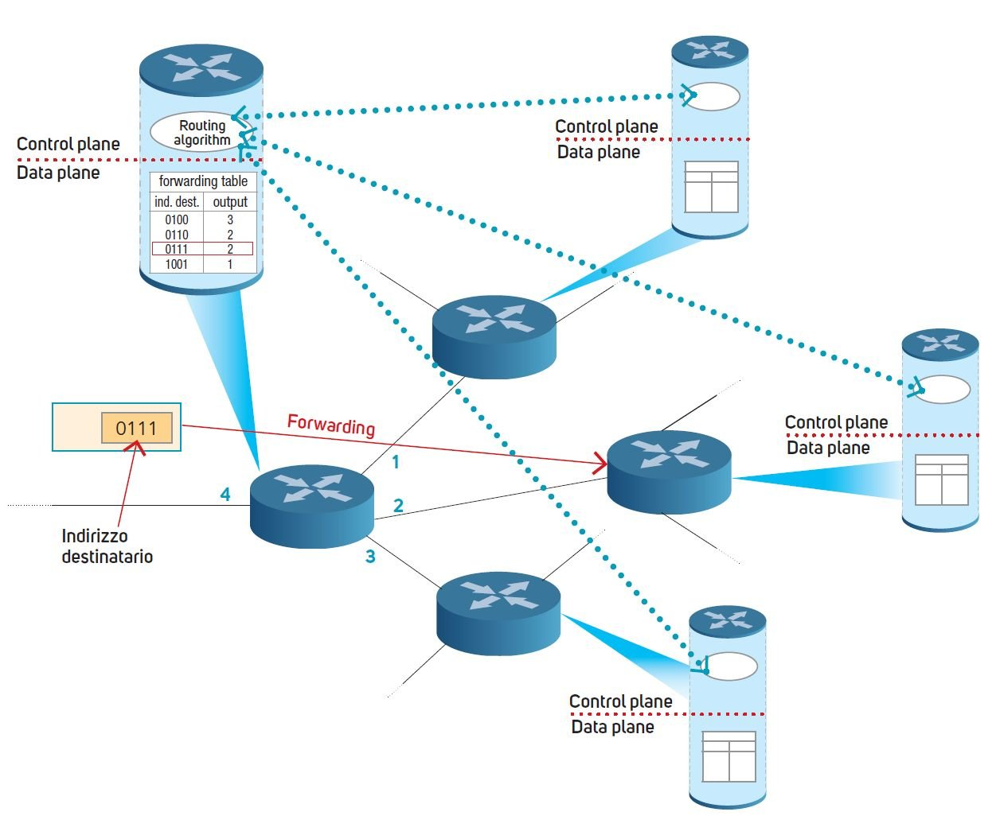

</div>
<div class="small">

**Control plane** – *"il cervello"*
- esegue il **routing**
- dialoga con gli altri router (linee tratteggiate)
- costruisce la **routing table**: una mappa globale della rete

**Data plane** – *"i riflessi"*
- esegue il **forwarding**
- usa la **forwarding table**, ricavata dalla routing table, più piccola e veloce
- per ogni pacchetto sceglie l'**interfaccia di uscita**

</div>
</div>

<div class="tiny">

**Leggiamo la figura:** arriva un pacchetto con indirizzo destinatario `0111`. Il router cerca `0111` nella forwarding table → output **2** → il pacchetto esce dall'interfaccia 2 verso il *next hop*.

</div>

---

## Internet e le reti SDN

**SDN** (*Software-Defined Networking*): il control plane è **centralizzato** su server dedicati che "programmano" tutti i router. Funziona bene in un data center o in una rete aziendale.

**Perché Internet non può essere una grande SDN?**
- **scalabilità**: nessun controllore centrale potrebbe gestire milioni di router (la scalabilità è la capacità di crescere o ridursi secondo le necessità);
- **autonomia decisionale**: Internet è una **rete di reti** gestite da organizzazioni diverse, che decidono da sole.

**Come funziona invece Internet:**
- è un sistema a **controllo distribuito**: ogni router calcola i percorsi e inoltra i pacchetti;
- è formata da tanti **Autonomous System (AS)** – le reti di un ISP, di un cloud provider, di una grande azienda;
- gli AS si scambiano le informazioni di instradamento con il protocollo **BGP**;
- ogni router ha la sua **routing table** e ne ricava la **forwarding table**.

---

## Servizi e protocolli del livello Network

<div class="columns">
<div>

### Due tipi di servizio
- **Connesso** (*connection-oriented*): prima si apre un **circuito virtuale**, poi tutti i pacchetti seguono lo **stesso percorso** (X.25, Frame Relay, ATM).
- **Non connesso** (*connectionless*): ogni pacchetto viaggia per conto suo e può seguire un **percorso diverso**. È il modello di **TCP/IP**.

> Connectionless è come spedire tante cartoline: ognuna può prendere una strada diversa e arrivare in ordine diverso.

</div>
<div>

### I protocolli
- **IP** (*Internet Protocol*): trasporta i dati, è il protocollo principale;
- **protocolli di controllo**: **ARP** (da IP a MAC), **ICMP** (messaggi di errore e `ping`), **protocolli di routing** (RIP, OSPF, BGP).

### Il ruolo del livello 3
- è il primo livello che garantisce la **connettività WAN** (tra reti lontane);
- identifica ogni host con un **indirizzo logico**: l'**indirizzo IP**;
- deve conoscere la **topologia** della rete e gestire reti fisiche **eterogenee**.

</div>
</div>

---

<!-- _class: lead -->


# Parte 2
## Il protocollo IPv4

---

## L'Internet Protocol (IP)

<div class="columns">
<div>

- Definito nel **1981** nell'**RFC 791**, poi aggiornato dagli RFC 1349, 2474 e 6864.
- Si occupa di **indirizzamento** (chi è il mittente, chi il destinatario), **impacchettamento** dei dati del livello Transport, **trasferimento** e, se serve, **frammentazione**.
- La sua PDU si chiama **datagram** (nell'RFC), comunemente **pacchetto**.

**IP è *connectionless* e *best effort*:** non apre connessioni e **non garantisce** consegna né ordine; l'affidabilità, se serve, la aggiunge il livello Transport (**TCP**).

</div>
<div>

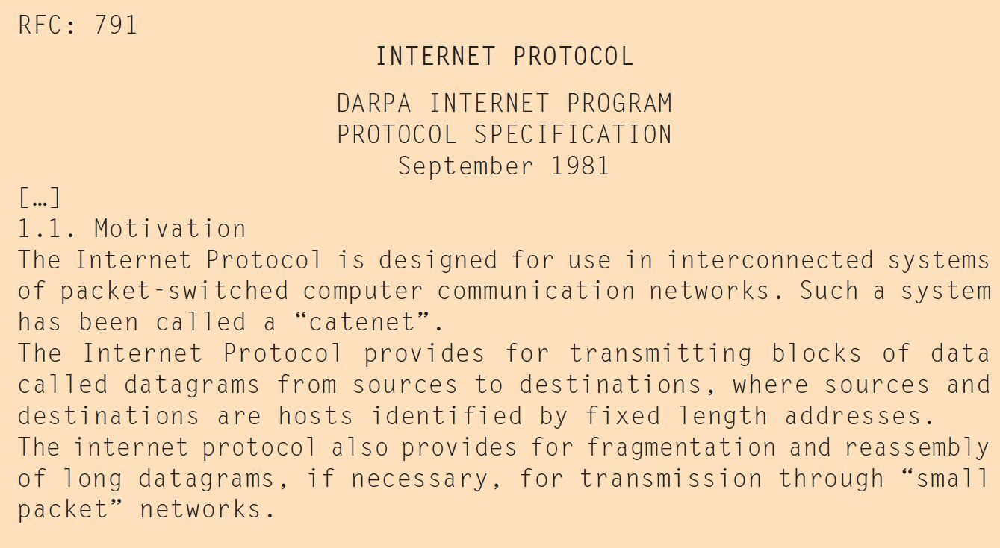

<div class="caption">L'inizio dell'RFC 791 (settembre 1981)</div>

> "Connectionless, nessuna garanzia" è lo stesso schema di **UDP** e di LLC tipo 1: IP fa da base sia a TCP sia a UDP.

</div>
</div>

---

## Il pacchetto IPv4: header + payload

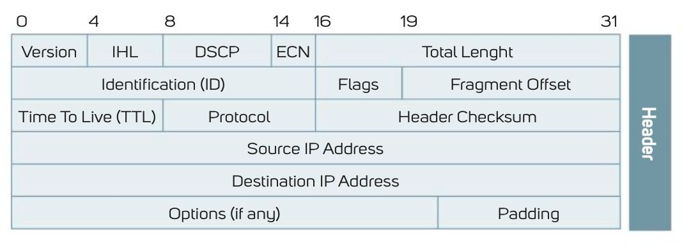

- **Header**: minimo **20 byte** (5 righe da 32 bit), fino a 60 byte con le opzioni.
- **Payload**: i dati da consegnare – di solito un segmento **TCP** o **UDP**, ma anche messaggi ICMP o di protocolli di routing.
- **Dimensione massima** (header + payload): **65.535 byte**, perché il campo *Total Length* è di **16 bit** → valori da 0 a 2¹⁶ − 1.

---

## Header IPv4 – Version, IHL, DSCP, ECN, Total Length

| Campo | Bit | A cosa serve |
|---|---|---|
| **Version** | 4 | versione del protocollo: vale **4** per IPv4. Se il destinatario non la gestisce, scarta il pacchetto |
| **IHL** (*Internet Header Length*) | 4 | lunghezza dell'header in **word da 32 bit** (4 byte) |
| **DSCP** (*Differentiated Services Code Point*) | 6 | **priorità / QoS**: dice ai router come trattare il pacchetto (es. voce prima del download) |
| **ECN** (*Explicit Congestion Notification*) | 2 | segnala la **congestione** senza dover scartare pacchetti |
| **Total Length** | 16 | lunghezza **totale** del pacchetto (header + payload) in **byte** |

> **Esempio:** IHL = `0101` = 5 → header = 5 × 4 = **20 byte** (nessuna opzione). IHL = 15 (valore massimo) → 60 byte.
> Se Total Length = 1500 e IHL = 5 → payload = 1500 − 20 = **1480 byte**.

---

## Header IPv4 – i campi per la frammentazione

Quando un pacchetto deve attraversare una rete che accetta frame più piccoli, viene **diviso in frammenti**. Tre campi permettono al destinatario di **rimetterli insieme**:

| Campo | Bit | A cosa serve |
|---|---|---|
| **Identification (ID)** | 16 | tutti i frammenti dello **stesso** datagram hanno lo **stesso ID** |
| **Flags** | 3 | controllano la frammentazione (vedi sotto) |
| **Fragment Offset** | 13 | **posizione** del frammento nel datagram originale, in unità di **8 byte** |

**I 3 bit di Flags:**
- **bit 0 – Reserved**: sempre **0**;
- **bit 1 – DF** (*Don't Fragment*): se **1** il pacchetto **non** può essere frammentato (se è troppo grande viene scartato e torna un messaggio ICMP);
- **bit 2 – MF** (*More Fragments*): **1** = "ci sono altri frammenti dopo di me"; solo l'**ultimo** frammento ha MF = **0**.

---

## Header IPv4 – TTL, Protocol, Header Checksum

| Campo | Bit | A cosa serve |
|---|---|---|
| **TTL** (*Time To Live*) | 8 | numero massimo di **hop** (router attraversati). Ogni router lo **decrementa di 1**; a **0** il pacchetto viene scartato. Evita che un pacchetto giri **all'infinito** in un loop |
| **Protocol** | 8 | protocollo contenuto nel payload: **1** = ICMP, **6** = TCP, **17** = UDP (codici assegnati da IANA) |
| **Header Checksum** | 16 | controllo di integrità calcolato **solo sull'header** |

> **Perché la checksum viene ricalcolata a ogni router?** Perché a ogni hop il **TTL cambia** (−1): l'header è diverso, quindi anche la checksum deve essere aggiornata.

> **Prova:** il comando `tracert` (Windows) / `traceroute` (Linux) sfrutta il TTL: invia pacchetti con TTL = 1, 2, 3… e ogni router che porta il TTL a 0 risponde con un messaggio ICMP, rivelando il percorso.

---

## Header IPv4 – indirizzi, Options e Padding

| Campo | Bit | A cosa serve |
|---|---|---|
| **Source IP Address** | 32 | indirizzo IP del **mittente** |
| **Destination IP Address** | 32 | indirizzo IP del **destinatario** |
| **Options** | variabile | opzioni facoltative (raramente usate) |
| **Padding** | variabile | bit a 0 aggiunti per rendere l'header un **multiplo di 32 bit** |

**Struttura delle Options – formato TLV** (*Type-Length-Value*):
- **Option-type** (8 bit) = Copy Flag (1 bit: copiare l'opzione in ogni frammento?) + Option Class (2 bit) + Option Number (5 bit);
- **Option-length** (8 bit): lunghezza totale dell'opzione, compreso questo byte;
- **Option-data** (variabile): il *valore* dell'opzione. I codici sono registrati presso **IANA**.

---

## Frammentazione e MTU

**MTU** (*Maximum Transmission Unit*): il numero massimo di byte che un frame di una certa rete può trasportare. Su **Ethernet** è **1500 byte**.

Se un pacchetto è più grande dell'MTU del collegamento successivo, il router lo **frammenta**; i frammenti vengono **riassemblati solo dal destinatario**.

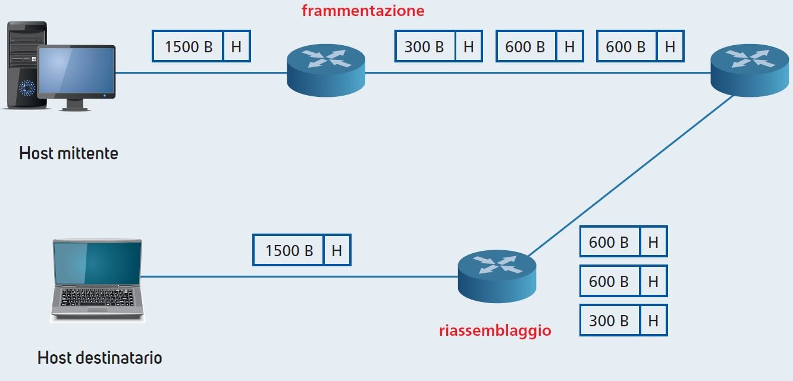

<div class="small">

**Problemi:** **prestazioni** (frammentare e riassemblare costa; se si perde un frammento si perde tutto il pacchetto) e **sicurezza** (alcuni attacchi usano frammenti malformati).
**Come evitarla:** **Path MTU Discovery** (si scopre l'MTU minimo del percorso, con DF = 1) e la **negoziazione dell'MSS** in TCP.

</div>

---

## Esempio guidato: frammentare un datagram

Datagram di **4000 byte** (20 header + **3980** di dati) su una rete con **MTU = 1500**.

1. Dati massimi per frammento: 1500 − 20 = **1480 byte** (è multiplo di 8 ✓)
2. 3980 = 1480 + 1480 + **1020** → servono **3 frammenti**
3. Offset = byte di partenza ÷ 8

| Frammento | Dati (byte) | Total Length | ID | MF | Fragment Offset |
|---|---|---|---|---|---|
| 1 | 0 – 1479 | 1500 | 777 | **1** | 0 ÷ 8 = **0** |
| 2 | 1480 – 2959 | 1500 | 777 | **1** | 1480 ÷ 8 = **185** |
| 3 | 2960 – 3979 | 1040 | 777 | **0** | 2960 ÷ 8 = **370** |

> Stesso **ID** = stesso datagram · **Offset** = dove va il pezzo · **MF = 0** = è l'ultimo pezzo.

---

<!-- _class: lead -->


# Parte 3
## Gli indirizzi IPv4

---

## Indirizzo IP = interfaccia, non computer

- IP assegna a ogni host un **indirizzo logico**, **univoco** nella rete in cui opera.
- Più precisamente l'indirizzo identifica un'**interfaccia di rete**: se un dispositivo ha più interfacce, ha **più indirizzi IP**.

> **Esempi:**
> - un portatile con scheda **cablata** (802.3) e **Wi-Fi** (802.11) ha due IP distinti;
> - lo smartphone ha un IP sul **Wi-Fi** di casa e un altro quando usa i **dati mobili** (4G/5G);
> - un **router** ha un IP **per ogni interfaccia**, uno per ciascuna rete a cui è collegato.

**Indirizzo IP vs indirizzo MAC**

| | **MAC** (livello 2) | **IP** (livello 3) |
|---|---|---|
| Lunghezza | 48 bit | 32 bit (IPv4) |
| Assegnato da | costruttore della scheda | amministratore di rete o DHCP |
| Serve per | consegna **dentro** la LAN | consegna **tra** reti diverse |

---

## La struttura di un indirizzo IPv4

- **32 bit**, divisi in **4 ottetti** da 8 bit (l'IETF dice *octet* invece di *byte*: un tempo esistevano byte non da 8 bit).
- Si scrive in **notazione decimale puntata**: 4 numeri da **0 a 255**.

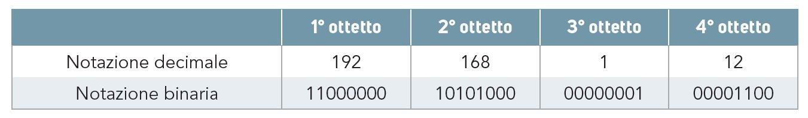

**Come convertire un ottetto: i pesi dei bit**

```
peso:    128   64   32   16    8    4    2    1
192  =     1    1    0    0    0    0    0    0    → 128 + 64          = 192
 12  =     0    0    0    0    1    1    0    0    → 8 + 4             = 12
168  =     1    0    1    0    1    0    0    0    → 128 + 32 + 8      = 168
```

---

## Network ID e Host ID

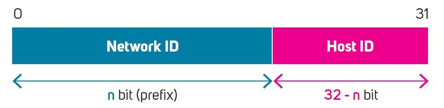

Ogni indirizzo IPv4 ha due parti:
- **Network ID** (i primi *n* bit, il **prefisso**): identifica la **rete** – es. `192.168.1`
- **Host ID** (i restanti 32 − *n* bit): identifica il **dispositivo** in quella rete – es. `12`

> **Analogia:** l'indirizzo IP è come "Via Roma 12": la **via** è il Network ID (uguale per tutti i vicini), il **civico** è l'Host ID.

**Dove mettere il confine?**
- **più** bit al Network ID → tante subnet **piccole** (pochi host ciascuna);
- **meno** bit al Network ID → poche subnet **grandi** (molti host ciascuna).

---

## CIDR e slash notation

**CIDR** (*Classless Inter-Domain Routing*), **1993** – RFC 1519, aggiornato dall'RFC 4632:
- **supera** l'indirizzamento **a classi** (classful): il confine rete/host può stare in **qualsiasi** punto;
- assegna **blocchi contigui** di indirizzi (es. `192.168.1.0 – 192.168.1.255`);
- indica la lunghezza del prefisso con la **slash notation**.

```
192.168.1.0/24   →   i primi 24 bit sono la rete, gli ultimi 8 bit gli host
10.20.0.0/16     →   i primi 16 bit sono la rete, gli ultimi 16 bit gli host
192.168.1.64/26  →   i primi 26 bit sono la rete, gli ultimi 6 bit gli host
```

Il numero dopo lo slash si chiama **prefix** (*network prefix*, *prefix length*).

---

## Subnet mask

La **subnet mask** (o *netmask*) è un'altra forma di scrivere il prefisso: **32 bit** in cui
**1 = parte rete** e **0 = parte host**. Gli 1 sono sempre **consecutivi e a sinistra**.

```
/24  →  11111111.11111111.11111111.00000000  →  255.255.255.0
/26  →  11111111.11111111.11111111.11000000  →  255.255.255.192
```

**Tabella da sapere a memoria (ultimo ottetto):**

| Prefisso | /24 | /25 | /26 | /27 | /28 | /29 | /30 |
|---|---|---|---|---|---|---|---|
| Ultimo ottetto maschera | 0 | 128 | 192 | 224 | 240 | 248 | 252 |
| Bit host (h) | 8 | 7 | 6 | 5 | 4 | 3 | 2 |
| Dimensione blocco (2^h) | 256 | 128 | 64 | 32 | 16 | 8 | 4 |
| Host utilizzabili (2^h − 2) | 254 | 126 | 62 | 30 | 14 | 6 | 2 |

> La maschera serve a ricavare l'**indirizzo di rete** con un **AND bit a bit**: un'operazione semplicissima che i router eseguono in **hardware**, velocissima.

---

## Subnet: un router che collega tre LAN

<div class="columns3">
<div>

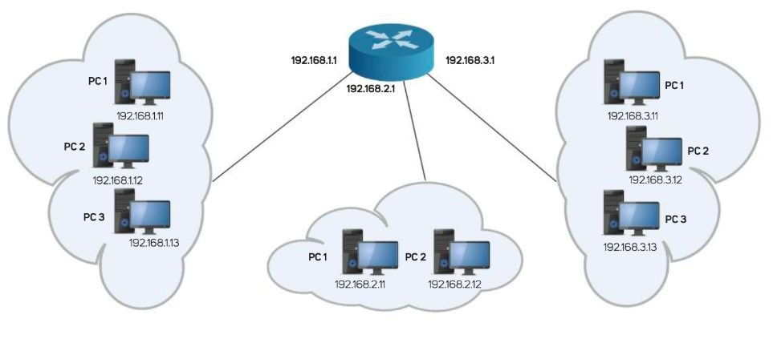

</div>
<div class="small">

- I computer della stessa LAN hanno **gli stessi primi 24 bit** → stessa **subnet**.
- Il **router** ha **un'interfaccia per ogni LAN**, con un indirizzo di quella LAN.
- Una **subnet** è una porzione isolata di una rete IP, più semplice da gestire.

</div>
</div>

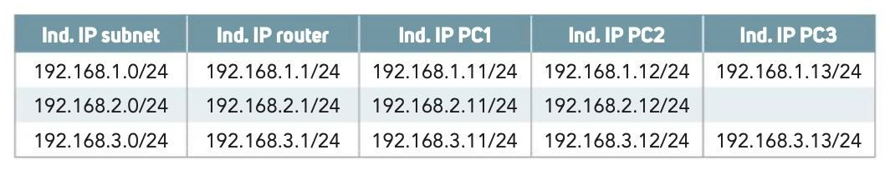

<div class="caption">Nell'esempio il router usa il primo indirizzo (.1) di ogni LAN; più avanti vedremo anche la convenzione del penultimo indirizzo.</div>

---

## Le formule fondamentali

Con **h** = bit della parte host e **s** = bit "presi in prestito" per creare le subnet:

| Cosa | Formula / regola | Esempio con `192.168.10.0/26` |
|---|---|---|
| Indirizzi totali del blocco | 2^h | 2⁶ = 64 |
| Host utilizzabili | **2^h − 2** | 64 − 2 = **62** |
| Numero di sottoreti | **2^s** | da /24 a /26: s = 2 → 4 subnet |
| Indirizzo di rete | tutti i bit host a **0** | `192.168.10.0` |
| Broadcast | tutti i bit host a **1** | `192.168.10.63` |
| Range host | rete + 1 … broadcast − 1 | `.1 – .62` |
| Default gateway (*convenzione del corso*) | **penultimo** = broadcast − 1 | `.62` |

> **Perché "−2"?** Due indirizzi di ogni blocco non vanno agli host: il primo (**indirizzo di rete**) e l'ultimo (**broadcast**). Con /24: 256 − 2 = **254** host.

> Il gateway si può mettere anche sul **primo** indirizzo (.1), è molto diffuso: l'importante è usare **sempre la stessa convenzione** in tutta la rete.

---

## Gli indirizzi riservati o speciali

| Tipo | Come è fatto | Esempio |
|---|---|---|
| **Indirizzo di rete** | parte host tutta a `0` | `200.10.5.0/24` |
| **Broadcast diretto** | parte host tutta a `1` → tutti gli host **di quella rete** | `200.10.5.255/24` |
| **Broadcast limitato** | tutti `1` → tutti gli host della **rete locale**, non passa i router | `255.255.255.255` |
| **"Questo host"/default route** | tutti `0` → host senza IP all'avvio, o "qualsiasi rete" nelle tabelle di routing | `0.0.0.0` |
| **Host sulla rete corrente** | parte rete tutta a `0` | `0.0.0.5/24` |
| **Loopback** | rete `127.0.0.0/8`: il pacchetto non esce dal PC | `127.0.0.1` (*localhost*) |
| **APIPA** | autoconfigurazione quando il **DHCP non risponde** | `169.254.0.0/16` |

> **Diagnosi:** se `ipconfig` mostra un indirizzo `169.254.x.x`, il PC **non ha raggiunto il server DHCP**. Primo indizio di un problema di rete (cavo, Wi-Fi, server DHCP spento).

---

## Indirizzi pubblici e privati

**Pubblici:** unici in tutto il mondo, necessari per comunicare **direttamente** su Internet.
**Privati (RFC 1918):** usabili solo nelle reti locali, **non instradati** su Internet e **riutilizzabili** in ogni LAN senza conflitti.

| Blocco privato | Range | N° indirizzi | Uso tipico |
|---|---|---|---|
| `10.0.0.0/8` | 10.0.0.0 – 10.255.255.255 | 2²⁴ ≈ 16,7 milioni | grandi reti aziendali |
| `172.16.0.0/12` | 172.16.0.0 – 172.31.255.255 | 2²⁰ ≈ 1 milione | reti medie |
| `192.168.0.0/16` | 192.168.0.0 – 192.168.255.255 | 2¹⁶ = 65.536 | LAN domestiche e piccole |

Per uscire su Internet, un host privato viene "tradotto" in un indirizzo pubblico dal router tramite **NAT/PAT** (o passando da un **proxy**).

> A casa tutti i dispositivi hanno IP `192.168.1.x`, ma su Internet compaiono tutti con **l'unico IP pubblico** del router.

---

## Quando usare indirizzi privati o pubblici

<div class="columns">
<div>

### Privati (quasi sempre)
Tutti i **dispositivi interni**: PC, stampanti, telefoni IP, access point, server interni.
- **gratuiti** e disponibili in abbondanza;
- **più sicuri**: non raggiungibili direttamente da fuori;
- escono su Internet tramite **NAT/PAT**.

</div>
<div>

### Pubblici (solo dove serve)
Dove bisogna essere **raggiungibili** o **univoci** su Internet:
- **server esposti** (web, mail, VPN);
- **interfaccia WAN** del router verso l'ISP;
- interconnessioni tra **Autonomous System** (BGP).

Sono **scarsi e a pagamento**: se ne usa il **minimo indispensabile**.

</div>
</div>

---

## Indirizzi statici e dinamici – chi li assegna?

<div class="columns">
<div>

**Dinamici**
- cambiano nel tempo (es. a ogni connessione), assegnati con **DHCP**;
- l'ISP **riutilizza** così gli indirizzi pubblici;
- tipici degli **utenti residenziali**.

**Statici**
- **fissi**, configurati a mano o riservati;
- per **server, router, stampanti**;
- tipici delle **aziende**.

**Gerarchia di assegnazione**
**IANA** (funzione gestita da **ICANN**) → **5 RIR** regionali → ISP → clienti.

</div>
<div>

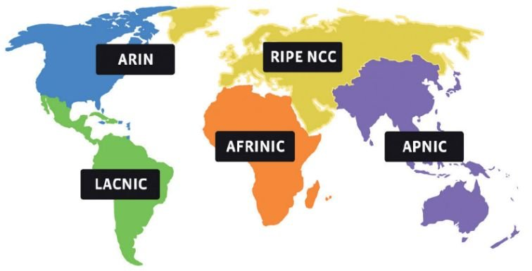

<div class="caption">I 5 RIR: ARIN (Nord America), LACNIC (America Latina), RIPE NCC (Europa e Medio Oriente – anche l'Italia), AFRINIC (Africa), APNIC (Asia-Pacifico)</div>

</div>
</div>

---

## La carenza degli indirizzi IPv4

Indirizzi teorici: 2³² = **4.294.967.296**. Sembrano tanti, ma molti sono riservati e con miliardi di dispositivi connessi lo spazio si è **esaurito** (IANA ha distribuito gli ultimi blocchi nel 2011).

**Soluzioni "tampone":**
- **indirizzi privati + NAT**: migliaia di dispositivi dietro un solo IP pubblico;
- **subnetting** (**FLSM**, **VLSM**) e **CIDR**: si assegnano solo gli indirizzi necessari.

**La soluzione definitiva – IPv6:**
- indirizzi da **128 bit**, scritti in **esadecimale** (es. `2001:db8::1`);
- 2¹²⁸ ≈ **3,4 × 10³⁸** indirizzi, più nuove funzionalità.

> Per farsi un'idea: 2¹²⁸ indirizzi sono **decine di miliardi di miliardi** di indirizzi per ogni granello di sabbia della Terra.

---

## Dall'indirizzamento classful al CIDR

**Classful addressing** – il metodo delle origini:
- il confine rete/host era **fisso** e dipendeva dalla **classe**;
- la classe si capiva dai **primi bit** (cioè dal primo ottetto);
- prefissi di **8, 16 o 24 bit** → classi **A, B, C**; le classi **D** ed **E** avevano altri scopi.

> Poco flessibile → oggi **superato** dal CIDR. Ma serve a capire da dove vengono certi blocchi: il privato `10.0.0.0/8` è esattamente un'intera vecchia **classe A**, `192.168.0.0/16` è un gruppo di **classi C**.

I protocolli di routing classful (**RIPv1**, IGRP) **non trasmettono la maschera**: la deducono dalla classe. Per questo non supportano il VLSM.

---

<!-- _class: dense -->

## Le cinque classi IPv4

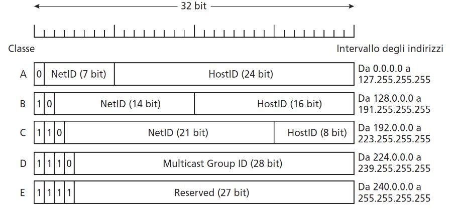

| Classe | Primi bit | 1° ottetto | Maschera | N° reti | Host per rete | Uso |
|---|---|---|---|---|---|---|
| **A** | `0` | 1 – 126 | /8 – 255.0.0.0 | 126 | 16.777.214 | reti grandi |
| **B** | `10` | 128 – 191 | /16 – 255.255.0.0 | 16.384 | 65.534 | reti medie |
| **C** | `110` | 192 – 223 | /24 – 255.255.255.0 | 2.097.152 | 254 | reti piccole |
| **D** | `1110` | 224 – 239 | — | *multicast* | — | gruppi di host |
| **E** | `1111` | 240 – 255 | — | *sperimentale* | — | riservata |

<div class="tiny">La classe A va da 0 a 127, ma la rete 0 e la rete 127 (loopback) sono riservate: per questo le reti utilizzabili sono 126.</div>

---

## Classful: esempi di calcolo

| | `10.0.0.5` → **A** | `172.16.20.9` → **B** | `192.168.1.30` → **C** |
|---|---|---|---|
| Maschera | 255.0.0.0 | 255.255.0.0 | 255.255.255.0 |
| Rete | 10.0.0.0 | 172.16.0.0 | 192.168.1.0 |
| Range | 10.0.0.1 – 10.255.255.254 | 172.16.0.1 – 172.16.255.254 | 192.168.1.1 – 192.168.1.254 |
| Gateway | 10.255.255.254 | 172.16.255.254 | 192.168.1.254 |
| Broadcast | 10.255.255.255 | 172.16.255.255 | 192.168.1.255 |

**Come si fa:** guardo il **1° ottetto** → trovo la classe → la maschera è fissa → metto a 0 gli ottetti host (rete) e a 255 (broadcast).

> **Il problema dello spreco:** serve una rete da **500 host**? La classe C (254) è troppo piccola; la B (65.534) ne spreca oltre **65.000**. Negli anni '80 intere classi B venivano assegnate a università che ne usavano una piccola frazione.

---

## Classful vs Classless (CIDR)

| | **Classful** | **Classless (CIDR)** |
|---|---|---|
| Maschera | fissa, decisa dalla classe | qualsiasi lunghezza, da /1 a /32 |
| Notazione | implicita (si deduce dalla classe) | esplicita `/n` |
| Spreco di indirizzi | alto | ridotto |
| Sottoreti | no (al massimo FLSM) | FLSM e **VLSM** |
| Aggregazione delle rotte | no | sì (**supernetting**) |
| Protocolli di routing | RIPv1, IGRP | RIPv2, OSPF, EIGRP, BGP |
| Stato | obsoleto | **standard attuale** |

---

<!-- _class: lead -->


# Parte 4
## Pianificare una rete IP: AND, FLSM e VLSM

---

## L'operazione di AND: ricavare l'indirizzo di rete

**Regola:** `indirizzo di rete = IP AND maschera`, bit per bit.
**Tabella dell'AND:** `1 AND 1 = 1` – in **tutti** gli altri casi il risultato è `0`.
In pratica la maschera "**lascia passare**" i bit di rete e "**azzera**" i bit host.

**Esempio:** `192.168.10.77/26`

```
IP        11000000.10101000.00001010.01001101   192.168.10.77
Maschera  11111111.11111111.11111111.11000000   255.255.255.192
AND       11000000.10101000.00001010.01000000   192.168.10.64   ← indirizzo di rete
```

| Rete | Range host | Gateway | Broadcast |
|---|---|---|---|
| `192.168.10.64/26` | .65 – .126 | .126 | .127 (bit host tutti a 1) |

---

## AND: secondo esempio e scorciatoia

`172.16.45.200/19` → maschera `255.255.224.0`

Trucco: dove la maschera vale **255** l'ottetto **resta uguale**, dove vale **0** diventa **0**. Si lavora solo sull'ottetto "misto" (qui il 3°):

```
45   = 00101101
224  = 11100000
AND  = 00100000 = 32
```

| Rete | Range host | Gateway | Broadcast |
|---|---|---|---|
| `172.16.32.0/19` | 172.16.32.1 – 172.16.63.254 | 172.16.63.254 | 172.16.63.255 |

> **Scorciatoia senza binario:** dimensione del blocco = **256 − 224 = 32**. I blocchi partono da 0, 32, 64, 96… e **45** cade nel blocco **32 – 63** → rete `.32.0`, broadcast `.63.255`.

---

## A cosa serve l'AND: stessa rete o no?

Prima di inviare un pacchetto, ogni host fa il ***ANDing process***:
1. AND tra **il proprio IP** e la propria maschera → la sua rete;
2. AND tra **l'IP del destinatario** e la **stessa** maschera (quella del mittente);
3. se i risultati sono **uguali** → stessa subnet → consegna **diretta** (via switch, con ARP);
   se sono **diversi** → subnet diverse → consegna **indiretta**, al **default gateway**.

**Esempio:** PC A = `192.168.10.77/26` → rete **192.168.10.64**

| Destinatario | Ultimo ottetto AND 192 | Rete | Esito |
|---|---|---|---|
| `192.168.10.100` | 01100100 AND 11000000 = **64** | .64 | <span class="ok">stessa rete → diretta</span> |
| `192.168.10.130` | 10000010 AND 11000000 = **128** | .128 | <span class="ko">rete diversa → gateway</span> |

---

## Il subnetting

Con le classi fisse il routing era semplice, ma si **sprecavano** enormi quantità di indirizzi. Serviva un modo per usare meglio lo spazio IPv4.

**Il subnetting** – introdotto nel **1985** con l'**RFC 950**:
- divide un blocco di indirizzi in **sottoreti più piccole**;
- si fa "**prendendo in prestito**" bit dalla parte host per creare il **Subnet ID**;
- un'organizzazione assegna **solo gli indirizzi necessari** a ogni reparto o segmento.

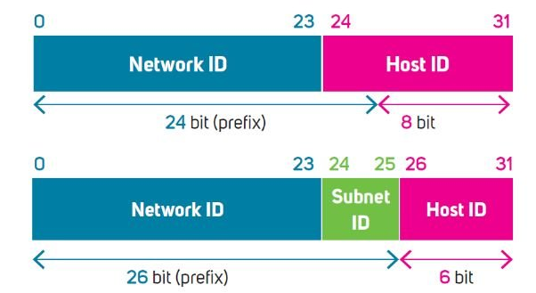

<div class="caption">Da /24 a /26: 2 bit presi in prestito diventano il Subnet ID → 2² = 4 subnet, ciascuna con 6 bit host (62 host)</div>

---

## FLSM – Fixed Length Subnet Mask

**FLSM** (*subnetting statico*): la rete viene divisa in sottoreti **tutte della stessa dimensione**, con la **stessa maschera**.

**Procedura:**
1. Numero di sottoreti richieste **N** → trova il minimo **s** con **2^s ≥ N**
2. Nuova maschera = maschera originale **+ s** bit
3. Dimensione del blocco = **2^h** (h = bit host rimasti) → è l'**incremento** tra una subnet e l'altra
4. Per ogni subnet calcola: rete, range, gateway, broadcast

**Pro:** semplice da calcolare e da gestire.
**Limite:** tutte le subnet devono essere grandi quanto **la più grande** → **spreco**.

---

## FLSM – Esempio 1: 4 sottoreti da `192.168.10.0/24`

N = 4 → **s = 2** (2² = 4) → /24 + 2 = **/26** → `255.255.255.192`
h = 6 → blocco **64**, **62** host per subnet

| Subnet | Rete | Range host | Gateway | Broadcast |
|---|---|---|---|---|
| 1 | 192.168.10.**0**/26 | .1 – .62 | .62 | .63 |
| 2 | 192.168.10.**64**/26 | .65 – .126 | .126 | .127 |
| 3 | 192.168.10.**128**/26 | .129 – .190 | .190 | .191 |
| 4 | 192.168.10.**192**/26 | .193 – .254 | .254 | .255 |

> **Schema che si ripete:** la rete successiva = rete precedente + 64; il broadcast = rete successiva − 1.

---

## FLSM – Esempio 2: 5 sottoreti da `172.16.0.0/16`

N = 5 → 2² = 4 non basta → **s = 3** (8 subnet) → **/19** → `255.255.224.0`
h = 13 → **8.190** host per subnet; blocco = **32** nel 3° ottetto

| Subnet | Rete | Range host | Gateway | Broadcast |
|---|---|---|---|---|
| 1 | 172.16.0.0/19 | 172.16.0.1 – 172.16.31.254 | 172.16.31.254 | 172.16.31.255 |
| 2 | 172.16.32.0/19 | 172.16.32.1 – 172.16.63.254 | 172.16.63.254 | 172.16.63.255 |
| 3 | 172.16.64.0/19 | 172.16.64.1 – 172.16.95.254 | 172.16.95.254 | 172.16.95.255 |
| 4 | 172.16.96.0/19 | 172.16.96.1 – 172.16.127.254 | 172.16.127.254 | 172.16.127.255 |
| 5 | 172.16.128.0/19 | 172.16.128.1 – 172.16.159.254 | 172.16.159.254 | 172.16.159.255 |

Restano **3 sottoreti libere** (`.160.0`, `.192.0`, `.224.0`) per ampliamenti futuri.

---

## Il piano di indirizzamento della rete

1. **Analisi dei requisiti**: quante subnet e quanti host per subnet, oggi e **in futuro** (+20–30 % di margine).
2. **Scelta dello spazio IP**: privato (`10/8` reti grandi, `172.16/12` medie, `192.168/16` piccole) o pubblico (blocco da ISP/RIR).
3. **Suddivisione in subnet**:
   - numero di subnet: **2^N ≥ subnet richieste** (N = bit del Subnet ID);
   - host per subnet: **2^H − 2 ≥ host richiesti** (H = bit dell'Host ID);
   - definizione delle **maschere**.
4. **Allocazione** delle subnet ai reparti/zone, in modo **gerarchico** (per poterle aggregare).
5. **Assegnazione degli IP** con una convenzione fissa, ad esempio: **gateway** al penultimo (o al primo), poi **server** e **stampanti** con IP statici, il resto ai **client** via DHCP.
6. **Documentazione**: tabella degli indirizzi e **schema della rete**.

---

## Attenzione alle sovrapposizioni (overlapping)

Due subnet **non devono mai condividere indirizzi**. Cause tipiche:
- **errore nei prefissi** – es. `192.168.1.0/24` e `192.168.1.128/25`: la seconda è **dentro** la prima!
- **mancata verifica**: usare blocchi pubblici senza consultare ISP o RIR → conflitti.

**Strumenti di IPAM** (*IP Address Management*):

| Strumento | Caratteristica |
|---|---|
| **SolarWinds IPAM** | dashboard per monitorare disponibilità e uso degli IP |
| **phpIPAM** | open source, gestisce IPv4/IPv6, subnet e VLAN (Linux) |
| **BlueCat IPAM** | gestione centralizzata di IP, DNS e DHCP, con report |

**Strumenti complementari:** **IP scanner** (quali IP sono davvero in uso) e **Whois** (a chi appartiene un blocco IP).

---

<!-- _class: lead -->


# Subnetting variabile
## VLSM

---

## I limiti del FLSM

- **Spreco**: una LAN da 10 host e una da 100 occupano lo **stesso** spazio.
- **Rigidità**: numero di subnet e dimensione sono fissati all'inizio.
- **Poca scalabilità**: se cambiano le esigenze, spesso va **rifatto tutto il piano**.

**Le 4 domande da farsi prima di progettare:**
1. Quante subnet servono **oggi**?
2. Quante subnet serviranno **in futuro**?
3. Quanti host ha la subnet **più grande oggi**?
4. Quanti host avrà la subnet **più grande in futuro**?

---

## VLSM – Variable Length Subnet Mask

Ogni subnet riceve la **maschera adatta al proprio numero di host**: si fanno "sottoreti di sottoreti".
- maschera **lunga** (es. /30) → **pochi** host;
- maschera **corta** (es. /25) → **molti** host.

**Procedura:**
1. Elenca i requisiti e **ordinali dal più grande al più piccolo**
2. Per ognuno trova il minimo **h** con **2^h − 2 ≥ host** → maschera **/(32 − h)**
3. Assegna i blocchi **in sequenza**, partendo dall'inizio della rete
4. Ogni blocco parte **subito dopo il broadcast** del precedente
5. Calcola rete, range, gateway, broadcast

> **Perché dal più grande?** Così ogni blocco parte da un indirizzo **allineato** (multiplo della sua dimensione) e non si creano "buchi" né sovrapposizioni.

Il VLSM richiede protocolli di routing **classless** (RIPv2, OSPF, EIGRP), che trasmettono la maschera.

---

## VLSM – Esempio: requisiti per `192.168.100.0/24`

| Rete | Host richiesti | h minimo (host disponibili) | Maschera | Blocco |
|---|---|---|---|---|
| LAN A | 100 | 7 (126) | /25 – 255.255.255.128 | 128 |
| LAN B | 50 | 6 (62) | /26 – 255.255.255.192 | 64 |
| LAN C | 25 | 5 (30) | /27 – 255.255.255.224 | 32 |
| LAN D | 10 | 4 (14) | /28 – 255.255.255.240 | 16 |
| Link router-router | 2 | 2 (2) | /30 – 255.255.255.252 | 4 |

<div class="small">

Esempio di ragionamento per LAN C: 2⁴ − 2 = 14 < 25 ✗ · 2⁵ − 2 = 30 ≥ 25 ✓ → h = 5 → /27.

</div>

---

## VLSM – Risultato

| Rete | Indirizzo di rete | Range host | Gateway | Broadcast |
|---|---|---|---|---|
| LAN A | 192.168.100.0/25 | .1 – .126 | .126 | .127 |
| LAN B | 192.168.100.128/26 | .129 – .190 | .190 | .191 |
| LAN C | 192.168.100.192/27 | .193 – .222 | .222 | .223 |
| LAN D | 192.168.100.224/28 | .225 – .238 | .238 | .239 |
| Link | 192.168.100.240/30 | .241 – .242 | – | .243 |

- Usati **244** indirizzi su 256 (128 + 64 + 32 + 16 + 4); liberi **.244 – .255** per il futuro.
- Sul link **punto-punto** i due router usano `.241` e `.242`: non c'è un gateway, si parlano direttamente.

```
 0        128      192   224 240 244   255
 |--- A ---|-- B --|- C -|D|L|  libero  |
```

---

## Perché VLSM e non FLSM?

Con gli stessi requisiti in **FLSM**, la LAN più grande (100 host) imporrebbe **/25 a tutte**:
- un /24 contiene solo **2** subnet /25, ma ne servono **5** → <span class="ko">non bastano</span>;
- e anche con più spazio, ogni LAN da 10 host o link da 2 host sprecherebbe **oltre 110** indirizzi.

Con **VLSM**: 5 reti nello **stesso /24**, spreco minimo, spazio libero residuo.

| Tecnica | Caratteristica |
|---|---|
| **FLSM** | subnet **uniformi** → semplice ma **inefficiente** |
| **VLSM** | subnet **su misura** → un po' più complesso ma **ottimale ed efficiente** |

> Altro esempio da `192.168.1.0/24`: una **/27** (30 host) per l'ufficio grande, una **/29** (6 host) per la sala server, una **/30** (2 host) per il collegamento tra due router.

---

## Il supernetting (route summarization)

<div class="columns">
<div>

**Subnetting**
- **divide** una rete grande in reti più piccole;
- scopo: organizzazione interna, niente sprechi;
- si fa **dentro** un'organizzazione.

Dividere un terreno in **lotti**.

</div>
<div>

**Supernetting**
- **unisce** più reti **contigue** in una più grande;
- scopo: **meno rotte** annunciate, tabelle più piccole;
- usato soprattutto dagli **ISP**.

Unire terreni confinanti in **un unico lotto**.

</div>
</div>

**Esempio:** 4 reti `192.168.0.0/24 … 192.168.3.0/24`

```
192.168.0.0  →  3° ottetto 000000|00
192.168.1.0  →  3° ottetto 000000|01
192.168.2.0  →  3° ottetto 000000|10
192.168.3.0  →  3° ottetto 000000|11      bit comuni: 16 + 6 = 22
```
→ un'**unica rotta**: `192.168.0.0/22` (maschera `255.255.252.0`) invece di 4.

---

## Linee guida di progetto

1. **Stima** gli host di ogni rete e aggiungi un **margine di crescita** (20–30 %)
2. Usa lo spazio **privato** (`10/8`, `172.16/12`, `192.168/16`); riserva i **pubblici** solo dove servono
3. Usa **VLSM**: ordina per dimensione **decrescente** e assegna i blocchi **in sequenza**
4. Per ogni rete documenta: **rete, maschera, range, gateway, broadcast**
5. Scegli una **convenzione** per il gateway (nel corso: **penultimo** = broadcast − 1) e rispettala ovunque
6. **Verifica con l'AND**: IP AND maschera = indirizzo di rete
7. Lascia **blocchi liberi contigui** per gli ampliamenti (e per poterli aggregare)

---

## Prova tu: esercizio VLSM

Partendo da `10.0.0.0/24`, progetta le reti per:
**LAN Uffici** 60 host · **LAN Laboratorio** 28 host · **LAN Segreteria** 12 host · **link** tra 2 router

<div class="small">

Suggerimento: ordina, trova h con 2^h − 2 ≥ host, assegna in sequenza.

</div>

---

## Soluzione

| Rete | Host | Maschera | Indirizzo di rete | Range | Gateway | Broadcast |
|---|---|---|---|---|---|---|
| Uffici | 60 → 62 | /26 – 255.255.255.192 | 10.0.0.0 | .1 – .62 | .62 | .63 |
| Laboratorio | 28 → 30 | /27 – 255.255.255.224 | 10.0.0.64 | .65 – .94 | .94 | .95 |
| Segreteria | 12 → 14 | /28 – 255.255.255.240 | 10.0.0.96 | .97 – .110 | .110 | .111 |
| Link | 2 → 2 | /30 – 255.255.255.252 | 10.0.0.112 | .113 – .114 | – | .115 |

Usati 116 indirizzi (64 + 32 + 16 + 4); liberi `10.0.0.116 – 10.0.0.255`.

> **Verifica con l'AND** – un PC della Segreteria con IP `10.0.0.105`: 105 AND 240 = `01101001` AND `11110000` = `01100000` = **96** → rete `10.0.0.96` ✓

---

<!-- _class: lead -->


# Riepilogo

---

## Mappa della lezione

```
Network Layer (TCP/IP)
│
├── Funzioni ── Routing (software, globale) + Forwarding (hardware, locale)
│     └── Control plane (routing table) vs Data plane (forwarding table)
│
├── IPv4 ── connectionless e best effort, header min. 20 byte
│     ├── Campi: Version, IHL, DSCP/ECN, TTL, Protocol, Checksum, indirizzi
│     └── Frammentazione: ID, Flags (DF/MF), Fragment Offset, MTU
│
└── Indirizzamento IPv4
      ├── 32 bit = Network ID + Host ID · subnet mask · AND bit a bit
      ├── Classful (A/B/C/D/E, maschera fissa) → CIDR (/n, maschera libera)
      ├── Pubblici (IANA/RIR) · Privati (RFC 1918) + NAT · Speciali (loopback, APIPA…)
      └── FLSM (subnet uguali) · VLSM (subnet su misura) · Supernetting (aggregazione)
```

| **Classful** | **FLSM** | **VLSM** |
|---|---|---|
| maschera fissa dalla classe, spreco alto | subnet uguali, semplice ma poco efficiente | subnet su misura, uso ottimale |

**Parole chiave:** routing vs forwarding · control/data plane · datagram · TTL · MTU · CIDR · subnet mask · AND · classful · NAT · FLSM/VLSM · route summarization

---

<!-- _class: lead -->
<!-- _paginate: false -->


# Domande?
