<!-- _class: lead -->
<!-- _paginate: false -->


# Il routing e l'interconnessione di reti geografiche

## Sistemi e Reti · Classe 4ª

Control plane · Algoritmi e protocolli di routing · **Bellman-Ford e Dijkstra** · Autonomous System · RIP, OSPF, BGP · MPLS

---

## Perché studiamo il routing?

Ogni volta che apri Instagram, guardi un video o invii un messaggio su WhatsApp, i tuoi pacchetti attraversano **10–20 router** diversi, gestiti da aziende diverse, in paesi diversi… e arrivano in pochi millisecondi.

Chi decide **da che parte** devono andare? Il **routing**.

- Il **navigatore** dell'auto fa esattamente la stessa cosa: conosce le strade (la rete), il traffico (le metriche) e calcola il **percorso migliore**
- Se una strada si chiude, ricalcola: in rete succede la stessa cosa quando un link si guasta

> **Nel lavoro del sistemista** – Collegare due sedi aziendali, configurare il router dell'ufficio, capire perché "Internet non va" o perché un servizio è lento: **sono tutti problemi di routing**.

---

## La mappa del capitolo

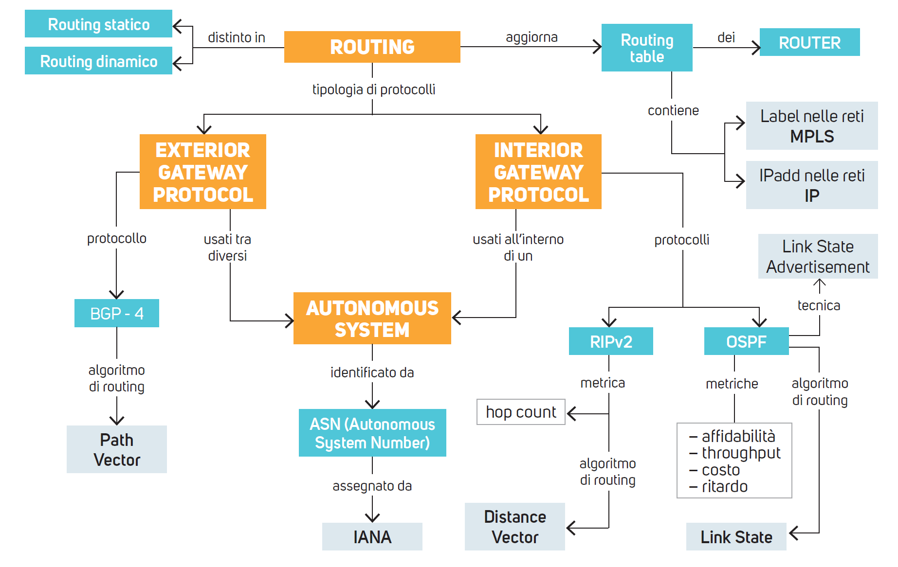

---

<!-- _class: lead -->


# Il Control plane del Network Layer

---

<!-- _class: small -->

## I fondamenti del Control plane e del routing


Il livello Network ha due "anime":

- **Data plane** – il protocollo IP **incapsula e inoltra** i dati (è il "braccio")
- **Control plane** – **decide** come inoltrarli (è il "cervello")

Rientrano nei compiti tipici del Control plane:
- **ARP**: mantiene le corrispondenze **IP ↔ MAC** usate per il forwarding
- **ICMP**: gestisce **errori, diagnostica e controllo** (es. `ping`, `traceroute`)

Nel Control plane i router eseguono gli **algoritmi di routing** per aggiornare la tabella di forwarding.

---

## Algoritmi di routing e protocolli di routing

Sono due concetti diversi, spesso confusi:

<div class="cols">
<div>

### Algoritmo di routing
È il **metodo di calcolo** che trova il percorso migliore secondo una **metrica** (distanza, banda, ritardo, costo).

Esempi: **Bellman-Ford** (Distance Vector) e **Dijkstra** (Link State).

</div>
<div>

### Protocollo di routing
È lo **standard di comunicazione tra router**: formato dei messaggi, procedure, modalità di distribuzione delle rotte.

Esempi: **RIP, OSPF, BGP**.

</div>
</div>

Il router **esegue l'algoritmo** per decidere dove mandare i pacchetti e **usa il protocollo** per ottenere e aggiornare le informazioni su cui fa i calcoli.

> **Analogia** – Il navigatore usa un *algoritmo* per calcolare il percorso, ma riceve le informazioni sul traffico tramite un *protocollo* (i dati inviati dagli altri utenti e dai server della mappa).

---

## Routing table e forwarding table

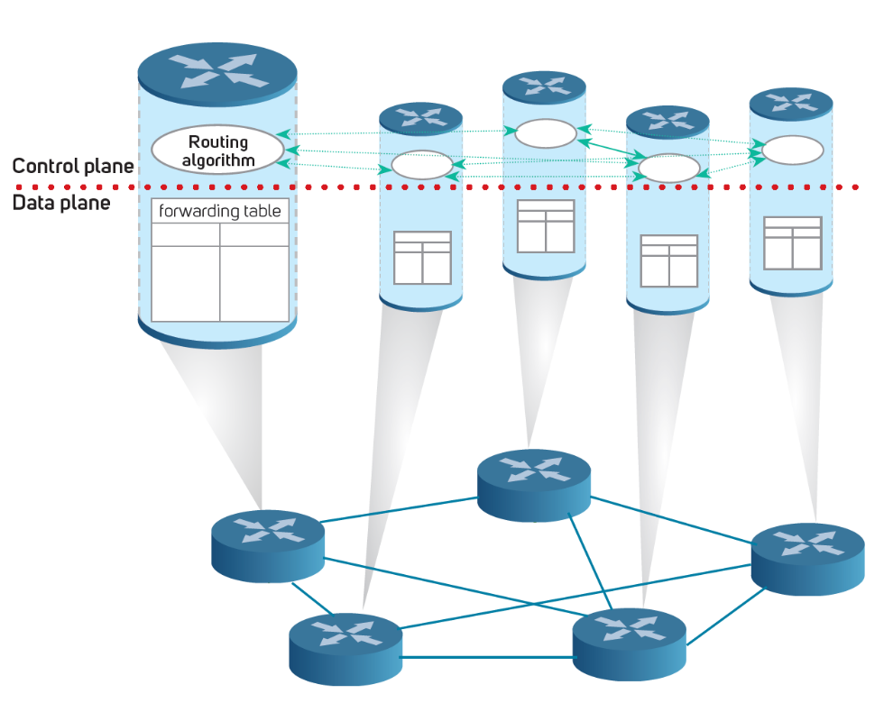

Sono le due strutture fondamentali del router.

**Routing table**
- si colloca nel **Control plane**
- è dove operano gli **algoritmi di routing**, che non toccano direttamente la forwarding table

**Forwarding table**
- si colloca nel **Data plane**
- deriva **automaticamente** dalla routing table tramite il software interno del router
- è ottimizzata per la **velocità** (spesso in hardware dedicato)

---

<!-- _class: small -->

## La routing table

Il formato cambia in base al protocollo, ma ogni riga (*entry*) ha quattro campi principali:

| Campo | Significato |
|---|---|
| **Network address** | IP della rete raggiungibile |
| **Next hop** | indirizzo del router successivo verso la destinazione |
| **Interface** | interfaccia su cui inoltrare il pacchetto per raggiungere il next hop |
| **Metric** | misura usata per scegliere il percorso migliore |

Alla metrica è associato un **costo**: nella routing table si inserisce il percorso a **costo minore**. La metrica più semplice è l'**hop count** (numero di router da attraversare), ma si possono usare anche banda disponibile, pacchetti persi o errati, ritardo di trasmissione.

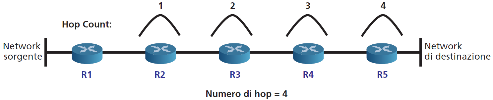

---

## La routing table "dal vivo"

Su un PC Linux (anche il tuo!) la routing table si legge con `ip route`:

```text
$ ip route
default via 192.168.1.1 dev wlan0 proto dhcp metric 600
10.8.0.0/24 dev tun0 proto kernel scope link src 10.8.0.5
192.168.1.0/24 dev wlan0 proto kernel scope link src 192.168.1.42 metric 600
```

Su un router Cisco con `show ip route`:

```text
O    10.20.0.0/16 [110/20] via 10.0.0.2, GigabitEthernet0/1
S*   0.0.0.0/0 [1/0] via 203.0.113.1
C    192.168.10.0/24 is directly connected, GigabitEthernet0/0
```

`O` = appresa da OSPF, `S` = statica, `C` = connessa direttamente, `[110/20]` = distanza amministrativa / metrica.

> **Su Windows**: `route print` · È il **primo comando** che un sistemista lancia quando "una rete non si vede".

---

## Le attività del router

Possiamo individuare tre fasi:

1. **Control plane** – il router costruisce e mantiene la **routing table completa**
2. **Popolamento della forwarding table** – il router estrae dalla routing table i percorsi migliori (**best path**) e li inserisce nella forwarding table
3. **Data plane** – quando arriva un pacchetto, l'hardware di forwarding consulta la forwarding table e decide su quale link inoltrarlo

> **Esempio** – Un router conosce due strade per `10.20.0.0/16`: una via OSPF con costo 20 e una via RIP con 3 hop. Entrambe sono nella routing table, ma **solo la migliore** finisce nella forwarding table e viene usata davvero.

---

## Default route

Il router legge dall'header IP l'**indirizzo del destinatario** e ne analizza i bit di rete:

- se la rete di destinazione **è presente** nella routing table → il pacchetto viene instradato (in modo diretto o indiretto)
- se **non è presente**:
  - il datagram viene inoltrato al **router di default** (`0.0.0.0/0`), che si occuperà di trovare la destinazione
  - se non esiste una default route, il router scarta il pacchetto e invia al mittente un messaggio **ICMP Destination Unreachable**

> **Esempio quotidiano** – Il router di casa conosce solo la tua LAN: **tutto il resto** (cioè Internet intero!) passa dalla default route verso il provider. Senza default route… niente Internet.

---

## Longest prefix match: quale riga vince?

Spesso una destinazione corrisponde a **più righe**. Vince la riga con il **prefisso più lungo** (la più specifica).

| Rete in tabella | Next hop |
|---|---|
| `0.0.0.0/0` | 203.0.113.1 (Internet) |
| `10.0.0.0/8` | 10.0.0.1 |
| `10.20.0.0/16` | 10.0.0.2 |

Pacchetto per **10.20.5.7** → corrisponde a tutte e tre, ma vince `/16` → next hop **10.0.0.2**.
Pacchetto per **10.99.1.1** → vince `/8` → next hop **10.0.0.1**.
Pacchetto per **8.8.8.8** → solo la default route → **203.0.113.1**.

> **Sul lavoro** – Una rotta troppo specifica dimenticata in tabella può "rubare" traffico a quella giusta: è un errore classico da cercare in fase di troubleshooting.

---

## Routing statico e routing dinamico

<div class="cols">
<div>

### Statico
Inserito **manualmente** dall'amministratore.
- adatto a **piccole reti**
- non scambia informazioni → meno banda
- percorsi già decisi, nessun calcolo
- se un link cade, **non si adatta**

</div>
<div>

### Dinamico
Creato **automaticamente** dai protocolli di routing.
- calcola i percorsi con **algoritmi**
- richiede meno intervento umano
- usa più banda per gli aggiornamenti
- si **adatta** a guasti e nuovi percorsi

</div>
</div>

```text
# Linux: rotta statica verso la LAN della sede di Modena
sudo ip route add 192.168.50.0/24 via 10.0.0.2 dev eth1
# Cisco: rotta statica e default route
ip route 192.168.50.0 255.255.255.0 10.0.0.2
ip route 0.0.0.0 0.0.0.0 203.0.113.1
```

---

<!-- _class: small -->

## Il problema della ricerca nella routing table

Il **Routing Table Lookup Problem (RTLP)** riguarda la necessità di decidere **rapidamente** il percorso di ogni pacchetto, per evitare ritardi e congestioni.

Le criticità:
- **moltissimi pacchetti al secondo**: un link da 1 Gbps con pacchetti piccoli supera il **milione di pacchetti/s** → circa **1 microsecondo per pacchetto**
- una memoria cache veloce ha tempi di accesso di circa **50 ns** → bastano una ventina di accessi per esaurire il tempo disponibile

Per velocizzare il routing si è intervenuti su:
- **strutture dati** più efficienti (es. alberi di prefissi, *trie*)
- **algoritmi** ottimizzati e **sistemi paralleli** per distribuire il carico
- **hardware dedicato** al packet processing: i *network processor* e le memorie TCAM offrono alte prestazioni restando flessibili

> **Collegamento con Informatica** – È lo stesso problema di efficienza che studiate con le strutture dati: qui la differenza tra O(n) e O(log n) si misura in **pacchetti persi**.

---

<!-- _class: lead -->


# Gli algoritmi e i protocolli di routing

---

## Lo scopo di un protocollo di routing

Un protocollo di routing aggiorna **dinamicamente** le routing table tramite pacchetti speciali (**routing update**) con cui i router condividono le rotte conosciute. Deve garantire:

- **ottimalità** – scegliere il percorso migliore o più veloce
- **imparzialità** – distribuire il traffico sui link, evitando congestioni
- **flessibilità** – adattarsi ai cambiamenti della rete
- **convergenza veloce** – propagare rapidamente le variazioni
- **robustezza** – funzionare anche con guasti o configurazioni errate
- **semplicità** – gestione efficiente

I protocolli moderni si basano su due famiglie di algoritmi: **Distance Vector** e **Link State**.

---

## L'algoritmo Distance Vector

Ogni router crea una routing table con:
- **due colonne**: la distanza (costo) verso ogni nodo e l'interfaccia/link da usare
- **tante righe** quanti sono i nodi della rete

Aggiorna dinamicamente le tabelle a **intervalli regolari**:
- all'inizio ogni router conosce solo i costi verso i **vicini** (*neighbour*)
- i vicini si scambiano un **vettore delle distanze**: un array con il costo per raggiungere ogni destinazione

> **Analogia** – È come chiedere la strada ai passanti: nessuno ha la mappa completa, ma ognuno ti dice "per la stazione da qui sono 5 minuti". Tu scegli chi ti offre il tragitto più breve, **fidandoti** di quello che ti dicono.

L'algoritmo matematico alla base è **Bellman-Ford** (lo vedremo in dettaglio).

---

## I principali problemi del Distance Vector

Il Distance Vector **non conosce la topologia** e ha bisogno di tempo per la **convergenza** (far arrivare le novità a tutti i router). Questo porta a due problemi critici:

### Routing loop
Un pacchetto gira in tondo tra i router senza mai arrivare. Il danno è limitato dal **TTL** (*Time To Live*): a ogni hop diminuisce di 1 e a 0 il pacchetto viene eliminato.

### Count to infinity
Dopo un guasto, il costo verso una rete irraggiungibile **cresce progressivamente** perché i router continuano a "credersi" a vicenda; alla fine il percorso viene scartato perché il costo diventa troppo alto (in RIP: 16 = infinito).

> **Sul lavoro** – Un `traceroute` che mostra gli **stessi indirizzi ripetuti** in alternanza è il segno tipico di un routing loop.

---

<!-- _class: small -->

## Le modifiche all'algoritmo Distance Vector

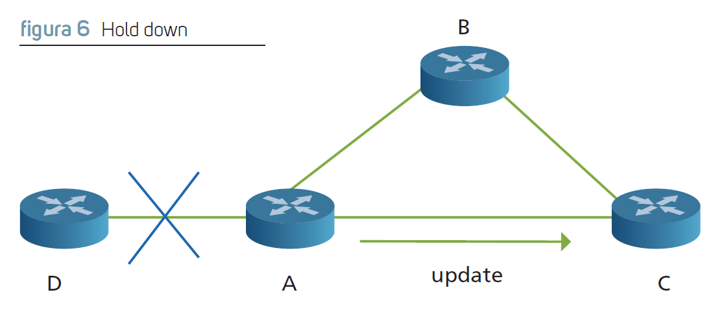

Per limitare i problemi sono nate alcune varianti:

- **split horizon** – un router **non rimanda** a un vicino le informazioni su una destinazione che ha imparato proprio da lui
- **poison reverse** (*split horizon with poison reverse*) – le rimanda, ma con **metrica infinita**, per dichiarare la destinazione irraggiungibile
- **route poisoning** – blocca le route il cui costo aumenta, supponendo un loop (ma l'aumento potrebbe essere legittimo, es. una congestione temporanea)
- **hold down** – dopo che un link è stato rimosso, il router accetta aggiornamenti su di esso solo allo scadere di un timer (**hold down timer**)
- **triggered updates** – gli update vengono inviati non solo a intervalli regolari, ma **subito** quando cambia qualcosa

---

## L'algoritmo Link State

Supera i limiti del Distance Vector: ogni router comunica con **tutti** i router della rete e ottiene una **descrizione completa della topologia**.

- ogni nodo invia a tutti i pacchetti **LSP** (*Link State Packet*) con i costi e l'elenco dei vicini
- gli LSP sono diffusi in **flooding** (su tutti i link, tranne quello da cui sono arrivati)
- i router accettano solo gli LSP con **numero di sequenza** più recente, aggiornano il database e li ritrasmettono
- ogni router costruisce un **grafo pesato** dell'intera rete e ci applica un algoritmo di cammino minimo: **Dijkstra**

**Pro**: mappa completa, convergenza rapida, pochi loop, database identici, buona scalabilità.
**Contro**: più complessità, più memoria e più potenza di calcolo.

> **Analogia** – Invece di chiedere ai passanti, ognuno pubblica la **mappa delle proprie strade**: alla fine tutti hanno la stessa cartina completa e il navigatore calcola il percorso da solo.

---

<!-- _class: small -->

## Distance Vector e Link State a confronto

**Distance Vector**: ogni nodo dice **tutto ciò che sa** ai suoi **vicini**.
**Link State**: ogni nodo dice **ciò che sa dei suoi vicini** a **tutti**.

| Caratteristica | Distance Vector | Link State |
|---|---|---|
| Tipo di routing | Dinamico | Dinamico |
| Convergenza | Lenta | Veloce |
| Uso della banda | Basso: pacchetti piccoli, niente flooding | Alto: flooding e LSP grandi |
| Conoscenza della rete | Locale (solo da ciò che dicono i vicini) | Globale (topologia intera) |
| Condivisione delle informazioni | A intervalli regolari | Solo quando c'è un cambiamento |
| Algoritmo | **Bellman-Ford** | **Dijkstra** SPF (*Shortest Path First*) |
| Problemi | Count to infinity (split horizon), loop (TTL) | Loop dovuti al traffico di flooding (TTL) |
| Protocolli | RIP, IGRP | OSPF, IS-IS |

---

<!-- _class: lead -->


# Gli algoritmi Bellman-Ford e Dijkstra

## Il "motore matematico" del routing

---

<!-- _class: small -->

## La rete vista come un grafo

Per calcolare i percorsi, la rete viene modellata come un **grafo pesato**:

- **nodi** (vertici) = router
- **archi** = collegamenti tra router
- **peso** di un arco = **costo** del collegamento (hop, ritardo, inverso della banda…)

Obiettivo: trovare il **cammino minimo** (*shortest path*), cioè il percorso con la **somma dei costi più bassa**, da un router a tutti gli altri.

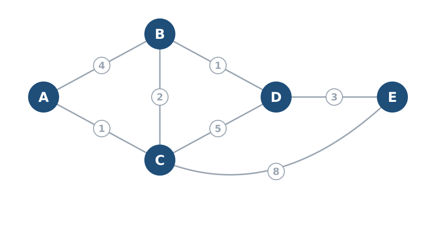

Attenzione: da A a B il collegamento diretto costa **4**, ma passando da C costa **1 + 2 = 3**. Il percorso più corto **non è sempre quello diretto**!

---

## Il cammino minimo è ovunque

Gli stessi algoritmi che usano i router li trovi in moltissime applicazioni di tutti i giorni:

- **Navigatori e mappe** – percorso più veloce tra due città (con varianti come A*)
- **Logistica** – il corriere che pianifica le consegne
- **Videogiochi** – i personaggi che trovano la strada evitando gli ostacoli
- **Metro e treni** – "quale combinazione di linee mi porta prima a destinazione?"
- **Social network** – "gradi di separazione" tra due persone

E nel lavoro del sistemista:
- **OSPF** esegue Dijkstra su ogni router della rete aziendale
- **RIP** e la famiglia Distance Vector sono una versione **distribuita** di Bellman-Ford
- **BGP** (Path Vector) è un'evoluzione del Distance Vector

---

## Bellman-Ford: l'idea

Richard Bellman e Lester Ford, anni '50. L'idea si basa sull'**equazione di Bellman**:

$$
d(x) = \min_{v \in \text{vicini}(x)} \big( c(x,v) + d_v \big)
$$

"La mia distanza da una destinazione = il minimo, tra tutti i miei vicini, di **(costo per arrivare al vicino) + (distanza del vicino dalla destinazione)**".

- si parte con distanza **0** per la sorgente e **∞** per tutti gli altri
- si ripete il **rilassamento** degli archi: *"passando da qui risparmio? Allora aggiorno"*
- dopo al massimo **N − 1** giri (N = numero di nodi) le distanze sono definitive

> **Perché N − 1?** Un cammino minimo senza cicli attraversa al massimo N − 1 archi: a ogni giro le distanze corrette "avanzano" di un arco.

---

## Bellman-Ford: lo pseudocodice

```text
BELLMAN-FORD(G, sorgente s)
    per ogni nodo v:  dist[v] ← ∞ ;  pred[v] ← nessuno
    dist[s] ← 0

    ripeti N − 1 volte:
        per ogni arco (u, v) con costo c:
            se dist[u] + c < dist[v]:          // rilassamento
                dist[v] ← dist[u] + c
                pred[v] ← u

    // controllo finale: se si può ancora migliorare c'è un ciclo negativo
    per ogni arco (u, v) con costo c:
        se dist[u] + c < dist[v]:  segnala "ciclo a costo negativo"
```

- **Complessità**: O(N · E), con N nodi ed E archi
- Funziona anche con **pesi negativi** (in rete non esistono, ma in altri campi sì: ad esempio nei problemi finanziari)

---

<!-- _class: small -->

## Bellman-Ford: esempio passo per passo (sorgente A)

A ogni giro ogni nodo usa le distanze del **giro precedente** dei vicini: è esattamente ciò che succede quando i router si scambiano i vettori.

| Giro | A | B | C | D | E | Cosa succede |
|---|---|---|---|---|---|---|
| 0 | **0** | ∞ | ∞ | ∞ | ∞ | conosco solo me stesso |
| 1 | 0 | 4 (A) | **1 (A)** | ∞ | ∞ | scopro i vicini diretti |
| 2 | 0 | **3 (C)** | 1 (A) | 5 (B) | 9 (C) | B migliora passando da C |
| 3 | 0 | 3 (C) | 1 (A) | **4 (B)** | 8 (D) | la notizia su B arriva a D |
| 4 | 0 | 3 (C) | 1 (A) | 4 (B) | **7 (D)** | …e infine a E |
| 5 | 0 | 3 (C) | 1 (A) | 4 (B) | 7 (D) | nessun cambiamento → **convergenza** |

Tra parentesi il **predecessore**. Le "buone notizie" viaggiano **un salto per giro**: in una rete grande la convergenza è **lenta**.


---

## Dal Bellman-Ford al Distance Vector

Nei router l'algoritmo è **distribuito**: nessuno ha il grafo completo.

Esempio: il router **B** riceve i vettori dai vicini e calcola la distanza verso **A**:

| Vicino | Costo B → vicino | Il vicino dice: "A dista…" | Totale |
|---|---|---|---|
| A | 4 | 0 | **4** |
| C | 2 | 1 | **3** ✔ |
| D | 1 | 4 (ma passando da B stesso!) | 5 |

B sceglie **C** come next hop per A, con costo 3. Poi manda il suo nuovo vettore ai vicini e il processo continua finché nessuno cambia più nulla.

> **Ecco perché RIP manda la tabella ogni 30 secondi**: ogni scambio è un "giro" di Bellman-Ford. E il fatto che D dica "4 passando da B" mostra già il rischio di **loop**.

---

## Il lato oscuro: count to infinity

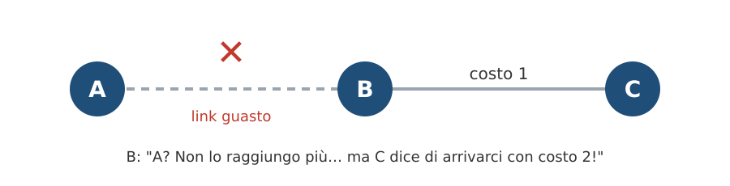

| Scambio | B → A | C → A |
|---|---|---|
| Prima del guasto | 1 (diretto) | 2 (via B) |
| B perde il link, ascolta C | 3 (via C) | 2 |
| C ascolta B | 3 | 4 (via B) |
| … | 5, 7, … | 6, 8, … fino a **16 = ∞** in RIP |

Con lo **split horizon** C non avrebbe mai annunciato a B una rotta imparata da B: problema evitato.

---

## Dijkstra: l'idea

Edsger W. Dijkstra, 1956: pare l'abbia ideato **in una ventina di minuti** al tavolino di un caffè di Amsterdam, senza carta e penna.

Richiede di **conoscere tutto il grafo** (per questo è usato dal Link State). Funziona come una macchia d'olio che si allarga dalla sorgente:

1. la sorgente ha distanza **0**, tutti gli altri **∞**
2. tra i nodi non ancora definitivi, prendo quello con la **distanza minima** e lo rendo **definitivo**
3. aggiorno (rilasso) le distanze dei suoi vicini
4. ripeto finché tutti i nodi sono definitivi

> **Perché funziona?** Con costi tutti **positivi**, il nodo più vicino non può essere raggiunto meglio passando da nodi più lontani: la sua distanza è sicuramente quella giusta. Per questo Dijkstra **non funziona con pesi negativi**.

---

## Dijkstra: lo pseudocodice

```text
DIJKSTRA(G, sorgente s)
    per ogni nodo v:  dist[v] ← ∞ ;  pred[v] ← nessuno
    dist[s] ← 0
    Q ← tutti i nodi                       // nodi non ancora definitivi

    finché Q non è vuoto:
        u ← nodo di Q con dist minima       // scelta "golosa" (greedy)
        togli u da Q                        // u diventa definitivo
        per ogni vicino v di u ancora in Q:
            se dist[u] + c(u,v) < dist[v]:  // rilassamento
                dist[v] ← dist[u] + c(u,v)
                pred[v] ← u
```

- **Complessità**: O(N²) nella versione semplice, **O((N + E) · log N)** con una coda di priorità (*heap*)
- È molto più veloce di Bellman-Ford quando il grafo è noto

---

## Dijkstra passo per passo – Passo 0

Rendo definitivo **A** (distanza 0) e aggiorno i suoi vicini B e C.

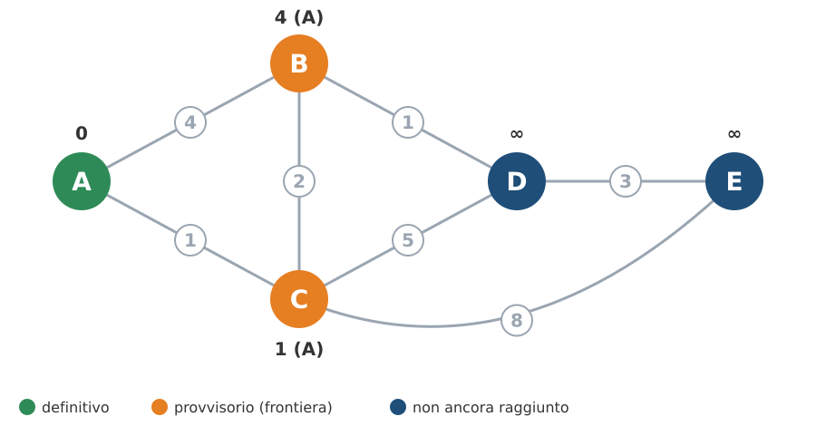

---

## Dijkstra passo per passo – Passo 1

Il provvisorio più vicino è **C (1)** → definitivo. Da C: B = 1 + 2 = **3** (meglio di 4!), D = 6, E = 9.

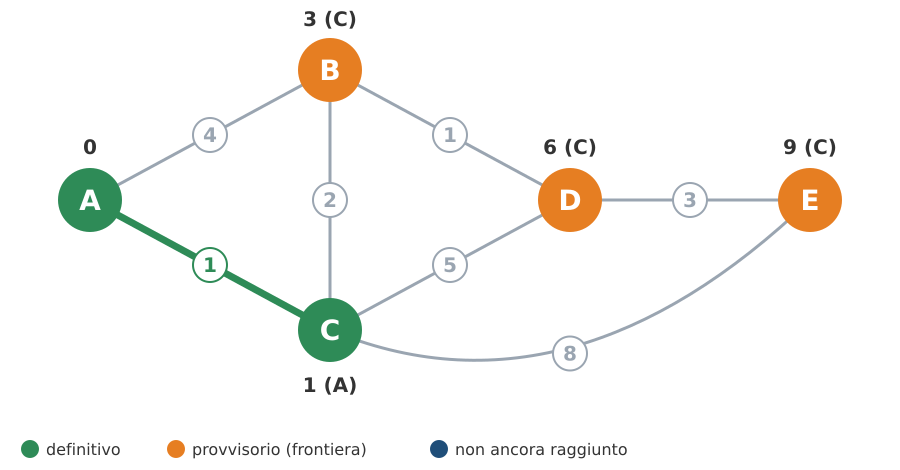

---

## Dijkstra passo per passo – Passo 2

Il provvisorio più vicino è **B (3)** → definitivo. Da B: D = 3 + 1 = **4** (meglio di 6).

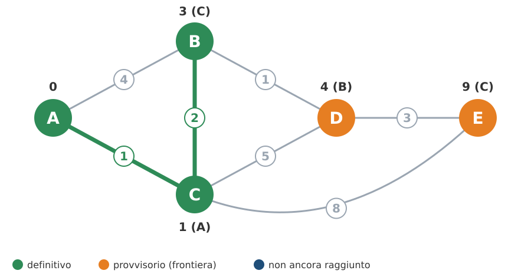

---

## Dijkstra passo per passo – Passo 3

Il provvisorio più vicino è **D (4)** → definitivo. Da D: E = 4 + 3 = **7** (meglio di 9).

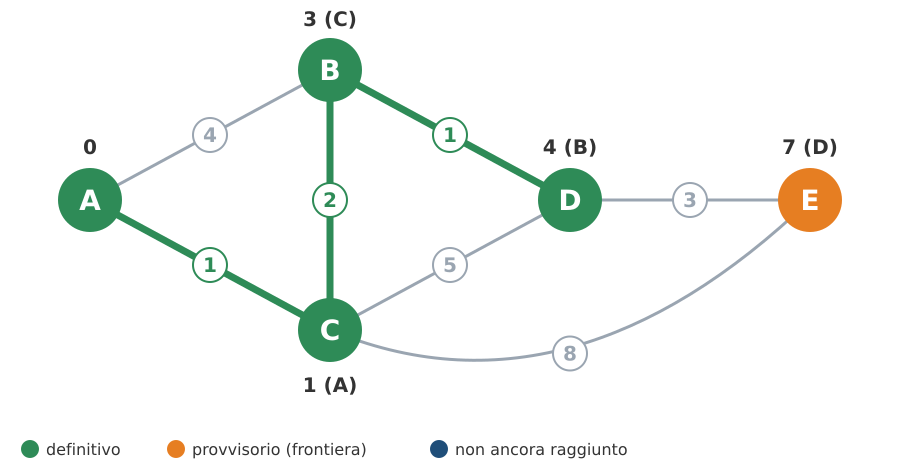

---

## Dijkstra passo per passo – Passo 4

Resta solo **E (7)** → definitivo. **Fine**: tutte le distanze sono minime.

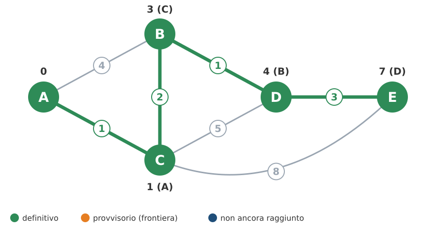

---

<!-- _class: small -->

## Dijkstra: riepilogo in tabella

| Passo | Nodi definitivi | B | C | D | E |
|---|---|---|---|---|---|
| 0 | A | 4, A | **1, A** | ∞ | ∞ |
| 1 | A, C | **3, C** | – | 6, C | 9, C |
| 2 | A, C, B | – | – | **4, B** | 9, C |
| 3 | A, C, B, D | – | – | – | **7, D** |
| 4 | A, C, B, D, E | – | – | – | – |

In grassetto il nodo scelto a ogni passo (distanza, predecessore).

**Confronto con Bellman-Ford**: stesso risultato, ma Dijkstra ha fatto **un solo passo per nodo**, mentre Bellman-Ford ha dovuto ripetere più giri su **tutti** gli archi.

> **Esercizio veloce** – Se il link B–D si guasta, quali distanze cambiano? Rifai Dijkstra da A. *(Soluzione: D = 6 via C, E = 9 via C oppure via D.)*

---

## Dal risultato alla routing table

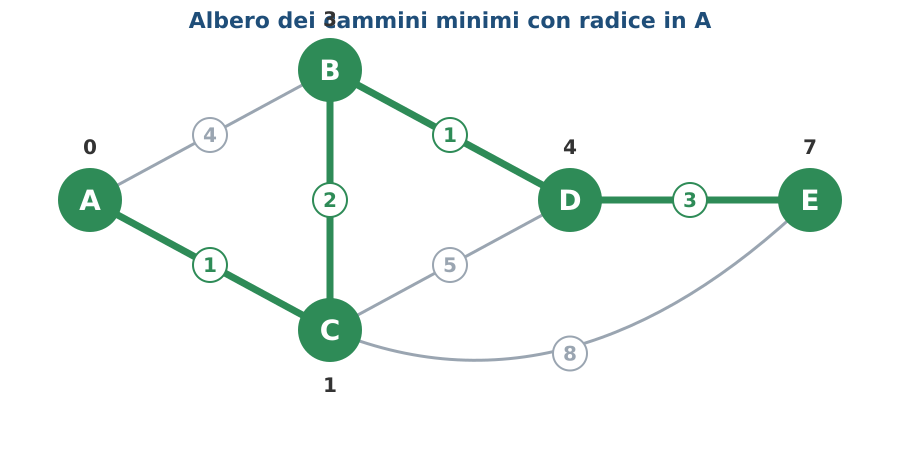

Ricostruendo i predecessori si ottiene l'**albero dei cammini minimi**.

Al router A interessa solo il **primo salto** (next hop):

| Destinazione | Costo | Next hop |
|---|---|---|
| B | 3 | C |
| C | 1 | C |
| D | 4 | C |
| E | 7 | C |

Per A **tutto passa da C**: il link diretto A–B non viene usato (resta come **riserva** se C si guasta).

---

## Dijkstra in Python

Un'implementazione reale con la coda di priorità (`heapq`):

```python
import heapq

def dijkstra(grafo, sorgente):
    dist = {n: float("inf") for n in grafo}
    pred = {n: None for n in grafo}
    dist[sorgente] = 0
    coda = [(0, sorgente)]                      # (distanza, nodo)
    while coda:
        d, u = heapq.heappop(coda)              # nodo più vicino
        if d > dist[u]:
            continue                            # voce vecchia, la salto
        for v, costo in grafo[u].items():
            if d + costo < dist[v]:             # rilassamento
                dist[v], pred[v] = d + costo, u
                heapq.heappush(coda, (dist[v], v))
    return dist, pred

rete = {"A": {"B": 4, "C": 1}, "B": {"A": 4, "C": 2, "D": 1},
        "C": {"A": 1, "B": 2, "D": 5, "E": 8}, "D": {"B": 1, "C": 5, "E": 3},
        "E": {"C": 8, "D": 3}}
print(dijkstra(rete, "A"))   # A:0  B:3  C:1  D:4  E:7
```

---

<!-- _class: small -->

## Bellman-Ford e Dijkstra a confronto

| | **Bellman-Ford** | **Dijkstra** |
|---|---|---|
| Informazioni necessarie | Solo i vicini e i loro vettori | **L'intero grafo** |
| Modo di esecuzione | Si presta a essere **distribuito** | **Centralizzato** su ogni router |
| Strategia | Ripete il rilassamento di tutti gli archi | Sceglie sempre il nodo più vicino (*greedy*) |
| Complessità | O(N · E) | O((N + E) log N) con heap |
| Pesi negativi | Sì (e rileva i cicli negativi) | No |
| Convergenza in rete | Lenta, rischio count to infinity | Rapida |
| Famiglia di routing | **Distance Vector** | **Link State** |
| Protocolli | RIP, IGRP (e BGP come Path Vector) | **OSPF**, IS-IS |

> **In sintesi** – Bellman-Ford è "chiedo ai vicini", Dijkstra è "ho la mappa e calcolo da solo".

---

<!-- _class: small -->

## Dijkstra nel lavoro del sistemista: il costo OSPF

OSPF calcola il costo di un'interfaccia così:

$$
\text{costo} = \frac{\text{banda di riferimento}}{\text{banda dell'interfaccia}} \qquad \text{(Cisco: riferimento predefinito 100 Mbps)}
$$

| Interfaccia | Costo predefinito |
|---|---|
| Ethernet 10 Mbps | 10 |
| FastEthernet 100 Mbps | 1 |
| GigabitEthernet 1 Gbps | **1** (!) |

Problema: FastEthernet e Gigabit risultano **uguali**, e Dijkstra non sa distinguerli. Il sistemista alza la banda di riferimento su **tutti** i router:

```text
router ospf 1
 auto-cost reference-bandwidth 10000     ! 10 Gbps → Gigabit = 10, FastEthernet = 100
```

> Cambiando i costi (`ip ospf cost 50` su un'interfaccia) il sistemista **sposta il traffico** su un link piuttosto che su un altro: sta "pilotando" Dijkstra.

---

## Come si verifica sul campo

Gli algoritmi non si vedono, ma i loro **risultati** sì:

- `traceroute` (Linux/macOS) / `tracert` (Windows) → mostra il **percorso reale** hop per hop
- `show ip route` → quale rotta ha vinto e con che metrica
- `show ip ospf neighbor` → con chi il router si scambia le informazioni Link State
- `show ip ospf database` → il **grafo** su cui gira Dijkstra

```text
$ traceroute www.garr.it            (esempio indicativo)
 1  192.168.1.1     1.2 ms     ← default gateway di casa
 2  10.40.0.1       8.5 ms     ← rete del provider
 3  …               9.1 ms
 …
 9  www.garr.it    14.7 ms
```

> **Caso tipico** – "Da quando abbiamo aggiunto il nuovo link il traffico non ci passa": quasi sempre è un problema di **costi**, e si risolve ragionando proprio come Dijkstra.

---

## Esercizio per la classe

Dato il grafo, calcola con **Dijkstra** i cammini minimi da **R1** e scrivi la routing table di R1 (destinazione, costo, next hop).

| Collegamento | R1–R2 | R1–R3 | R2–R3 | R2–R4 | R3–R4 | R3–R5 | R4–R5 |
|---|---|---|---|---|---|---|---|
| **Costo** | 2 | 6 | 3 | 7 | 1 | 9 | 2 |

1. Disegna il grafo e svolgi la tabella dei passi
2. Rifai il calcolo con **Bellman-Ford**: quanti giri servono per convergere?
3. Il link R3–R4 si guasta: cosa cambia nella routing table di R1?
4. Verifica i risultati con il programma Python visto in precedenza

---

<!-- _class: lead -->


# Gli Autonomous System e il routing gerarchico

---

## Gli Autonomous System

Nei primi anni '80 Internet era vista come **rete unica**: ogni router doveva avere una riga per **ogni rete** raggiungibile.

- la crescita delle tabelle rendeva il sistema **poco scalabile**, anche con protocolli adattivi
- la soluzione fu una struttura **modulare**: Internet viene suddivisa in aree chiamate **Autonomous System (AS)**, ognuna gestita da un network provider (o da un gruppo di amministratori)

> **Oggi** – Internet è formata da **decine di migliaia** di AS: provider, grandi aziende, università, cloud provider. Ogni volta che navighi attraversi diversi AS.

---

<!-- _class: small -->

## Autonomous System e comunicazione tra AS

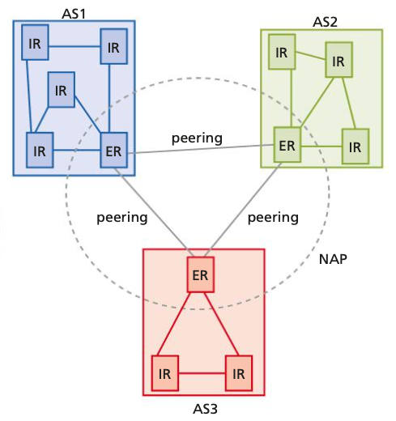

Un **AS** raggruppa router e LAN organizzati in modo che tutti i nodi interni siano raggiungibili tra loro.

- comunicazione **interna** → protocolli **Interior**, tra **Interior Router (IR)**
- comunicazione **esterna** (verso un altro AS) → protocollo **Exterior**, tramite gli **Exterior Router (ER)**, almeno uno per AS, che conoscono le reti raggiungibili attraverso i link con gli altri ER

Gli accordi tra AS, detti **peering**, definiscono le politiche di instradamento.

> **Esempio vicino a noi** – Il **GARR (AS137)** collega università, enti di ricerca e molte scuole italiane con il resto del mondo. Puoi esplorare un AS su siti pubblici come *bgp.he.net*.

---

<!-- _class: small -->

## Tipi di Autonomous System e ASN

<div class="cols">
<div>

### Tipi di AS
- **Multi-homed AS** – collegato a **due o più** AS, per restare online se un collegamento si guasta
- **Stub AS** (*single-homed*) – collegato a **un solo** AS (può avere connessioni private non visibili su Internet)
- **Transit AS** – fa da **collegamento** tra più AS e lascia transitare traffico di altri (tipico dei grandi provider)

</div>
<div>

### Autonomous System Number (ASN)
- identifica ogni AS
- allocati a blocchi da **IANA** ai **RIR** (in Europa il **RIPE NCC**), che li assegnano ai gestori
- **2 byte**: da 0 a 65.535 (1.023 per uso privato: 64512–65534)
- **4 byte**: da 0 a 4.294.967.295 (94.967.295 per uso privato)

</div>
</div>

> **Sul lavoro** – Un'azienda che vuole due provider diversi per la ridondanza (multi-homed) deve richiedere un proprio ASN e propri indirizzi IP, e parlare **BGP** con entrambi.

---

## Il routing gerarchico


- Routing table troppo grandi **saturano la memoria** dei router e rallentano la CPU nel calcolo dei percorsi
- Gli aggiornamenti generano **traffico** tra moltissimi router

In reti molto estese la rete si divide in **regioni** più piccole, interconnesse secondo il **routing gerarchico**:
- ogni regione comunica internamente con i propri protocolli standard
- l'interconnessione tra regioni è garantita da **router dedicati**

> **Analogia** – Il sistema postale: il postino del tuo quartiere conosce le vie, ma una lettera per Tokyo la consegna al centro di smistamento senza sapere nulla del Giappone.

---

## Router interni e di frontiera

Nel routing gerarchico un router può essere:

**Interno** (*internal router*)
- conosce solo la topologia della **propria regione**
- se la destinazione è fuori, inoltra verso il router di frontiera locale

**Di frontiera** (*boundary router*)
- gestisce il **passaggio tra regioni**, inoltrando verso la destinazione o verso un altro router di frontiera
- non ha visibilità sull'intera rete

**Vantaggio**: routing table **più piccole**.
**Svantaggio**: senza la topologia completa, le scelte possono essere **non ottimali**.

---

## Quanti livelli gerarchici?

Serve un equilibrio tra **tabelle snelle** e **percorsi efficienti**. Lavorando su più livelli:
- si riducono le tabelle e il traffico di aggiornamento
- i router perdono la visione globale → percorsi spesso **non ottimali**
- è utile per reti molto estese: un pacchetto da **Torino** a **San Paolo** può passare per Roma, Parigi e Buenos Aires

Usando **due router di frontiera** collegati a due regioni diverse:
- si evitano i sovraccarichi (e si ha ridondanza)
- le regioni si scelgono anche in base al **routing domain** (gruppo di router che usano lo stesso protocollo)

---

## Protocolli diversi e metriche diverse

Quando due regioni usano protocolli di routing diversi:
- non possono scambiarsi **direttamente** le informazioni
- devono usare la **redistribuzione**

Un router che ridistribuisce è detto **router multiprotocollo** e può:
- **importare** le rotte apprese in un dominio e **riannunciarle** in un altro
- **adattare le metriche**, che spesso sono diverse (hop count di RIP ≠ costo di OSPF)

Nei pacchetti di routing serve un **identificativo di protocollo**, per convertire le metriche in modo coerente.

> **Sul lavoro** – Capita quando due aziende si fondono: una usa OSPF, l'altra EIGRP. La redistribuzione è delicata: un errore può creare **loop** tra i due domini.

---

<!-- _class: small -->

## I protocolli di routing interior ed exterior

Il routing può avvenire:
- **all'interno di una singola rete**, anche suddivisa in sottoreti
- **nell'internetwork**, cioè tra reti eterogenee che magari usano protocolli diversi

In entrambi i casi si costruisce il **grafo dei router** e si applica l'algoritmo (Distance Vector o Link State). Nell'internetwork è più difficile: ogni router ha una scelta molto ampia.

**IGP** (*Interior Gateway Protocol*) – usati **all'interno** di un AS · **EGP** (*Exterior Gateway Protocol*) – usati **tra** AS diversi

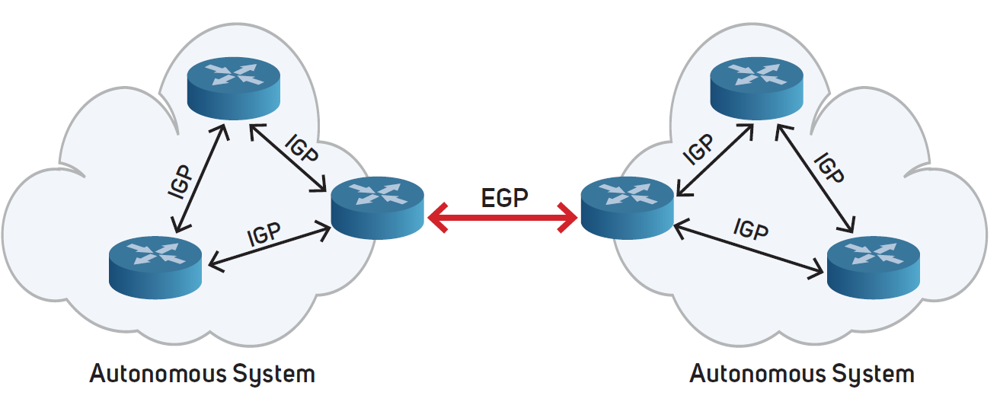

---

## Gateway e router

Il termine **gateway** (portone, passaggio) indica il servizio di inoltro dei pacchetti **da una rete verso l'esterno**:
- nelle reti semplici c'è un solo gateway verso Internet
- nelle reti articolate ogni sottorete ha il proprio gateway
- spesso il gateway integra **servizi aggiuntivi**: firewall, NAT, proxy, DNS

Gli host si affidano al **gateway predefinito** per raggiungere reti remote: solo il router deve gestire tabelle complesse.

```text
C:\> ipconfig            →  Gateway predefinito . . . : 192.168.1.1
$ ip route | grep default  →  default via 192.168.1.1 dev eth0
```

> **Sul lavoro** – "Vedo la stampante ma non Internet": la prima cosa da controllare è il **gateway predefinito** del PC (sbagliato o mancante).

---

<!-- _class: lead -->


# Protocolli di routing IGP

---

## Gli Interior Gateway Protocol

L'instradamento **all'interno** di un Autonomous System è gestito dai protocolli **IGP**, che si dividono in due famiglie:

<div class="cols">
<div>

### Distance Vector (Bellman-Ford)
- **RIP** (*Routing Information Protocol*)
- **IGRP** (*Interior Gateway Routing Protocol*)
- **EIGRP** (*Enhanced IGRP*)

</div>
<div>

### Link State (Dijkstra)
- **OSPF** (*Open Shortest Path First*)
- **Integrated IS-IS** (*Intermediate System to Intermediate System*)

</div>
</div>

> **Sul lavoro** – Nelle reti aziendali di oggi lo standard di fatto è **OSPF**; RIP si incontra ancora in piccole reti, apparati datati e nei laboratori (è perfetto per imparare).

---

## Il protocollo RIP (Routing Information Protocol)

- uno dei protocolli più **antichi**: nato in Xerox, adattato a TCP/IP nel 1982
- protocollo **IGP Distance Vector** con metrica **hop count**: semplice ma poco efficiente
- la distanza è il **numero di subnet attraversate** lungo il percorso più breve, compresa quella di destinazione
- memorizza solo il percorso più breve e accetta al massimo **15 hop** (16 = irraggiungibile) → adatto a reti **piccole**

> **Limite pratico** – RIP non distingue un link da 1 Gbps da uno da 2 Mbps: per lui contano solo i salti. Un percorso con 2 hop lenti "vince" su uno con 3 hop velocissimi.

---

## RIP – Funzionamento


Le tabelle vengono aggiornate **ogni 30 secondi**:
- ogni router invia la **tabella completa** ai vicini → molto traffico sulle reti a bassa capacità
- la convergenza richiede **circa 3 minuti**

Opzionalmente usa l'**hold down**: per 60 secondi non accetta update su una route guasta.

Per evitare i loop tra router adiacenti applica lo **split horizon**.

Un pacchetto RIP **non ha un campo dati** per gli host: trasporta solo informazioni di routing.

---

<!-- _class: small -->

## RIP – Il pacchetto

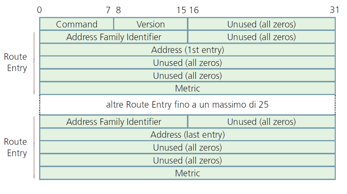

Un pacchetto **RIPv1** contiene:
- **Command**: 1 = Request, 2 = Response
- **Version**: 1 = RIPv1, 2 = RIPv2
- fino a **25 route entry** (le righe della routing table del mittente)

Ogni route entry occupa **20 ottetti**:
- **Address Family Identifier**: tipo di indirizzo
- **Address**: destinazione (rete, sottorete o host)
- **Metric**: in hop count, unica metrica di RIPv1

Con più di 25 entry il router invia **più pacchetti**. RIP è incapsulato in **UDP, porta 520**.

---

## RIP – Versioni

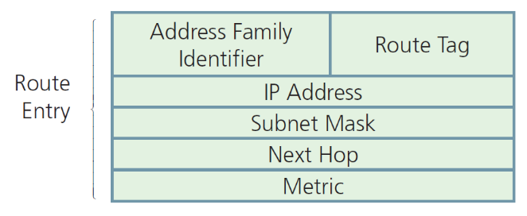

- **RIPv1**: *classful*, non trasporta la subnet mask (tutte le sottoreti devono avere la stessa maschera)
- **RIPv2**: trasporta la **Subnet Mask**, usa il **multicast** (224.0.0.9), supporta l'**autenticazione**
- **RIPng**: estensione per **IPv6**

Configurazione su router Cisco:

```text
router rip
 version 2
 network 192.168.10.0
 network 10.0.0.0
 no auto-summary
```

---

## Il protocollo OSPF (Open Shortest Path First)

**OSPF** (RFC 2328) è un protocollo **IGP Link State**: costruisce un **database distribuito** che rappresenta la topologia della rete sotto forma di **grafo** e ci applica **Dijkstra**.

Tutti i router dell'area condividono le **stesse informazioni** sullo stato dei collegamenti, garantendo:
- **uniformità**
- **aggiornamenti rapidi** in caso di variazioni

Esiste anche **OSPFv3** (RFC 5340) per **IPv6**.

> **Perché "Open"?** È uno standard aperto, non proprietario: router di marche diverse (Cisco, Juniper, MikroTik, Linux con FRRouting…) possono parlarsi.

---

## OSPF – Il concetto di Area

OSPF divide la rete in **aree**, formate da reti contigue. Ogni area:
- ha il **proprio database** ed esegue il proprio algoritmo di routing
- ha una struttura interna **nascosta** alle altre aree → meno traffico di routing

Si distinguono due tipi di routing:
- **intra-area**: sorgente e destinazione nella stessa area
- **inter-area**: traffico tra aree diverse

La separazione in aree rende OSPF **scalabile**, efficiente e adatto a reti molto estese.

> **Collegamento con Dijkstra** – Dividere in aree significa far girare Dijkstra su **grafi più piccoli**: meno calcoli, meno memoria, convergenza più rapida.

---

## OSPF – Backbone Area

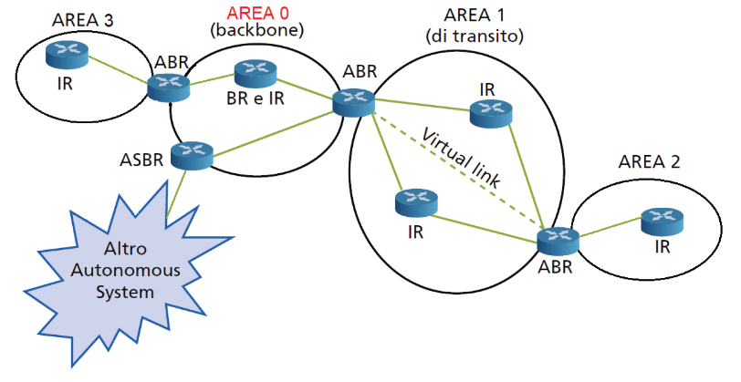

Tra le aree ne esiste una speciale, la **backbone** (o **area 0**), formata da:
- le reti che non appartengono a nessuna area
- i router di confine di ogni area

Per passare da un'area a un'altra **si passa sempre dalla backbone**.

Se un'area non è fisicamente collegata alla backbone si usa un **virtual link** attraverso un'area di transito.

---

## OSPF – Tipi di router


- **IR** (*Internal Router*) – tutte le interfacce nella stessa area
- **ABR** (*Area Border Router*) – collegato a più aree
- **BR** (*Backbone Router*) – almeno un'interfaccia sulla backbone
- **ASBR** (*Autonomous System Boundary Router*) – scambia informazioni con altri AS (IGP + EGP)

> **Esempio aziendale** – Sede centrale = area 0; ogni filiale = un'area; il router della sede verso il provider = ASBR.

---

## OSPF – Instradamento verso un'area esterna


Percorso di un pacchetto verso un'altra area:
1. percorso **intra-area** fino all'**ABR**
2. percorso nella **backbone** tra l'ABR dell'area sorgente e l'ABR dell'area di destinazione
3. percorso **intra-area** dall'ABR di destinazione fino all'**IR** destinatario

Per le rotte esterne si usano due metriche:
- **Tipo 1**: costo **totale** del percorso
- **Tipo 2**: conta solo il **costo esterno** dichiarato dal router di confine

---

## OSPF – Type of Service (TOS)

- OSPF supporta il **TOS**, che permette di associare **costi diversi** alla stessa interfaccia
- i router possono calcolare uno **SPF** (*Shortest Path First*, cioè Dijkstra) **per ogni TOS**, ottenendo rotte già pronte per ogni tipo di traffico
- tipi di TOS: **default, affidabilità, throughput, costo, ritardo**
- se una TOS-route non è configurata, i pacchetti seguono le rotte del TOS di default (**TOS 0**)

> **Esempio** – Il traffico VoIP (sensibile al ritardo) potrebbe seguire un percorso diverso dai backup notturni (sensibili alla banda). Nella pratica moderna questa funzione è stata in gran parte sostituita da QoS e MPLS.

---

## OSPF – Link State Advertisement (LSA)

La tecnica **LSA** è il modo con cui OSPF condivide le informazioni di instradamento tra i nodi.

- i router inviano pacchetti **LSA** che rendono pubblico lo **stato dei loro collegamenti**
- sono i "mattoncini" con cui ogni router costruisce il **grafo** su cui esegue Dijkstra
- esistono vari tipi di LSA, generati da router diversi e inviati in **flooding** nella stessa area o verso le altre:
  - **interni** (router LSA)
  - **designated** (network LSA)
  - **ABR** (summary LSA)
  - **ASBR** (external LSA)

---

<!-- _class: small -->

## OSPF – L'header

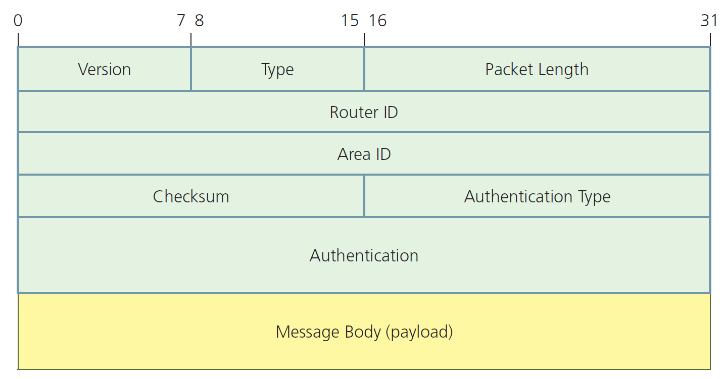

- **Version** (1 byte): 2 per IPv4, 3 per IPv6
- **Packet Type** (1 byte): 1 Hello, 2 Database Description, 3 Link State Request, 4 Link State Update, 5 Link State Acknowledgment
- **Packet Length** (2 byte): dimensione totale in byte
- **Router ID** (4 byte): chi ha generato il messaggio
- **Area ID** (4 byte): area di appartenenza
- **Checksum** (2 byte): su tutto tranne Authentication
- **Authentication Type** (2 byte): 0 nessuna, 1 password, 2 crittografica
- **Authentication** (8 byte): dati di autenticazione
- **Message Body**: contenuto, in base al Packet Type

OSPF viaggia **direttamente su IP** (protocollo numero **89**), non su TCP o UDP.

---

<!-- _class: small -->

## OSPF – I Packet Type

- **Hello** – crea e mantiene le relazioni di **vicinato** ed elegge il **Designated Router**; all'avvio il router invia/riceve Hello sulle interfacce per scoprire i vicini; poi fanno da **keep-alive**
- **Database Description (DD)** – due router adiacenti si scambiano i DD per **sincronizzare** il Link State Database: uno è **master** (*poll*), l'altro **slave** (*response*)
- **Link State Request (LSR)** – richiesta di uno o più LSA a un vicino quando dai DD si scopre che il proprio database non è aggiornato
- **Link State Update (LSU)** – contiene gli LSA richiesti o aggiornati, inviato in **flooding**; risponde a un LSR o notifica una variazione
- **Link State Acknowledgment** – conferma la ricezione di un LSU ed evita ritrasmissioni inutili

> **Sul lavoro** – Se due router non diventano vicini (`show ip ospf neighbor` vuoto), il problema è quasi sempre negli **Hello**: area, subnet mask, timer o autenticazione diversi.

---

## OSPF – Configurazione di base

```text
router ospf 1
 router-id 1.1.1.1
 auto-cost reference-bandwidth 10000
 network 192.168.10.0 0.0.0.255 area 0
 network 10.0.12.0 0.0.0.3 area 0
 passive-interface GigabitEthernet0/0      ! LAN utenti: niente Hello verso i PC
```

Comandi di verifica:

```text
show ip ospf neighbor        ! vicini e stato (FULL = sincronizzati)
show ip ospf database        ! gli LSA: il grafo su cui gira Dijkstra
show ip route ospf           ! le rotte calcolate
```

> `passive-interface` è una buona pratica di **sicurezza**: non si mandano messaggi di routing verso la LAN degli utenti.

---

<!-- _class: lead -->


# Protocolli di routing EGP

---

## Gli Exterior Gateway Protocol

I protocolli **EGP**, detti anche **extradominio**, gestiscono l'instradamento **tra Autonomous System** diversi.

A differenza degli IGP, qui ogni AS vuole mantenere la propria **autonomia** e non subire decisioni altrui: contano le **politiche** (accordi commerciali, costi, sicurezza) più della semplice distanza.

Principali protocolli EGP:
- **EGP** – il primo standardizzato, oggi **obsoleto**
- **BGP** (*Border Gateway Protocol*) – standard IETF, **il** protocollo di Internet, oggi **BGP-4**
- **IDRP** (*Inter-Domain Routing Protocol*) – sviluppato da ISO, Path Vector come BGP

---

## Il protocollo BGP (Border Gateway Protocol)

- è il principale protocollo di routing **tra AS**, usato nel **backbone di Internet**
- successore di EGP, con diverse versioni: BGP-1 (RFC 1105, 1988), BGP-2 (RFC 1163, 1990), BGP-3 (RFC 1267, 1991), **BGP-4** (RFC 4271, 2006) tuttora in uso
- è complesso e **strategico**: Internet è fatta di molti AS gestiti da ISP diversi, che devono cooperare mantenendo le proprie politiche
- è un protocollo **Path Vector**, evoluzione del Distance Vector: nel vettore si elencano **tutti gli AS attraversati** per raggiungere la destinazione

> **Quanto è importante?** Il 4 ottobre 2021 un errore di configurazione fece sparire da BGP le rotte di **Facebook**: Facebook, Instagram e WhatsApp rimasero irraggiungibili per circa **6 ore**, in tutto il mondo.

---

## BGP – I vantaggi del Path Vector

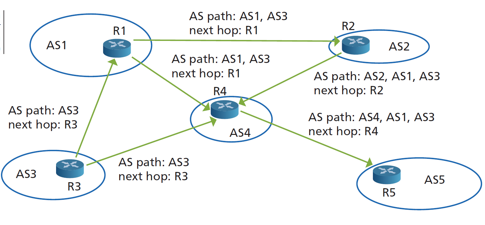

Il Path Vector risolve il problema dei **percorsi ciclici**:
- se un router trova il **proprio AS** nel vettore, scarta la rotta → niente loop
- se il percorso è valido, aggiunge il proprio AS e lo inoltra ai vicini

Ogni Path Vector ha degli **attributi**:
- **ORIGIN** (code 1): origine della rotta (IGP, EGP o incomplete)
- **AS_PATH** (code 2): elenco degli AS da attraversare
- **NEXT_HOP** (code 3): IP del router di frontiera

---

## BGP – Header e tipi di messaggio

L'header dei messaggi BGP è lungo **19 ottetti**:
- i primi **16** (*marker*) sono tutti a 1
- **2** ottetti indicano la lunghezza totale del messaggio
- l'ultimo ottetto indica il **tipo** di messaggio

I quattro tipi di messaggio:

| Tipo | Funzione |
|---|---|
| **OPEN** | apertura della sessione |
| **UPDATE** | invio dei Path Vector (rotte nuove o ritirate) |
| **NOTIFICATION** | segnalazione di errori o chiusura |
| **KEEPALIVE** | conferma che il router è attivo |

---

<!-- _class: small -->

## Le sessioni BGP

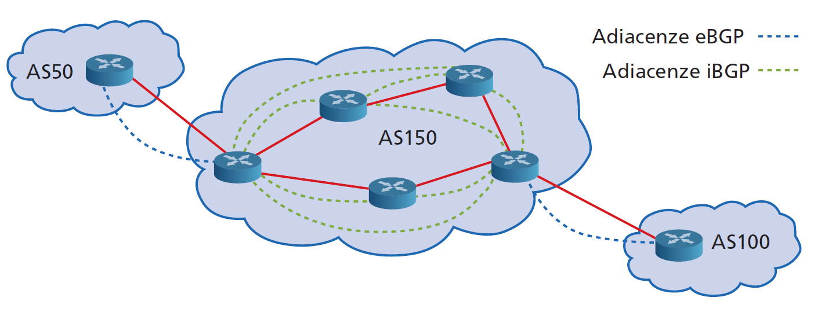

I router BGP comunicano su **TCP, porta 179**: l'affidabilità è delegata al livello Transport. Due tipi di sessione:
- **eBGP**: tra router di **AS diversi**, normalmente collegati direttamente
- **iBGP**: tra router dello **stesso AS**, anche non collegati fisicamente

All'avvio i router si scambiano **l'intera tabella** con messaggi UPDATE, poi **solo le variazioni**; le reti sono annunciate in notazione **CIDR**.

Le politiche tra AS:
- **export policy**: annuncio solo i percorsi autorizzati
- **import policy**: rifiuto i percorsi non conformi

```text
router bgp 65001
 neighbor 203.0.113.2 remote-as 65002
 network 198.51.100.0 mask 255.255.255.0
```

---

<!-- _class: lead -->


# Le reti multiprotocollo: MPLS

---

## MPLS e la tecnica Label Switching

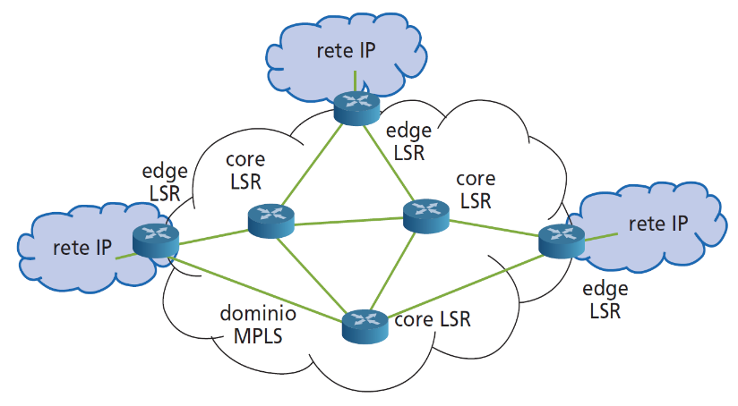

**MPLS** (*Multiprotocol Label Switching*) è una tecnologia IETF (RFC 3031) che rende l'instradamento più **generale** e indipendente dal solo IP.

Supera il forwarding basato sull'indirizzo IP e introduce il **label switching**: ogni pacchetto riceve un'**etichetta** (label) usata per inoltrarlo.

> **Analogia** – In aeroporto non si legge ogni volta l'indirizzo di casa sulla valigia: le si attacca un'**etichetta** con il codice del volo e tutti la smistano guardando solo quella.

---

## Funzionamento del dominio MPLS

La rete MPLS usa due tipi di router:
- **ELSR** (*Edge LSR*) ai **bordi** del dominio
- **CLSR** (*Core LSR*) nel **core**

I pacchetti IP sono raggruppati in **FEC** (*Forwarding Equivalence Class*) in base a destinazione e tipo di servizio; l'ELSR di ingresso assegna una **label** che individua il percorso verso l'ELSR di uscita.

Da quel momento il routing avviene **solo tramite label**, senza leggere l'header IP:
- ogni CLSR consulta la tabella **label ↔ next hop**, **sostituisce** l'etichetta e inoltra
- l'ELSR di uscita **rimuove** la label e si torna al normale routing IP

---

<!-- _class: small -->

## La gestione delle label in MPLS

Un pacchetto può trasportare **m ≥ 1 label** organizzate a livelli (**label stack**); l'instradamento dipende solo dalla label **in cima** → utile per **tunnel** e organizzazione gerarchica.

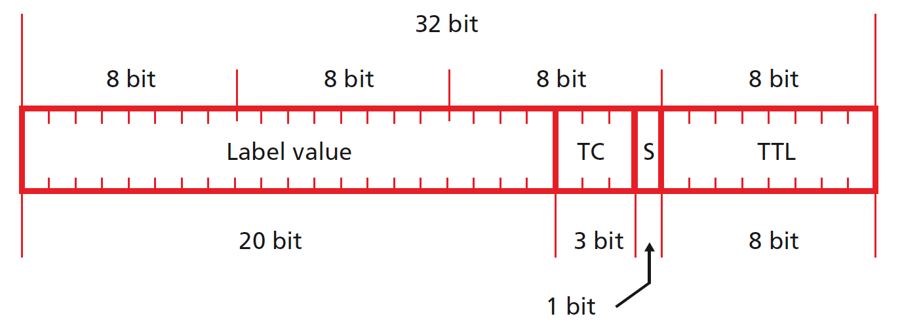

- **Label Value** (20 bit): indice nella tabella di inoltro
- **Traffic Class** (3 bit): classe di servizio (**QoS**)
- **Bottom of Stack** (1 bit): indica se è l'ultima label dello stack
- **TTL** (8 bit): come in IP, limita i salti

La label sta tra l'header di livello 2 e quello di livello 3: per questo MPLS è detto di **livello 2.5**.

---

## Label Switching Path (LSP)

Il percorso seguito da un pacchetto MPLS è detto **Label Switching Path (LSP)**: la sequenza di router (R1, R2, …, Rn) in cui
- **R1** è l'ELSR di ingresso che inserisce la label di livello m
- nei CLSR intermedi il pacchetto è instradato usando **solo** la label di livello m
- label di livello superiore possono comparire solo se aggiunte **in transito** (tunnel)

Le tre operazioni sulle label:

| Router | Operazione |
|---|---|
| ELSR d'ingresso | **push** – inserisce la label |
| CLSR di transito | **swap** – sostituisce la label |
| ELSR d'uscita | **pop** – rimuove la label |

---

## I servizi offerti dalle reti MPLS

- **Qualità del servizio** – introduce un trasferimento *connection-oriented* che permette di **garantire parametri** non ottenibili con il normale IP connectionless
- **Ingegneria del traffico** – usa **più cammini** tra due punti e distribuisce i flussi, ottimizzando l'uso della rete
- **VPN** – reti private virtuali **isolate** dal resto del traffico, tra sedi remote
- **Fault tolerance** – cammini di protezione pronti a subentrare in caso di guasto, con riconfigurazione **molto più rapida** dei protocolli IP tradizionali

> **Sul lavoro** – Quando un'azienda con più sedi acquista dal provider una "**VPN MPLS**", il sistemista vede le sedi come se fossero sulla stessa rete privata: il lavoro con le label lo fa l'operatore, ma bisogna sapere cosa si sta comprando.

---

## Riepilogo: il routing nel lavoro del sistemista

| Situazione reale | Concetto in gioco |
|---|---|
| Il PC vede la LAN ma non Internet | **gateway / default route** |
| Collegare la sede di una filiale | **rotte statiche** o **OSPF** |
| Il traffico non usa il nuovo link veloce | **costi OSPF** → **Dijkstra** |
| Un `traceroute` gira in tondo | **routing loop**, count to infinity |
| Due provider per non restare mai offline | **multi-homed AS**, **BGP** |
| Mezzo mondo non raggiunge un sito | annunci **BGP** sbagliati |
| Collegare sedi lontane con qualità garantita | **VPN MPLS** |

> Algoritmi come **Bellman-Ford** e **Dijkstra** non sono "teoria da libro": girano **in questo momento** su milioni di router, compreso quello della scuola.

---

## Domande di verifica

1. Qual è la differenza tra **algoritmo** e **protocollo** di routing? Fai un esempio per ciascuno.
2. Perché la forwarding table è separata dalla routing table?
3. Spiega il **longest prefix match** con un esempio.
4. Che cos'è il **count to infinity** e come lo limita lo **split horizon**?
5. Applica **Dijkstra** al grafo d'esempio partendo da **E**: qual è il next hop di E verso A?
6. Perché Dijkstra non può essere eseguito "alla Distance Vector" sui router?
7. Perché OSPF divide la rete in **aree** e cos'è l'area 0?
8. Cosa evita il **Path Vector** di BGP rispetto al Distance Vector?
9. Quali sono le tre operazioni sulle label MPLS e chi le esegue?
