<!--
_class: lead dark
_paginate: false
_header: ""
_footer: ""
-->


# L'evoluzione di IP e il monitoring della rete

IPv6 · indirizzamento · ARP · ICMP/ICMPv6 · Neighbor Discovery

**Unità 5 – Internetworking**

---

# Mappa dei contenuti

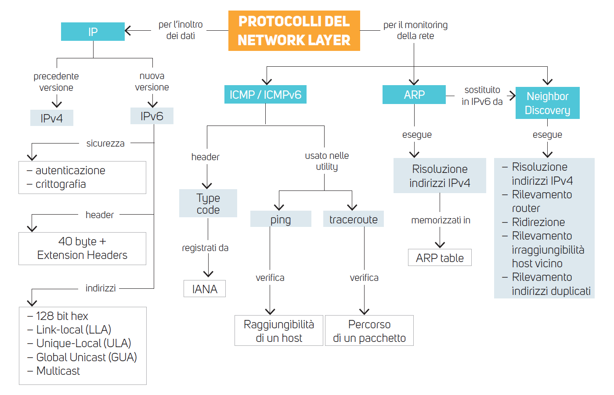

---

# Come leggere la mappa

I protocolli del **Network Layer** si dividono in due famiglie:

- **Per l'inoltro dei dati** → **IP**, nelle due versioni IPv4 e IPv6 (header, indirizzi, extension header)
- **Per il monitoring della rete** → **ICMP/ICMPv6** (diagnostica e segnalazione errori) e **ARP** / **Neighbor Discovery** (collegamento tra indirizzi logici e fisici)

> **Obiettivi dell'unità**
> - descrivere struttura e funzionamento di IPv6 e il confronto con IPv4
> - rappresentare, classificare e assegnare indirizzi IPv6
> - spiegare la risoluzione degli indirizzi con ARP (IPv4) e NDP (IPv6)
> - usare ICMP/ICMPv6 per diagnosticare la rete (`ping`, `traceroute`)

---

<!--
_class: lead dark
_paginate: false
_header: ""
_footer: ""
-->


# L'evoluzione del protocollo IP: IPv6

---

# Perché serviva una nuova versione di IP


- IPv4 usa indirizzi a **32 bit** → 2³² ≈ **4,3 miliardi** di indirizzi, pochi per miliardi di dispositivi
- Soluzioni **temporanee** per rallentare l'esaurimento:
  - **indirizzi privati** (RFC 1918: `10.0.0.0/8`, `172.16.0.0/12`, `192.168.0.0/16`)
  - **NAT** (Network Address Translation)
  - **CIDR** e **VLSM** (uso più efficiente dei blocchi)

> **Esempio.** Un router domestico con un solo IPv4 pubblico, tramite NAT, fa uscire su Internet decine di dispositivi. Funziona, ma rompe la connettività **end-to-end** e complica servizi come VoIP e peer-to-peer.

---

# La nascita di IPv6

- Progettato negli anni '90 dall'**IETF** (Internet Engineering Task Force) come **IPng** (IP next generation)
- Prime specifiche: **RFC 1883** e **RFC 1887**
- Evoluzione delle specifiche: **RFC 2460** (1998) → **RFC 8200** (2017, versione attuale)

> **Cos'è una RFC?** *Request for Comments*: documento ufficiale pubblicato dall'IETF che descrive un protocollo o una pratica di Internet. Ogni RFC ha un numero e può essere aggiornata o resa obsoleta da RFC successive.

> **Perché IPv6 e non IPv5?** Il valore 5 nel campo *Version* era già stato assegnato a un protocollo sperimentale (ST, Internet Stream Protocol), quindi si passò direttamente a 6.

---

# IPv6: lo spazio degli indirizzi

- Indirizzi da **4 byte (32 bit)** a **16 byte (128 bit)**: la lunghezza è **quadruplicata**, lo spazio cresce in modo esponenziale
- Numero di indirizzi: 2¹²⁸ ≈ **3,4 × 10³⁸** (circa 340 miliardi di miliardi di miliardi di miliardi)
- Non solo host tradizionali: ogni dispositivo "intelligente" (smartphone, GPS, sensori IoT, auto connesse) può avere un indirizzo **univoco e globale**

> **Per rendere l'idea.** Sulla superficie terrestre (≈ 5,1 × 10¹⁴ m²) ci sarebbero circa **6,7 × 10²³ indirizzi per ogni metro quadrato**.

---

# I miglioramenti introdotti da IPv6

| Novità | Beneficio |
|---|---|
| **Header semplificato** (meno campi, lunghezza fissa) | elaborazione più rapida nei router |
| **Header flessibile** (extension header) | supporto a opzioni future senza rallentare il forwarding |
| **Controllo del flusso** (*Flow Label*) | migliore **QoS**, utile per trasmissioni in tempo reale |
| **Sicurezza** (autenticazione e crittografia tramite estensioni, IPsec) | comunicazioni protette a livello di rete |
| **Maggiore efficienza** (rimosso il campo *checksum*) | meno calcoli: le reti moderne hanno basso tasso di errore fisico |

> Anche la **frammentazione** è più efficiente: in IPv6 la eseguono solo gli host mittenti, non i router intermedi.

---

<!-- _class: small -->

# Confronto sintetico IPv4 / IPv6

| Caratteristica | IPv4 | IPv6 |
|---|---|---|
| Lunghezza indirizzo | 32 bit | 128 bit |
| Notazione | decimale puntata `192.168.1.1` | esadecimale a gruppi `2001:db8::1` |
| Header | 20–60 byte, variabile | **40 byte, fisso** |
| Opzioni | campo *Options* nell'header | **extension header** |
| Checksum dell'header | presente | **assente** |
| Frammentazione | host e router | **solo l'host mittente** |
| Broadcast | sì | **no** (sostituito dal multicast) |
| Risoluzione indirizzi | ARP | **NDP** (ICMPv6) |
| Configurazione | manuale o DHCP | manuale, **SLAAC** o DHCPv6 |
| NAT | molto diffuso | non necessario |

---

# Coesistenza tra IPv4 e IPv6

**IPv6 non è compatibile con IPv4**: sono due protocolli distinti che devono convivere durante la transizione. Tre meccanismi principali:

1. **Dual-stack** → ogni nodo supporta entrambi i protocolli
2. **Tunneling** → i pacchetti IPv6 viaggiano incapsulati dentro pacchetti IPv4
3. **Traduzione** (es. NAT64/DNS64) → una rete IPv6-only raggiunge servizi che hanno ancora solo IPv4

> Le prime due tecniche sono approfondite nelle slide seguenti. La traduzione serve quando un client è solo IPv6 e il server solo IPv4: il gateway NAT64 converte i pacchetti da un formato all'altro.

---

# La tecnica di tunneling

Il **tunneling** si usa nelle telecomunicazioni per:

- trasportare pacchetti di un **protocollo non gestito** dalla rete attraversata
- **nascondere l'intera PDU**, header inclusi (es. per cifrare mittente e destinatario)

Un pacchetto IPv6 può essere **incapsulato in IPv4**, attraversare una rete che conosce solo IPv4 ed essere **estratto** dal destinatario.

> **Attenzione**
> - IPv4 **non è influenzato** dall'attivazione di IPv6
> - tutti i sistemi supportano l'uso contemporaneo dei due protocolli (**dual-stack**)
> - molte applicazioni **preferiscono IPv6** quando disponibile

---

<!-- _class: small -->

# Tunneling: come funziona passo per passo

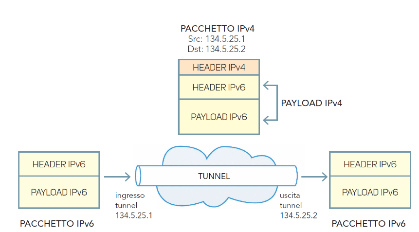

1. L'host sorgente invia un normale **pacchetto IPv6** (header IPv6 + payload)
2. All'**ingresso del tunnel** (`134.5.25.1`) il router aggiunge un **header IPv4**: `Src 134.5.25.1`, `Dst 134.5.25.2`
3. La rete IPv4 inoltra il pacchetto guardando **solo l'header IPv4**
4. All'**uscita del tunnel** (`134.5.25.2`) il router **rimuove l'header IPv4** e inoltra il pacchetto IPv6 originale

> Nell'header IPv4 il campo *Protocol* vale **41**, che indica "payload = IPv6" (tecnica 6in4).

---

<!-- _class: small -->

# Il dual-stack

Il **dual-stack** è il metodo più usato per introdurre IPv6 nelle reti di accesso: l'interfaccia ha **sia un indirizzo IPv4 sia uno o più indirizzi IPv6**.

- pro: buona esperienza d'uso, molti dispositivi non funzionano ancora in modalità IPv6-only
- contro: **non risolve la scarsità di IPv4**, perché ogni dispositivo riceve comunque un indirizzo IPv4

```text
$ ip -br addr show eth0
eth0   UP   192.168.1.20/24  2001:db8:acad:1::20/64  fe80::21a:2bff:fe3c:4d5e/64
```

> **Quale protocollo viene usato?** Se un nome ha record DNS sia `A` (IPv4) sia `AAAA` (IPv6), i sistemi moderni provano **prima IPv6** e, se non risponde rapidamente, passano a IPv4 (algoritmo *Happy Eyeballs*, RFC 8305).

---

<!-- _class: small -->

# Le reti IPv6-only e l'RFC 8925

L'adozione di IPv6 è avanzata più rapidamente nei Paesi che hanno costruito **reti moderne da zero**, senza il peso dell'infrastruttura IPv4 esistente.

L'**RFC 8925** (*IPv6-Only Preferred Option for DHCPv4*) introduce l'**opzione DHCPv4 108**:

- il client dichiara di poter lavorare in **IPv6-only**
- il server DHCP, se la rete lo supporta, risponde con l'opzione 108 e **non assegna l'IPv4**
- i dispositivi **legacy** che non la capiscono ricevono normalmente un indirizzo IPv4

Risultato: **migrazione graduale** verso reti IPv6-only, con uso di IPv4 sempre più ridotto.

> **Esempio.** In una rete Wi-Fi aziendale, smartphone e portatili recenti inviano l'opzione 108 e rimangono IPv6-only; una vecchia stampante, che non la invia, riceve ancora un indirizzo IPv4.

---

# L'header IPv6

- Specifiche definite dall'IETF: **RFC 2460** (1998) → **RFC 8200** (2017, attuale)
- L'header è **fisso, lungo 40 byte** (in IPv4 varia da 20 a 60 byte)
- Struttura più semplice di IPv4: sono stati **rimossi vari campi** non più necessari, quindi i router elaborano il datagramma più velocemente
- Le **opzioni** non sono più nell'header, ma gestite come **extension header** inseriti all'inizio del payload: più flessibilità e modularità

> **Perché 40 byte fissi?** Con una lunghezza costante il router sa sempre dove iniziano i campi e può usare hardware dedicato per il forwarding, senza leggere un campo "lunghezza header" come l'IHL di IPv4.

---

<!-- _class: small -->

# Dall'header IPv4 all'header IPv6

| Campo IPv4 | In IPv6 |
|---|---|
| Version | **Version** (valore 6) |
| IHL (lunghezza header) | **eliminato** (header a lunghezza fissa) |
| Type of Service | **Traffic Class** |
| Total Length | **Payload Length** (esclude l'header) |
| Identification, Flags, Fragment Offset | **eliminati** dall'header: nel *Fragment Header* (estensione) |
| Time To Live (TTL) | **Hop Limit** (stessa funzione, nome più preciso) |
| Protocol | **Next Header** |
| Header Checksum | **eliminato** |
| Options / Padding | **eliminati**: extension header |
| Source / Destination Address (32 bit) | **Source / Destination Address (128 bit)** |
| – | **Flow Label** (nuovo) |

---

<!-- _class: fig -->

# I campi dell'header IPv6

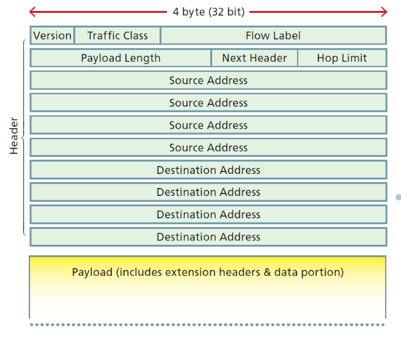

Totale: 4 + 8 + 20 + 16 + 8 + 8 + 128 + 128 = **320 bit = 40 byte**

---

<!-- _class: small -->

# I campi dell'header IPv6 (1/2)

| Campo | Bit | Funzione |
|---|---|---|
| **Version** | 4 | Versione IP, fissata a **6**. Con valore 4 il pacchetto non è un datagram IPv4 valido |
| **Traffic Class** | 8 | **Priorità** per il QoS. Include **DSCP** (classifica i pacchetti) ed **ECN** (segnala la congestione). Nella definizione originale i valori 8–15 erano riservati al traffico real time |
| **Flow Label** | 20 | Identifica i **flussi** che richiedono un trattamento speciale; vale **0** se non supportato dal router |
| **Payload Length** | 16 | Lunghezza del payload (extension header inclusi), **max 65.535 byte** |

> **Esempio – Flow Label.** Una videochiamata genera pacchetti con la stessa terna (sorgente, destinazione, Flow Label): i router possono riconoscere il flusso e applicare la stessa politica senza analizzare i livelli superiori.

---

<!-- _class: small -->

# I campi dell'header IPv6 (2/2)

| Campo | Bit | Funzione |
|---|---|---|
| **Next Header** | 8 | Identifica l'**extension header successivo** oppure il protocollo di livello superiore |
| **Hop Limit** | 8 | **Numero massimo di hop**: decrementato di 1 da ogni router; a 0 il pacchetto è scartato |
| **Source Address** | 128 | Indirizzo IPv6 di **origine** |
| **Destination Address** | 128 | Indirizzo IPv6 di **destinazione** |

Valori tipici di **Next Header**: `0` Hop-by-Hop · `6` TCP · `17` UDP · `43` Routing · `44` Fragment · `50` ESP · `51` AH · `58` ICMPv6 · `60` Destination Options

> **Esempio – Hop Limit.** Un host invia un pacchetto con Hop Limit = 64. Dopo 5 router vale 59. Se arriva a 0 il router scarta il pacchetto e invia al mittente un messaggio **ICMPv6 Time Exceeded**: è il principio su cui si basa `traceroute`.

---

# Gli Extension Header

In IPv4 il campo **Options** rallentava l'elaborazione: ogni router doveva processarlo prima di inoltrare il pacchetto.

IPv6 usa gli **extension header** (elenco ufficiale gestito da **IANA**):

- sono posti **subito dopo l'header IPv6**; se non rilevanti per i router intermedi sono trattati come parte del **payload**, a vantaggio delle prestazioni di forwarding
- un pacchetto può contenerne **più di uno**: ognuno ha un campo **Next Header** che indica il successivo, formando una **catena ordinata** fino al protocollo di livello superiore
- se **non ci sono** extension header, il *Next Header* dell'header principale identifica direttamente il livello superiore

---

<!-- _class: small -->

# Catena di Next Header: un esempio

```text
Senza extension header
+-------------------+------------------------+
| IPv6 (NH = 6)     | TCP + dati             |
+-------------------+------------------------+

Con due extension header
+----------------+--------------------+-------------------+-------------+
| IPv6 (NH = 43) | Routing  (NH = 44) | Fragment (NH = 6) | TCP + dati  |
+----------------+--------------------+-------------------+-------------+
```

- Il router legge l'header base: `NH = 43` → segue un **Routing Header**
- Il Routing Header ha `NH = 44` → segue un **Fragment Header**
- Il Fragment Header ha `NH = 6` → il payload è un segmento **TCP**

> Ogni extension header "punta" al successivo, come una **lista concatenata**. L'ultimo punta al protocollo di livello superiore.

---

# Extension Header: pacchetto senza e con estensioni

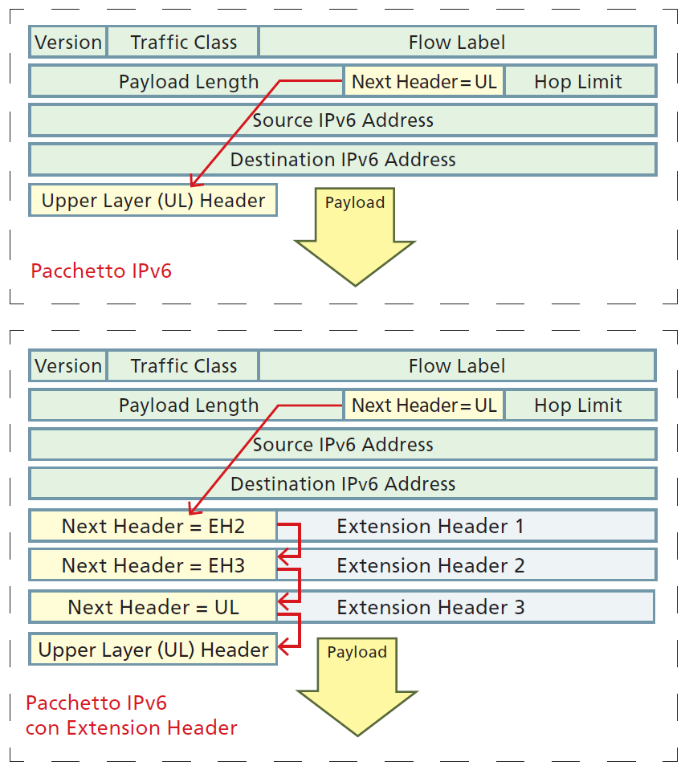

Nella figura:

- **in alto**: pacchetto con il solo header base; il campo *Next Header* indica direttamente l'**Upper Layer** (UL)
- **in basso**: tra header base e payload compaiono **EH1, EH2, EH3**; ogni *Next Header* indica l'estensione successiva e l'ultima punta all'**Upper Layer Header**

Le extension header fanno parte della sezione **payload** del pacchetto, per questo il campo *Payload Length* le comprende.

---

<!-- _class: small -->

# Extension Header: ordine di comparsa

Ordine corretto secondo l'**RFC 8200**:

| # | Header | Next Header |
|---|---|---|
| 1 | IPv6 Header (base) | – |
| 2 | **Hop-by-Hop Options** (letto da *tutti* i router sul percorso) | 0 |
| 3 | **Destination Options** (con instradamento) | 60 |
| 4 | **Routing** | 43 |
| 5 | **Fragment** | 44 |
| 6 | **Authentication (AH)** | 51 |
| 7 | **Encapsulating Security Payload (ESP)** | 50 |
| 8 | **Destination Options** (senza instradamento) | 60 |
| 9 | **Upper Layer Header** (TCP, UDP, ICMPv6) | 6 / 17 / 58 |

---

<!--
_class: lead dark
_paginate: false
_header: ""
_footer: ""
-->


# Gli indirizzi IPv6

---

# Il formato degli indirizzi IPv6

- **RFC 4291**: architettura degli indirizzi IPv6 (gli aggiornamenti successivi sono elencati nella sezione *Updated by*)
- Il **broadcast IPv4 non esiste**: le sue funzioni sono sostituite e migliorate dal **multicast**

| Categoria | Identifica | Comportamento | Esempio |
|---|---|---|---|
| **Unicast** | una singola interfaccia | comunicazione **univoca** | `2001:db8::1` |
| **Anycast** | più interfacce | risponde il nodo **più vicino** (in termini di routing) | stesso indirizzo su più server DNS |
| **Multicast** | un gruppo di interfacce | invio a **tutti i membri** del gruppo | `ff02::1` (tutti i nodi del link) |

> **Perché eliminare il broadcast?** Un broadcast interrompe **tutti** gli host del segmento. Il multicast raggiunge solo chi si è iscritto al gruppo.

---

# La rappresentazione degli indirizzi IPv6

- **128 bit** suddivisi in **8 gruppi da 16 bit** (*hextet*) separati da `:`
- ogni gruppo è scritto con **4 cifre esadecimali** (0–9, a–f)

Forma **estesa**:

`2001:0db8:0000:0000:0000:0000:0000:0001`

```text
2001 : 0db8 : 0000 : 0000 : 0000 : 0000 : 0000 : 0001
 16b    16b    16b    16b    16b    16b    16b    16b   = 128 bit
```

> **Richiamo.** Una cifra esadecimale vale 4 bit, quindi 4 cifre = 16 bit e 8 gruppi = 128 bit. Esempio: `0db8` = `0000 1101 1011 1000`.

---

<!-- _class: small -->

# La forma compatta (RFC 5952)

1. eliminare gli **zeri iniziali** di ogni gruppo
2. un gruppo `0000` isolato → scriverlo `0`
3. usare `::` per comprimere il **blocco più lungo** di gruppi a zero consecutivi (**una sola volta** per indirizzo)
4. a parità di lunghezza si comprime il blocco **più a sinistra**
5. usare solo **lettere minuscole** (a–f)

| Forma estesa | Forma compatta |
|---|---|
| `2001:0db8:0000:0000:0000:0000:0000:0001` | `2001:db8::1` |
| `2001:0db8:0000:0000:0000:ff00:0042:8329` | `2001:db8::ff00:42:8329` |
| `2001:0db8:0000:0001:0000:0000:0000:0001` | `2001:db8:0:1::1` |
| `2001:0db8:0000:0000:0001:0000:0000:0001` | `2001:db8::1:0:0:1` |

> Nella terza riga il gruppo isolato diventa `0` (regola 2) e `::` comprime il blocco più lungo. Nella quarta i due blocchi sono uguali: si comprime il primo.

---

# Il prefisso riservato alla documentazione

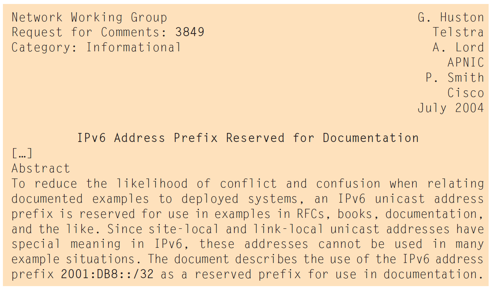

L'**RFC 3849** riserva il prefisso **`2001:db8::/32`** agli **esempi** in RFC, libri, manuali e documentazione.

- non viene instradato su Internet
- evita conflitti con indirizzi reali
- è lo stesso criterio usato in IPv4 con `192.0.2.0/24`, `198.51.100.0/24` e `203.0.113.0/24`

> Per questo gli esempi di questa unità usano `2001:db8::/32`. In un laboratorio di simulazione puoi usarlo senza rischi.

---

# La struttura di un indirizzo unicast IPv6

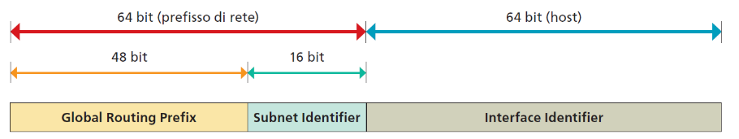

- **Global Routing Prefix**: assegnato dall'**ISP**, lunghezza tipica **/48**, /56 o /64. Gli indirizzi *Global Unicast* iniziano con `001` (binario) → prefisso `2000::/3`
- **Subnet ID**: suddivide la rete in più subnet (con un /48 ha 16 bit)
- **Interface ID (IID)**: gli **ultimi 64 bit**, identifica l'interfaccia (equivalente dell'*HostID* in IPv4)

---

<!-- _class: small -->

# Subnet ID e Interface ID

Con un prefisso **/48** si hanno 16 bit di Subnet ID → 2¹⁶ = **65.536 subnet**, ciascuna con prefisso **/64** per gli host.

**Interface ID**: ottenuto dal MAC con **EUI-64** oppure **generato casualmente** (*privacy extensions*, RFC 4941).

```text
MAC address:        00:1A:2B:3C:4D:5E
1) inserire FF:FE:  00:1A:2B:FF:FE:3C:4D:5E
2) invertire il 7° bit del primo byte (U/L):  00 → 02
Interface ID:       021A:2BFF:FE3C:4D5E   →   21a:2bff:fe3c:4d5e
Indirizzo:          2001:db8:acad:1:21a:2bff:fe3c:4d5e/64
```

> **Perché preferire IID casuali?** Un IID derivato dal MAC è **fisso**: consente di tracciare il dispositivo anche cambiando rete. Con gli IID casuali l'indirizzo cambia periodicamente.

---

<!-- _class: fig -->

# I tipi di indirizzi IPv6

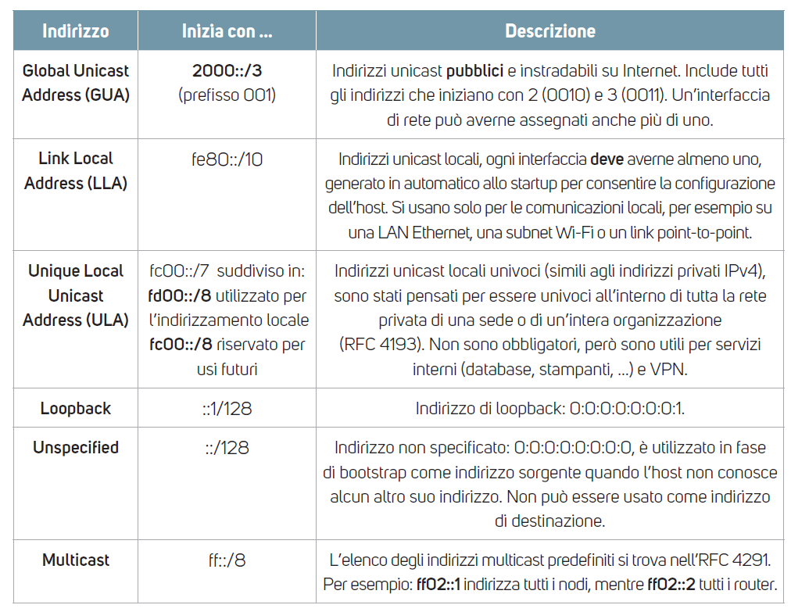

---

<!-- _class: small -->

# Tipi di indirizzi e livelli di visibilità (scope)

| Scope | Prefisso | Descrizione |
|---|---|---|
| **Globale** | `2000::/3` | indirizzi pubblici instradabili su Internet (*GUA*) |
| **Sito** | `fc00::/7` (in uso `fd00::/8`) | locali, univoci all'interno di un'organizzazione (*ULA*), simili agli IPv4 privati |
| **Link** | `fe80::/10` | validi su un **singolo collegamento fisico** (*LLA*), non instradati |
| **Interfaccia** | `::1/128` | **loopback**: il dispositivo stesso |

Indirizzi speciali: `::/128` **non specificato** (usato come sorgente prima di avere un indirizzo) · `ff00::/8` **multicast**.

> **Esempio.** Un'azienda usa `fd12:3456:789a::/48` per i server interni, che restano irraggiungibili da Internet, e un prefisso `2001:db8:acad::/48` fornito dall'ISP per i servizi pubblici.

---

<!-- _class: small -->

# L'indirizzo link-local e il default gateway

- L'**LLA** inizia con `fe80::/10`; l'**interfaccia** la genera **automaticamente**, anche senza router o DHCP
- È usata dai protocolli di servizio (NDP, protocolli di routing)
- L'LLA dell'interfaccia **LAN del router** è di solito usata dagli host come **default gateway IPv6**

```text
$ ip -6 route show
2001:db8:acad:1::/64 dev eth0 proto kernel metric 256
fe80::/64 dev eth0 proto kernel metric 256
default via fe80::1 dev eth0 proto ra metric 1024
```

La riga `default via fe80::1` indica che il gateway è un link-local, **appreso con un Router Advertisement** (`proto ra`).

> Poiché lo stesso `fe80::/64` esiste su ogni interfaccia, nei comandi serve indicare l'interfaccia: `ping fe80::1%eth0` (Windows: `fe80::1%12`).

---

# Indirizzi multicast notevoli

| Indirizzo | Destinatari |
|---|---|
| `ff02::1` | **tutti i nodi** del link |
| `ff02::2` | **tutti i router** del link |
| `ff02::1:ffXX:XXXX` | **solicited-node**: usato da NDP per la risoluzione degli indirizzi |
| `ff02::5` | router OSPFv3 |
| `ff02::fb` | mDNS |

Struttura: `ff` + flag/**scope** + gruppo. La quarta cifra indica la portata (scope): `ff02` = link-local, `ff05` = site-local, `ff0e` = globale.

> **Esempio.** `ping ff02::1%eth0` invia un echo request a tutti i nodi del link: ogni host acceso risponde. È l'equivalente IPv6 (selettivo) del vecchio ping broadcast.

---

<!-- _class: small -->

# Il subnetting in IPv6

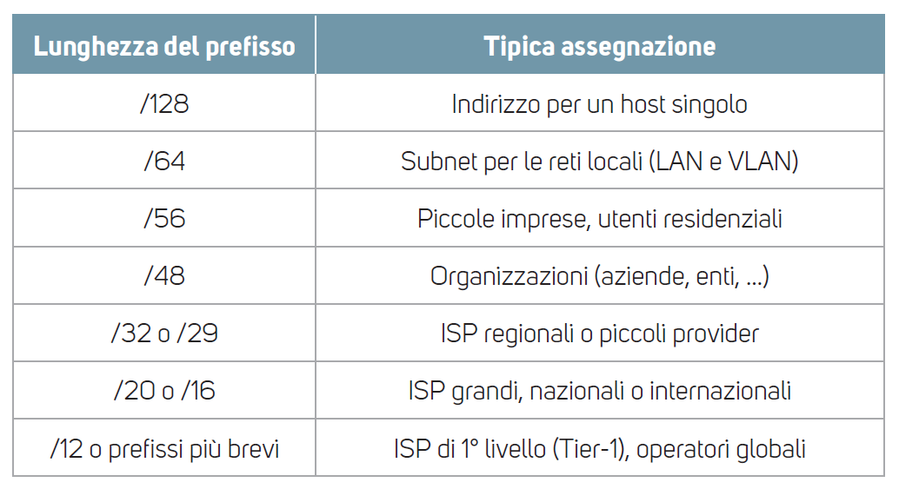

- Usa la notazione **CIDR** ed è **molto più semplice** di IPv4: si "conta" nel Subnet ID, senza maschere da calcolare
- Organizza la rete in modo **logico e gerarchico**
- Nella tabella: prefissi tipici e destinatari

> **Best practice.** Usare **/64 per ogni LAN e VLAN**.

Subnet più piccole sono possibili ma **non consigliate**: limitano funzioni come l'**autoconfigurazione (SLAAC)**, che richiede un IID di 64 bit. Eccezione consolidata: **/127** sui collegamenti punto-punto tra router (RFC 6164).

---

<!-- _class: small -->

# Esempio di subnetting con un /48

Un'azienda riceve **`2001:db8:acad::/48`**. Il quarto gruppo è il **Subnet ID** (16 bit, quindi 65.536 subnet).

| Reparto | Subnet |
|---|---|
| Rete data center | `2001:db8:acad:1::/64` |
| Rete sviluppo | `2001:db8:acad:2::/64` |
| Rete amministrazione | `2001:db8:acad:3::/64` |
| Rete ospiti (VLAN 40) | `2001:db8:acad:4::/64` |

Per creare una nuova subnet basta **incrementare il Subnet ID**: nessun calcolo di maschere, nessun rischio di sovrapposizione.

> **Con un /56** il Subnet ID è di 8 bit → 2⁸ = **256 subnet**: `2001:db8:acad:00::/64` … `2001:db8:acad:ff::/64`.

---

# L'allocazione degli indirizzi IPv6

Gli indirizzi sono gestiti dalla **IANA**, che assegna i prefissi *Global Unicast* ai **RIR** (*Regional Internet Registry*).

| RIR | Area |
|---|---|
| **RIPE NCC** | Europa, Medio Oriente, Asia centrale |
| **ARIN** | Nord America |
| **APNIC** | Asia-Pacifico |
| **LACNIC** | America Latina e Caraibi |
| **AFRINIC** | Africa |

Catena: **IANA → RIR → LIR/ISP → utente finale**.

> Un /64 per subnet può sembrare uno **spreco**, ma IPv6 è progettato per eliminare la scarsità di indirizzi e semplificare la gestione.

---

<!-- _class: fig -->

# La catena di assegnazione: un esempio

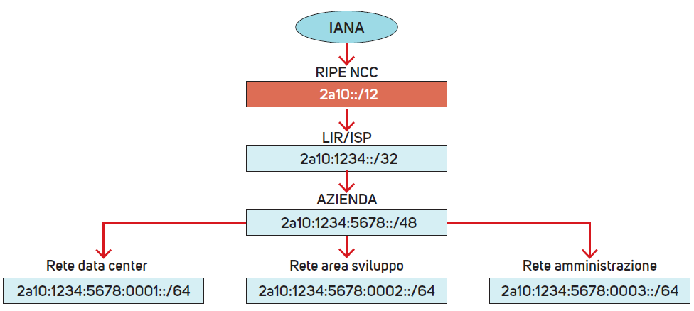

IANA → **RIPE NCC** `2a10::/12` → **LIR** `2a10:1234::/32` → **azienda** `2a10:1234:5678::/48` → **subnet** `/64`

---

<!-- _class: small -->

# La catena di assegnazione: i calcoli

1. **IANA** ha allocato a **RIPE NCC** il blocco `2a10::/12`
2. RIPE assegna a un **LIR** il blocco `2a10:1234::/32`. Con un /32 può servire:
   - 2⁽⁴⁸⁻³²⁾ = 2¹⁶ = **65.536 clienti aziendali** con un /48 ciascuno
   - 2⁽⁵⁶⁻³²⁾ = 2²⁴ = **16.777.216 clienti residenziali** con un /56 ciascuno
3. Il LIR assegna a un'**azienda** `2a10:1234:5678::/48`, che dispone di:
   - 2⁽⁶⁴⁻⁴⁸⁾ = 2¹⁶ = **65.536 subnet /64**
4. Ogni **subnet /64** ha 2⁶⁴ = **18.446.744.073.709.551.616** indirizzi

> **Regola pratica.** Numero di prefissi di lunghezza *n* contenuti in un prefisso di lunghezza *m* = **2⁽ⁿ⁻ᵐ⁾**.

---

<!--
_class: lead dark
_paginate: false
_header: ""
_footer: ""
-->


# Indirizzi fisici e indirizzi IPv4: il protocollo ARP

---

# Indirizzi logici e indirizzi fisici

Ogni host TCP/IP ha un **indirizzo IP logico** (livello 3) assegnato alla sua scheda di rete (**NIC**). Un host con più NIC ha più indirizzi IP.

Per comunicare serve anche il **MAC address del destinatario** (livello 2, 48 bit), richiesto dal frame.

```text
Frame Ethernet
+--------------+--------------+-----------+--------------------+-----+
| MAC dest.    | MAC sorgente | EtherType | Pacchetto IP       | FCS |
+--------------+--------------+-----------+--------------------+-----+
```

> **Il problema.** Un'applicazione conosce l'IP del destinatario (es. `192.168.1.20`), ma la scheda di rete ha bisogno del suo MAC. Come si ottiene?

---

# Il protocollo ARP

L'**IETF** ha introdotto **ARP** (*Address Resolution Protocol*, **RFC 826**): permette a un host di trovare il **MAC address** a partire dal solo **indirizzo IP**.

- Questa operazione si chiama **risoluzione dell'indirizzo IP**
- ARP opera direttamente a **livello Data Link**: i messaggi ARP viaggiano in frame Ethernet con **EtherType `0x0806`**
- **non funziona con IPv6**, dove la funzione è svolta dal **Neighbor Discovery Protocol**

> **Analogia.** Per spedire un pacco al condominio (IP) il corriere deve sapere a quale citofono suonare (MAC). Chiede a voce alta nel cortile: "chi è l'interno 20?" (ARP Request); quello giusto risponde (ARP Reply).

---

# I messaggi ARP Request e ARP Reply

Il protocollo prevede **solo due tipi di messaggi**:

- **ARP Request**: richiesta di risoluzione di un indirizzo IP
- **ARP Reply**: risposta con il **MAC address** associato all'IP richiesto

Campi dell'header della PDU per **Ethernet e IPv4**:

| Campo | Bit | Significato |
|---|---|---|
| Hardware Type | 16 | tipo di rete fisica (`0x0001` = Ethernet) |
| Protocol Type | 16 | protocollo di rete (`0x0800` = IPv4) |
| Hardware Address Length | 8 | lunghezza indirizzo fisico (6 byte per il MAC) |
| IP Address Length | 8 | lunghezza indirizzo IP (4 byte per IPv4) |
| Operation Code | 16 | `1` = Request, `2` = Reply |

---

<!-- _class: fig -->

# Struttura del messaggio ARP

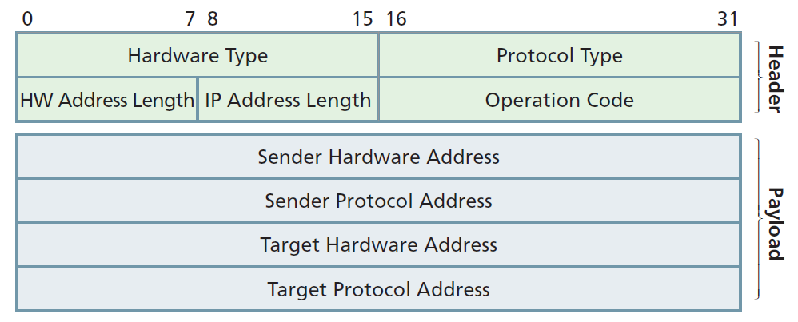

**Header** (8 byte): tipi e lunghezze · **Payload** (20 byte): 2 indirizzi MAC (6 byte) + 2 indirizzi IP (4 byte)

Totale messaggio ARP: **28 byte**.

---

<!-- _class: small -->

# Payload ARP: Request e Reply a confronto

Contiene MAC e IP di mittente e destinatario. Il significato dei campi **cambia** secondo il tipo di messaggio:

| Campo | ARP Request | ARP Reply |
|---|---|---|
| **Sender Hardware Address** | MAC del mittente | MAC dell'host interrogato (la risposta cercata) |
| **Sender Protocol Address** | IP del mittente | IP del mittente della Reply |
| **Target Hardware Address** | **non valorizzato** (è proprio il MAC richiesto) | MAC dell'host che ha inviato la Request |
| **Target Protocol Address** | IP del destinatario (quello da risolvere) | IP dell'host che ha inviato la Request |

> **Come leggerla.** Nella Reply il mittente e il destinatario si **scambiano i ruoli**: chi rispondeva (*Target*) diventa *Sender* e fornisce il MAC cercato.

---

<!-- _class: small -->

# ARP: un esempio concreto

Host **A** (`192.168.1.10`, MAC `00:0A:0A:0A:0A:0A`) vuole comunicare con **B** (`192.168.1.20`, MAC `00:0B:0B:0B:0B:0B`).

```text
ARP Request  (frame Ethernet con MAC destinazione FF:FF:FF:FF:FF:FF)
  Opcode = 1
  Sender MAC = 00:0A:0A:0A:0A:0A   Sender IP = 192.168.1.10
  Target MAC = 00:00:00:00:00:00   Target IP = 192.168.1.20
  → "Who has 192.168.1.20? Tell 192.168.1.10"

ARP Reply    (frame unicast verso 00:0A:0A:0A:0A:0A)
  Opcode = 2
  Sender MAC = 00:0B:0B:0B:0B:0B   Sender IP = 192.168.1.20
  Target MAC = 00:0A:0A:0A:0A:0A   Target IP = 192.168.1.10
  → "192.168.1.20 is at 00:0B:0B:0B:0B:0B"
```

> La Request è **broadcast** (la ricevono tutti); la Reply è **unicast** (solo A).

---

<!-- _class: small -->

# La risoluzione dell'indirizzo IP

Ogni host mantiene una **cache ARP** (*ARP table*) con le coppie **IP–MAC** già note. Prima di inviare, controlla la cache.

**Procedura standard** (per ottenere il MAC di un host sulla stessa rete):

1. cerca l'IP nella cache ARP: se c'è, **invia subito** il frame
2. altrimenti invia una **ARP Request** in broadcast (`FF-FF-FF-FF-FF-FF`) con l'IP del destinatario e il proprio IP/MAC
3. tutti la ricevono: se l'IP **non corrisponde** la ignorano, l'host con l'IP richiesto risponde con una **ARP Reply**
4. il mittente **aggiorna la cache** e avvia la comunicazione

> Le voci **dinamiche** hanno un **timeout** (da decine di secondi ad alcuni minuti, secondo il sistema operativo): se un host cambia scheda di rete la cache si aggiorna da sola.

---

<!-- _class: small -->

# ARP su reti remote: il gateway

Se il destinatario è **fuori dalla subnet**, l'host non può inviargli direttamente un frame: lo manda al **gateway predefinito** (router) e risolve con ARP il **MAC del gateway**, nello stesso modo usato per un host locale.

> **Esempio.** Host `192.168.1.10/24` → server `8.8.8.8`
> 1. `8.8.8.8` non appartiene a `192.168.1.0/24` → usa il gateway `192.168.1.1`
> 2. ARP Request: "Who has `192.168.1.1`?" → Reply con il MAC del router
> 3. Frame inviato: **IP destinazione = `8.8.8.8`**, **MAC destinazione = MAC del router**

Regola importante:

- l'**indirizzo IP** di destinazione resta lo **stesso** per tutto il percorso
- il **MAC address** cambia ad **ogni hop**: a ogni segmento il router risolve il MAC del salto successivo

---

<!-- _class: small -->

# Visualizzare la cache ARP

Comandi per vedere la cache ARP di un host:

- **Windows**: `arp -a`
- **Linux**: `ip neigh show`

```text
C:\> arp -a
Interfaccia: 192.168.1.10 --- 0x7
  Indirizzo Internet    Indirizzo fisico      Tipo
  192.168.1.1           00-1a-2b-3c-4d-5e     dinamico
  192.168.1.20          00-0b-0b-0b-0b-0b     dinamico
  192.168.1.255         ff-ff-ff-ff-ff-ff     statico

$ ip neigh show
192.168.1.1  dev eth0 lladdr 00:1a:2b:3c:4d:5e REACHABLE
192.168.1.20 dev eth0 lladdr 00:0b:0b:0b:0b:0b STALE
```

> Dopo un `ping` verso un host locale, la sua voce compare nella cache: è il modo più semplice per **vedere ARP in azione**.

---


# Le vulnerabilità di ARP

ARP è tra i protocolli **più antichi** della suite TCP/IP, progettato quando la sicurezza non era una priorità. **Non prevede autenticazione**: lo **spoofing** (falsificazione dell'identità) è semplice.

1. un attaccante invia una **ARP Reply falsa** dichiarando che il proprio MAC corrisponde a un IP della rete
2. l'host **non può verificarne l'autenticità** e accetta l'informazione
3. l'attaccante appare come un utente **legittimo** e può accedere a risorse come i database aziendali
4. l'obiettivo è **manipolare la cache ARP** (*ARP cache poisoning*) per deviare il traffico verso destinazioni non autorizzate

---

<!-- _class: small -->

# ARP cache poisoning: attacco man-in-the-middle

**Scenario.** Host A `192.168.1.10`, gateway `192.168.1.1`, attaccante M.

```text
M → A:        ARP Reply  "192.168.1.1 is at MAC_di_M"      (falsa)
M → gateway:  ARP Reply  "192.168.1.10 is at MAC_di_M"     (falsa)

Traffico:  A  →  M  →  gateway  →  Internet
```

Le due cache sono "avvelenate": **tutto il traffico passa da M**, che può leggerlo, modificarlo o scartarlo (**man-in-the-middle**).

**Contromisure principali**

- **Dynamic ARP Inspection (DAI)** sugli switch, basata sulla tabella di **DHCP snooping**
- **Port security** e **VLAN** per segmentare la rete
- voci ARP **statiche** per host critici (es. il gateway)
- monitoraggio con strumenti come **arpwatch** o un IDS

> Non va confuso con il *MAC flooding*, che colpisce la **tabella CAM dello switch** (e non la cache ARP degli host).

---

<!--
_class: lead dark
_paginate: false
_header: ""
_footer: ""
-->


# Il monitoring della rete: ICMP, ICMPv6 e Neighbor Discovery

---

# Il protocollo ICMP


L'**Internet Control Message Protocol** è un protocollo di **controllo** nato insieme a IP, usato da router e host per **segnalare problemi di instradamento**:

- destinatario **irraggiungibile**
- pacchetto **troppo lungo**
- **TTL scaduto**

Non trasporta dati utente, ma solo **messaggi diagnostici**. **ICMPv6** è la versione progettata per IPv6.

> ICMP **segnala** gli errori ma **non li corregge**: sta all'host o all'applicazione reagire (ritentare, usare un altro percorso, avvisare l'utente).

---

<!-- _class: fig -->

# L'header ICMP

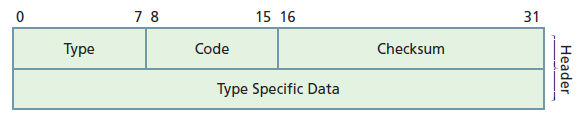

- specificato nell'**RFC 792** e successivi aggiornamenti
- il pacchetto ICMP è **incapsulato in un pacchetto IP** e identificato dal **numero di protocollo = 1**

```text
| Header IP (Protocol = 1) | Messaggio ICMP |
```

---

<!-- _class: small -->

# I campi dell'header ICMP

| Campo | Bit | Funzione |
|---|---|---|
| **Type** | 8 | numero che identifica il **tipo di messaggio** ICMP |
| **Code** | 8 | codice che fornisce **indicazioni aggiuntive** rispetto al Type |
| **Checksum** | 16 | controllo degli errori di trasmissione su **tutto** il messaggio ICMP |
| **Type Specific Data** | 32 | informazioni che dipendono da Type e Code |

> **Esempi di Type Specific Data**
> - **Echo Request/Reply**: *Identifier* e *Sequence Number* (servono ad associare ogni risposta alla sua richiesta)
> - **Destination Unreachable**: nel corpo del messaggio è riportato l'**header IP originale** più i primi 8 byte dei dati, per far capire al mittente quale pacchetto ha causato l'errore

---

<!-- _class: tiny -->

# ICMP: i campi Type e Code più utilizzati

| Type | Code | Nome | Funzione |
|---|---|---|---|
| 0 | 0 | **Echo Reply** | risposta al ping (ICMP Echo Request) |
| 3 | 0–15 | **Destination Unreachable** | `0` rete irraggiungibile · `1` host irraggiungibile · `2` protocollo non supportato dall'host · `3` porta irraggiungibile (servizio non attivo su porta TCP/UDP) · `4` frammentazione necessaria ma flag DF attivo |
| 5 | 0–3 | **Redirect** | usato dai router per indicare a un host una **route migliore** |
| 8 | 0 | **Echo Request** | usato da strumenti come il ping per **testare la raggiungibilità** |
| 11 | 0–1 | **Time Exceeded** | con Code = 0 avverte che il **TTL è scaduto** (TTL = 0) e il pacchetto è stato scartato |
| 12 | 0–2 | **Parameter Problem** | errore o ambiguità nell'**header IP** ricevuto |

L'elenco aggiornato è su **IANA**: `https://www.iana.org/assignments/icmp-parameters/`

---

<!-- _class: small -->

# Interazioni ICMP tra router e host

I messaggi ICMP possono viaggiare tra tutti i nodi della rete:

| Tipo di interazione | A cosa serve |
|---|---|
| **router → router** | scambio di informazioni di servizio per un **corretto instradamento** |
| **router → host** | far **rallentare** o **reindirizzare** un flusso di pacchetti (es. Redirect) |
| **host → host** | verificare la raggiungibilità (`ping`) |
| **host → router** | ottenere dettagli sul funzionamento e sulla **topologia** della rete |

Strumenti come **ping** e **traceroute** sfruttano ICMP per verificare lo stato della rete e **diagnosticare i problemi**.

> **Esempio.** Un host invia un pacchetto per `203.0.113.50`, ma il router non ha una route verso quella rete: scarta il pacchetto e risponde all'host con **ICMP Destination Unreachable (Type 3, Code 0)**.

---

<!-- _class: small -->

# Strumento 1: ping

`ping` invia un **Echo Request** (Type 8) e attende un **Echo Reply** (Type 0): verifica la **raggiungibilità** e misura il **tempo di andata e ritorno** (RTT).

```text
$ ping -c 4 192.168.1.20
PING 192.168.1.20 (192.168.1.20) 56(84) bytes of data.
64 bytes from 192.168.1.20: icmp_seq=1 ttl=64 time=0.412 ms
64 bytes from 192.168.1.20: icmp_seq=2 ttl=64 time=0.388 ms
64 bytes from 192.168.1.20: icmp_seq=3 ttl=64 time=0.401 ms
64 bytes from 192.168.1.20: icmp_seq=4 ttl=64 time=0.395 ms
--- 192.168.1.20 ping statistics ---
4 packets transmitted, 4 received, 0% packet loss, time 3004ms
```

- `icmp_seq`: numero di sequenza · `ttl`: TTL residuo · `time`: **RTT**
- se un router non trova la route risponde con `Destination Host Unreachable` (Type 3)

> **Attenzione.** Molti firewall bloccano gli Echo Request: **nessuna risposta non significa per forza host spento**.

---

<!-- _class: small -->

# Strumento 2: traceroute

`traceroute` scopre il **percorso** verso una destinazione sfruttando il campo **TTL**:

1. invia un pacchetto con **TTL = 1**: il primo router lo decrementa a 0, lo scarta e risponde con **ICMP Time Exceeded** (Type 11) → ne rivela l'IP
2. ripete con **TTL = 2, 3, …** per scoprire i router successivi
3. quando raggiunge la destinazione, questa risponde (Echo Reply oppure **Port Unreachable**, Type 3 Code 3)

```text
$ traceroute 203.0.113.10
 1  192.168.1.1    1.2 ms
 2  10.20.0.1      8.5 ms
 3  198.51.100.1  14.9 ms
 4  203.0.113.10  19.3 ms
```

> Su Windows il comando è `tracert` (usa Echo Request), su Linux `traceroute` (di default UDP su porte alte). Con IPv6: `tracert -6` / `traceroute -6`.

---

# Il protocollo ICMPv6

- Con IPv6 è stato necessario **riorganizzare tipi e codici** ICMP e creare **nuovi messaggi**: nasce **ICMPv6** (**RFC 4443**)
- Il formato della PDU resta simile a ICMP, ma il protocollo è stato **ampliato**, integrando funzioni prima svolte da **IGMP** (gestione multicast) e **ARP**
- È quindi **incompatibile** con ICMP per IPv4
- In IPv6 è identificato dal valore **58** nel campo **Next Header**

> **Attenzione.** In IPv6 ICMPv6 è **indispensabile** (Path MTU Discovery, Neighbor Discovery, SLAAC): bloccarlo del tutto sul firewall rompe la rete. Si filtrano solo i tipi non necessari (RFC 4890).

---

<!-- _class: fig -->

# Formato dei messaggi: ICMP e ICMPv6


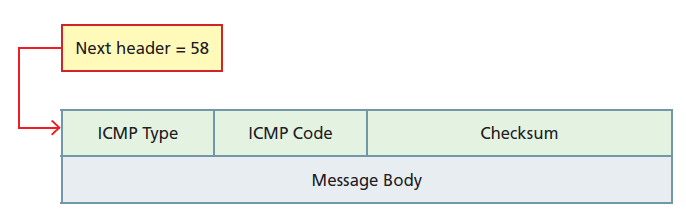

Il campo `Next header = 58` nell'header IPv6 identifica ICMPv6. Il campo *Message Body* sostituisce *Type Specific Data*.

---

# Le due categorie di messaggi ICMPv6

| Categoria | Type | Scopo |
|---|---|---|
| **Error message** | **0–127** | generati da host o router per **segnalare problemi nell'inoltro** |
| **Informational message** | **128–255** | **diagnostica** e informazioni sulla rete |

> **Regola mnemonica.** Se il bit più significativo del Type è **0** (valore < 128) il messaggio è un **errore**; se è **1** (valore ≥ 128) è **informativo**.

Esempi:

- `Type 1` Destination Unreachable → **errore**
- `Type 128` Echo Request → **informativo** (il ping)
- `Type 135` Neighbor Solicitation → **informativo** (NDP)

---

<!-- _class: tiny -->

# ICMPv6: i campi Type e Code più utilizzati

| Type | Code | Nome | Funzione |
|---|---|---|---|
| 1 | 0–6 | **Destination Unreachable** | destinazione irraggiungibile: manca la route, porta irraggiungibile, ecc. |
| 2 | 0 | **Packet Too Big** | problema di **MTU**: usato dal **Path MTU Discovery** (RFC 8201). Il mittente deve conoscere la MTU perché la frammentazione la fa solo lui |
| 3 | 0–1 | **Time Exceeded** | simile a ICMP (TTL/Hop Limit = 0) |
| 4 | 0–2 | **Parameter Problem** | problema nell'**header** o nelle **estensioni** |
| 128 | 0 | **Echo Request** | simile a ICMP (invio del ping) |
| 129 | 0 | **Echo Reply** | risposta al ping |
| 133 | 0 | **Router Solicitation** | richiesta dell'host per rilevare la presenza di un router |
| 134 | 0 | **Router Advertisement** | risposta del router con i **dati di configurazione** |

L'elenco aggiornato è su **IANA**: `https://www.iana.org/assignments/icmpv6-parameters/`

---

<!-- _class: small -->

# Packet Too Big e Path MTU Discovery

In IPv6 **i router non frammentano** i pacchetti. Se un pacchetto è più grande della MTU del link successivo:

1. il router lo **scarta**
2. invia al mittente un **ICMPv6 Type 2 – Packet Too Big** con la **MTU** del link
3. il mittente **riduce la dimensione** dei pacchetti (o li frammenta con il *Fragment Header*) e ritrasmette

```text
Host A ── MTU 1500 ── Router ── MTU 1400 ── Server

A → Server : pacchetto da 1500 byte
Router → A : ICMPv6 Packet Too Big, MTU = 1400
A → Server : pacchetti da ≤ 1400 byte  ✔
```

> La MTU minima di un link IPv6 è **1280 byte** (RFC 8200). Se Packet Too Big viene filtrato, le connessioni con pacchetti grandi si **bloccano** senza errori evidenti (*black hole*).

---

# Neighbor Discovery Protocol (NDP)

In IPv6 **ARP non è più usato**: la risoluzione degli indirizzi MAC è gestita dal **Neighbor Discovery Protocol**.

- NDP lavora **a livello di rete**, usando messaggi **ICMPv6** (ARP lavorava direttamente sul Data Link)
- non si limita alla risoluzione degli indirizzi, ma svolge **diverse funzioni fondamentali**

| Messaggio ICMPv6 | Type | Funzione |
|---|---|---|
| Router Solicitation (RS) | 133 | l'host cerca i router |
| Router Advertisement (RA) | 134 | il router annuncia prefisso e parametri |
| Neighbor Solicitation (NS) | 135 | richiesta del MAC di un vicino |
| Neighbor Advertisement (NA) | 136 | risposta con il MAC |
| Redirect | 137 | indica un percorso migliore |

---

<!-- _class: small -->

# Le funzioni di NDP

| Funzione | Descrizione |
|---|---|
| **Address Resolution** | trova il **MAC** associato a un indirizzo IPv6 tramite **Neighbor Solicitation / Advertisement** |
| **Router Discovery** | scopre i **router** presenti nel link |
| **Redirection** | indica un **percorso migliore**, come il Redirect IPv4 |
| **Neighbor Unreachability Detection (NUD)** | verifica se un *neighbor* è **ancora raggiungibile** |
| **SLAAC** | permette la **configurazione automatica** degli indirizzi IPv6 |
| **DAD** (*Duplicate Address Detection*) | rileva gli **indirizzi duplicati** |

> NDP **sostituisce e amplia** ARP, ICMP Router Discovery e ICMP Redirect di IPv4 in un unico protocollo.

---

<!-- _class: small -->

# NDP: risoluzione dell'indirizzo con NS e NA

Invece del broadcast, NS è inviato al **multicast solicited-node** del destinatario, calcolato dagli **ultimi 24 bit** dell'IPv6: così vengono disturbati solo pochi host.

```text
Host A: 2001:db8:acad:1::10        Host B: 2001:db8:acad:1::20

1) A → ff02::1:ff00:20      Neighbor Solicitation  (Type 135)
                            "Chi ha 2001:db8:acad:1::20 ?"
                            MAC dest. multicast: 33:33:ff:00:00:20
2) B → A (unicast)          Neighbor Advertisement (Type 136)
                            "Sono io, il mio MAC è 00:0b:0b:0b:0b:0b"
3) A memorizza la coppia nella neighbor cache
```

Cache dei vicini: `ip -6 neigh show` (Linux) · `netsh interface ipv6 show neighbors` (Windows)

> Calcolo: ultimi 24 bit di `…::20` = `00:00:20` → `ff02::1:ff` + `00:0020` = `ff02::1:ff00:20`. Il MAC multicast è `33:33` + gli ultimi 32 bit dell'IPv6 multicast (`ff:00:00:20`).

---

<!-- _class: small -->

# Router Discovery e SLAAC

Un host IPv6 può **configurarsi da solo**, senza DHCP (**SLAAC**, *Stateless Address Autoconfiguration*):

1. l'host genera l'**indirizzo link-local** `fe80::…`
2. invia un **Router Solicitation** a `ff02::2` (tutti i router)
3. il router risponde con un **Router Advertisement** che contiene il **prefisso /64** della rete (es. `2001:db8:acad:1::/64`), la durata di validità e il gateway
4. l'host forma l'indirizzo globale: **prefisso /64 + Interface ID**
5. esegue la **DAD** per verificare che non sia già in uso

> **Esempio.** Prefisso annunciato `2001:db8:acad:1::/64` + IID `21a:2bff:fe3c:4d5e` → indirizzo `2001:db8:acad:1:21a:2bff:fe3c:4d5e`.

I flag del RA indicano se usare anche **DHCPv6**: `M` (indirizzo da DHCPv6) · `O` (altre informazioni, es. DNS, da DHCPv6).

---

<!-- _class: small -->

# DAD, NUD e Redirect

**Duplicate Address Detection (DAD)**: prima di usare un indirizzo, l'host invia una **NS** per quell'indirizzo, da sorgente `::`.

- se **qualcuno risponde** con una NA → l'indirizzo è **duplicato** e non viene usato
- se **nessuno risponde** → l'indirizzo è libero e diventa valido

**Neighbor Unreachability Detection (NUD)**: verifica che un vicino sia raggiungibile. Gli stati nella cache cambiano nel tempo:

`REACHABLE` (risposta recente) → `STALE` (non verificato da un po') → `DELAY` → `PROBE` (invio di NS unicast) → vicino rimosso se non risponde

**Redirect (Type 137)**: il router informa l'host che esiste un **next hop migliore** sullo stesso link.

> **Esempio NUD.** Un host perde la connessione al gateway: la voce passa a `PROBE`, le NS restano senza risposta e l'host sceglie un altro router tra quelli noti.

---

<!-- _class: small -->

# Sicurezza di NDP

Come ARP, anche **NDP non è autenticato** per impostazione predefinita:

| Attacco | Effetto |
|---|---|
| **NA/NS spoofing** | associa il MAC dell'attaccante all'IPv6 della vittima (equivalente dell'ARP poisoning) |
| **Rogue Router Advertisement** | un host malevolo si presenta come router e diventa il **default gateway** della rete |
| **DAD denial of service** | l'attaccante risponde a ogni DAD, impedendo agli host di configurarsi |

**Contromisure**

- **RA Guard** (RFC 6105): lo switch accetta i Router Advertisement solo dalle porte autorizzate
- **ND Inspection / DHCPv6 Guard** sugli switch
- **SEND** (RFC 3971): NDP con firme crittografiche (poco usato)

> L'**RA Guard** è l'equivalente IPv6 del **DHCP snooping** usato per bloccare i server DHCP non autorizzati.

---

<!-- _class: small -->

# Confronto: ARP e NDP

| Caratteristica | ARP (IPv4) | NDP (IPv6) |
|---|---|---|
| Livello di funzionamento | direttamente su **Data Link** (EtherType `0x0806`) | **ICMPv6** sopra IPv6 |
| Messaggi | Request, Reply | NS, NA, RS, RA, Redirect |
| Destinazione della richiesta | **broadcast** (`FF:FF:FF:FF:FF:FF`) | **multicast** solicited-node |
| Rilevamento router | non previsto (si configura il gateway) | **Router Discovery** integrato |
| Autoconfigurazione | non prevista (DHCP) | **SLAAC** |
| Indirizzi duplicati | ARP probe / gratuitous ARP (opzionale) | **DAD** obbligatoria |
| Verifica raggiungibilità | non prevista | **NUD** |
| Sicurezza | nessuna autenticazione | nessuna di default; possibile **SEND** |

---

<!-- _class: small -->

# Comandi utili per il monitoring

| Obiettivo | Linux | Windows |
|---|---|---|
| Ping IPv4 / IPv6 | `ping` · `ping -6` | `ping` · `ping -6` |
| Percorso verso l'host | `traceroute` · `traceroute -6` | `tracert` · `tracert -6` |
| Indirizzi dell'interfaccia | `ip addr` · `ip -6 addr` | `ipconfig` |
| Cache ARP (IPv4) | `ip neigh show` | `arp -a` |
| Cache dei vicini (IPv6) | `ip -6 neigh show` | `netsh interface ipv6 show neighbors` |
| Tabella di routing | `ip route` · `ip -6 route` | `route print` |
| Analisi dei pacchetti | `tcpdump icmp6` · **Wireshark** | **Wireshark** |

> **Suggerimento.** Con Wireshark il filtro `arp` mostra i messaggi ARP; `icmpv6` mostra NS, NA, RS, RA ed Echo; `icmp` mostra i messaggi ICMPv4.

---

<!-- _class: small -->

# Riepilogo dell'unità

| Argomento | Concetto chiave |
|---|---|
| **IPv6** | 128 bit, header fisso di 40 byte, extension header, niente broadcast, nessun checksum |
| **Coesistenza** | dual-stack, tunneling (protocollo 41), traduzione (NAT64) |
| **Indirizzi IPv6** | 8 gruppi esadecimali, forma compatta con `::`, prefisso + Subnet ID + Interface ID |
| **Tipi di indirizzo** | GUA `2000::/3` · ULA `fc00::/7` · LLA `fe80::/10` · loopback `::1` · multicast `ff00::/8` |
| **Allocazione** | IANA → RIR → LIR/ISP → utente; /48 al sito, **/64 per le LAN** |
| **ARP** | risolve IPv4 → MAC con Request (broadcast) e Reply (unicast); vulnerabile allo spoofing |
| **ICMP/ICMPv6** | diagnostica e segnalazione errori (`ping`, `traceroute`); protocollo IP 1 / Next Header 58 |
| **NDP** | sostituisce ARP in IPv6: NS/NA, RS/RA, Redirect, NUD, SLAAC, DAD |

---

<!-- _class: small -->

# Domande di ripasso

1. Perché IPv6 non è direttamente compatibile con IPv4 e come possono coesistere?
2. Quali campi dell'header IPv4 sono stati **eliminati** in IPv6 e perché?
3. Qual è la differenza tra *Next Header* nell'header base e nelle extension header?
4. Comprimere `2001:0db8:0000:0000:0042:0000:0000:0001`.
5. Con un prefisso `/48`, quante subnet `/64` si possono creare? E con un `/56`?
6. Perché un host invia l'ARP Request in **broadcast** e la Reply in **unicast**?
7. Come sfrutta `traceroute` il campo TTL e quale messaggio ICMP ottiene dai router intermedi?
8. Quali funzioni di NDP non hanno un equivalente in ARP?

---

<!-- _class: small -->

# Soluzioni

1. Header, formato degli indirizzi e protocollo sono diversi (versione 6 vs 4). Coesistono con **dual-stack**, **tunneling** e **traduzione**.
2. **IHL, Identification/Flags/Fragment Offset, Header Checksum, Options**: header fisso, frammentazione solo nel mittente, controllo errori demandato a livelli inferiori e superiori.
3. Nell'header base indica la prima estensione (o il livello superiore); in ogni estensione indica **l'header successivo** nella catena.
4. `2001:db8::42:0:0:1` (blocchi di zeri uguali: si comprime il più a sinistra).
5. /48 → 2¹⁶ = **65.536**; /56 → 2⁸ = **256**.
6. Il mittente **non conosce il MAC** del destinatario, quindi interroga tutti; il destinatario conosce il MAC del mittente (contenuto nella Request) e risponde **direttamente**.
7. Invia pacchetti con TTL crescente (1, 2, 3, …); ogni router che azzera il TTL risponde con **ICMP Time Exceeded (Type 11)**, rivelando il proprio IP.
8. **Router Discovery, SLAAC, DAD, NUD** (e Redirect integrato).

---

<!-- _class: cols2 tiny -->

# Glossario

- **ARP**: Address Resolution Protocol
- **CIDR**: Classless Inter-Domain Routing
- **DAD**: Duplicate Address Detection
- **DSCP / ECN**: classificazione del traffico / notifica di congestione
- **EUI-64**: formato per derivare l'IID dal MAC
- **GUA / ULA / LLA**: indirizzi Global / Unique Local / Link-Local
- **ICMP**: Internet Control Message Protocol
- **IANA**: ente che gestisce lo spazio di indirizzi e i registri dei parametri
- **IETF**: Internet Engineering Task Force
- **LIR**: Local Internet Registry (ISP)
- **MTU**: Maximum Transmission Unit
- **NAT**: Network Address Translation
- **NDP**: Neighbor Discovery Protocol
- **NUD**: Neighbor Unreachability Detection
- **PDU**: Protocol Data Unit
- **QoS**: Quality of Service
- **RFC**: Request For Comments
- **RIR**: Regional Internet Registry
- **SLAAC**: Stateless Address Autoconfiguration
- **TTL / Hop Limit**: numero massimo di salti
- **VLSM**: Variable Length Subnet Mask
