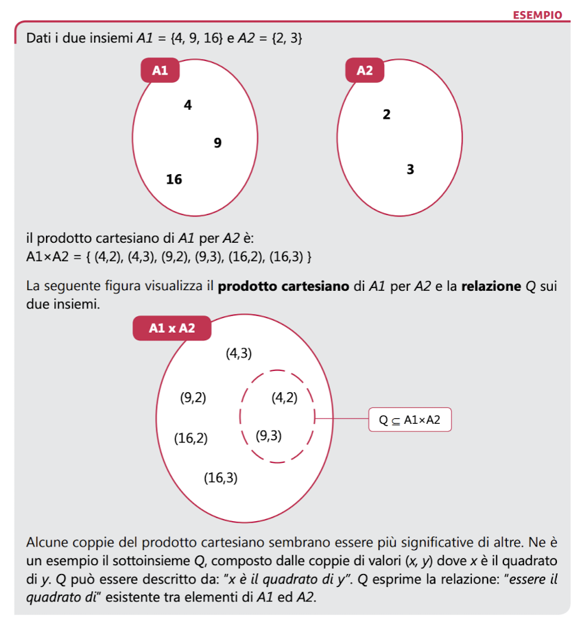
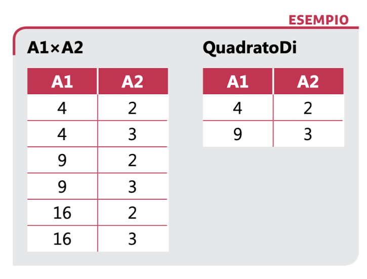
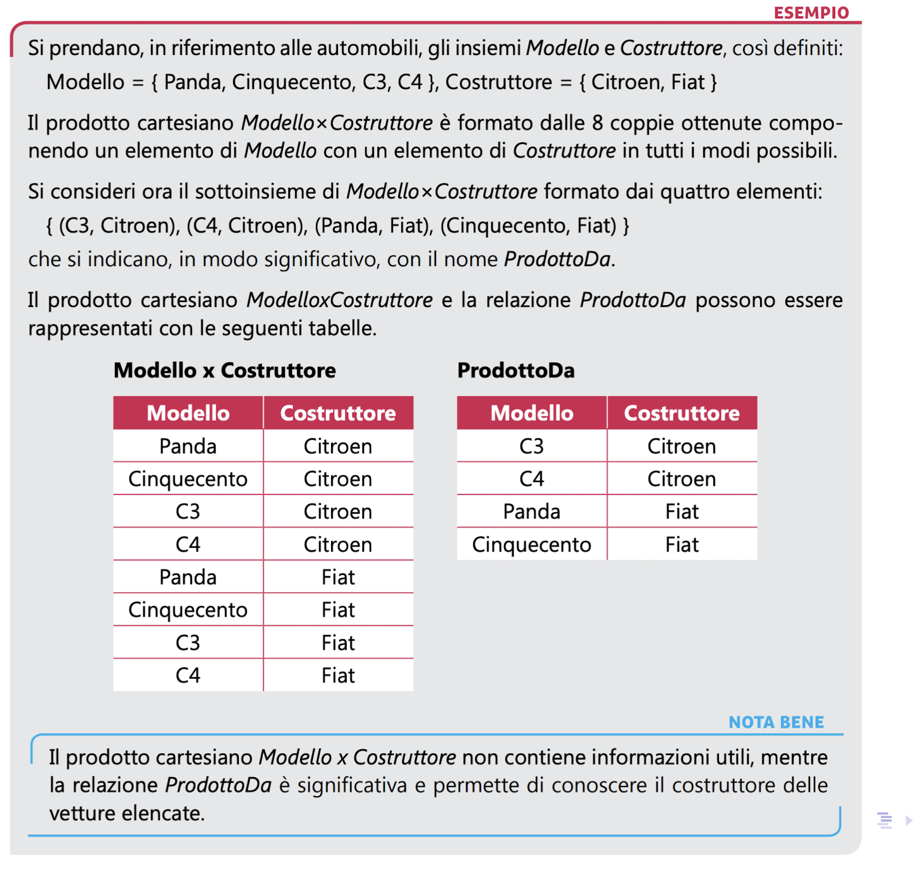
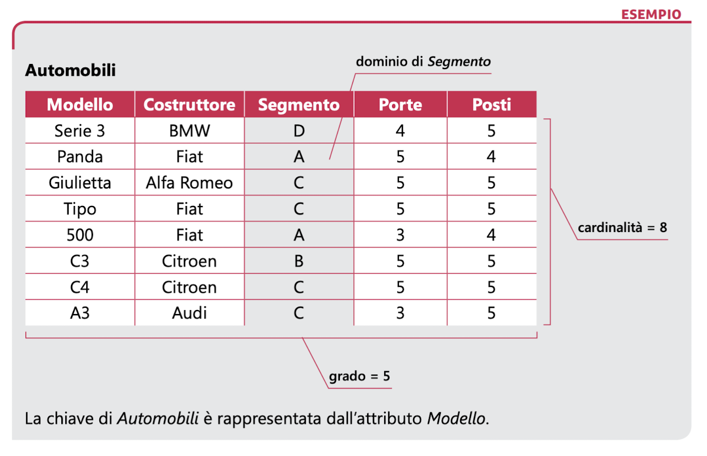
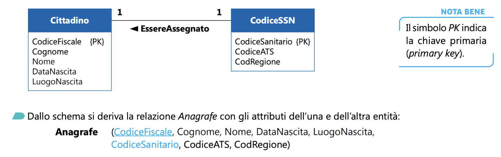
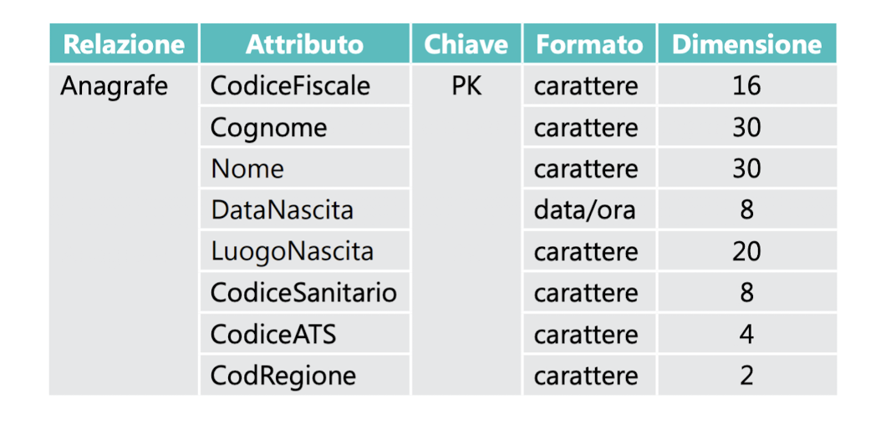
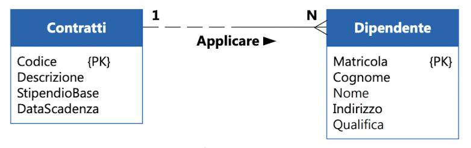
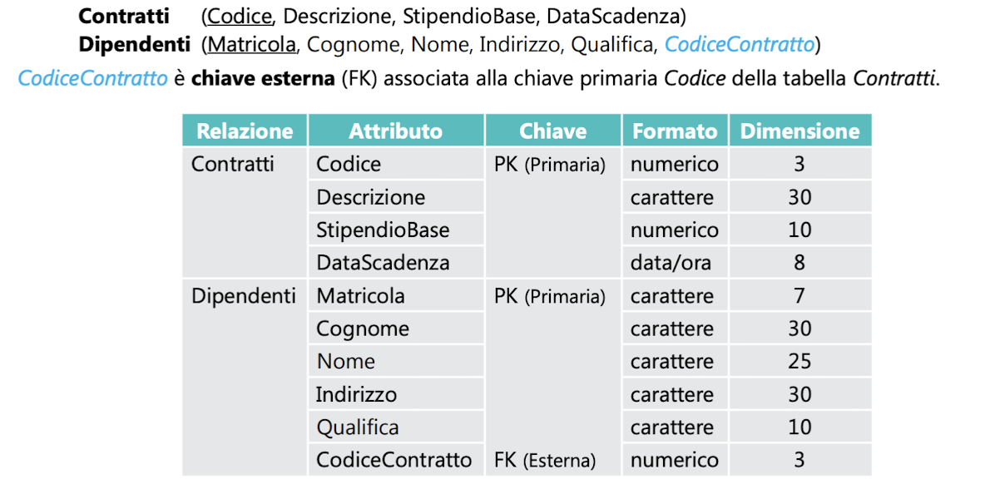
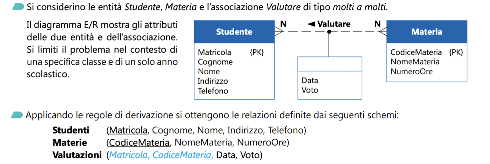
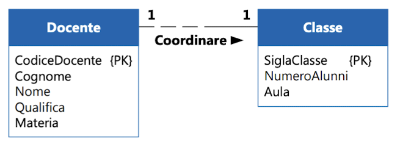

<!-- _class: lead -->
<!-- _paginate: false -->
<!-- _header: '' -->
<!-- _footer: '' -->

# I concetti del Modello Relazionale

## Parte 1

Prof. Francesco Dicara
I.I.S.S. Galileo Galilei – Ostiglia (MN)
Materia: Informatica

---

# Introduzione al modello relazionale

- Il modello relazionale è stato proposto da **Edgar F. Codd** nel **1970** per descrivere le informazioni in forma **tabellare**, con basi matematiche rigorose (teoria degli insiemi e logica).
- I dati sono visti come **insiemi di tabelle**, tra le quali è possibile eseguire **operazioni logiche**.
- La base di dati è modellata come un **insieme di relazioni**: ognuna corrisponde a una tabella.
- È il modello su cui si fondano i DBMS relazionali (MySQL, PostgreSQL, Oracle, SQL Server, …).

> **Livello logico:** il modello relazionale descrive *come sono organizzati i dati*, senza dire come vengono memorizzati fisicamente sul disco.

---

# Il concetto di relazione

Il modello si basa sul concetto matematico di **relazione tra insiemi**.

- **Prodotto cartesiano** di $A_1, A_2, \dots, A_n$: l'insieme di tutte le **n-uple ordinate** $(a_1, a_2, \dots, a_n)$ con $a_i \in A_i$.
- **Relazione**: un **sottoinsieme** del prodotto cartesiano di due o più insiemi.

Esempio con due insiemi:

$$A_1 = \{4, 9, 16\}, \qquad A_2 = \{2, 3\}$$

$$A_1 \times A_2 = \{(4,2),\ (4,3),\ (9,2),\ (9,3),\ (16,2),\ (16,3)\}$$

> Le coppie sono **ordinate**: $(4,2) \neq (2,4)$. Il numero di coppie è $|A_1| \cdot |A_2| = 3 \cdot 2 = 6$.

---

# Esempio di prodotto cartesiano



Le coppie risultanti sono **tutte le possibili combinazioni** degli elementi dei due insiemi:

$A_1 \times A_2 = \{(4,2), (4,3), (9,2), (9,3), (16,2), (16,3)\}$

---

# Relazione tra insiemi

Non tutte le coppie del prodotto cartesiano sono ugualmente significative: una **relazione** ne seleziona solo alcune, quelle che rispettano un certo legame.

- Definiamo la relazione $Q$ = *QuadratoDi*: l'insieme delle coppie $(x, y)$ tali che $x$ è il quadrato di $y$.
- $Q$ è un sottoinsieme di $A_1 \times A_2$:

$$Q = \{(4,2),\ (9,3)\}$$



---

# Perché utilizzare il modello relazionale?

- Usa il **linguaggio matematico** per descrivere i dati con **precisione e rigore**.
- **Riduce l'ambiguità**: i dati sono facili da comprendere e da manipolare.
- Permette di operare sui dati in modo **logico**, **indipendente dalla struttura fisica** del database (indipendenza fisica dei dati).
- Offre una base teorica solida per i linguaggi di interrogazione, come SQL.

---

# Altro esempio di relazione (Modello Auto – Costruttore)



> Anche qui la relazione contiene **solo le coppie (modello, costruttore) realmente esistenti**, non tutte le combinazioni possibili.

---

<!-- _class: small -->

# Definizione di relazione e terminologia

Una **relazione su $n$ insiemi** $A_1, A_2, \dots, A_n$ è un sottoinsieme del loro prodotto cartesiano.

| Termine del modello | Nella tabella | Significato |
| --- | --- | --- |
| **Relazione** | Tabella | Insieme di n-uple con la stessa struttura |
| **n-upla (tupla)** | Riga (record) | Una singola istanza dei dati |
| **Attributo** | Colonna (campo) | Proprietà descritta da un nome |
| **Dominio** | Valori ammessi | Insieme dei valori che un attributo può assumere |
| **Grado** | N. di colonne | Numero di attributi della relazione |
| **Cardinalità** | N. di righe | Numero di n-uple della relazione |

> **Schema e istanza.** Lo *schema* è la struttura, ad es. `Studenti(Matricola, Nome, Età)`, e cambia raramente. L'*istanza* è l'insieme delle righe presenti in un dato momento, e cambia di continuo.

---

# La relazione come tabella

La relazione si rappresenta con una **tabella** avente:

- **tante colonne quanti sono gli attributi** → *grado* della relazione;
- **tante righe quante sono le n-uple** → *cardinalità* della relazione.

Nomi delle colonne e valori possibili:

- Gli **attributi** sono i **nomi delle colonne**.
- I valori di ogni colonna appartengono allo **stesso dominio**.

> Nel modello relazionale gli attributi si distinguono **per nome**, non per posizione: l'ordine delle colonne non cambia il significato della relazione.

---

# La chiave primaria di una tabella

La **chiave primaria** (*primary key*, PK) è un attributo, o un insieme di attributi, che **identifica univocamente** ogni n-upla della relazione.

- Due righe diverse non possono avere lo stesso valore di chiave.
- La chiave primaria **non può essere nulla** (`NULL` = valore assente o sconosciuto): è il vincolo di **integrità di entità**.
- Se la chiave è formata da più attributi si dice **chiave composta**.

> **Superchiave, chiave candidata, chiave primaria.** Una *superchiave* è un insieme di attributi che identifica le righe. Una *chiave candidata* è una superchiave minimale (se togli un attributo non identifica più). La *chiave primaria* è la candidata scelta come identificatore principale.

---

<!-- _class: tiny -->

# Chiave primaria in SQL: schema e istanza

```sql
-- SCHEMA: la struttura della relazione (DDL)
CREATE TABLE Studenti (
  Matricola INT         PRIMARY KEY,          -- univoca e mai NULL
  Cognome   VARCHAR(30) NOT NULL,
  Nome      VARCHAR(30) NOT NULL,
  Eta       TINYINT     CHECK (Eta BETWEEN 14 AND 25)
);

-- ISTANZA: le righe presenti in un dato momento (DML)
INSERT INTO Studenti VALUES (12345, 'Rossi',   'Mario', 18);
INSERT INTO Studenti VALUES (12346, 'Bianchi', 'Luisa', 17);
INSERT INTO Studenti VALUES (12345, 'Verdi',   'Carlo', 18);  -- ERRORE: chiave duplicata
```

- **Tipo di dato + `CHECK`** definiscono il **dominio** dell'attributo.
- Dopo i primi due `INSERT` la relazione ha **grado 4** (colonne) e **cardinalità 2** (righe).
- Il terzo `INSERT` viene rifiutato dal DBMS: la matricola 12345 esiste già (**integrità di entità**).

---

# Esempio di tabella Automobile



*Rappresentazione di una tabella mediante una notazione schematica della tabella stessa:*


---

# Accesso ai dati

Il modello relazionale è **basato sui valori**: ogni dato è raggiungibile tramite **tre "coordinate"**.

| Coordinata | Cosa individua |
| --- | --- |
| Nome della **tabella** | La relazione che contiene il dato |
| Valore della **chiave primaria** | La riga (n-upla) cercata |
| Nome della **colonna** | L'attributo, cioè il valore specifico nella riga |

**Esempio**

- Tabella: `Studenti`
- Chiave primaria: `Matricola = 12345`
- Colonna: `Cognome` → valore **Rossi**

> I collegamenti tra tabelle non usano puntatori: si usano **valori uguali** (chiavi esterne, vedi Parte 2).

---

<!-- _class: small -->

# Requisiti delle tabelle nel modello relazionale

1. Ogni riga è **unica**: non esistono due righe uguali.
2. Esiste una **chiave primaria** (un attributo o una combinazione di attributi).
3. Le righe compaiono in **ordine non prefissato**.
4. Tutte le righe hanno lo **stesso numero di colonne**.
5. Gli attributi sono **atomici**: contengono un solo valore, non scomponibile (es. non si inseriscono più telefoni in un unico campo).
6. I valori di una colonna sono **omogenei**: appartengono allo stesso dominio e quindi sono dello stesso tipo.

---

<!-- _class: small -->

# Requisiti delle tabelle (continuazione)

**Esempio 1 – Omogeneità dei valori.** Nella tabella `Studenti` la colonna `Età` contiene solo numeri interi, mentre la colonna `Nome` contiene solo stringhe.

**Esempio 2 – Chiave e ordine delle righe.**

- Tabella: `Libri`
- Chiave primaria: `ISBN = 9781234567890`
- Le righe possono comparire in qualsiasi ordine, perché l'ordinamento **non è rilevante** nel modello relazionale.

> **Valore NULL.** Un attributo non chiave può avere valore `NULL` (informazione mancante o non applicabile). `NULL` **non è** lo zero né la stringa vuota: è l'assenza di un valore.

---

<!-- _class: tiny -->

# Requisiti e valore NULL in SQL

```sql
CREATE TABLE Libri (
  ISBN    CHAR(13)     PRIMARY KEY,
  Titolo  VARCHAR(100) NOT NULL,
  Anno    SMALLINT,                 -- ammette NULL
  Prezzo  DECIMAL(6,2)
);

INSERT INTO Libri VALUES ('9781234567890', 'Basi di dati', NULL, 24.90);  -- anno sconosciuto
INSERT INTO Libri VALUES ('9789876543210', 'Reti', 2024, 'venti');        -- ERRORE: tipo errato
INSERT INTO Libri VALUES ('9785555555555', NULL, 2023, 18.00);            -- ERRORE: Titolo NOT NULL
```

- Il **tipo di dato** garantisce l'omogeneità dei valori di una colonna (requisito 6): MySQL rifiuta il testo `'venti'` in una colonna `DECIMAL`.
- `NOT NULL` rende un attributo **obbligatorio**; senza `NOT NULL` l'attributo ammette valori mancanti.
- `NULL` si scrive **senza apici**: `'NULL'` sarebbe una stringa di quattro lettere.

---

<!-- _class: tiny -->

# Tipi di dato MySQL: numeri

| Tipo | Valori | Quando usarlo | Esempio |
| --- | --- | --- | --- |
| `TINYINT` | da −128 a 127 (`UNSIGNED`: da 0 a 255) | Età, voti, piccoli contatori | `Eta TINYINT` |
| `SMALLINT` | da −32 768 a 32 767 | Anni, ore, quantità limitate | `Anno SMALLINT` |
| `INT` | circa ± 2,1 miliardi | Identificatori e chiavi, contatori | `IDCliente INT` |
| `BIGINT` | circa ± 9,2 × 10¹⁸ | Valori molto grandi (log, visualizzazioni) | `NumVisite BIGINT` |
| `DECIMAL(p,s)` | numero **esatto**: *p* cifre totali, di cui *s* decimali | **Importi in euro**, prezzi, tariffe | `Prezzo DECIMAL(8,2)` → max 999999.99 |
| `FLOAT`, `DOUBLE` | numero **approssimato** (virgola mobile) | Misure scientifiche, coordinate GPS | `Latitudine DOUBLE` |
| `BOOLEAN` | sinonimo di `TINYINT(1)`: `TRUE` = 1, `FALSE` = 0 | Valori sì/no | `Pagata BOOLEAN` |

> `UNSIGNED` esclude i negativi e raddoppia il massimo positivo (es. `Quantita INT UNSIGNED`).
> **Mai `FLOAT` per i soldi:** 0.1 + 0.2 non dà esattamente 0.3; con `DECIMAL` il calcolo è esatto.

---

<!-- _class: tiny -->

# Tipi di dato MySQL: testo e date

| Tipo | Valori | Quando usarlo | Esempio |
| --- | --- | --- | --- |
| `CHAR(n)` | stringa di lunghezza **fissa** *n* | Codici a lunghezza costante | `CodFiscale CHAR(16)`, `CAP CHAR(5)` |
| `VARCHAR(n)` | stringa **variabile**, fino a *n* caratteri | Nomi, cognomi, e-mail, indirizzi | `Email VARCHAR(100)` |
| `TEXT` | testo lungo (fino a 65 535 byte) | Descrizioni, note, recensioni | `Descrizione TEXT` |
| `ENUM(...)` | un valore da una **lista fissa** | Stati, categorie stabili | `Taglia ENUM('S','M','L')` |
| `DATE` | `'AAAA-MM-GG'` | Date di nascita, iscrizioni, scadenze | `DataNascita DATE` |
| `TIME` | `'hh:mm:ss'` | Orari, durate | `OraInizio TIME` |
| `DATETIME` | `'AAAA-MM-GG hh:mm:ss'` | Un istante preciso: noleggi, prenotazioni, ordini | `DataOraInizio DATETIME` |
| `TIMESTAMP` | come `DATETIME`, dal 1970 al 2038 | Istante di creazione o modifica di una riga | `CreatoIl TIMESTAMP` |
| `YEAR` | anno di 4 cifre | Anno di immatricolazione, di pubblicazione | `AnnoImm YEAR` |

> **Errori tipici all'esame:** telefono, CAP e partita IVA in `INT` invece che in `CHAR`/`VARCHAR` (zeri iniziali, nessun calcolo); date in `VARCHAR` invece che in `DATE`.

---

<!-- _class: tiny -->

# Dati multimediali: link o BLOB?

Immagini, PDF, audio e video si possono gestire in due modi.

| | **Link** (percorso o URL in `VARCHAR`) | **BLOB** (file dentro il database) |
| --- | --- | --- |
| Cosa si salva | Solo il riferimento: `'img/prodotti/p10.jpg'` | I byte del file |
| Dimensione del DB | Piccola | Cresce molto, backup lenti |
| Visualizzazione nel web | Diretta: `` | Il file va estratto da uno script |
| Coerenza | Il file può essere cancellato o spostato e il link resta "rotto" | Dato e file sono sempre insieme |
| Uso tipico | Foto prodotti, copertine, video, allegati | File piccoli e riservati (firme, documenti) |

**Tipi BLOB** (*Binary Large OBject*):

| Tipo | Dimensione massima |
| --- | --- |
| `TINYBLOB` | 255 byte |
| `BLOB` | 64 KB |
| `MEDIUMBLOB` | 16 MB |
| `LONGBLOB` | 4 GB |

> **Soluzione consigliata (e più usata nelle prove d'esame):** il file sta nel file system del server o su un servizio cloud; il database memorizza **il percorso o l'URL** e le informazioni sul file.

---

<!-- _class: tiny -->

# Dati multimediali in SQL

**Soluzione con link** (consigliata)

```sql
CREATE TABLE FotoProdotti (
  IDFoto      INT          AUTO_INCREMENT PRIMARY KEY,
  CodProdotto CHAR(3)      NOT NULL,
  Percorso    VARCHAR(255) NOT NULL UNIQUE,   -- percorso relativo o URL
  TipoMIME    VARCHAR(50)  NOT NULL,          -- es. 'image/jpeg'
  Didascalia  VARCHAR(100),
  FOREIGN KEY (CodProdotto) REFERENCES Prodotti(CodProdotto)
);

INSERT INTO FotoProdotti (CodProdotto, Percorso, TipoMIME, Didascalia)
  VALUES ('P10', 'img/prodotti/p10_fronte.jpg', 'image/jpeg', 'Vista frontale');
```

**Soluzione con BLOB**

```sql
CREATE TABLE DocumentiStudenti (
  IDDocumento INT          AUTO_INCREMENT PRIMARY KEY,
  IDStudente  INT          NOT NULL,
  NomeFile    VARCHAR(100) NOT NULL,
  TipoMIME    VARCHAR(50)  NOT NULL,          -- es. 'application/pdf'
  Contenuto   MEDIUMBLOB   NOT NULL,          -- file fino a 16 MB
  FOREIGN KEY (IDStudente) REFERENCES Studenti(IDStudente)
);
```

> Il contenuto di un BLOB non si scrive a mano nell'`INSERT`: lo carica l'**applicazione** (es. una pagina PHP che riceve il file con un form di upload).

---

<!-- _class: tiny -->

# Vincoli nella CREATE TABLE

| Vincolo | Significato | Dove si scrive | Esempio |
| --- | --- | --- | --- |
| `PRIMARY KEY` | Identifica ogni riga: univoca e mai `NULL`. **Una sola** per tabella | Colonna; tabella se composta | `ISBN CHAR(13) PRIMARY KEY` · `PRIMARY KEY (IDStudente, IDCorso)` |
| `FOREIGN KEY … REFERENCES` | Integrità referenziale verso la PK di un'altra tabella (Parte 2) | Tabella | `FOREIGN KEY (IDDocente) REFERENCES Docenti(IDDocente)` |
| `UNIQUE` | Nessun valore duplicato; ammette `NULL` | Colonna o tabella | `Email VARCHAR(100) UNIQUE` |
| `NOT NULL` | Valore obbligatorio | Colonna | `Cognome VARCHAR(30) NOT NULL` |
| `CHECK (condizione)` | I valori devono rispettare la condizione | Colonna o tabella | `Voto TINYINT CHECK (Voto BETWEEN 1 AND 10)` |
| `DEFAULT valore` | Valore usato se l'`INSERT` non lo specifica | Colonna | `Pagata BOOLEAN DEFAULT FALSE` |
| `AUTO_INCREMENT` | Numero progressivo generato dal DBMS; colonna intera e chiave, una per tabella | Colonna | `IDOrdine INT AUTO_INCREMENT PRIMARY KEY` |

> `DEFAULT` e `AUTO_INCREMENT` non sono vincoli di integrità in senso stretto, ma **proprietà** della colonna: si scrivono nello stesso punto.
> Un vincolo può avere un **nome**, che compare nei messaggi di errore: `CONSTRAINT chk_voto CHECK (Voto BETWEEN 1 AND 10)`. Il `CHECK` è applicato da MySQL 8.0.16 in poi.

---

<!-- _class: tiny -->

# Tipi e vincoli insieme: un esempio completo

```sql
CREATE TABLE Clienti (
  IDCliente   INT          AUTO_INCREMENT PRIMARY KEY,
  CodFiscale  CHAR(16)     NOT NULL UNIQUE,
  Cognome     VARCHAR(30)  NOT NULL,
  Email       VARCHAR(100) UNIQUE,
  Telefono    VARCHAR(15),
  CAP         CHAR(5)
);

CREATE TABLE Ordini (
  IDOrdine  INT          AUTO_INCREMENT PRIMARY KEY,
  DataOra   DATETIME     NOT NULL DEFAULT CURRENT_TIMESTAMP,
  Stato     ENUM('in preparazione', 'spedito', 'consegnato') NOT NULL DEFAULT 'in preparazione',
  Totale    DECIMAL(8,2) NOT NULL CHECK (Totale >= 0),
  IDCliente INT          NOT NULL,
  FOREIGN KEY (IDCliente) REFERENCES Clienti(IDCliente)
);

INSERT INTO Clienti (CodFiscale, Cognome, Email, Telefono, CAP)
  VALUES ('RSSMRA05A01E897X', 'Rossi', 'mario.rossi@mail.it', '0386 123456', '46035');
INSERT INTO Ordini (Totale, IDCliente) VALUES (59.90, 1);
INSERT INTO Ordini (Totale, IDCliente) VALUES (-5.00, 1);   -- ERRORE: viola il CHECK
```

> Indicando l'**elenco delle colonne** nell'`INSERT`, quelle omesse ricevono il valore di `AUTO_INCREMENT` o di `DEFAULT` (`IDOrdine`, `DataOra`, `Stato`).

---

<!-- _class: lead -->
<!-- _paginate: false -->
<!-- _header: '' -->
<!-- _footer: '' -->

# I concetti del Modello Relazionale

## Parte 2

Prof. Francesco Dicara
I.I.S.S. Galileo Galilei – Ostiglia (MN)

---

# Introduzione: dal modello E/R al modello logico

Dal **modello concettuale** (diagramma E/R) si ottiene il **modello logico** dei dati: si definisce la struttura degli archivi, cioè le **tabelle** che devono essere create.

> **Attenzione ai termini.**
> - Nel modello **E/R** si parla di *entità* e *associazioni* (o relazioni tra entità).
> - Nel modello **relazionale** la parola *relazione* indica la **tabella**.
>
> Si devono quindi trasformare le entità e le associazioni del modello E/R in relazioni (tabelle) del modello relazionale, facendo attenzione ai nomi e alla loro collocazione.

---

# Regole di derivazione: le entità

Le regole principali per ricavare le relazioni dal modello E/R sono:

1. **Ogni entità diventa una relazione** (una tabella del modello relazionale).
2. **Ogni attributo dell'entità diventa un attributo della relazione**.
3. Ogni attributo della relazione **mantiene le caratteristiche** (tipo di dato e dominio) dell'attributo dell'entità.
4. L'**identificatore unico** dell'entità diventa la **chiave primaria** della relazione.

> Le associazioni si traducono in base alla loro **cardinalità** (1:1, 1:N, N:M), come nelle slide seguenti.

---

<!-- _class: small -->

# Le associazioni: regole di derivazione

| Cardinalità | Come si traduce |
| --- | --- |
| **Uno a uno** (1:1) | Di norma **un'unica relazione** con gli attributi di entrambe le entità. In alternativa, due relazioni con una chiave esterna **univoca** (`UNIQUE`) in una delle due. |
| **Uno a molti** (1:N) | La **chiave primaria dell'entità "a uno"** viene aggiunta come **chiave esterna** nella relazione dell'entità "a molti". |
| **Molti a molti** (N:M) | Si crea una **nuova relazione** che contiene le chiavi primarie (come chiavi esterne) delle due entità e gli eventuali attributi dell'associazione. |

> **Regola pratica:** la chiave esterna sta sempre dal lato **"molti"**. Nell'N:M non esiste un lato "uno": per questo serve una terza tabella.

---

# Chiave esterna

La **chiave esterna** (FK, *foreign key*) è un attributo (o un insieme di attributi) di una tabella i cui valori **fanno riferimento alla chiave primaria di un'altra tabella**.

- Permette di **collegare** le righe di tabelle diverse.
- Impone il vincolo di **integrità referenziale**: ogni valore della FK deve esistere come chiave primaria nella tabella riferita (oppure essere `NULL`, se ammesso).

**Esempio.** Un docente può tenere più corsi, ma ogni corso ha un solo docente:

- `Docenti(`**ID Docente**`, Nome, Cognome)`
- `Corsi(`**ID Corso**`, Nome Corso,` *ID Docente*`)`

`ID Docente` in `Corsi` è una **chiave esterna** che riferisce la chiave primaria `ID Docente` di `Docenti`. *(PK in grassetto, FK in corsivo.)*

---

<!-- _class: small -->

# Chiave esterna: esempio con i dati

Ogni corso è associato a **un solo** docente; un docente può avere **più** corsi.

**Docenti**

| ID Docente | Nome | Cognome |
| --- | --- | --- |
| 1 | Anna | Bianchi |
| 2 | Paolo | Rossi |

**Corsi**

| ID Corso | Nome Corso | ID Docente (FK) |
| --- | --- | --- |
| C1 | Matematica | 1 |
| C2 | Fisica | 2 |
| C3 | Statistica | 1 |

> Un valore come `ID Docente = 9` in `Corsi` violerebbe l'integrità referenziale, perché non esiste nessun docente con quell'ID.

---

<!-- _class: tiny -->

# Chiave esterna in SQL

```sql
CREATE TABLE Docenti (
  IDDocente INT         PRIMARY KEY,
  Nome      VARCHAR(30) NOT NULL,
  Cognome   VARCHAR(30) NOT NULL
);

CREATE TABLE Corsi (
  IDCorso   CHAR(3)     PRIMARY KEY,
  NomeCorso VARCHAR(50) NOT NULL,
  IDDocente INT         NOT NULL,
  FOREIGN KEY (IDDocente) REFERENCES Docenti(IDDocente)
);

INSERT INTO Docenti VALUES (1, 'Anna', 'Bianchi');
INSERT INTO Corsi   VALUES ('C1', 'Matematica', 1);
INSERT INTO Corsi   VALUES ('C4', 'Chimica', 9);     -- ERRORE: il docente 9 non esiste
```

- Si crea e si popola **prima** la tabella riferita (`Docenti`), poi quella con la FK (`Corsi`).
- La FK deve avere **lo stesso tipo** della PK riferita (qui `INT`).

> In SQL i nomi non contengono spazi: `ID Docente` diventa `IDDocente`.

---

# Passaggio pratico: dal modello E/R al modello logico

**Procedura in tre passi**

1. **Entità → tabelle.** Ogni entità diventa una tabella; l'identificatore diventa la chiave primaria.
2. **Associazioni → chiavi esterne o nuove tabelle**, in base alla cardinalità:
   - **1:1** → una sola tabella con gli attributi di entrambe le entità;
   - **1:N** → chiave primaria del lato "uno" come chiave esterna nel lato "molti";
   - **N:M** → terza tabella con le due chiavi primarie e gli attributi dell'associazione.
3. **Verifica finale.** Controlla nomi, chiavi primarie, chiavi esterne e vincoli di integrità.

---

<!-- _class: small -->

# Esempio uno a uno: Persona e Passaporto

Ogni persona ha **un solo** passaporto e ogni passaporto appartiene a **una sola** persona: la relazione è rappresentata da **un'unica tabella** che unisce gli attributi di entrambe le entità.

| ID | Nome | Cognome | ID Passaporto | Data Emissione |
| --- | --- | --- | --- | --- |
| 1 | Mario | Rossi | P123 | 2023-01-01 |
| 2 | Luisa | Bianchi | P124 | 2023-02-15 |
| 3 | Carlo | Verdi | P125 | 2023-03-20 |

*Tabella PersonePassaporti (unica relazione tra Persona e Passaporto).*

> `ID` è la chiave primaria. `ID Passaporto` è una **chiave candidata**: anch'essa è univoca, quindi si dichiara `UNIQUE`.

---

<!-- _class: tiny -->

# Uno a uno in SQL

**Soluzione con una tabella unica**

```sql
CREATE TABLE PersonePassaporti (
  ID            INT         PRIMARY KEY,
  Nome          VARCHAR(30) NOT NULL,
  Cognome       VARCHAR(30) NOT NULL,
  IDPassaporto  CHAR(4)     NOT NULL UNIQUE,   -- chiave candidata
  DataEmissione DATE        NOT NULL
);
```

**Alternativa con due tabelle: chiave esterna univoca**

```sql
CREATE TABLE Passaporti (
  IDPassaporto  CHAR(4) PRIMARY KEY,
  DataEmissione DATE    NOT NULL,
  IDPersona     INT     NOT NULL UNIQUE,       -- senza UNIQUE sarebbe 1:N
  FOREIGN KEY (IDPersona) REFERENCES Persone(ID)
);
```

> È il vincolo `UNIQUE` sulla FK a garantire che una persona abbia **al più un** passaporto.

---

<!-- _class: small -->

# Esempio uno a molti: Dipartimento e Impiegato

Ogni dipartimento può avere **molti** impiegati, ma ogni impiegato appartiene a **un solo** dipartimento. La **chiave esterna** si inserisce nella tabella degli impiegati (lato "molti").

**Dipartimenti**

| ID Dipartimento | Nome Dipartimento |
| --- | --- |
| 10 | Risorse Umane |
| 20 | IT |
| 30 | Marketing |

**Impiegati** (con chiave esterna *ID Dipartimento*)

| ID Impiegato | Nome | Cognome | ID Dipartimento (FK) |
| --- | --- | --- | --- |
| 1 | Anna | Verdi | 10 |
| 2 | Marco | Bianchi | 20 |
| 3 | Sara | Rossi | 20 |

---

<!-- _class: tiny -->

# Uno a molti in SQL

```sql
CREATE TABLE Dipartimenti (
  IDDipartimento   INT         PRIMARY KEY,
  NomeDipartimento VARCHAR(40) NOT NULL
);

CREATE TABLE Impiegati (
  IDImpiegato    INT         PRIMARY KEY,
  Nome           VARCHAR(30) NOT NULL,
  Cognome        VARCHAR(30) NOT NULL,
  IDDipartimento INT         NOT NULL,
  FOREIGN KEY (IDDipartimento) REFERENCES Dipartimenti(IDDipartimento)
);

INSERT INTO Dipartimenti VALUES (10, 'Risorse Umane'), (20, 'IT'), (30, 'Marketing');
INSERT INTO Impiegati VALUES
  (1, 'Anna',  'Verdi',   10),
  (2, 'Marco', 'Bianchi', 20),
  (3, 'Sara',  'Rossi',   20);
```

> La FK sta nel lato **"molti"** (`Impiegati`): più impiegati possono avere lo stesso `IDDipartimento` (20). Con un solo `INSERT` si possono inserire **più righe**, separate da virgole.

---

<!-- _class: small -->

# Esempio molti a molti: Studenti e Corsi

Ogni studente può iscriversi a **molti** corsi e ogni corso può avere **molti** studenti. Si crea una **tabella di associazione** con **due chiavi esterne**, una per ciascuna tabella collegata.

**Studenti**

| ID Studente | Nome | Cognome |
| --- | --- | --- |
| 101 | Luca | Neri |
| 102 | Giulia | Rosa |
| 103 | Fabio | Blu |

**Corsi**

| ID Corso | Nome Corso | Descrizione |
| --- | --- | --- |
| C1 | Matematica | Corso di base |
| C2 | Informatica | Introduzione alla programmazione |
| C3 | Storia | Storia moderna |

---

<!-- _class: small -->

# Esempio molti a molti: la tabella di associazione

**Iscrizioni** (tabella di associazione Studenti–Corsi)

| ID Studente (FK) | ID Corso (FK) | Data Iscrizione |
| --- | --- | --- |
| 101 | C1 | 2023-09-01 |
| 101 | C2 | 2023-09-05 |
| 102 | C1 | 2023-09-03 |
| 103 | C3 | 2023-09-02 |

- La **chiave primaria** è **composta** da `(ID Studente, ID Corso)`: ogni coppia compare una sola volta.
- Entrambi gli attributi sono anche **chiavi esterne**.
- `Data Iscrizione` è un **attributo dell'associazione**: non appartiene né allo studente né al corso, ma al loro legame.

> **N.B.** Nel passaggio dall'entità alla relazione il nome si scrive di solito al **plurale** (convenzione), perché la relazione, vista come insieme, contiene tutte le istanze dell'entità.

---

<!-- _class: tiny -->

# Molti a molti in SQL

```sql
CREATE TABLE Iscrizioni (
  IDStudente     INT     NOT NULL,
  IDCorso        CHAR(3) NOT NULL,
  DataIscrizione DATE    NOT NULL,
  PRIMARY KEY (IDStudente, IDCorso),
  FOREIGN KEY (IDStudente) REFERENCES Studenti(IDStudente),
  FOREIGN KEY (IDCorso)    REFERENCES Corsi(IDCorso)
);

INSERT INTO Iscrizioni VALUES
  (101, 'C1', '2023-09-01'),
  (101, 'C2', '2023-09-05'),
  (102, 'C1', '2023-09-03'),
  (103, 'C3', '2023-09-02');

INSERT INTO Iscrizioni VALUES (101, 'C1', '2023-10-01');  -- ERRORE: coppia (101, C1) già presente
```

- La **PK composta** impedisce che uno studente si iscriva due volte allo stesso corso.
- `Studenti` e `Corsi` vanno popolate **prima** di `Iscrizioni`. Le date si scrivono `'AAAA-MM-GG'`.

---

# Esempio del libro: uno a uno

 

*Figura: Relazione Anagrafe associata, casistica "uno a uno".*

---

# Esempio del libro: uno a molti

 

*Figura: Relazioni Contratti e Dipendenti, casistica "uno a molti".*

---

# Esempio del libro: molti a molti



---

# Caso particolare: 1:1 con partecipazione facoltativa

**Definizione.** Un'associazione 1:1 ha **partecipazione facoltativa** (o opzionale) quando **una delle due entità può non partecipare** all'associazione.

**Esempio: Docente e Classe**

- Ogni classe ha **un solo coordinatore** (un Docente): per la Classe la partecipazione è **obbligatoria**.
- **Non tutti** i docenti sono coordinatori di una classe: per il Docente la partecipazione è **facoltativa**.

> Se si fondessero le due entità in un'unica tabella, per i docenti non coordinatori si avrebbero molti valori `NULL`. Per questo si preferiscono soluzioni diverse (slide successive).

---

# Rappresentazione grafica



*Figura: esempio di relazione 1:1 con partecipazione facoltativa tra Docente e Classe.*

> **N.B.** Nella figura la linea dal lato del Docente è **tratteggiata**: la partecipazione è opzionale, perché un docente può anche non essere coordinatore.
> Questa **non è la notazione adottata nel corso di Informatica**: noi usiamo la notazione a **zampe di gallina** (*crow's foot*), in cui l'opzionalità si indica con un **cerchietto vuoto** (zero) accanto alla **barra verticale** (uno).

---

<!-- _class: small -->

# Approfondimento: scelte di modellazione

Con partecipazione facoltativa in un'associazione 1:1 ci sono tre soluzioni principali:

1. **Chiave esterna nel lato obbligatorio** *(soluzione più comune)*. Si aggiunge `ID Docente` come chiave esterna in `Classi`, dichiarata `NOT NULL` (ogni classe ha un coordinatore) e `UNIQUE` (un docente coordina al massimo una classe). Senza `UNIQUE` la relazione diventerebbe 1:N.
2. **Tabella aggiuntiva** `Coordinatori(ID Docente, ID Classe)`. Utile se l'associazione è **debole** o ha **attributi propri** (es. data di nomina) oppure se la partecipazione è facoltativa da **entrambi** i lati.
3. **Partecipazione obbligatoria da entrambi i lati.** Se ogni classe deve avere un coordinatore **e** ogni docente deve coordinare una classe, la facoltatività sparisce e si può usare una **tabella unica**.

> Non esiste una scelta universalmente corretta: dipende dai **requisiti** del sistema.

---

<!-- _class: tiny -->

# 1:1 con partecipazione facoltativa in SQL

Soluzione 1: chiave esterna nel lato obbligatorio (`Classi`).

```sql
CREATE TABLE Classi (
  IDClasse       CHAR(3)     PRIMARY KEY,
  Aula           VARCHAR(10),
  IDCoordinatore INT         NOT NULL UNIQUE,
  FOREIGN KEY (IDCoordinatore) REFERENCES Docenti(IDDocente)
);

INSERT INTO Classi VALUES ('5A', 'Lab1', 7);
INSERT INTO Classi VALUES ('5B', 'A12', 7);     -- ERRORE: il docente 7 coordina già la 5A
INSERT INTO Classi VALUES ('4A', 'A10', NULL);  -- ERRORE: la classe deve avere un coordinatore
```

- `NOT NULL`: ogni classe **deve** avere un coordinatore (partecipazione obbligatoria).
- `UNIQUE`: un docente coordina **al più una** classe (cardinalità 1:1).
- Il nome `IDCoordinatore` esprime il **ruolo** del docente nell'associazione.

---

<!-- _class: small -->

# Esempio alternativo: Cittadino Italiano e Calciatore Nazionale

**Scenario**

- Ogni Cittadino italiano potrebbe essere un Calciatore Nazionale, ma **pochissimi** lo sono.
- L'associazione è 1:1 con **partecipazione facoltativa**: un calciatore è sempre un cittadino, un cittadino quasi mai un calciatore.

**Soluzione di modellazione**

- Due tabelle distinte: `Cittadini` e `CalciatoriNazionali`.
- `ID Cittadino` è chiave primaria in `Cittadini`.
- In `CalciatoriNazionali`, `ID Cittadino` è **contemporaneamente chiave primaria e chiave esterna** verso `Cittadini`.

> È il caso tipico di una **specializzazione**: `CalciatoriNazionali` aggiunge attributi solo per i cittadini che appartengono a quella categoria.

---

<!-- _class: small -->

# Esempio: Cittadino Italiano e Calciatore Nazionale

La tabella `Cittadini` contiene **tutti** i cittadini; `CalciatoriNazionali` contiene **solo** quelli che sono anche calciatori della nazionale.

**Cittadini**

| ID Cittadino | Nome | Cognome | Data Nascita |
| --- | --- | --- | --- |
| 1 | Mario | Rossi | 1995-05-10 |
| 2 | Luisa | Bianchi | 1988-11-22 |
| 3 | Carlo | Verdi | 1990-03-15 |
| 4 | Anna | Neri | 1992-07-28 |

**CalciatoriNazionali**

| ID Cittadino (PK, FK) | Ruolo | Squadra Appartenenza | Data Nazionale |
| --- | --- | --- | --- |
| 1 | Attaccante | Roma | 2021-09-01 |
| 3 | Portiere | Juventus | 2020-06-15 |

---

<!-- _class: tiny -->

# Specializzazione in SQL: Cittadini e Calciatori

```sql
CREATE TABLE CalciatoriNazionali (
  IDCittadino         INT         PRIMARY KEY,
  Ruolo               VARCHAR(20) NOT NULL,
  SquadraAppartenenza VARCHAR(40) NOT NULL,
  DataNazionale       DATE,
  FOREIGN KEY (IDCittadino) REFERENCES Cittadini(IDCittadino)
);

INSERT INTO CalciatoriNazionali VALUES (1, 'Attaccante', 'Roma', '2021-09-01');
INSERT INTO CalciatoriNazionali VALUES (3, 'Portiere', 'Juventus', '2020-06-15');
INSERT INTO CalciatoriNazionali VALUES (9, 'Difensore', 'Milan', '2022-03-10');
-- ERRORE: il cittadino 9 non esiste in Cittadini
```

- **PK = FK:** ogni calciatore corrisponde a un cittadino esistente (FK) e compare al massimo una volta (PK).

---

# Conclusioni sul caso particolare

- Le relazioni 1:1 con partecipazione facoltativa permettono una modellazione **più flessibile**: non tutti gli elementi di un'entità devono partecipare all'associazione.
- È importante **analizzare il contesto** per decidere se la partecipazione è facoltativa o obbligatoria.
- Nelle relazioni uno a uno la scelta del lato in cui inserire la chiave esterna dipende dall'**importanza relativa delle due entità** e dalla partecipazione: di norma si sceglie il lato obbligatorio, per evitare valori `NULL`.
- La modellazione deve rispecchiare la **logica** e i **requisiti** del sistema.

---

<!-- _class: lead -->
<!-- _paginate: false -->
<!-- _header: '' -->
<!-- _footer: '' -->

# I concetti del Modello Relazionale

## Parte 3 – Chiavi composte e casi particolari

Prof. Francesco Dicara
I.I.S.S. Galileo Galilei – Ostiglia (MN)

---

# Chiave primaria composta: quando serve

Una chiave primaria è **composta** quando **nessun attributo da solo** identifica la riga e serve una **combinazione** di due o più attributi.

- **Minimalità:** ogni attributo della chiave è indispensabile; togliendone uno, l'unicità si perde.
- Casi tipici:
  - tabelle di associazione **N:M** (es. `Iscrizioni`, Parte 2);
  - **entità deboli** (es. righe di un ordine);
  - **eventi nel tempo** (prenotazioni, noleggi, lezioni: serve data/ora);
  - **attributi multivalore** (più telefoni per cliente).
- In SQL si dichiara a livello di tabella: `PRIMARY KEY (A, B, C)`.

> Notazione: **PK in grassetto**, *FK in corsivo*, ***grassetto corsivo*** = PK e FK insieme.

---

<!-- _class: small -->

# Esempio: orario delle lezioni (chiave di 3 attributi)

Lezioni(**Classe**, **Giorno**, **Ora**, Materia, *IDDocente*)

| Classe | Giorno | Ora | Materia | IDDocente (FK) |
| --- | --- | --- | --- | --- |
| 5A | Lun | 1 | Informatica | 7 |
| 5A | Lun | 2 | Matematica | 3 |
| 5B | Lun | 1 | Italiano | 4 |
| 5A | Mar | 1 | Informatica | 7 |

> In un certo giorno e a una certa ora, una classe ha **una sola** lezione: la terna (Classe, Giorno, Ora) identifica la riga.

---

<!-- _class: small -->

# Verifica della minimalità

Togliamo un attributo alla volta e cerchiamo un controesempio nei dati:

| Sottoinsieme | È univoco? | Controesempio |
| --- | --- | --- |
| (Classe, Giorno) | No | 5A–Lun compare alle ore 1 e 2 |
| (Giorno, Ora) | No | Lun–1 compare per 5A e 5B |
| (Classe, Ora) | No | 5A–1 compare lunedì e martedì |
| **(Classe, Giorno, Ora)** | **Sì** | — |

Nessun sottoinsieme proprio funziona, quindi la chiave è **minimale**.

> **Chiave candidata alternativa:** anche (IDDocente, Giorno, Ora) è univoca, perché un docente non può stare in due classi alla stessa ora. Si dichiara `UNIQUE`.
> **Attenzione:** i dati servono a trovare controesempi; la chiave si sceglie in base al **significato della realtà**, non a un'istanza.

---

<!-- _class: tiny -->

# Orario delle lezioni in SQL

```sql
CREATE TABLE Lezioni (
  Classe     CHAR(3)     NOT NULL,
  Giorno     CHAR(3)     NOT NULL,
  Ora        SMALLINT    NOT NULL,
  Materia    VARCHAR(30) NOT NULL,
  IDDocente  INT         NOT NULL,
  PRIMARY KEY (Classe, Giorno, Ora),
  UNIQUE (IDDocente, Giorno, Ora),
  FOREIGN KEY (IDDocente) REFERENCES Docenti(IDDocente)
);
```

- Una `PRIMARY KEY` su più colonne si scrive come **vincolo di tabella**, dopo l'elenco delle colonne, e non accanto a una singola colonna.
- Il vincolo `UNIQUE` impedisce di assegnare lo stesso docente a due classi nella stessa ora.

---

<!-- _class: small -->

# Entità debole: Ordini e Righe d'ordine

Un'**entità debole** non ha un identificatore proprio: si identifica solo **insieme all'entità da cui dipende**. La riga numero 1 esiste in ogni ordine!

Ordini(**IDOrdine**, Data, *IDCliente*)
RigheOrdine(***IDOrdine***, **NumRiga**, *CodProdotto*, Quantità, PrezzoUnitario)

| IDOrdine (PK, FK) | NumRiga (PK) | CodProdotto (FK) | Quantità | PrezzoUnitario |
| --- | --- | --- | --- | --- |
| 1001 | 1 | P10 | 2 | 15,00 |
| 1001 | 2 | P27 | 1 | 49,90 |
| 1002 | 1 | P10 | 5 | 14,50 |

> `IDOrdine` è **sia parte della PK sia FK**: è il caso tipico delle tracce su e-commerce e gestionali. `PrezzoUnitario` si salva nella riga perché il prezzo del prodotto può cambiare nel tempo.

---

<!-- _class: small -->

# N:M che si ripete nel tempo: i noleggi

**Traccia tipo (bike sharing):** un cliente noleggia più biciclette e una bicicletta è noleggiata da più clienti. **Lo stesso cliente può noleggiare la stessa bici più volte.**

| IDCliente (FK) | IDBici (FK) | DataOraInizio | DataOraFine |
| --- | --- | --- | --- |
| 15 | B03 | 2026-10-02 08:10 | 2026-10-02 08:40 |
| 15 | B03 | 2026-10-05 17:30 | 2026-10-05 18:05 |
| 22 | B03 | 2026-10-05 19:00 | NULL |

- (IDCliente, IDBici) **non basta**: la coppia 15–B03 compare due volte.
- Serve un attributo temporale. **(IDBici, DataOraInizio)** è sufficiente, perché una bici non può iniziare due noleggi nello stesso istante.
- `IDCliente` resta FK, ma **non fa parte** della chiave. `DataOraFine = NULL` indica un noleggio **in corso**.

---

<!-- _class: small -->

# Chiave composta o chiave surrogata?

Una **chiave surrogata** è un identificatore artificiale, senza significato nella realtà (es. `IDNoleggio INT AUTO_INCREMENT`).

| | Chiave composta (naturale) | Chiave surrogata |
| --- | --- | --- |
| Significato | Esprime un vincolo della realtà | Nessuno: è solo un numero |
| FK nelle altre tabelle | Composte, su più colonne | Un solo attributo |
| Rischio | Chiavi lunghe se ha molti attributi | Duplicati logici se manca `UNIQUE` |

> **All'esame** entrambe le scelte sono corrette se motivate. Con la chiave surrogata si dichiara **sempre** `UNIQUE` sulla chiave naturale, altrimenti il DBMS accetta due noleggi della stessa bici nello stesso istante.

---

<!-- _class: tiny -->

# Noleggi in SQL: le due soluzioni

**A – Chiave composta naturale**

```sql
CREATE TABLE Noleggi (
  IDBici        CHAR(3)  NOT NULL,
  DataOraInizio DATETIME NOT NULL,
  IDCliente     INT      NOT NULL,
  DataOraFine   DATETIME,
  PRIMARY KEY (IDBici, DataOraInizio),
  FOREIGN KEY (IDBici)    REFERENCES Biciclette(IDBici),
  FOREIGN KEY (IDCliente) REFERENCES Clienti(IDCliente)
);
```

**B – Chiave surrogata** (stesse colonne e stesse FK, cambiano solo i vincoli di chiave)

```sql
  IDNoleggio INT AUTO_INCREMENT PRIMARY KEY,
  ...
  UNIQUE (IDBici, DataOraInizio),
```

---

<!-- _class: tiny -->

# Chiave esterna composta: gli esami

Se una tabella riferisce una tabella con **PK composta**, anche la **FK deve essere composta** (stessi attributi, stesso ordine).

Uno studente sostiene l'esame di un corso a cui è iscritto e può **ripeterlo** in appelli diversi:

Esami(***IDStudente***, ***IDCorso***, **DataAppello**, Voto)

```sql
CREATE TABLE Esami (
  IDStudente  INT     NOT NULL,
  IDCorso     CHAR(3) NOT NULL,
  DataAppello DATE    NOT NULL,
  Voto        TINYINT CHECK (Voto BETWEEN 1 AND 10),
  PRIMARY KEY (IDStudente, IDCorso, DataAppello),
  FOREIGN KEY (IDStudente, IDCorso)
    REFERENCES Iscrizioni(IDStudente, IDCorso)
);
```

> Non si può registrare un esame per un corso a cui lo studente **non è iscritto**: l'integrità referenziale lavora sulla **coppia**, non sui singoli attributi.

---

<!-- _class: small -->

# Attributo multivalore: i telefoni

Requisito 5 della Parte 1: gli attributi sono **atomici**. Se un cliente ha **più numeri di telefono**, non li si scrive tutti in un campo.

**Errato:** Clienti(**IDCliente**, Nome, Telefoni) con `Telefoni = "0386 123456, 333 1234567"`

**Corretto:** una tabella separata, in relazione 1:N con Clienti.

Clienti(**IDCliente**, Nome, Cognome) · TelefoniClienti(***IDCliente***, **Telefono**, Tipo)

| IDCliente (PK, FK) | Telefono (PK) | Tipo |
| --- | --- | --- |
| 1 | 0386 123456 | Casa |
| 1 | 333 1234567 | Cellulare |
| 2 | 347 7654321 | Cellulare |

> **Attributo composto** (es. Indirizzo): si scompone nei componenti Via, Civico, CAP, Città, come colonne della stessa tabella.

---

<!-- _class: small -->

# Associazione ricorsiva 1:N: il responsabile

Un'**associazione ricorsiva** (o autoassociazione) lega un'entità **a se stessa**. Ogni impiegato ha al più un responsabile, che è a sua volta un impiegato.

Impiegati(**IDImpiegato**, Nome, Cognome, *IDResponsabile*)

| IDImpiegato | Nome | Cognome | IDResponsabile (FK) |
| --- | --- | --- | --- |
| 1 | Elena | Gallo | NULL |
| 2 | Marco | Bianchi | 1 |
| 3 | Sara | Rossi | 1 |
| 4 | Luca | Neri | 2 |

- `IDResponsabile` riferisce la PK **della stessa tabella**: `FOREIGN KEY (IDResponsabile) REFERENCES Impiegati(IDImpiegato)`.
- Elena è al vertice e non ha responsabile, quindi il valore è `NULL`.

---

<!-- _class: small -->

# Associazione ricorsiva N:M: le propedeuticità

Un corso può avere **più corsi propedeutici** ed essere propedeutico a **più corsi**. Come ogni N:M serve una nuova tabella, qui con **due FK verso la stessa tabella**.

Corsi(**IDCorso**, NomeCorso) · Propedeuticita(***IDCorso***, ***IDCorsoPropedeutico***)

| IDCorso (FK) | IDCorsoPropedeutico (FK) |
| --- | --- |
| C3 (Basi di dati) | C2 (Informatica) |
| C4 (Sistemi web) | C2 (Informatica) |
| C4 (Sistemi web) | C3 (Basi di dati) |

- PK composta: (IDCorso, IDCorsoPropedeutico).
- I due attributi riferiscono la stessa colonna `Corsi.IDCorso`, ma hanno **nomi diversi** che ne chiariscono il **ruolo**.

> Vincolo aggiuntivo: un corso non è propedeutico a se stesso → `CHECK (IDCorso <> IDCorsoPropedeutico)`.

---

<!-- _class: small -->

# Associazione ternaria: chi insegna cosa e dove

Un'associazione **ternaria** coinvolge **tre** entità (Docente, Materia, Classe) e diventa una tabella con **tre FK**.

Insegnamenti(***IDClasse***, ***CodMateria***, *IDDocente*)

| IDClasse (PK, FK) | CodMateria (PK, FK) | IDDocente (FK) |
| --- | --- | --- |
| 5A | INF | 7 |
| 5A | MAT | 3 |
| 5B | INF | 7 |

- **La chiave dipende dalle cardinalità.** Se in una classe ogni materia ha **un solo** docente, basta (IDClasse, CodMateria); `IDDocente` è FK `NOT NULL` ma resta fuori dalla chiave.
- Se più docenti insegnano la stessa materia nella stessa classe (es. **compresenza dell'ITP** in laboratorio), la chiave diventa **(IDClasse, CodMateria, IDDocente)**.

---

<!-- _class: small -->

# Riepilogo dei casi particolari

| Caso | Soluzione | Chiave primaria |
| --- | --- | --- |
| N:M | Tabella di associazione | Composta dalle due FK |
| N:M ripetuta nel tempo | Tabella con attributo data/ora | FK + data/ora, oppure surrogata |
| Entità debole | FK verso l'entità "forte" | FK + identificatore parziale |
| Attributo multivalore | Tabella separata (1:N) | FK + valore |
| Ricorsiva 1:N | FK verso la stessa tabella | Semplice |
| Ricorsiva N:M | Tabella con due FK sulla stessa tabella | Composta dalle due FK |
| Ternaria | Tabella con tre FK | Dipende dalle cardinalità |
| Riferimento a PK composta | FK composta | — |

---

<!-- _class: small -->

# Esercizio stile maturità

> Un centro sportivo comunale gestisce la **prenotazione dei campi** (calcetto, tennis, padel). Ogni campo ha un codice, un tipo e una tariffa oraria. I soci si registrano con codice fiscale, nome, cognome ed e-mail. Un socio prenota un campo per una data e una **fascia oraria** di un'ora (es. 18–19); in una certa data e fascia un campo può essere prenotato da **un solo** socio. Per ogni prenotazione si registra se è stata pagata.

1. Disegna il modello E/R con entità, associazioni e cardinalità.
2. Ricava il modello logico indicando chiavi primarie ed esterne.
3. Scrivi il codice SQL che crea la tabella delle prenotazioni.

---

<!-- _class: tiny -->

# Esercizio: soluzione

Campi(**CodCampo**, Tipo, TariffaOraria) · Soci(**CodFiscale**, Nome, Cognome, Email)
Prenotazioni(***CodCampo***, **Data**, **FasciaOraria**, *CodFiscale*, Pagata)

- Soci–Campi è **N:M**, ma la stessa coppia si ripete in date diverse: la chiave contiene data e fascia.
- Il socio **non entra nella chiave**: dati campo, data e fascia, il socio è unico.

```sql
CREATE TABLE Prenotazioni (
  CodCampo     CHAR(4)  NOT NULL,
  Data         DATE     NOT NULL,
  FasciaOraria TINYINT  NOT NULL CHECK (FasciaOraria BETWEEN 8 AND 22),
  CodFiscale   CHAR(16) NOT NULL,
  Pagata       BOOLEAN  NOT NULL DEFAULT FALSE,
  PRIMARY KEY (CodCampo, Data, FasciaOraria),
  FOREIGN KEY (CodCampo)   REFERENCES Campi(CodCampo),
  FOREIGN KEY (CodFiscale) REFERENCES Soci(CodFiscale)
);
```

> `FasciaOraria` memorizza l'ora di inizio (18 = fascia 18–19).