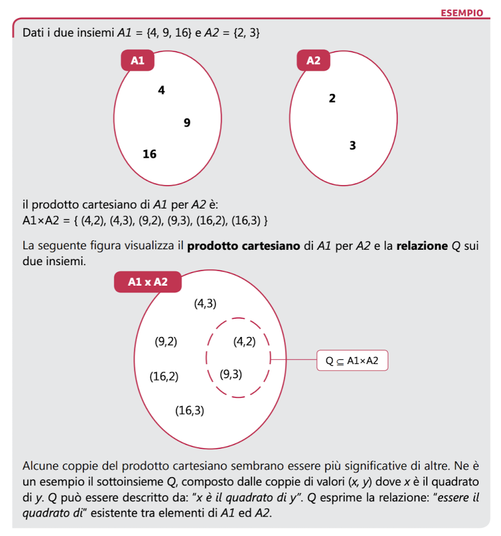
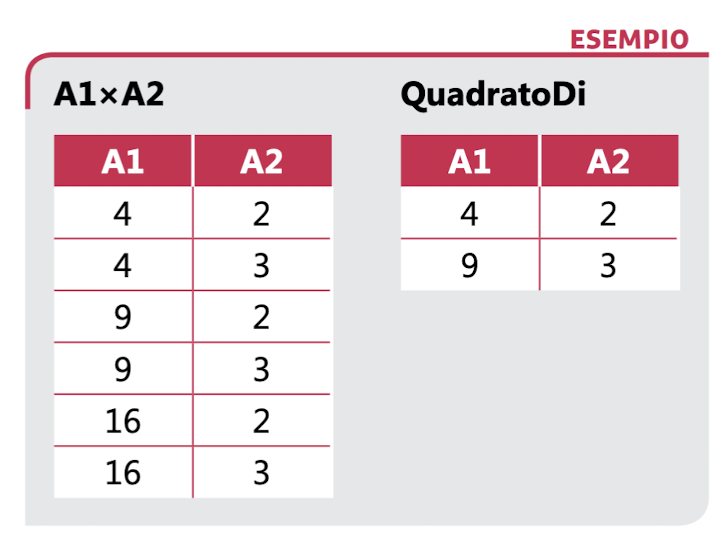
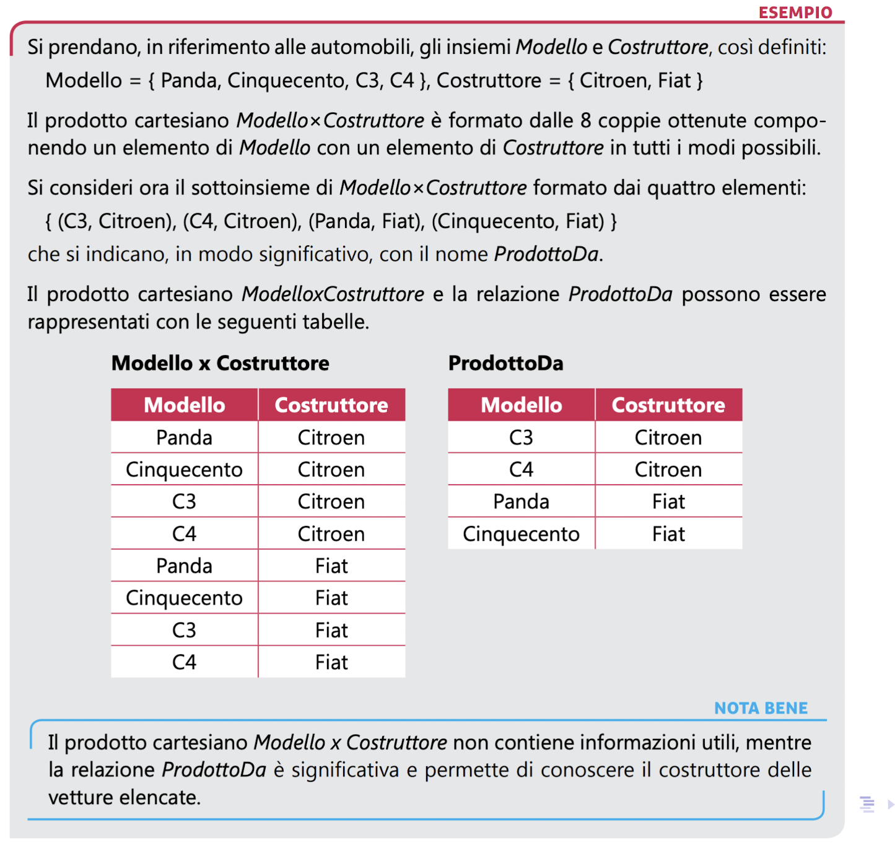
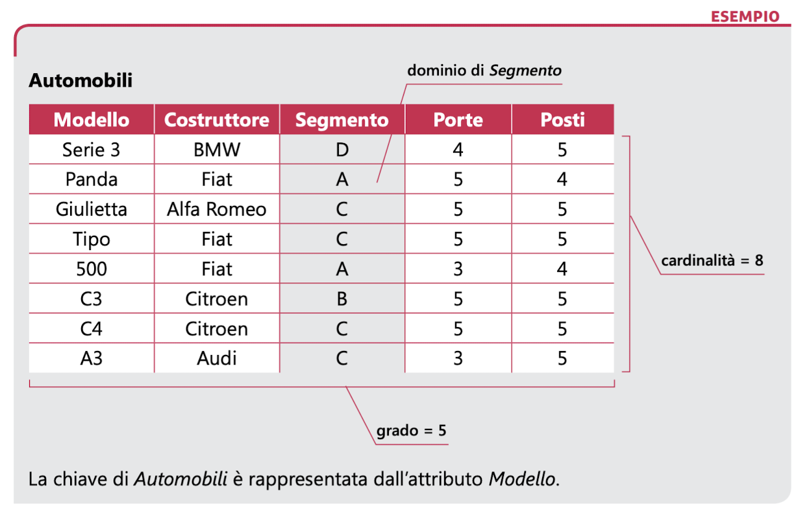
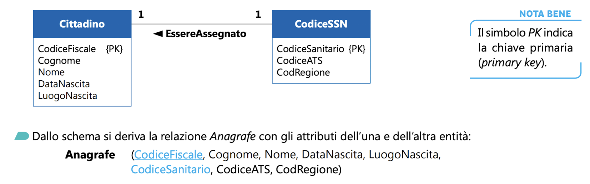
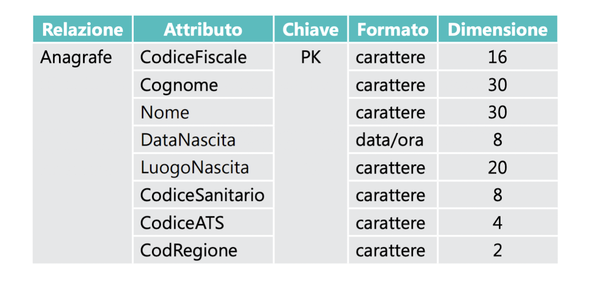
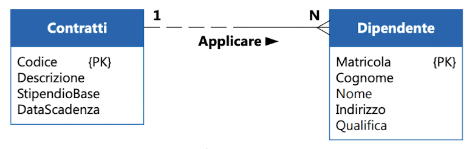
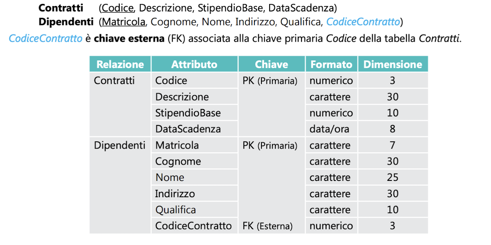
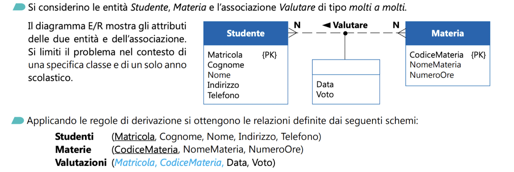
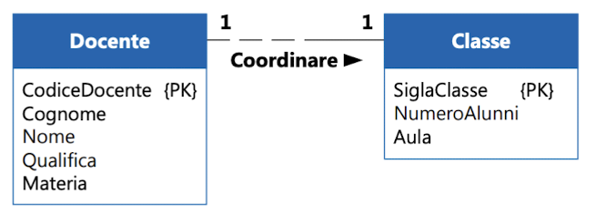

<!-- _class: lead -->
<!-- _paginate: false -->
<!-- _header: '' -->
<!-- _footer: '' -->

# I concetti del Modello Relazionale

## Parte 1

Prof. Francesco Dicara
I.I.S.S. Galileo Galilei – Ostiglia (MN)
Materia: Informatica

---

# Introduzione al modello relazionale

- Il modello relazionale è stato proposto da **Edgar F. Codd** nel **1970** per descrivere le informazioni in forma **tabellare**, con basi matematiche rigorose (teoria degli insiemi e logica).
- I dati sono visti come **insiemi di tabelle**, tra le quali è possibile eseguire **operazioni logiche**.
- La base di dati è modellata come un **insieme di relazioni**: ognuna corrisponde a una tabella.
- È il modello su cui si fondano i DBMS relazionali (MySQL, PostgreSQL, Oracle, SQL Server, …).

> **Livello logico:** il modello relazionale descrive *come sono organizzati i dati*, senza dire come vengono memorizzati fisicamente sul disco.

---

# Il concetto di relazione

Il modello si basa sul concetto matematico di **relazione tra insiemi**.

- **Prodotto cartesiano** di $A_1, A_2, \dots, A_n$: l'insieme di tutte le **n-uple ordinate** $(a_1, a_2, \dots, a_n)$ con $a_i \in A_i$.
- **Relazione**: un **sottoinsieme** del prodotto cartesiano di due o più insiemi.

Esempio con due insiemi:

$$A_1 = \{4, 9, 16\}, \qquad A_2 = \{2, 3\}$$

$$A_1 \times A_2 = \{(4,2),\ (4,3),\ (9,2),\ (9,3),\ (16,2),\ (16,3)\}$$

> Le coppie sono **ordinate**: $(4,2) \neq (2,4)$. Il numero di coppie è $|A_1| \cdot |A_2| = 3 \cdot 2 = 6$.

---

# Esempio di prodotto cartesiano

Le coppie risultanti sono **tutte le possibili combinazioni** degli elementi dei due insiemi:

$A_1 \times A_2 = \{(4,2), (4,3), (9,2), (9,3), (16,2), (16,3)\}$

---

# Relazione tra insiemi

Non tutte le coppie del prodotto cartesiano sono ugualmente significative: una **relazione** ne seleziona solo alcune, quelle che rispettano un certo legame.

- Definiamo la relazione $Q$ = *QuadratoDi*: l'insieme delle coppie $(x, y)$ tali che $x$ è il quadrato di $y$.
- $Q$ è un sottoinsieme di $A_1 \times A_2$:

$$Q = \{(4,2),\ (9,3)\}$$

---

# Perché utilizzare il modello relazionale?

- Usa il **linguaggio matematico** per descrivere i dati con **precisione e rigore**.
- **Riduce l'ambiguità**: i dati sono facili da comprendere e da manipolare.
- Permette di operare sui dati in modo **logico**, **indipendente dalla struttura fisica** del database (indipendenza fisica dei dati).
- Offre una base teorica solida per i linguaggi di interrogazione, come SQL.

---

# Altro esempio di relazione (Modello Auto – Costruttore)

> Anche qui la relazione contiene **solo le coppie (modello, costruttore) realmente esistenti**, non tutte le combinazioni possibili.

---

<!-- _class: small -->

# Definizione di relazione e terminologia

Una **relazione su $n$ insiemi** $A_1, A_2, \dots, A_n$ è un sottoinsieme del loro prodotto cartesiano.

| Termine del modello | Nella tabella | Significato |
| --- | --- | --- |
| **Relazione** | Tabella | Insieme di n-uple con la stessa struttura |
| **n-upla (tupla)** | Riga (record) | Una singola istanza dei dati |
| **Attributo** | Colonna (campo) | Proprietà descritta da un nome |
| **Dominio** | Valori ammessi | Insieme dei valori che un attributo può assumere |
| **Grado** | N. di colonne | Numero di attributi della relazione |
| **Cardinalità** | N. di righe | Numero di n-uple della relazione |

> **Schema e istanza.** Lo *schema* è la struttura, ad es. `Studenti(Matricola, Nome, Età)`, e cambia raramente. L'*istanza* è l'insieme delle righe presenti in un dato momento, e cambia di continuo.

---

# La relazione come tabella

La relazione si rappresenta con una **tabella** avente:

- **tante colonne quanti sono gli attributi** → *grado* della relazione;
- **tante righe quante sono le n-uple** → *cardinalità* della relazione.

Nomi delle colonne e valori possibili:

- Gli **attributi** sono i **nomi delle colonne**.
- I valori di ogni colonna appartengono allo **stesso dominio**.

> Nel modello relazionale gli attributi si distinguono **per nome**, non per posizione: l'ordine delle colonne non cambia il significato della relazione.

---

# La chiave primaria di una tabella

La **chiave primaria** (*primary key*, PK) è un attributo, o un insieme di attributi, che **identifica univocamente** ogni n-upla della relazione.

- Due righe diverse non possono avere lo stesso valore di chiave.
- La chiave primaria **non può essere nulla** (`NULL` = valore assente o sconosciuto): è il vincolo di **integrità di entità**.
- Se la chiave è formata da più attributi si dice **chiave composta**.

> **Superchiave, chiave candidata, chiave primaria.** Una *superchiave* è un insieme di attributi che identifica le righe. Una *chiave candidata* è una superchiave minimale (se togli un attributo non identifica più). La *chiave primaria* è la candidata scelta come identificatore principale.

---

# Esempio di tabella Automobile

*Rappresentazione di una tabella mediante una notazione schematica della tabella stessa:*

---

# Accesso ai dati

Il modello relazionale è **basato sui valori**: ogni dato è raggiungibile tramite **tre "coordinate"**.

| Coordinata | Cosa individua |
| --- | --- |
| Nome della **tabella** | La relazione che contiene il dato |
| Valore della **chiave primaria** | La riga (n-upla) cercata |
| Nome della **colonna** | L'attributo, cioè il valore specifico nella riga |

**Esempio**

- Tabella: `Studenti`
- Chiave primaria: `Matricola = 12345`
- Colonna: `Cognome` → valore **Rossi**

> I collegamenti tra tabelle non usano puntatori: si usano **valori uguali** (chiavi esterne, vedi Parte 2).

---

<!-- _class: small -->

# Requisiti delle tabelle nel modello relazionale

1. Ogni riga è **unica**: non esistono due righe uguali.
2. Esiste una **chiave primaria** (un attributo o una combinazione di attributi).
3. Le righe compaiono in **ordine non prefissato**.
4. Tutte le righe hanno lo **stesso numero di colonne**.
5. Gli attributi sono **atomici**: contengono un solo valore, non scomponibile (es. non si inseriscono più telefoni in un unico campo).
6. I valori di una colonna sono **omogenei**: appartengono allo stesso dominio e quindi sono dello stesso tipo.

---

<!-- _class: small -->

# Requisiti delle tabelle (continuazione)

**Esempio 1 – Omogeneità dei valori.** Nella tabella `Studenti` la colonna `Età` contiene solo numeri interi, mentre la colonna `Nome` contiene solo stringhe.

**Esempio 2 – Chiave e ordine delle righe.**

- Tabella: `Libri`
- Chiave primaria: `ISBN = 9781234567890`
- Le righe possono comparire in qualsiasi ordine, perché l'ordinamento **non è rilevante** nel modello relazionale.

> **Valore NULL.** Un attributo non chiave può avere valore `NULL` (informazione mancante o non applicabile). `NULL` **non è** lo zero né la stringa vuota: è l'assenza di un valore.

---

<!-- _class: lead -->
<!-- _paginate: false -->
<!-- _header: '' -->
<!-- _footer: '' -->

# I concetti del Modello Relazionale

## Parte 2

Prof. Francesco Dicara
I.I.S.S. Galileo Galilei – Ostiglia (MN)

---

# Introduzione: dal modello E/R al modello logico

Dal **modello concettuale** (diagramma E/R) si ottiene il **modello logico** dei dati: si definisce la struttura degli archivi, cioè le **tabelle** che devono essere create.

> **Attenzione ai termini.**
> - Nel modello **E/R** si parla di *entità* e *associazioni* (o relazioni tra entità).
> - Nel modello **relazionale** la parola *relazione* indica la **tabella**.
>
> Si devono quindi trasformare le entità e le associazioni del modello E/R in relazioni (tabelle) del modello relazionale, facendo attenzione ai nomi e alla loro collocazione.

---

# Regole di derivazione: le entità

Le regole principali per ricavare le relazioni dal modello E/R sono:

1. **Ogni entità diventa una relazione** (una tabella del modello relazionale).
2. **Ogni attributo dell'entità diventa un attributo della relazione**.
3. Ogni attributo della relazione **mantiene le caratteristiche** (tipo di dato e dominio) dell'attributo dell'entità.
4. L'**identificatore unico** dell'entità diventa la **chiave primaria** della relazione.

> Le associazioni si traducono in base alla loro **cardinalità** (1:1, 1:N, N:M), come nelle slide seguenti.

---

<!-- _class: small -->

# Le associazioni: regole di derivazione

| Cardinalità | Come si traduce |
| --- | --- |
| **Uno a uno** (1:1) | Di norma **un'unica relazione** con gli attributi di entrambe le entità. In alternativa, due relazioni con una chiave esterna **univoca** (`UNIQUE`) in una delle due. |
| **Uno a molti** (1:N) | La **chiave primaria dell'entità "a uno"** viene aggiunta come **chiave esterna** nella relazione dell'entità "a molti". |
| **Molti a molti** (N:M) | Si crea una **nuova relazione** che contiene le chiavi primarie (come chiavi esterne) delle due entità e gli eventuali attributi dell'associazione. |

> **Regola pratica:** la chiave esterna sta sempre dal lato **"molti"**. Nell'N:M non esiste un lato "uno": per questo serve una terza tabella.

---

# Chiave esterna

La **chiave esterna** (FK, *foreign key*) è un attributo (o un insieme di attributi) di una tabella i cui valori **fanno riferimento alla chiave primaria di un'altra tabella**.

- Permette di **collegare** le righe di tabelle diverse.
- Impone il vincolo di **integrità referenziale**: ogni valore della FK deve esistere come chiave primaria nella tabella riferita (oppure essere `NULL`, se ammesso).

**Esempio.** Un docente può tenere più corsi, ma ogni corso ha un solo docente:

- `Docenti(`**ID Docente**`, Nome, Cognome)`
- `Corsi(`**ID Corso**`, Nome Corso,` *ID Docente*`)`

`ID Docente` in `Corsi` è una **chiave esterna** che riferisce la chiave primaria `ID Docente` di `Docenti`. *(PK in grassetto, FK in corsivo.)*

---

<!-- _class: small -->

# Chiave esterna: esempio con i dati

Ogni corso è associato a **un solo** docente; un docente può avere **più** corsi.

**Docenti**

| ID Docente | Nome | Cognome |
| --- | --- | --- |
| 1 | Anna | Bianchi |
| 2 | Paolo | Rossi |

**Corsi**

| ID Corso | Nome Corso | ID Docente (FK) |
| --- | --- | --- |
| C1 | Matematica | 1 |
| C2 | Fisica | 2 |
| C3 | Statistica | 1 |

> Un valore come `ID Docente = 9` in `Corsi` violerebbe l'integrità referenziale, perché non esiste nessun docente con quell'ID.

---

# Passaggio pratico: dal modello E/R al modello logico

**Procedura in tre passi**

1. **Entità → tabelle.** Ogni entità diventa una tabella; l'identificatore diventa la chiave primaria.
2. **Associazioni → chiavi esterne o nuove tabelle**, in base alla cardinalità:
   - **1:1** → una sola tabella con gli attributi di entrambe le entità;
   - **1:N** → chiave primaria del lato "uno" come chiave esterna nel lato "molti";
   - **N:M** → terza tabella con le due chiavi primarie e gli attributi dell'associazione.
3. **Verifica finale.** Controlla nomi, chiavi primarie, chiavi esterne e vincoli di integrità.

---

<!-- _class: small -->

# Esempio uno a uno: Persona e Passaporto

Ogni persona ha **un solo** passaporto e ogni passaporto appartiene a **una sola** persona: la relazione è rappresentata da **un'unica tabella** che unisce gli attributi di entrambe le entità.

| ID | Nome | Cognome | ID Passaporto | Data Emissione |
| --- | --- | --- | --- | --- |
| 1 | Mario | Rossi | P123 | 2023-01-01 |
| 2 | Luisa | Bianchi | P124 | 2023-02-15 |
| 3 | Carlo | Verdi | P125 | 2023-03-20 |

*Tabella PersonePassaporti (unica relazione tra Persona e Passaporto).*

> `ID` è la chiave primaria. `ID Passaporto` è una **chiave candidata**: anch'essa è univoca, quindi si dichiara `UNIQUE`.

---

<!-- _class: small -->

# Esempio uno a molti: Dipartimento e Impiegato

Ogni dipartimento può avere **molti** impiegati, ma ogni impiegato appartiene a **un solo** dipartimento. La **chiave esterna** si inserisce nella tabella degli impiegati (lato "molti").

**Dipartimenti**

| ID Dipartimento | Nome Dipartimento |
| --- | --- |
| 10 | Risorse Umane |
| 20 | IT |
| 30 | Marketing |

**Impiegati** (con chiave esterna *ID Dipartimento*)

| ID Impiegato | Nome | Cognome | ID Dipartimento (FK) |
| --- | --- | --- | --- |
| 1 | Anna | Verdi | 10 |
| 2 | Marco | Bianchi | 20 |
| 3 | Sara | Rossi | 20 |

---

<!-- _class: small -->

# Esempio molti a molti: Studenti e Corsi

Ogni studente può iscriversi a **molti** corsi e ogni corso può avere **molti** studenti. Si crea una **tabella di associazione** con **due chiavi esterne**, una per ciascuna tabella collegata.

**Studenti**

| ID Studente | Nome | Cognome |
| --- | --- | --- |
| 101 | Luca | Neri |
| 102 | Giulia | Rosa |
| 103 | Fabio | Blu |

**Corsi**

| ID Corso | Nome Corso | Descrizione |
| --- | --- | --- |
| C1 | Matematica | Corso di base |
| C2 | Informatica | Introduzione alla programmazione |
| C3 | Storia | Storia moderna |

---

<!-- _class: small -->

# Esempio molti a molti: la tabella di associazione

**Iscrizioni** (tabella di associazione Studenti–Corsi)

| ID Studente (FK) | ID Corso (FK) | Data Iscrizione |
| --- | --- | --- |
| 101 | C1 | 2023-09-01 |
| 101 | C2 | 2023-09-05 |
| 102 | C1 | 2023-09-03 |
| 103 | C3 | 2023-09-02 |

- La **chiave primaria** è **composta** da `(ID Studente, ID Corso)`: ogni coppia compare una sola volta.
- Entrambi gli attributi sono anche **chiavi esterne**.
- `Data Iscrizione` è un **attributo dell'associazione**: non appartiene né allo studente né al corso, ma al loro legame.

> **N.B.** Nel passaggio dall'entità alla relazione il nome si scrive di solito al **plurale** (convenzione), perché la relazione, vista come insieme, contiene tutte le istanze dell'entità.

---

# Esempio del libro: uno a uno

 

*Figura: Relazione Anagrafe associata, casistica "uno a uno".*

---

# Esempio del libro: uno a molti

 

*Figura: Relazioni Contratti e Dipendenti, casistica "uno a molti".*

---

# Esempio del libro: molti a molti

---

# Caso particolare: 1:1 con partecipazione facoltativa

**Definizione.** Un'associazione 1:1 ha **partecipazione facoltativa** (o opzionale) quando **una delle due entità può non partecipare** all'associazione.

**Esempio: Docente e Classe**

- Ogni classe ha **un solo coordinatore** (un Docente): per la Classe la partecipazione è **obbligatoria**.
- **Non tutti** i docenti sono coordinatori di una classe: per il Docente la partecipazione è **facoltativa**.

> Se si fondessero le due entità in un'unica tabella, per i docenti non coordinatori si avrebbero molti valori `NULL`. Per questo si preferiscono soluzioni diverse (slide successive).

---

# Rappresentazione grafica

*Figura: esempio di relazione 1:1 con partecipazione facoltativa tra Docente e Classe.*

> **N.B.** Nella figura la linea dal lato del Docente è **tratteggiata**: la partecipazione è opzionale, perché un docente può anche non essere coordinatore.
> Questa **non è la notazione adottata nel corso di Informatica**: noi usiamo la notazione a **zampe di gallina** (*crow's foot*), in cui l'opzionalità si indica con un **cerchietto vuoto** (zero) accanto alla **barra verticale** (uno).

---

<!-- _class: small -->

# Approfondimento: scelte di modellazione

Con partecipazione facoltativa in un'associazione 1:1 ci sono tre soluzioni principali:

1. **Chiave esterna nel lato obbligatorio** *(soluzione più comune)*. Si aggiunge `ID Docente` come chiave esterna in `Classi`, dichiarata `NOT NULL` (ogni classe ha un coordinatore) e `UNIQUE` (un docente coordina al massimo una classe). Senza `UNIQUE` la relazione diventerebbe 1:N.
2. **Tabella aggiuntiva** `Coordinatori(ID Docente, ID Classe)`. Utile se l'associazione è **debole** o ha **attributi propri** (es. data di nomina) oppure se la partecipazione è facoltativa da **entrambi** i lati.
3. **Partecipazione obbligatoria da entrambi i lati.** Se ogni classe deve avere un coordinatore **e** ogni docente deve coordinare una classe, la facoltatività sparisce e si può usare una **tabella unica**.

> Non esiste una scelta universalmente corretta: dipende dai **requisiti** del sistema.

---

<!-- _class: small -->

# Esempio alternativo: Cittadino Italiano e Calciatore Nazionale

**Scenario**

- Ogni Cittadino italiano potrebbe essere un Calciatore Nazionale, ma **pochissimi** lo sono.
- L'associazione è 1:1 con **partecipazione facoltativa**: un calciatore è sempre un cittadino, un cittadino quasi mai un calciatore.

**Soluzione di modellazione**

- Due tabelle distinte: `Cittadini` e `CalciatoriNazionali`.
- `ID Cittadino` è chiave primaria in `Cittadini`.
- In `CalciatoriNazionali`, `ID Cittadino` è **contemporaneamente chiave primaria e chiave esterna** verso `Cittadini`.

> È il caso tipico di una **specializzazione**: `CalciatoriNazionali` aggiunge attributi solo per i cittadini che appartengono a quella categoria.

---

<!-- _class: small -->

# Esempio: Cittadino Italiano e Calciatore Nazionale

La tabella `Cittadini` contiene **tutti** i cittadini; `CalciatoriNazionali` contiene **solo** quelli che sono anche calciatori della nazionale.

**Cittadini**

| ID Cittadino | Nome | Cognome | Data Nascita |
| --- | --- | --- | --- |
| 1 | Mario | Rossi | 1995-05-10 |
| 2 | Luisa | Bianchi | 1988-11-22 |
| 3 | Carlo | Verdi | 1990-03-15 |
| 4 | Anna | Neri | 1992-07-28 |

**CalciatoriNazionali**

| ID Cittadino (PK, FK) | Ruolo | Squadra Appartenenza | Data Nazionale |
| --- | --- | --- | --- |
| 1 | Attaccante | Roma | 2021-09-01 |
| 3 | Portiere | Juventus | 2020-06-15 |

---

# Conclusioni sul caso particolare

- Le relazioni 1:1 con partecipazione facoltativa permettono una modellazione **più flessibile**: non tutti gli elementi di un'entità devono partecipare all'associazione.
- È importante **analizzare il contesto** per decidere se la partecipazione è facoltativa o obbligatoria.
- Nelle relazioni uno a uno la scelta del lato in cui inserire la chiave esterna dipende dall'**importanza relativa delle due entità** e dalla partecipazione: di norma si sceglie il lato obbligatorio, per evitare valori `NULL`.
- La modellazione deve rispecchiare la **logica** e i **requisiti** del sistema.
