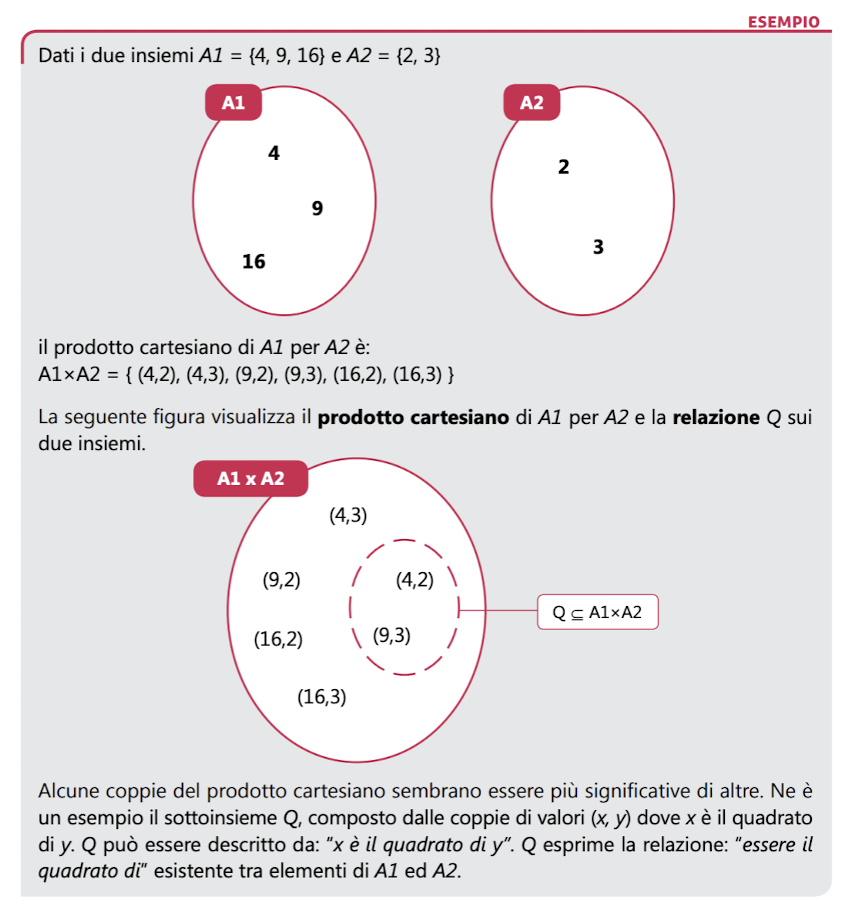
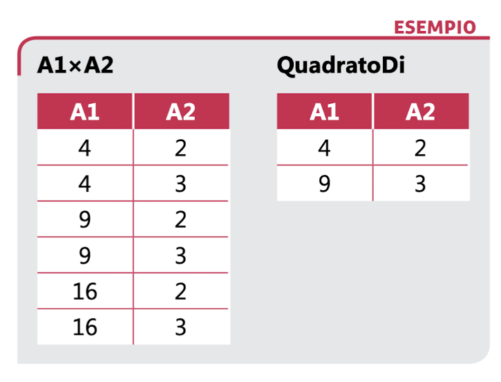
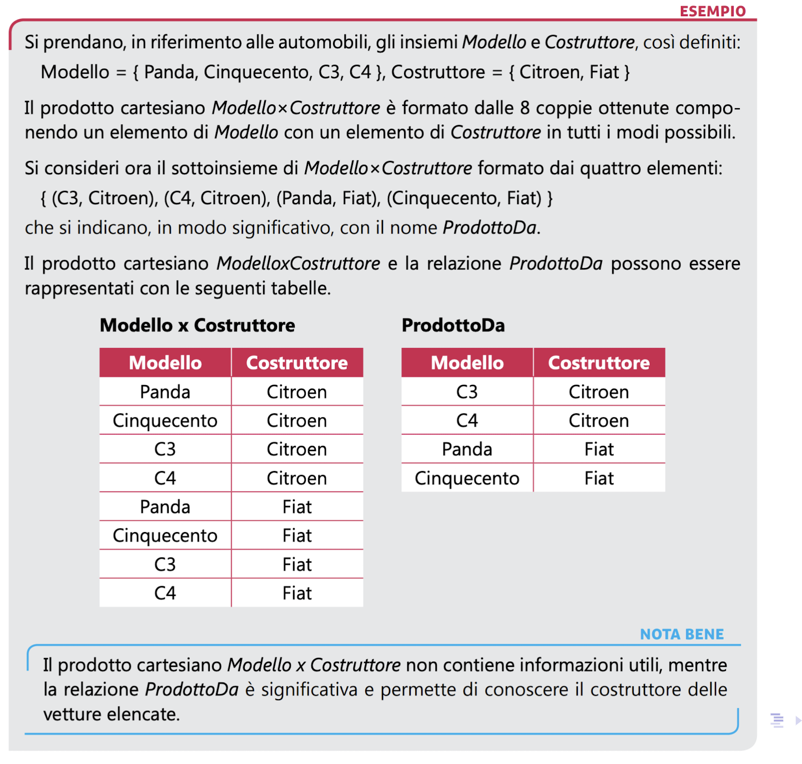
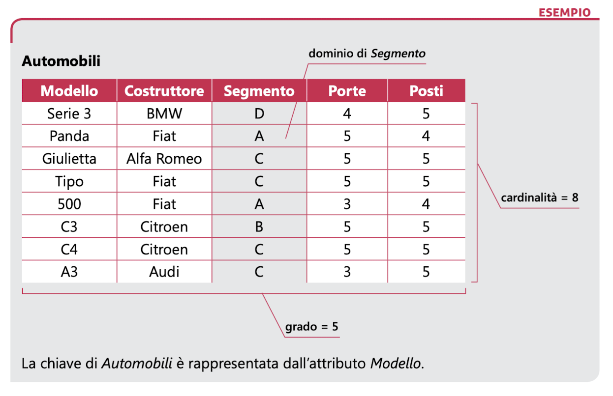
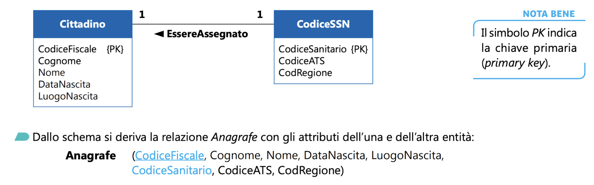
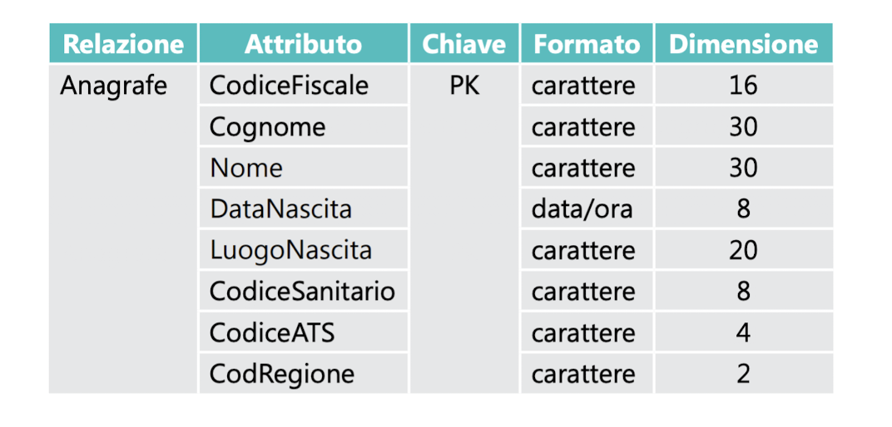
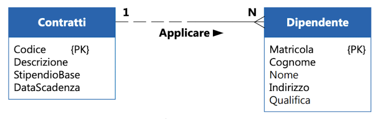
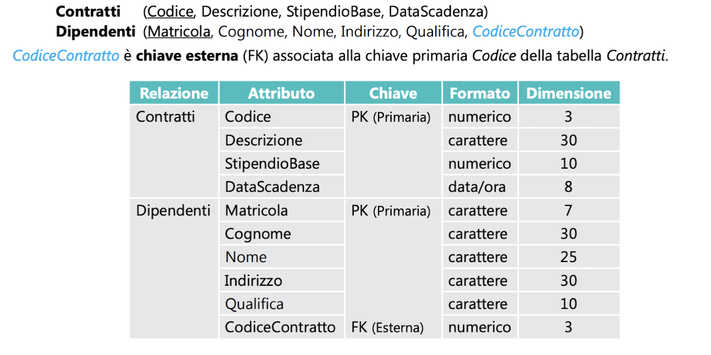
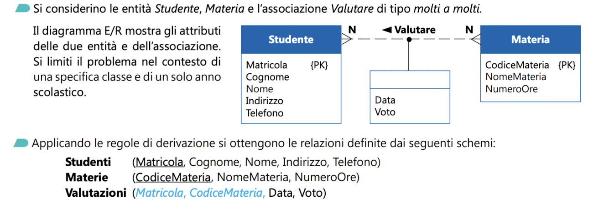
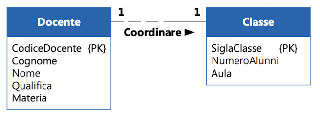

<!-- _class: lead -->
<!-- _paginate: false -->
<!-- _header: '' -->
<!-- _footer: '' -->

# I concetti del Modello Relazionale

## Parte 1

Prof. Francesco Dicara
I.I.S.S. Galileo Galilei – Ostiglia (MN)
Materia: Informatica

---

# Introduzione al modello relazionale

- Il modello relazionale è stato proposto da **Edgar F. Codd** nel **1970** per descrivere le informazioni in forma **tabellare**, con basi matematiche rigorose (teoria degli insiemi e logica).
- I dati sono visti come **insiemi di tabelle**, tra le quali è possibile eseguire **operazioni logiche**.
- La base di dati è modellata come un **insieme di relazioni**: ognuna corrisponde a una tabella.
- È il modello su cui si fondano i DBMS relazionali (MySQL, PostgreSQL, Oracle, SQL Server, …).

> **Livello logico:** il modello relazionale descrive *come sono organizzati i dati*, senza dire come vengono memorizzati fisicamente sul disco.

---

# Il concetto di relazione

Il modello si basa sul concetto matematico di **relazione tra insiemi**.

- **Prodotto cartesiano** di $A_1, A_2, \dots, A_n$: l'insieme di tutte le **n-uple ordinate** $(a_1, a_2, \dots, a_n)$ con $a_i \in A_i$.
- **Relazione**: un **sottoinsieme** del prodotto cartesiano di due o più insiemi.

Esempio con due insiemi:

$$A_1 = \{4, 9, 16\}, \qquad A_2 = \{2, 3\}$$

$$A_1 \times A_2 = \{(4,2),\ (4,3),\ (9,2),\ (9,3),\ (16,2),\ (16,3)\}$$

> Le coppie sono **ordinate**: $(4,2) \neq (2,4)$. Il numero di coppie è $|A_1| \cdot |A_2| = 3 \cdot 2 = 6$.

---

# Esempio di prodotto cartesiano



Le coppie risultanti sono **tutte le possibili combinazioni** degli elementi dei due insiemi:

$A_1 \times A_2 = \{(4,2), (4,3), (9,2), (9,3), (16,2), (16,3)\}$

---

# Relazione tra insiemi

Non tutte le coppie del prodotto cartesiano sono ugualmente significative: una **relazione** ne seleziona solo alcune, quelle che rispettano un certo legame.

- Definiamo la relazione $Q$ = *QuadratoDi*: l'insieme delle coppie $(x, y)$ tali che $x$ è il quadrato di $y$.
- $Q$ è un sottoinsieme di $A_1 \times A_2$:

$$Q = \{(4,2),\ (9,3)\}$$



---

# Perché utilizzare il modello relazionale?

- Usa il **linguaggio matematico** per descrivere i dati con **precisione e rigore**.
- **Riduce l'ambiguità**: i dati sono facili da comprendere e da manipolare.
- Permette di operare sui dati in modo **logico**, **indipendente dalla struttura fisica** del database (indipendenza fisica dei dati).
- Offre una base teorica solida per i linguaggi di interrogazione, come SQL.

---

# Altro esempio di relazione (Modello Auto – Costruttore)



> Anche qui la relazione contiene **solo le coppie (modello, costruttore) realmente esistenti**, non tutte le combinazioni possibili.

---

<!-- _class: small -->

# Definizione di relazione e terminologia

Una **relazione su $n$ insiemi** $A_1, A_2, \dots, A_n$ è un sottoinsieme del loro prodotto cartesiano.

| Termine del modello | Nella tabella | Significato |
| --- | --- | --- |
| **Relazione** | Tabella | Insieme di n-uple con la stessa struttura |
| **n-upla (tupla)** | Riga (record) | Una singola istanza dei dati |
| **Attributo** | Colonna (campo) | Proprietà descritta da un nome |
| **Dominio** | Valori ammessi | Insieme dei valori che un attributo può assumere |
| **Grado** | N. di colonne | Numero di attributi della relazione |
| **Cardinalità** | N. di righe | Numero di n-uple della relazione |

> **Schema e istanza.** Lo *schema* è la struttura, ad es. `Studenti(Matricola, Nome, Età)`, e cambia raramente. L'*istanza* è l'insieme delle righe presenti in un dato momento, e cambia di continuo.

---

# La relazione come tabella

La relazione si rappresenta con una **tabella** avente:

- **tante colonne quanti sono gli attributi** → *grado* della relazione;
- **tante righe quante sono le n-uple** → *cardinalità* della relazione.

Nomi delle colonne e valori possibili:

- Gli **attributi** sono i **nomi delle colonne**.
- I valori di ogni colonna appartengono allo **stesso dominio**.

> Nel modello relazionale gli attributi si distinguono **per nome**, non per posizione: l'ordine delle colonne non cambia il significato della relazione.

---

# La chiave primaria di una tabella

La **chiave primaria** (*primary key*, PK) è un attributo, o un insieme di attributi, che **identifica univocamente** ogni n-upla della relazione.

- Due righe diverse non possono avere lo stesso valore di chiave.
- La chiave primaria **non può essere nulla** (`NULL` = valore assente o sconosciuto): è il vincolo di **integrità di entità**.
- Se la chiave è formata da più attributi si dice **chiave composta**.

> **Superchiave, chiave candidata, chiave primaria.** Una *superchiave* è un insieme di attributi che identifica le righe. Una *chiave candidata* è una superchiave minimale (se togli un attributo non identifica più). La *chiave primaria* è la candidata scelta come identificatore principale.

---

# Esempio di tabella Automobile



*Rappresentazione di una tabella mediante una notazione schematica della tabella stessa:*


---

# Accesso ai dati

Il modello relazionale è **basato sui valori**: ogni dato è raggiungibile tramite **tre "coordinate"**.

| Coordinata | Cosa individua |
| --- | --- |
| Nome della **tabella** | La relazione che contiene il dato |
| Valore della **chiave primaria** | La riga (n-upla) cercata |
| Nome della **colonna** | L'attributo, cioè il valore specifico nella riga |

**Esempio**

- Tabella: `Studenti`
- Chiave primaria: `Matricola = 12345`
- Colonna: `Cognome` → valore **Rossi**

> I collegamenti tra tabelle non usano puntatori: si usano **valori uguali** (chiavi esterne, vedi Parte 2).

---

<!-- _class: small -->

# Requisiti delle tabelle nel modello relazionale

1. Ogni riga è **unica**: non esistono due righe uguali.
2. Esiste una **chiave primaria** (un attributo o una combinazione di attributi).
3. Le righe compaiono in **ordine non prefissato**.
4. Tutte le righe hanno lo **stesso numero di colonne**.
5. Gli attributi sono **atomici**: contengono un solo valore, non scomponibile (es. non si inseriscono più telefoni in un unico campo).
6. I valori di una colonna sono **omogenei**: appartengono allo stesso dominio e quindi sono dello stesso tipo.

---

<!-- _class: small -->

# Requisiti delle tabelle (continuazione)

**Esempio 1 – Omogeneità dei valori.** Nella tabella `Studenti` la colonna `Età` contiene solo numeri interi, mentre la colonna `Nome` contiene solo stringhe.

**Esempio 2 – Chiave e ordine delle righe.**

- Tabella: `Libri`
- Chiave primaria: `ISBN = 9781234567890`
- Le righe possono comparire in qualsiasi ordine, perché l'ordinamento **non è rilevante** nel modello relazionale.

> **Valore NULL.** Un attributo non chiave può avere valore `NULL` (informazione mancante o non applicabile). `NULL` **non è** lo zero né la stringa vuota: è l'assenza di un valore.

---

<!-- _class: lead -->
<!-- _paginate: false -->
<!-- _header: '' -->
<!-- _footer: '' -->

# I concetti del Modello Relazionale

## Parte 2

Prof. Francesco Dicara
I.I.S.S. Galileo Galilei – Ostiglia (MN)

---

# Introduzione: dal modello E/R al modello logico

Dal **modello concettuale** (diagramma E/R) si ottiene il **modello logico** dei dati: si definisce la struttura degli archivi, cioè le **tabelle** che devono essere create.

> **Attenzione ai termini.**
> - Nel modello **E/R** si parla di *entità* e *associazioni* (o relazioni tra entità).
> - Nel modello **relazionale** la parola *relazione* indica la **tabella**.
>
> Si devono quindi trasformare le entità e le associazioni del modello E/R in relazioni (tabelle) del modello relazionale, facendo attenzione ai nomi e alla loro collocazione.

---

# Regole di derivazione: le entità

Le regole principali per ricavare le relazioni dal modello E/R sono:

1. **Ogni entità diventa una relazione** (una tabella del modello relazionale).
2. **Ogni attributo dell'entità diventa un attributo della relazione**.
3. Ogni attributo della relazione **mantiene le caratteristiche** (tipo di dato e dominio) dell'attributo dell'entità.
4. L'**identificatore unico** dell'entità diventa la **chiave primaria** della relazione.

> Le associazioni si traducono in base alla loro **cardinalità** (1:1, 1:N, N:M), come nelle slide seguenti.

---

<!-- _class: small -->

# Le associazioni: regole di derivazione

| Cardinalità | Come si traduce |
| --- | --- |
| **Uno a uno** (1:1) | Di norma **un'unica relazione** con gli attributi di entrambe le entità. In alternativa, due relazioni con una chiave esterna **univoca** (`UNIQUE`) in una delle due. |
| **Uno a molti** (1:N) | La **chiave primaria dell'entità "a uno"** viene aggiunta come **chiave esterna** nella relazione dell'entità "a molti". |
| **Molti a molti** (N:M) | Si crea una **nuova relazione** che contiene le chiavi primarie (come chiavi esterne) delle due entità e gli eventuali attributi dell'associazione. |

> **Regola pratica:** la chiave esterna sta sempre dal lato **"molti"**. Nell'N:M non esiste un lato "uno": per questo serve una terza tabella.

---

# Chiave esterna

La **chiave esterna** (FK, *foreign key*) è un attributo (o un insieme di attributi) di una tabella i cui valori **fanno riferimento alla chiave primaria di un'altra tabella**.

- Permette di **collegare** le righe di tabelle diverse.
- Impone il vincolo di **integrità referenziale**: ogni valore della FK deve esistere come chiave primaria nella tabella riferita (oppure essere `NULL`, se ammesso).

**Esempio.** Un docente può tenere più corsi, ma ogni corso ha un solo docente:

- `Docenti(`**ID Docente**`, Nome, Cognome)`
- `Corsi(`**ID Corso**`, Nome Corso,` *ID Docente*`)`

`ID Docente` in `Corsi` è una **chiave esterna** che riferisce la chiave primaria `ID Docente` di `Docenti`. *(PK in grassetto, FK in corsivo.)*

---

<!-- _class: small -->

# Chiave esterna: esempio con i dati

Ogni corso è associato a **un solo** docente; un docente può avere **più** corsi.

**Docenti**

| ID Docente | Nome | Cognome |
| --- | --- | --- |
| 1 | Anna | Bianchi |
| 2 | Paolo | Rossi |

**Corsi**

| ID Corso | Nome Corso | ID Docente (FK) |
| --- | --- | --- |
| C1 | Matematica | 1 |
| C2 | Fisica | 2 |
| C3 | Statistica | 1 |

> Un valore come `ID Docente = 9` in `Corsi` violerebbe l'integrità referenziale, perché non esiste nessun docente con quell'ID.

---

# Passaggio pratico: dal modello E/R al modello logico

**Procedura in tre passi**

1. **Entità → tabelle.** Ogni entità diventa una tabella; l'identificatore diventa la chiave primaria.
2. **Associazioni → chiavi esterne o nuove tabelle**, in base alla cardinalità:
   - **1:1** → una sola tabella con gli attributi di entrambe le entità;
   - **1:N** → chiave primaria del lato "uno" come chiave esterna nel lato "molti";
   - **N:M** → terza tabella con le due chiavi primarie e gli attributi dell'associazione.
3. **Verifica finale.** Controlla nomi, chiavi primarie, chiavi esterne e vincoli di integrità.

---

<!-- _class: small -->

# Esempio uno a uno: Persona e Passaporto

Ogni persona ha **un solo** passaporto e ogni passaporto appartiene a **una sola** persona: la relazione è rappresentata da **un'unica tabella** che unisce gli attributi di entrambe le entità.

| ID | Nome | Cognome | ID Passaporto | Data Emissione |
| --- | --- | --- | --- | --- |
| 1 | Mario | Rossi | P123 | 2023-01-01 |
| 2 | Luisa | Bianchi | P124 | 2023-02-15 |
| 3 | Carlo | Verdi | P125 | 2023-03-20 |

*Tabella PersonePassaporti (unica relazione tra Persona e Passaporto).*

> `ID` è la chiave primaria. `ID Passaporto` è una **chiave candidata**: anch'essa è univoca, quindi si dichiara `UNIQUE`.

---

<!-- _class: small -->

# Esempio uno a molti: Dipartimento e Impiegato

Ogni dipartimento può avere **molti** impiegati, ma ogni impiegato appartiene a **un solo** dipartimento. La **chiave esterna** si inserisce nella tabella degli impiegati (lato "molti").

**Dipartimenti**

| ID Dipartimento | Nome Dipartimento |
| --- | --- |
| 10 | Risorse Umane |
| 20 | IT |
| 30 | Marketing |

**Impiegati** (con chiave esterna *ID Dipartimento*)

| ID Impiegato | Nome | Cognome | ID Dipartimento (FK) |
| --- | --- | --- | --- |
| 1 | Anna | Verdi | 10 |
| 2 | Marco | Bianchi | 20 |
| 3 | Sara | Rossi | 20 |

---

<!-- _class: small -->

# Esempio molti a molti: Studenti e Corsi

Ogni studente può iscriversi a **molti** corsi e ogni corso può avere **molti** studenti. Si crea una **tabella di associazione** con **due chiavi esterne**, una per ciascuna tabella collegata.

**Studenti**

| ID Studente | Nome | Cognome |
| --- | --- | --- |
| 101 | Luca | Neri |
| 102 | Giulia | Rosa |
| 103 | Fabio | Blu |

**Corsi**

| ID Corso | Nome Corso | Descrizione |
| --- | --- | --- |
| C1 | Matematica | Corso di base |
| C2 | Informatica | Introduzione alla programmazione |
| C3 | Storia | Storia moderna |

---

<!-- _class: small -->

# Esempio molti a molti: la tabella di associazione

**Iscrizioni** (tabella di associazione Studenti–Corsi)

| ID Studente (FK) | ID Corso (FK) | Data Iscrizione |
| --- | --- | --- |
| 101 | C1 | 2023-09-01 |
| 101 | C2 | 2023-09-05 |
| 102 | C1 | 2023-09-03 |
| 103 | C3 | 2023-09-02 |

- La **chiave primaria** è **composta** da `(ID Studente, ID Corso)`: ogni coppia compare una sola volta.
- Entrambi gli attributi sono anche **chiavi esterne**.
- `Data Iscrizione` è un **attributo dell'associazione**: non appartiene né allo studente né al corso, ma al loro legame.

> **N.B.** Nel passaggio dall'entità alla relazione il nome si scrive di solito al **plurale** (convenzione), perché la relazione, vista come insieme, contiene tutte le istanze dell'entità.

---

# Esempio del libro: uno a uno

 

*Figura: Relazione Anagrafe associata, casistica "uno a uno".*

---

# Esempio del libro: uno a molti

 

*Figura: Relazioni Contratti e Dipendenti, casistica "uno a molti".*

---

# Esempio del libro: molti a molti



---

# Caso particolare: 1:1 con partecipazione facoltativa

**Definizione.** Un'associazione 1:1 ha **partecipazione facoltativa** (o opzionale) quando **una delle due entità può non partecipare** all'associazione.

**Esempio: Docente e Classe**

- Ogni classe ha **un solo coordinatore** (un Docente): per la Classe la partecipazione è **obbligatoria**.
- **Non tutti** i docenti sono coordinatori di una classe: per il Docente la partecipazione è **facoltativa**.

> Se si fondessero le due entità in un'unica tabella, per i docenti non coordinatori si avrebbero molti valori `NULL`. Per questo si preferiscono soluzioni diverse (slide successive).

---

# Rappresentazione grafica



*Figura: esempio di relazione 1:1 con partecipazione facoltativa tra Docente e Classe.*

> **N.B.** Nella figura la linea dal lato del Docente è **tratteggiata**: la partecipazione è opzionale, perché un docente può anche non essere coordinatore.
> Questa **non è la notazione adottata nel corso di Informatica**: noi usiamo la notazione a **zampe di gallina** (*crow's foot*), in cui l'opzionalità si indica con un **cerchietto vuoto** (zero) accanto alla **barra verticale** (uno).

---

<!-- _class: small -->

# Approfondimento: scelte di modellazione

Con partecipazione facoltativa in un'associazione 1:1 ci sono tre soluzioni principali:

1. **Chiave esterna nel lato obbligatorio** *(soluzione più comune)*. Si aggiunge `ID Docente` come chiave esterna in `Classi`, dichiarata `NOT NULL` (ogni classe ha un coordinatore) e `UNIQUE` (un docente coordina al massimo una classe). Senza `UNIQUE` la relazione diventerebbe 1:N.
2. **Tabella aggiuntiva** `Coordinatori(ID Docente, ID Classe)`. Utile se l'associazione è **debole** o ha **attributi propri** (es. data di nomina) oppure se la partecipazione è facoltativa da **entrambi** i lati.
3. **Partecipazione obbligatoria da entrambi i lati.** Se ogni classe deve avere un coordinatore **e** ogni docente deve coordinare una classe, la facoltatività sparisce e si può usare una **tabella unica**.

> Non esiste una scelta universalmente corretta: dipende dai **requisiti** del sistema.

---

<!-- _class: small -->

# Esempio alternativo: Cittadino Italiano e Calciatore Nazionale

**Scenario**

- Ogni Cittadino italiano potrebbe essere un Calciatore Nazionale, ma **pochissimi** lo sono.
- L'associazione è 1:1 con **partecipazione facoltativa**: un calciatore è sempre un cittadino, un cittadino quasi mai un calciatore.

**Soluzione di modellazione**

- Due tabelle distinte: `Cittadini` e `CalciatoriNazionali`.
- `ID Cittadino` è chiave primaria in `Cittadini`.
- In `CalciatoriNazionali`, `ID Cittadino` è **contemporaneamente chiave primaria e chiave esterna** verso `Cittadini`.

> È il caso tipico di una **specializzazione**: `CalciatoriNazionali` aggiunge attributi solo per i cittadini che appartengono a quella categoria.

---

<!-- _class: small -->

# Esempio: Cittadino Italiano e Calciatore Nazionale

La tabella `Cittadini` contiene **tutti** i cittadini; `CalciatoriNazionali` contiene **solo** quelli che sono anche calciatori della nazionale.

**Cittadini**

| ID Cittadino | Nome | Cognome | Data Nascita |
| --- | --- | --- | --- |
| 1 | Mario | Rossi | 1995-05-10 |
| 2 | Luisa | Bianchi | 1988-11-22 |
| 3 | Carlo | Verdi | 1990-03-15 |
| 4 | Anna | Neri | 1992-07-28 |

**CalciatoriNazionali**

| ID Cittadino (PK, FK) | Ruolo | Squadra Appartenenza | Data Nazionale |
| --- | --- | --- | --- |
| 1 | Attaccante | Roma | 2021-09-01 |
| 3 | Portiere | Juventus | 2020-06-15 |

---

# Conclusioni sul caso particolare

- Le relazioni 1:1 con partecipazione facoltativa permettono una modellazione **più flessibile**: non tutti gli elementi di un'entità devono partecipare all'associazione.
- È importante **analizzare il contesto** per decidere se la partecipazione è facoltativa o obbligatoria.
- Nelle relazioni uno a uno la scelta del lato in cui inserire la chiave esterna dipende dall'**importanza relativa delle due entità** e dalla partecipazione: di norma si sceglie il lato obbligatorio, per evitare valori `NULL`.
- La modellazione deve rispecchiare la **logica** e i **requisiti** del sistema.

---

<!-- _class: lead -->
<!-- _paginate: false -->
<!-- _header: '' -->
<!-- _footer: '' -->

# I concetti del Modello Relazionale

## Parte 3 – Algebra relazionale

Prof. Francesco Dicara
I.I.S.S. Galileo Galilei – Ostiglia (MN)


---

# Concetti chiave: insiemi

Un **insieme** è una raccolta di elementi **distinti** (senza ripetizioni e senza ordine).

$$A = \{1, 2, 3\}, \qquad B = \{3, 4, 5\}$$

- **Unione** $A \cup B$: tutti gli elementi che stanno in $A$ **o** in $B$.
  $A \cup B = \{1, 2, 3, 4, 5\}$
- **Intersezione** $A \cap B$: gli elementi comuni ad $A$ **e** a $B$.
  $A \cap B = \{3\}$
- **Differenza** $A - B$: gli elementi di $A$ che **non** stanno in $B$.
  $A - B = \{1, 2\}$

> Nell'algebra relazionale gli elementi non sono numeri ma **righe**, e queste operazioni si applicano solo a relazioni con lo **stesso schema** (stessi attributi e domini compatibili).

---

# Che cos'è l'algebra relazionale?

- È un **linguaggio formale** per manipolare e interrogare i dati del modello relazionale.
- Ogni operatore prende in **input una o due relazioni** e produce **una nuova relazione** come output (*proprietà di chiusura*): gli operatori si possono quindi **comporre**.
- È un linguaggio **procedurale**: l'espressione indica **quali operazioni eseguire e in quale ordine**. SQL, invece, è **dichiarativo**: descrive *cosa* si vuole ottenere, non come calcolarlo.
- È la **base teorica di SQL**: i DBMS (MySQL, PostgreSQL, …) traducono le query SQL in espressioni di algebra relazionale e le ottimizzano.

> *MySQL* non è un linguaggio ma un **DBMS** che implementa SQL.

---

<!-- _class: small -->

# Struttura di base e operatori

**Relazioni.** Una relazione è una tabella con **righe** (tuple, istanze del dato) e **colonne** (attributi, proprietà del dato).

- Le relazioni sono **insiemi**: **non contengono righe duplicate** e l'**ordine delle righe non conta**.
- In SQL le tabelle possono invece contenere duplicati (si eliminano con `DISTINCT`).

| Operatore | Simbolo | Tipo | Funzione |
| --- | --- | --- | --- |
| Selezione | σ | unario | filtra le **righe** in base a una condizione |
| Proiezione | π | unario | mantiene solo alcune **colonne** |
| Rinomina | ρ | unario | cambia il nome di attributi o relazioni |
| Unione, intersezione, differenza | ∪ ∩ − | binari | operazioni insiemistiche |
| Prodotto cartesiano | × | binario | tutte le combinazioni di righe |
| Join | ⋈ | binario | combina righe correlate da una condizione |

---

# Esempio: tabelle "Studenti" e "Corsi"

**Studenti**

| ID Studente | Nome | Cognome | Corso |
| --- | --- | --- | --- |
| 1 | Marco | Rossi | Informatica |
| 2 | Laura | Bianchi | Matematica |
| 3 | Sara | Verdi | Informatica |

**Corsi**

| ID Corso | Nome Corso | Docente |
| --- | --- | --- |
| 101 | Informatica | Prof. Neri |
| 102 | Matematica | Prof.ssa Bianchi |

**Domanda:** come estraiamo tutti gli studenti che frequentano il corso di Informatica?

---

# 1. Operatore di selezione (σ)

Filtra le **tuple (righe)** di una relazione in base a una **condizione** e restituisce una **nuova relazione** con le sole righe che la soddisfano.

**Notazione:** $\sigma_{\text{condizione}}(\text{Relazione})$

- Lo **schema non cambia**: stessi attributi, quindi **stesso grado**.
- La **cardinalità** del risultato è minore o uguale a quella di partenza.

**Esempio:** trova tutti gli studenti che frequentano Informatica.

$$\sigma_{\text{Corso} = \text{'Informatica'}}(\text{Studenti})$$

| ID Studente | Nome | Cognome | Corso |
| --- | --- | --- | --- |
| 1 | Marco | Rossi | Informatica |
| 3 | Sara | Verdi | Informatica |

---

# 2. Operatore di proiezione (π)

Seleziona alcuni **attributi (colonne)** e restituisce una **nuova relazione** con i soli attributi indicati, **eliminando le righe duplicate**.

**Notazione:** $\pi_{\text{attributi}}(\text{Relazione})$

**Esempio 1:** nome e cognome degli studenti: $\pi_{\text{Nome, Cognome}}(\text{Studenti})$

| Nome | Cognome |
| --- | --- |
| Marco | Rossi |
| Laura | Bianchi |
| Sara | Verdi |

**Esempio 2 (duplicati):** $\pi_{\text{Corso}}(\text{Studenti})$ restituisce solo **2 righe**, perché "Informatica" compare una volta sola:

| Corso |
| --- |
| Informatica |
| Matematica |

---

# 3. Operatore di unione (∪)

Combina due relazioni con **lo stesso schema** in una nuova relazione che contiene le righe presenti in **almeno una** delle due (senza duplicati).

**Notazione:** $R \cup S$

**Esempio:** studenti iscritti al laboratorio di Robotica ($R$) o al laboratorio di Teatro ($S$).

**R (Robotica)**

| ID Studente | Nome |
| --- | --- |
| 1 | Marco |
| 3 | Sara |

**S (Teatro)**

| ID Studente | Nome |
| --- | --- |
| 2 | Laura |
| 3 | Sara |

**R ∪ S**

| ID Studente | Nome |
| --- | --- |
| 1 | Marco |
| 2 | Laura |
| 3 | Sara |

> Sara è in entrambe le relazioni, ma nel risultato compare **una sola volta**.

---

# 4. Intersezione (∩) e differenza (−)

Si applicano a relazioni con lo **stesso schema**, con le relazioni $R$ e $S$ della slide precedente.

- **Intersezione** $R \cap S$: restituisce le righe **comuni** a entrambe le relazioni.
- **Differenza** $R - S$: restituisce le righe presenti in $R$ **ma non in** $S$ (**non è commutativa**: $R - S \neq S - R$).

**R ∩ S** (iscritti a Robotica **e** a Teatro)

| ID Studente | Nome |
| --- | --- |
| 3 | Sara |

**R − S** (iscritti a Robotica **ma non** a Teatro)

| ID Studente | Nome |
| --- | --- |
| 1 | Marco |

**S − R** (iscritti a Teatro ma non a Robotica)

| ID Studente | Nome |
| --- | --- |
| 2 | Laura |

---

# 5. Operatore di join (⋈)

Un **join** combina due relazioni in una nuova relazione, **accoppiando le righe** che soddisfano una condizione.

**Notazione:** $R \bowtie_{\text{condizione}} S$

**Idea di fondo.** Il join equivale a un **prodotto cartesiano** seguito da una **selezione**:

$$R \bowtie_{\theta} S \;=\; \sigma_{\theta}(R \times S)$$

- $R \times S$ ha **grado** = grado($R$) + grado($S$) e **cardinalità** = $|R| \cdot |S|$ (tutte le combinazioni).
- La condizione $\theta$ (di solito *chiave esterna = chiave primaria*) tiene solo le combinazioni sensate.

**Tipologie principali:** 5.1 **Inner join** (theta, equi, naturale) · 5.2 **Outer join** (left, right, full)

---

<!-- _class: small -->

# Tabelle di riferimento per i join

`ID Corso` in `Studenti` è una **chiave esterna** verso `Corsi`. Laura non è iscritta a nessun corso (`NULL`).

**Studenti**

| ID Studente | Nome | ID Corso |
| --- | --- | --- |
| 1 | Marco | C1 |
| 2 | Laura | NULL |
| 3 | Sara | C3 |

**Corsi**

| ID Corso | Docente |
| --- | --- |
| C1 | Prof. Neri |
| C3 | Prof.ssa Verdi |

> Nelle espressioni algebriche i nomi degli attributi possono contenere spazi. In **SQL** conviene usare `ID_Corso` (oppure i nomi tra virgolette).

---

<!-- _class: small -->

# 5.1.1 Equi join

**Definizione.** Combina le righe di due relazioni in base a una **condizione di uguaglianza esplicita** tra attributi (anche con nomi diversi).

**Notazione:** $R \bowtie_{R.a = S.b} S$

$$\text{Studenti} \bowtie_{\text{Studenti.ID Corso} = \text{Corsi.ID Corso}} \text{Corsi}$$

| ID Studente | Nome | Studenti.ID Corso | Corsi.ID Corso | Docente |
| --- | --- | --- | --- | --- |
| 1 | Marco | C1 | C1 | Prof. Neri |
| 3 | Sara | C3 | C3 | Prof.ssa Verdi |

> L'equi join **conserva entrambe** le colonne usate nella condizione (qui `ID Corso` compare due volte, per questo si usa il prefisso `Tabella.Attributo`). Laura **non compare**: `NULL` non è uguale a nessun valore.

---

<!-- _class: small -->

# 5.1.1 Equi join: considerazioni

- **Grado** del risultato = somma dei gradi delle due relazioni:
  grado(Studenti) + grado(Corsi) = 3 + 2 = **5**
- **Cardinalità** del risultato: dipende dalla condizione e **può andare da 0 a $|R| \cdot |S|$**. Nel caso tipico di un join *chiave esterna = chiave primaria*, ogni riga della tabella con la chiave esterna trova **al massimo una** corrispondenza, quindi il risultato ha **al massimo** tante righe quante ne ha quella tabella.
  Qui: **2** (le righe che trovano corrispondenza).

L'equi join si usa quando bisogna **confrontare attributi**, anche con **nomi diversi**, ed è quindi molto versatile. In combinazione con selezione e proiezione permette di ottenere un **grado finale inferiore**.

---

<!-- _class: small -->

# 5.1.2 Join naturale

**Definizione.** Combina le righe di due relazioni in base all'uguaglianza di **tutti gli attributi con lo stesso nome**. Gli attributi comuni compaiono **una sola volta** nel risultato.

**Notazione:** $R \bowtie S$ (senza condizione)

$$\text{Studenti} \bowtie \text{Corsi}$$

| ID Studente | Nome | ID Corso | Docente |
| --- | --- | --- | --- |
| 1 | Marco | C1 | Prof. Neri |
| 3 | Sara | C3 | Prof.ssa Verdi |

- **Grado** = grado(Studenti) + grado(Corsi) − attributi comuni = 3 + 2 − 1 = **4**
- **Cardinalità** = 2 (le righe che trovano corrispondenza; valgono le stesse considerazioni dell'equi join).

> **Attenzione:** se le due relazioni hanno per caso **altri attributi omonimi** (es. `Nome` in entrambe), il join naturale li userà nella condizione e potrebbe restituire risultati inattesi.

---

<!-- _class: small -->

# 5.2 Outer join (left, right, full)

L'**outer join** include le righe che **non hanno corrispondenza** nell'altra tabella, riempiendo con `NULL` gli attributi mancanti. L'inner join, invece, le scarta.

| Tipo | Simbolo | Include |
| --- | --- | --- |
| **Left outer join** | ⟕ | tutte le righe della tabella di **sinistra** |
| **Right outer join** | ⟖ | tutte le righe della tabella di **destra** |
| **Full outer join** | ⟗ | tutte le righe di **entrambe** le tabelle |

**Esempio (left outer join)** con le tabelle `Studenti` e `Corsi`:

```sql
Studenti LEFT JOIN Corsi ON Studenti.ID_Corso = Corsi.ID_Corso
```

| ID Studente | Nome | ID Corso | Docente |
| --- | --- | --- | --- |
| 1 | Marco | C1 | Prof. Neri |
| 2 | Laura | NULL | NULL |
| 3 | Sara | C3 | Prof.ssa Verdi |

---

<!-- _class: small -->

# Esempi di outer join: tabelle di riferimento

**Dipendenti**

| ID Dip | Nome | Cognome |
| --- | --- | --- |
| 1 | Marco | Rossi |
| 2 | Laura | Bianchi |
| 3 | Sara | Verdi |

**Progetti**

| ID Progetto | Nome Progetto | ID Dip |
| --- | --- | --- |
| 101 | ProgettoAlpha | 1 |
| 102 | ProgettoBeta | 2 |
| 103 | ProgettoGamma | NULL |

> Sara non ha progetti; `ProgettoGamma` non ha dipendenti assegnati.

---

<!-- _class: small -->

# 5.2.1 Left outer join

Include **tutte le righe della tabella di sinistra** (Dipendenti), anche se non trovano corrispondenza nella tabella di destra (Progetti).

```sql
Dipendenti LEFT JOIN Progetti ON Dipendenti.ID_Dip = Progetti.ID_Dip
```

| ID Dip | Nome | Cognome | ID Progetto | Nome Progetto |
| --- | --- | --- | --- | --- |
| 1 | Marco | Rossi | 101 | ProgettoAlpha |
| 2 | Laura | Bianchi | 102 | ProgettoBeta |
| 3 | Sara | Verdi | NULL | NULL |

> Sara compare con `NULL` negli attributi di Progetti. `ProgettoGamma` **non compare**.

---

<!-- _class: small -->

# 5.2.2 Right outer join

Include **tutte le righe della tabella di destra** (Progetti), anche se non trovano corrispondenza nella tabella di sinistra (Dipendenti).

```sql
Dipendenti RIGHT JOIN Progetti ON Dipendenti.ID_Dip = Progetti.ID_Dip
```

| ID Dip | Nome | Cognome | ID Progetto | Nome Progetto |
| --- | --- | --- | --- | --- |
| 1 | Marco | Rossi | 101 | ProgettoAlpha |
| 2 | Laura | Bianchi | 102 | ProgettoBeta |
| NULL | NULL | NULL | 103 | ProgettoGamma |

> `ProgettoGamma` compare con `NULL` negli attributi di Dipendenti. Sara **non compare**.

---

<!-- _class: small -->

# 5.2.3 Full outer join

Combina left e right outer join: include **tutte le righe di entrambe le tabelle**.

```sql
Dipendenti FULL OUTER JOIN Progetti ON Dipendenti.ID_Dip = Progetti.ID_Dip
```

| ID Dip | Nome | Cognome | ID Progetto | Nome Progetto |
| --- | --- | --- | --- | --- |
| 1 | Marco | Rossi | 101 | ProgettoAlpha |
| 2 | Laura | Bianchi | 102 | ProgettoBeta |
| 3 | Sara | Verdi | NULL | NULL |
| NULL | NULL | NULL | 103 | ProgettoGamma |

> Il risultato contiene le righe dell'inner join **più** le righe senza corrispondenza di entrambe le tabelle.

---

<!-- _class: lead -->
<!-- _paginate: false -->
<!-- _header: '' -->
<!-- _footer: '' -->

# I concetti del Modello Relazionale

## Parte 4 – Esercizi di algebra relazionale

Prof. Francesco Dicara
I.I.S.S. Galileo Galilei – Ostiglia (MN)


---

# Come risolvere un esercizio di algebra relazionale

1. **Individua le tabelle** coinvolte e le **chiavi esterne** che le collegano.
2. **Collegale con un join** (condizione: chiave esterna = chiave primaria).
3. Applica la **selezione σ** per le condizioni sulle righe.
4. Applica la **proiezione π** per ottenere solo le colonne richieste.

> Un'espressione si legge **dall'interno verso l'esterno**: prima il join, poi σ, infine π.
> Se due tabelle hanno attributi con lo stesso nome, **qualificali**: `Tabella.Attributo`.
> Le condizioni sono applicate al risultato del join; l'ottimizzatore del DBMS può anticiparle, ma il risultato **non cambia**.

---

<!-- _class: small -->

# Relazioni di riferimento (esercizi su selezione e proiezione)

**Dipendenti**

| ID Dipendente | Nome | Cognome |
| --- | --- | --- |
| 1 | Marco | Rossi |
| 2 | Laura | Bianchi |
| 3 | Sara | Verdi |
| 4 | Luca | Neri |

**Progetti**

| ID Progetto | Nome Progetto | ID Dipendente |
| --- | --- | --- |
| 101 | ProgettoAlpha | 1 |
| 102 | ProgettoBeta | 2 |
| 103 | ProgettoGamma | 3 |
| 104 | ProgettoDelta | NULL |

---

# Esercizio 1: selezione

**Testo:** trova tutti i dipendenti con ID maggiore di 2.

$$\sigma_{\text{ID Dipendente} > 2}(\text{Dipendenti})$$

| ID Dipendente | Nome | Cognome |
| --- | --- | --- |
| 3 | Sara | Verdi |
| 4 | Luca | Neri |

---

# Esercizio 2: selezione

**Testo:** trova tutti i progetti che non hanno un dipendente assegnato.

$$\sigma_{\text{ID Dipendente IS NULL}}(\text{Progetti})$$

| ID Progetto | Nome Progetto | ID Dipendente |
| --- | --- | --- |
| 104 | ProgettoDelta | NULL |

> Per verificare l'assenza di un valore si usa `IS NULL`, **non** `= NULL`: `NULL` non è uguale a nessun valore, nemmeno a se stesso.

---

# Esercizio 3: selezione

**Testo:** trova tutti i progetti con ID maggiore di 102.

$$\sigma_{\text{ID Progetto} > 102}(\text{Progetti})$$

| ID Progetto | Nome Progetto | ID Dipendente |
| --- | --- | --- |
| 103 | ProgettoGamma | 3 |
| 104 | ProgettoDelta | NULL |

---

# Esercizio 1: proiezione

**Testo:** visualizza solo i nomi e i cognomi dei dipendenti.

$$\pi_{\text{Nome, Cognome}}(\text{Dipendenti})$$

| Nome | Cognome |
| --- | --- |
| Marco | Rossi |
| Laura | Bianchi |
| Sara | Verdi |
| Luca | Neri |

---

# Esercizio 2: proiezione

**Testo:** visualizza solo i nomi dei progetti.

$$\pi_{\text{Nome Progetto}}(\text{Progetti})$$

| Nome Progetto |
| --- |
| ProgettoAlpha |
| ProgettoBeta |
| ProgettoGamma |
| ProgettoDelta |

---

# Esercizio 3: proiezione

**Testo:** visualizza solo gli ID dei dipendenti e i relativi cognomi.

$$\pi_{\text{ID Dipendente, Cognome}}(\text{Dipendenti})$$

| ID Dipendente | Cognome |
| --- | --- |
| 1 | Rossi |
| 2 | Bianchi |
| 3 | Verdi |
| 4 | Neri |

---

<!-- _class: small -->

# Esercizio 1: equi join con proiezione

**Testo:** trova il nome del progetto e il nome del dipendente per tutti i progetti con un dipendente assegnato.

$$\pi_{\text{Nome Progetto, Nome}}\Big(\text{Progetti} \bowtie_{\text{Progetti.ID Dipendente} = \text{Dipendenti.ID Dipendente}} \text{Dipendenti}\Big)$$

| Nome Progetto | Nome |
| --- | --- |
| ProgettoAlpha | Marco |
| ProgettoBeta | Laura |
| ProgettoGamma | Sara |

> Gli attributi usati nella condizione (`ID Dipendente`) restano nella relazione intermedia ma non compaiono nel risultato dopo la proiezione. `ProgettoDelta` è escluso: il suo `ID Dipendente` è `NULL`.

---

<!-- _class: tiny -->

# Esercizio 2: equi join con selezione

**Testo:** trova i progetti con dipendenti assegnati, ma solo quelli in cui l'ID del dipendente è maggiore di 2.

$$\sigma_{\text{Progetti.ID Dipendente} > 2}\Big(\text{Progetti} \bowtie_{\text{Progetti.ID Dipendente} = \text{Dipendenti.ID Dipendente}} \text{Dipendenti}\Big)$$

| ID Progetto | Nome Progetto | Progetti.ID Dipendente | Dipendenti.ID Dipendente | Nome | Cognome |
| --- | --- | --- | --- | --- | --- |
| 103 | ProgettoGamma | 3 | 3 | Sara | Verdi |

> L'equi join **mantiene entrambe le colonne** `ID Dipendente`, che hanno lo stesso nome: per questo nella selezione serve il prefisso `Progetti.` (o `Dipendenti.`) e il risultato ha 6 colonne (grado 3 + 3).

---

<!-- _class: small -->

# Esercizio 3: equi join con selezione e proiezione

**Testo:** trova i nomi dei progetti e i nomi dei dipendenti assegnati, ma solo per i progetti il cui ID è maggiore di 102.

$$\pi_{\text{Nome Progetto, Nome}}\Big(\sigma_{\text{ID Progetto} > 102}\big(\text{Progetti} \bowtie_{\text{Progetti.ID Dipendente} = \text{Dipendenti.ID Dipendente}} \text{Dipendenti}\big)\Big)$$

| Nome Progetto | Nome |
| --- | --- |
| ProgettoGamma | Sara |

> L'equi join conserva gli attributi duplicati nella relazione intermedia, ma la proiezione li elimina nel risultato finale. `ProgettoDelta` (104) non ha dipendente e quindi non compare.

---

<!-- _class: small -->

# Esercizio 1: join naturale con proiezione

**Testo:** trova il nome del progetto e il nome del dipendente per tutti i progetti con un dipendente assegnato.

$$\pi_{\text{Nome Progetto, Nome}}\big(\text{Progetti} \bowtie \text{Dipendenti}\big)$$

| Nome Progetto | Nome |
| --- | --- |
| ProgettoAlpha | Marco |
| ProgettoBeta | Laura |
| ProgettoGamma | Sara |

> Il join naturale usa l'unico attributo comune, `ID Dipendente`, ed elimina automaticamente la colonna duplicata.

---

<!-- _class: small -->

# Esercizio 2: join naturale con selezione

**Testo:** trova i progetti con dipendenti assegnati, ma solo quelli in cui l'ID del dipendente è maggiore di 2.

$$\sigma_{\text{ID Dipendente} > 2}\big(\text{Progetti} \bowtie \text{Dipendenti}\big)$$

| ID Progetto | Nome Progetto | ID Dipendente | Nome | Cognome |
| --- | --- | --- | --- | --- |
| 103 | ProgettoGamma | 3 | Sara | Verdi |

> Nel join naturale `ID Dipendente` compare **una sola volta** (grado 3 + 3 − 1 = 5): non serve qualificarlo.

---

<!-- _class: small -->

# Esercizio 3: join naturale con selezione e proiezione

**Testo:** trova i nomi dei progetti e i nomi dei dipendenti assegnati, ma solo per i progetti il cui ID è maggiore di 102.

$$\pi_{\text{Nome Progetto, Nome}}\Big(\sigma_{\text{ID Progetto} > 102}\big(\text{Progetti} \bowtie \text{Dipendenti}\big)\Big)$$

| Nome Progetto | Nome |
| --- | --- |
| ProgettoGamma | Sara |

> Il join naturale elimina gli attributi comuni duplicati, riducendo il grado della relazione risultante.

---

<!-- _class: small -->

# Nuove tabelle di riferimento: Clienti e Ordini

**Clienti**

| ID Cliente | Nome | Città |
| --- | --- | --- |
| 1 | Anna | Roma |
| 2 | Luca | Milano |
| 3 | Maria | Torino |
| 4 | Marco | Napoli |

**Ordini**

| ID Ordine | Prodotto | ID Cliente |
| --- | --- | --- |
| 101 | Laptop | 1 |
| 102 | Smartphone | 2 |
| 103 | Tablet | 3 |
| 104 | Monitor | NULL |

---

<!-- _class: small -->

# Esercizio 1: equi join con selezione e proiezione

**Testo:** trova i nomi dei clienti e i prodotti acquistati da chi vive a "Roma".

$$\pi_{\text{Nome, Prodotto}}\Big(\sigma_{\text{Città} = \text{'Roma'}}\big(\text{Clienti} \bowtie_{\text{Clienti.ID Cliente} = \text{Ordini.ID Cliente}} \text{Ordini}\big)\Big)$$

| Nome | Prodotto |
| --- | --- |
| Anna | Laptop |

> La selezione `Città = 'Roma'` è applicata al risultato del join. Il risultato sarebbe identico filtrando prima `Clienti` (è ciò che spesso fa l'ottimizzatore, per eseguire join su meno righe).

---

<!-- _class: small -->

# Esercizio 2: equi join con selezione e proiezione

**Testo:** trova i nomi dei clienti e i prodotti acquistati, ma solo per gli ordini con ID maggiore di 102.

$$\pi_{\text{Nome, Prodotto}}\Big(\sigma_{\text{ID Ordine} > 102}\big(\text{Clienti} \bowtie_{\text{Clienti.ID Cliente} = \text{Ordini.ID Cliente}} \text{Ordini}\big)\Big)$$

| Nome | Prodotto |
| --- | --- |
| Maria | Tablet |

> Gli ordini con ID > 102 sono il 103 e il 104. Il 104 (Monitor) non ha cliente (`NULL`), quindi **non trova corrispondenza** nel join e non compare.

---

<!-- _class: small -->

# Esercizio 3: equi join con selezione e proiezione

**Testo:** trova i nomi dei clienti e i prodotti acquistati, ma solo per i clienti con ID maggiore di 2.

$$\pi_{\text{Nome, Prodotto}}\Big(\sigma_{\text{Clienti.ID Cliente} > 2}\big(\text{Clienti} \bowtie_{\text{Clienti.ID Cliente} = \text{Ordini.ID Cliente}} \text{Ordini}\big)\Big)$$

| Nome | Prodotto |
| --- | --- |
| Maria | Tablet |

> I clienti con ID > 2 sono Maria (3) e Marco (4). **Marco non ha ordini** (nessuna riga di `Ordini` ha `ID Cliente = 4`) e l'ordine "Monitor" ha `ID Cliente = NULL`: nessuno dei due compare nel join. Si qualifica `Clienti.ID Cliente` perché l'attributo è presente in entrambe le tabelle.

---

<!-- _class: small -->

# Nuove tabelle di riferimento: Studenti ed Esami

**Studenti**

| ID Studente | Nome | Classe |
| --- | --- | --- |
| 1 | Marco | 5A |
| 2 | Anna | 5B |
| 3 | Luca | 4A |
| 4 | Sara | 5A |
| 5 | Maria | 4B |

**Esami**

| ID Esame | Materia | ID Studente |
| --- | --- | --- |
| 101 | Matematica | 1 |
| 102 | Inglese | 2 |
| 103 | Fisica | 1 |
| 104 | Chimica | 4 |
| 105 | Storia | 5 |

---

<!-- _class: small -->

# Esercizio 1: equi join con selezione e proiezione

**Testo:** trova i nomi degli studenti e le materie d'esame per gli studenti della classe "5A".

$$\pi_{\text{Nome, Materia}}\Big(\sigma_{\text{Classe} = \text{'5A'}}\big(\text{Studenti} \bowtie_{\text{Studenti.ID Studente} = \text{Esami.ID Studente}} \text{Esami}\big)\Big)$$

| Nome | Materia |
| --- | --- |
| Marco | Matematica |
| Marco | Fisica |
| Sara | Chimica |

> `Classe = '5A'` seleziona solo gli studenti della 5A. L'equi join associa ogni studente ai propri esami tramite `ID Studente`: Marco compare **due volte** perché ha sostenuto due esami.

---

<!-- _class: tiny -->

# Esercizio 2: equi join con selezione complessa e proiezione

**Testo:** trova i nomi degli studenti, le materie d'esame e le classi, ma solo per gli esami il cui ID è maggiore di 102 e appartengono a studenti di classi quarte.

$$\pi_{\text{Nome, Materia, Classe}}\Big(\sigma_{\text{ID Esame} > 102 \,\wedge\, \text{Classe LIKE '4\%'}}\big(\text{Studenti} \bowtie_{\text{Studenti.ID Studente} = \text{Esami.ID Studente}} \text{Esami}\big)\Big)$$

| Nome | Materia | Classe |
| --- | --- | --- |
| Maria | Storia | 4B |

- `ID Esame > 102`: filtra gli esami con ID maggiore di 102.
- `Classe LIKE '4%'`: seleziona le classi che **iniziano per 4** (`%` = qualsiasi sequenza di caratteri).
- `AND` (∧): **entrambe** le condizioni devono essere vere.
- Il join collega ogni studente ai propri esami tramite `ID Studente`.

---

<!-- _class: tiny -->

# Esercizio 3: equi join con selezione e proiezione multipla

**Testo:** trova i nomi degli studenti e le materie d'esame, ma solo per gli esami di "Matematica" o "Fisica".

$$\pi_{\text{Nome, Materia}}\Big(\sigma_{\text{Materia} = \text{'Matematica'} \,\vee\, \text{Materia} = \text{'Fisica'}}\big(\text{Studenti} \bowtie_{\text{Studenti.ID Studente} = \text{Esami.ID Studente}} \text{Esami}\big)\Big)$$

| Nome | Materia |
| --- | --- |
| Marco | Matematica |
| Marco | Fisica |

- `Materia = 'Matematica' OR Materia = 'Fisica'`: l'`OR` (∨) seleziona le righe in cui **almeno una** delle due condizioni è vera.
- Il join associa ogni studente ai propri esami tramite `ID Studente`.

---

<!-- _class: tiny -->

# Esercizio 4: equi join con selezione complessa e proiezione

**Testo:** trova i nomi degli studenti, le materie d'esame e le classi, ma solo per gli esami di "Matematica" o "Fisica" sostenuti da studenti della classe "5A" o "4B", il cui ID esame è **dispari**.

$$\pi_{\text{Nome, Materia, Classe}}\Big(\sigma_{c}\big(\text{Studenti} \bowtie_{\text{Studenti.ID Studente} = \text{Esami.ID Studente}} \text{Esami}\big)\Big)$$

$$c:\ (\text{Materia} = \text{'Matematica'} \vee \text{Materia} = \text{'Fisica'}) \wedge (\text{Classe} = \text{'5A'} \vee \text{Classe} = \text{'4B'}) \wedge \text{ID Esame mod } 2 = 1$$

| Nome | Materia | Classe |
| --- | --- | --- |
| Marco | Matematica | 5A |
| Marco | Fisica | 5A |

- Le prime due condizioni filtrano materia e classe; `ID Esame mod 2 = 1` (in SQL: `% 2 = 1`) tiene solo gli ID dispari (101 e 103).
- Le parentesi stabiliscono l'**ordine di valutazione** di `AND` e `OR`.

---

<!-- _class: small -->

# Tabelle di riferimento (modello logico)

Schemi delle relazioni (**PK** in grassetto, *FK* in corsivo):

- `Docenti(`**ID Docente**`, Nome, Dipartimento)`
- `Corsi(`**ID Corso**`, Nome Corso,` *ID Docente*`)`
- `Studenti(`**ID Studente**`, Nome, Classe,` *ID Corso*`)`

**Docenti**

| ID Docente | Nome | Dipartimento |
| --- | --- | --- |
| 1 | Prof. Bianchi | Matematica |
| 2 | Prof. Rossi | Fisica |
| 3 | Prof. Verdi | Informatica |

**Corsi**

| ID Corso | Nome Corso | ID Docente |
| --- | --- | --- |
| C1 | Analisi 1 | 1 |
| C2 | Fisica 1 | 2 |
| C3 | Programmazione | 3 |
| C4 | Basi di Dati | 3 |

---

<!-- _class: small -->

# Tabella Studenti (modello logico)

**Studenti**

| ID Studente | Nome | Classe | ID Corso |
| --- | --- | --- | --- |
| 1 | Giulia | 4A | C2 |
| 2 | Luca | 5B | C2 |
| 3 | Elisa | 5A | C3 |
| 4 | Marco | 5A | C4 |
| 5 | Anna | 4B | C1 |

> **Chiavi primarie:** identificano in modo univoco ogni riga della tabella.
> **Chiavi esterne:** collegano una tabella a un'altra riferendo le sue chiavi primarie (`Corsi.ID Docente → Docenti`, `Studenti.ID Corso → Corsi`).

---

<!-- _class: small -->

# Esercizio 1: join e proiezione

**Testo:** trova i nomi dei docenti e i nomi dei corsi che insegnano.

$$\pi_{\text{Docenti.Nome, Nome Corso}}\Big(\text{Docenti} \bowtie_{\text{Docenti.ID Docente} = \text{Corsi.ID Docente}} \text{Corsi}\Big)$$

| Nome | Nome Corso |
| --- | --- |
| Prof. Bianchi | Analisi 1 |
| Prof. Rossi | Fisica 1 |
| Prof. Verdi | Programmazione |
| Prof. Verdi | Basi di Dati |

> L'equi join associa i docenti ai corsi tramite `ID Docente`. La proiezione restituisce solo `Nome` (docente) e `Nome Corso`. Il Prof. Verdi compare **due volte**, perché insegna due corsi.

---

<!-- _class: tiny -->

# Esercizio 2: join, selezione e proiezione

**Testo:** trova i nomi degli studenti che frequentano corsi insegnati da docenti del dipartimento di "Fisica".

$$\pi_{\text{Studenti.Nome}}\Big(\sigma_{\text{Dipartimento} = \text{'Fisica'}}\big(\text{Studenti} \bowtie_{\text{Studenti.ID Corso} = \text{Corsi.ID Corso}} (\text{Corsi} \bowtie_{\text{Corsi.ID Docente} = \text{Docenti.ID Docente}} \text{Docenti})\big)\Big)$$

| Nome |
| --- |
| Giulia |
| Luca |

- Si risolve dall'interno: `Corsi ⋈ Docenti` (corsi con il proprio docente), poi il join con `Studenti`.
- La selezione `Dipartimento = 'Fisica'` tiene il corso **C2** (Fisica 1, Prof. Rossi), frequentato da Giulia e Luca.
- Due join concatenati collegano `Studenti`, `Corsi` e `Docenti` tramite le **chiavi esterne**.

---

<!-- _class: tiny -->

# Esercizio 3: join complesso, selezione e proiezione

**Testo:** trova i nomi degli studenti e i nomi dei corsi frequentati, ma solo per studenti di classi quinte che frequentano corsi insegnati dal dipartimento di "Informatica".

$$\pi_{\text{Studenti.Nome, Nome Corso}}\Big(\sigma_{\text{Classe LIKE '5\%'} \,\wedge\, \text{Dipartimento} = \text{'Informatica'}}\big(\text{Studenti} \bowtie_{\text{Studenti.ID Corso} = \text{Corsi.ID Corso}} (\text{Corsi} \bowtie_{\text{Corsi.ID Docente} = \text{Docenti.ID Docente}} \text{Docenti})\big)\Big)$$

| Nome | Nome Corso |
| --- | --- |
| Elisa | Programmazione |
| Marco | Basi di Dati |

- `Classe LIKE '5%'`: filtra gli studenti delle classi quinte (Elisa 5A, Marco 5A; Luca 5B segue un corso di Fisica).
- `Dipartimento = 'Informatica'`: seleziona i corsi del Prof. Verdi.
- I join concatenano `Studenti`, `Corsi` e `Docenti` tramite le chiavi esterne; la proiezione restituisce solo i campi richiesti.

---

<!-- _class: lead -->
<!-- _paginate: false -->
<!-- _header: '' -->
<!-- _footer: '' -->

# Operazioni relazionali – Schema riassuntivo

Prof. Francesco Dicara
I.I.S.S. Galileo Galilei – Ostiglia (MN)


---

<!-- _class: small -->

# Selezione (σ): condizioni numeriche

**Definizione.** La selezione è un'operazione **unaria** che restituisce le tuple di una relazione che soddisfano una **condizione**.

**Notazione:** $\sigma_{\text{condizione}}(R)$

Condizioni numeriche (operatori `=`, `>`, `<`, `>=`, `<=`, `!=`):

- Attributo $=$ Valore (es. `Età = 18`)
- Attributo $>$ Valore (es. `Età > 18`)
- Attributo $<$ Valore (es. `Salario < 2000`)
- Attributo $\geq$ Valore, Attributo $\leq$ Valore

**Esempi pratici**

$$\sigma_{\text{Età} > 18}(\text{Studenti}), \qquad \sigma_{\text{Salario} \leq 1500}(\text{Impiegati}), \qquad \sigma_{\text{Voto} \geq 8}(\text{Esami})$$

Restituiscono rispettivamente: gli studenti con età maggiore di 18, gli impiegati con salario fino a 1500, gli esami con voto almeno 8.

> **N.B.** Si possono usare gli operatori logici `AND`, `OR`, `NOT` per unire più condizioni nella stessa selezione.

---

<!-- _class: small -->

# Selezione (σ): condizioni sulle stringhe

- Attributo `= 'Valore'` (es. `Nome = 'Mario'`)
- Attributo `!= 'Valore'` (es. `Città != 'Roma'`)
- Operatori logici: `AND`, `OR`, `NOT`
- Confronti con **stringhe parziali** (`LIKE`), dove `%` indica una sequenza qualsiasi di caratteri:
  - `LIKE 'A%'` → inizia con "A"
  - `LIKE '%z'` → finisce con "z"
  - `LIKE '%par%'` → contiene "par"

**Esempi pratici**

$$\sigma_{\text{Città} = \text{'Milano'}}(\text{Clienti}), \qquad \sigma_{\text{Nome LIKE 'A\%'}}(\text{Studenti})$$

$$\sigma_{\text{Cognome LIKE '\%ini'}}(\text{Professori}), \qquad \sigma_{\text{Email NOT LIKE '\%gmail.com'}}(\text{Utenti})$$

Restituiscono rispettivamente: i clienti di Milano, gli studenti il cui nome inizia con "A", i professori con cognome che termina in "ini" e gli utenti senza email Gmail.

---

# Proiezione (π)

**Definizione.** La proiezione seleziona solo **alcuni attributi** di una relazione, **eliminando eventuali duplicati**.

**Notazione:** $\pi_{\text{Attributi}}(R)$

**Esempio:**

$$\pi_{\text{Nome, Età}}(\text{Studenti})$$

Restituisce una relazione con **solo** i campi `Nome` ed `Età`.

> La selezione **filtra le righe**; la proiezione **filtra le colonne**.

---

# Equi join

**Definizione.** L'equi join combina due relazioni in base a una **condizione di uguaglianza** esplicita tra attributi.

**Notazione:** $R \bowtie_{R.a = S.b} S$

**Esempio:**

$$\text{Studenti} \bowtie_{\text{Studenti.Classe} = \text{Classi.ID}} \text{Classi}$$

Combina gli studenti con le classi corrispondenti, usando il campo `Classe` (chiave esterna) e `ID` (chiave primaria di `Classi`).

---

# Join naturale

**Definizione.** Il join naturale è un **caso particolare dell'equi join**: la condizione di uguaglianza è **implicita** su tutti gli attributi con lo stesso nome, che compaiono **una sola volta** nel risultato.

**Notazione:** $R \bowtie S$

**Esempio:**

$$\text{Studenti} \bowtie \text{Classi}$$

Combina gli studenti con le classi usando **tutti gli attributi comuni** tra le due relazioni.

---

<!-- _class: small -->

# Conclusione: riepilogo delle operazioni

| Operazione | Simbolo | Funzione | In SQL |
| --- | --- | --- | --- |
| **Selezione** | σ | Filtra le **righe** (tuple) | `WHERE` |
| **Proiezione** | π | Filtra le **colonne** (attributi) | `SELECT` + `DISTINCT` |
| **Unione, intersezione, differenza** | ∪ ∩ − | Operazioni insiemistiche | `UNION`, `INTERSECT`, `EXCEPT` |
| **Equi join** | ⋈ | Combina relazioni con una condizione di uguaglianza esplicita | `JOIN … ON` |
| **Join naturale** | ⋈ | Combina relazioni sugli attributi omonimi | `NATURAL JOIN` |
| **Outer join** | ⟕ ⟖ ⟗ | Come l'equi join, ma conserva le righe senza corrispondenza | `LEFT / RIGHT / FULL JOIN` |

> L'algebra relazionale è la **base teorica di SQL**: saper scrivere un'espressione algebrica significa saper pensare una query.